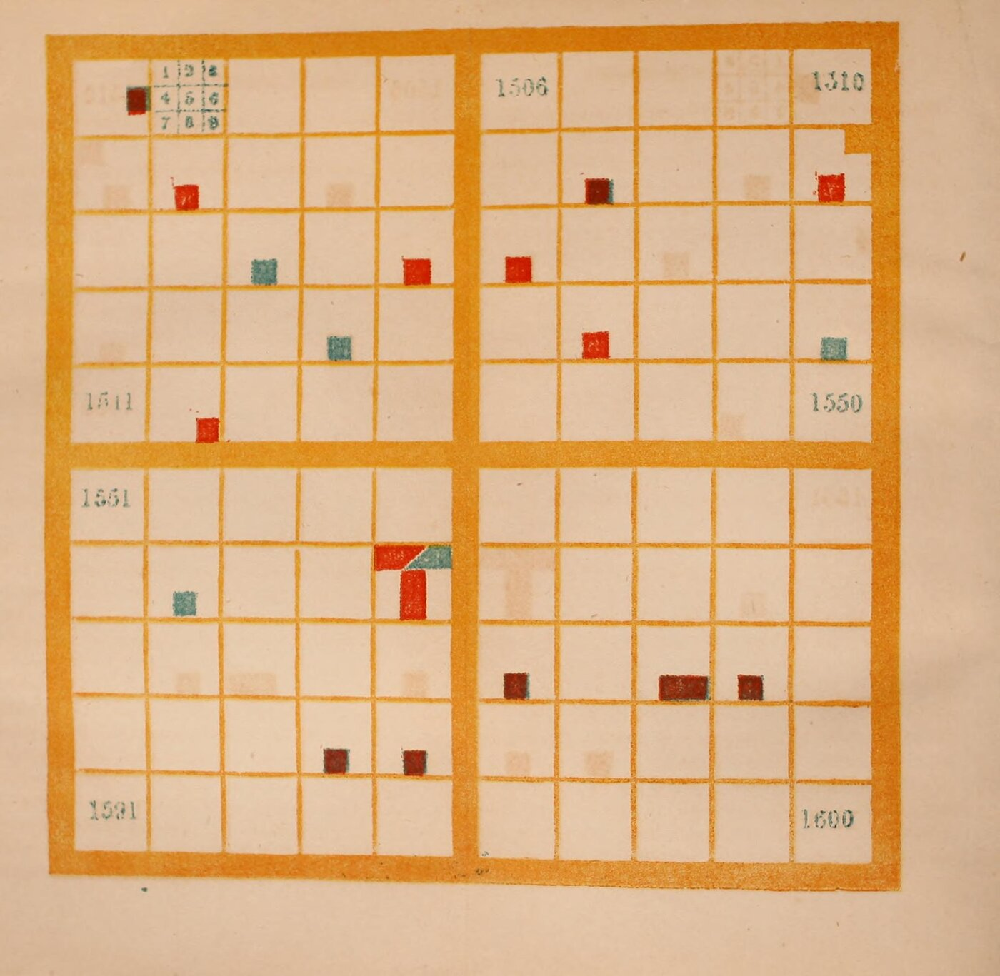

+++
author = "矢崎裕一"
title = "100年を10×10に、1年を3×3に塗り分ける──Peabody の『Chronological History of the United States』（1856）"
slug = "peabody-chronological-history"
date = "2026-11-07"
description = "Peabody の図は、1世紀を10×10のマス（1マス＝1年）に、1年を3×3のマス（出来事の種類）に分けて国を色で塗る図で、生徒が自分で塗って年代を覚えるための道具でした。"
categories = [
    "consume"
]
tags = [
    "Elizabeth Palmer Peabody",
    "Józef Bem",
    "年表",
    "グリッド",
    "色",
    "Data Feminism"
]
image = "images/plate-17th-century.jpg"
series = ["dataviz-classics"]
series_weight = 99
seriesByline = "Elizabeth Palmer Peabody"
seriesTitle = "1年を9マスに塗り分ける──Peabody の年代図 1856"
+++

Elizabeth Palmer Peabody（エリザベス・パーマー・ピーボディ）の年代図は、1世紀を10×10のマス（1マス＝1年）に、1年を3×3のマス（出来事の種類）に分けて、国を色で塗る図でした。生徒が自分で塗って年代を覚えるための道具です。1856年の『Chronological History of the United States』には、16〜19世紀の4世紀分を塗った図版が付きました。白紙の世紀を生徒が塗るやり方は、前の1850年の手引きに書かれています。

以下は、Internet Archive にある1856年版のスキャン（米国議会図書館の蔵書）と、Peabody 自身の説明文に沿います。前の本『The Polish-American System of Chronology』（1850）も参照します。後半では、Lauren F. Klein（ローレン・クライン）らの再現「The Shape of History」と、『Data Feminism』（2020）での扱いを見ます。

<!--more-->

## 1850年と1856年、Bem の方式を合衆国史に

Peabody（1804–1894）は編集者で、教育者でした。Boston の 13 West Street で書店を営んでいます。1850年、世界史の手引き『The Polish-American System of Chronology』を出しました。副題は「General Bem's Franco-Polish Method」を、手を加えて写したもの、です。

方式を知ったきっかけは、下宿人だったと Klein の『Data by Design』は書きます。ポーランドから Bem の図を持ってきた巡回講師 Joseph Podbielski（ジョゼフ・ポドビェルスキ）が、West Street の Peabody 家に一時住みました。Peabody は図に「captivated」されたといいます。伝記作者 Bruce Ronda の記述によるものです。

1850年版の広告文で、Peabody は図の役割をこう書いています。

> "The Charts of Chronology are intended to do for the science of history what maps do for that of geography"

年代の図は、地理にとっての地図の役目を、歴史に果たす、という意味です。

6年後の1856年、New York の Sheldon, Blakeman & Company から合衆国史の教科書を出しました。題は『Chronological History of the United States, arranged with plates on Bem's principle』です。巻末の版元広告は「painted Plates of the four last Centuries」と書きます。16〜19世紀の4枚で、19世紀は1850年で終わります。

「To the Teacher」の章は、図の狙いをこう書きます。

> "A chronological outline of the chain of events may certainly be impressed on the mind, by means of that natural memorizer, the sense of sight, addressed by these colored symbols, before historical causes can be appreciated"

原因が分かる前でも、色の記号を通して、視覚という「生まれつきの記憶装置」に出来事の並びを刻める、という説明です。

## 1世紀を10×10、1年を3×3に

Peabody は「THE PAINTED CENTURIES」の節（pp.9–10）で、16世紀の図版を例に規則を説明しています。本文に沿って表にすると、次のとおりです。

| データ | 図での表し方 | Peabody の説明（1856年版） |
|---|---|---|
| 1世紀 | 1枚の大きな正方形 | 「a large square, divided into a hundred smaller squares」 |
| 1年 | 10×10のマスの1つ | 左上が1501年。左から右へ1行が10年（decade）。2行目は1511年から |
| 年の下1桁 | マスの列 | 同じ列の年は、下1桁が同じ（Lesson II の問い） |
| 世紀の前半と後半 | 5行目の下の太い横線 | 1550年までと、その後を分ける |
| 10年の前半と後半 | 各行の5年目と6年目の間の太い縦線 | 「landmarks for the eye」 |
| 出来事の種類 | 年のマスを3×3に分けた小マスの位置 | 下の表の9種類 |
| 国・民族 | 色 | 煉瓦色（brick-red）＝Spain、青＝France、紫＝England、青みの緑＝Sweden、黄みの緑＝Holland、オレンジ＝Americans |
| 2国が関わる出来事 | 色どうしを斜めに接する | 「When colors slant to each other, the nations concur in events.」 |
| 1マスに無関係な出来事が複数 | 平行四辺形に分ける | 「they are painted in parallelograms」 |
| 時代を画す出来事 | 年のマス全体を塗る | 「Epochal events fill the whole square to the neglect of the subdivisions.」 |

オレンジの Americans には「whether aboriginals, or citizens of the United States」と添えてあります。先住民も合衆国の市民も、同じ色です。

9つの小マスの種類は、次のとおりです。番号は、本文の Lesson II と Plate I の説明で使う番号です。

| | 左 | 中 | 右 |
|---|---|---|---|
| 上 | 1 戦い・包囲・開戦 | 2 征服・併合・統合 | 3 損失・災厄 |
| 中 | 4 国の滅亡 | 5 国の建設・革命 | 6 条約・その他 |
| 下 | 7 誕生 | 8 行い | 9 死（いずれも著名な人物の） |

Elizabeth P. Peabody『Chronological History of the United States』（1856）、Library of Congress 所蔵／[Internet Archive](https://archive.org/details/chronologicalhis00peab/page/n25/mode/1up) より引用（パブリックドメイン）

Plate I の表（pp.13–14）には、出来事ごとに塗る場所が書いてあります。1501年、Henry VII が植民の特許を与えた出来事は、左上のマスの6番目を紫で塗ります。1512年、Ponce de Leon の Florida 発見は、12番目のマスの8番目を煉瓦色で塗ります。1542年、de Soto の死は9番目です。

1565年の St. Augustine の建設は、一つのマスに5つの指定があります。1番目と2番目の上半分は、征服したスペインの煉瓦色です。建設の5番目と、Melendez の行いの8番目も煉瓦色です。2番目の下半分と3番目は、フランスの損失を表す青です。

Elizabeth P. Peabody『Chronological History of the United States』（1856）、Library of Congress 所蔵／[Internet Archive](https://archive.org/details/chronologicalhis00peab/page/n25/mode/1up) より引用・部分拡大（パブリックドメイン）

スキャンを見ると、2つ目のマスに、1〜9の番号を振った見本が刷ってあります。ほかのマスには、小マスの線がありません。18世紀の表の注で、Peabody は生徒に「keeping in mind the subdivision into ninths, even where it is not marked off」と求めています。線が見えなくても、9分割を頭に置いて読む、ということです。

[Machine chronologique](/machine-chronologique/) は、1年を0.1インチの長さにして時間を1本の線に並べました。Peabody は100年を10年ずつ折り返して、正方形の面にしています。**どの年も同じ広さのマスを持ち、出来事の多い年も少ない年も大きさは変わりません。**

## 生徒が塗り、教師が棒で指す

1850年版の手引きは、生徒が白紙を塗るのがよいと書きます。

> "it will be best for the pupils, in all cases, to have blank representations, and to color them themselves, according to the lessons given them."

塗った図は値段が高く、塗る作業は「agreeable」で「profitable」な練習でもある、と続けます。絵の具がなければ色の番号を小マスに書けばよいが、それでは「a vast advantage is given up」とも書いています。

> "The attention requisite to paint the events according to directions, impresses the colors, as appropriated to each nation, on the memory"

指示どおりに塗るときの注意が、国ごとの色を記憶に刻む、という説明です。同じ年の出来事の並び（synchronisms）も、こうして楽に覚えられるとしています。

1856年版は、塗った図版を付けたうえで、空いたマスに同時代のヨーロッパの出来事をペンで書き込める、と書きます（p.6）。図の読み方は、数字より場所です。

> "It is easier to remember the relative locality of the representation, than to remember the figures of the dates"

年の数字より、図の中の場所のほうが覚えやすい、という意味です。授業では、教師が大判の図を棒で指し、生徒が年と出来事を答えます（1850年版 pp.14–15、1856年版 p.12）。

Elizabeth P. Peabody『Chronological History of the United States』（1856）、Library of Congress 所蔵／[Internet Archive](https://archive.org/details/chronologicalhis00peab/page/n138/mode/1up) より引用（パブリックドメイン）

18世紀の説明（pp.122–123）は、1775年のマスを対角線で2つの三角に分けます。上の三角は勝ったアメリカのオレンジ、残りは敗れた英国の紫です。1776年は「nearly filled with the orange」で、英国の損失は3番目に紫で入ります。Peabody は同じ箇所で「A life-long impression is what is aimed at.」と書いています。

Peabody はまた、全部を描かないことを地図にたとえます（p.11）。

> "The best Chronological Chart, is, like the best school map, not one where every item is represented; but where enough is represented to suggest where everything else should come."

よい年代図は、よい学校地図と同じで、すべてを描くのではなく、残りがどこに来るかを示すだけ描く、という考えです。

Klein は『Data by Design』で、残った練習帳の様子を書いています。数ページは真剣に塗られ、次に途中で投げ出され、やがて模様を描く遊びに変わっていく、という順です。甥の Julian Hawthorne（ジュリアン・ホーソーン）は、自分は「most inapt and grievous」な生徒だったと回想しています。

## 資料によって違う5つの点

資料を読み比べると、少なくとも5つの点で書き方が違います。どれが正しいかは決めず、出典ごとに並べます。

| 論点 | 出典 | 書かれていること |
|---|---|---|
| 方式を始めた人 | Peabody（1850年版 p.4） | 「The invention of the Charts by General Bem」。1856年版の題も「on Bem's principle」 |
| | Public Domain Review | 1820年代にポーランドの教育者 Antoni Jażwiński（アントニ・ヤジュヴィンスキ）が考え、1830〜40年代に Józef Bem（ユゼフ・ベム）が広めた |
| | 『Data by Design』 | 1820年代にポーランドで生まれ、のちに Bem が広めた |
| 9分割は誰の考えか | Peabody（1850年版 p.10） | 自分が変えた点として、色の割り当てと、紀元前25世紀より前の図を省いたことだけを挙げる |
| | 『Data by Design』 | 「She also borrows the idea of subdividing each square」 |
| | Public Domain Review | 「To increase granularity, her chart further divides up the (previously) smallest unit into a 3x3 grid」 |
| England の色 | Peabody（1856年版 p.10） | 紫。1850年版では「the purple of Assyria」 |
| | 『Data by Design』 | 1607年のマスは「entirely red」（英国の Jamestown） |
| | The Shape of History の CSV | #8D2B1D（赤茶）。DH2017 の要旨は「元の配色に忠実」と書く |
| 大判の図は残っているか | DH2017・DH2018 の要旨 | 残っていない（「have not been preserved」） |
| | 『Data by Design』本文 | 「not a single one has been preserved」 |
| | 『Data by Design』の図版データ | 「Christian Era」（ca. 1850）を「The only extant example of Peabody's mural charts」とする。2020年代初めに Ruderman Antique Maps が修復 |
| 図の年 | 『Data Feminism』図3.3のキャプション | (a) を「(1865)」とする |
| | 同書の画像クレジット | 「A Chronological History of the United States (1856)」 |
| | DH2018 の要旨 | 「(1865)」 |
| | Internet Archive のスキャン | 扉は「1856」 |

9分割について、Peabody は自分の変更に数えていません。Bem から受け継いだものと読めます。Public Domain Review は、Jażwiński の元の図では出来事の種類を記号で表した、とも書いています。

England の色は、印刷を見ると手がかりがあります。このスキャンでは、紫とされる色は暗い赤茶に見え、青とされる France は青緑に見えます。退色か刷りの違いかは、確かめていません。1607年のマスは、全体がその暗い赤茶です。Klein の「red」は、刷られた色を見た呼び方と読めます。

Elizabeth P. Peabody『Chronological History of the United States』（1856）、Library of Congress 所蔵／[Internet Archive](https://archive.org/details/chronologicalhis00peab/page/n42/mode/1up) より引用（パブリックドメイン）

「Christian Era」を収めたとされる David Rumsey Map Collection と Raremaps のページは、ボット確認で本文を読めませんでした。『Data Feminism』の「1865」は、1856の数字の入れ違いと読めます。

## 第三者はこの図をどう見たか

当時の評価は、版元の広告に残っています。Brooklyn の Polytechnic School の校長 J. H. Raymond（レイモンド）は、こう書きました。

> "The chronological method of Bem, which she incorporates in her plan, I have long regarded as OUT OF SIGHT SUPERIOR to any other scheme of Chronological Mnemonics ever invented."

Bem の方式は、ほかのどの年代の記憶術よりはるかに優れる、という推薦です。評価の軸は、記憶術としての出来でした。

2016年、Georgia Tech の Digital Humanities Lab が、Klein の発案で「The Shape of History」を作りました。Peabody の4世紀分の表を、年・国・種類・説明の CSV に直しています。Compare の画面では、同じ出来事を格子とふつうの年表に並べます。サイトの導入文はこう問います。

> "What would it mean if a visualization was designed to be difficult and abstract? If it was intended to send us back to the original source of the data in order to make sense of the image we encountered?"

わざと難しく抽象的に作られ、図を理解するために元の資料へ送り返す可視化があったら、という問いです。Klein は『Data by Design』で、Peabody の図を「abstract rather than intuitive」な設計と呼びます。

Catherine D'Ignazio（キャサリン・ディグナツィオ）と Klein の『Data Feminism』は、第3章 pp.77–78 で Peabody に触れます。可視化の歴史を問い直す例として、Du Bois や Shanawdithit と並べた短い紹介です。格子の規則の説明はありません。

Jessica DeSpain（ジェシカ・デスペイン）は2018年、Commonplace の書評で、この再現を評価しつつ注文を付けました。

> "the background information on Peabody delivers minimal insight into why someone would engage with this project who is not invested in the nineteenth-century or data visualization."

19世紀や可視化に関心のない人が、なぜ触れるべきかが伝わらない、という批判です。DeSpain は、19世紀の85件を塗り終えて、Peabody の生徒のように「the futility of history」を考えた、とも書いています。

## 使い道

可視化の仕事に持ち帰れる判断は、四つあります。

一つ目は、時間を折り返して面にすることです。10年で行を折り返すと、同じ列は下1桁が同じ年になります。[カレンダー・ヒートマップ](/calendar-heat-map/)が週で折り返すのと、同じ考え方と読めます。100マスの格子は[ワッフル・チャート](/waffle-chart/)と同じ形ですが、1マスは割合ではなく1年です。

二つ目は、量ではなくカテゴリを、マスの中の位置で表すことです。[プレイフェアの円](/pie-chart-william-playfair/)は面積と角度で、[ミナールの図](/minard-napoleon-march-to-moscow/)は帯の幅で量を描きました。Peabody は量を描かず、種類を3×3の位置に、国を色に割り当てています。

三つ目は、全部を描かないことです。Peabody は、残りがどこに来るかを示せれば足りると書きました。Klein はこれを「Design to support increased knowledge, not complete knowledge」という指針にまとめています。

四つ目は、規則がデータ形式に乗るかを確かめることです。The Shape of History の CSV は、2国が関わる出来事を国ごとの行に分けました。床の図の LED は1小マスに1個で、DH2017 は「We cannot account for multiple simultaneous events」と書きます。対角線や平行四辺形の規則は、1マス1値の形式には乗りにくいと読めます。

## 参考・出典

**一次情報**

- Elizabeth P. Peabody, *Chronological History of the United States, arranged with plates on Bem's principle*, New York: Sheldon, Blakeman, 1856（pp.5–6, 9–14, 28, 122–123、巻末の版元広告）. [Internet Archive](https://archive.org/details/chronologicalhis00peab) / [本文テキスト](https://archive.org/download/chronologicalhis00peab/chronologicalhis00peab_djvu.txt) / [メタデータ](https://archive.org/metadata/chronologicalhis00peab)
- Elizabeth P. Peabody, *The Polish-American System of Chronology, reproduced, with some modifications, from General Bem's Franco-Polish Method*, Boston／New York: G. P. Putnam, 1850（pp.3–15）. [Internet Archive](https://archive.org/details/polishamericansy00peab)
- Catherine D'Ignazio, Lauren F. Klein, *Data Feminism*, MIT Press, 2020（CC BY-NC-ND 4.0。第3章 pp.77–80、Figure Credits）. [Internet Archive](https://archive.org/details/mit_press_book_9780262358521)
- The Shape of History のソース（index.html、CSV）. [GitHub](https://github.com/EmoryDHLab/speculative) ／ サイト：[shapeofhistory.net](http://shapeofhistory.net/)（現在は接続できない）
- Caroline Foster ほか, "The Shape of History: Reimagining Nineteenth-Century Data Visualization," DH2017. [PDF](https://dh2017.adho.org/abstracts/146/146.pdf)
- Alexandra Beall, Courtney Allen ほか, "Reimagining Elizabeth Palmer Peabody's Lost 'Mural Charts'," DH2018. [要旨](https://dh2018.adho.org/en/reimagining-elizabeth-palmer-peabodys-lost-mural-charts/) / [DH Abstracts](https://dh-abstracts.library.virginia.edu/works/6348)
- Lauren F. Klein ほか, "The Shape of History: Reimagining Elizabeth Palmer Peabody's Feminist Visualization Work," *Feminist Media Histories* 3(3), 2017, 149–153. [UC Press](https://online.ucpress.edu/fmh/article/3/3/149/34211)（本文は未読）
- Lauren F. Klein ほか, *Data by Design: An Interactive History of Data Visualization, 1789–1900*, MIT Press, 2026. 第4章「Knowledge」. [dataxdesign.io](https://dataxdesign.io/) / [本文と図版データ（GitHub）](https://github.com/EmoryDHLab/data-by-design)

**第三者評価**

- Jessica DeSpain, "The Feminist Forebears of Affective Design," *Commonplace* 18.1 (Winter 2018). [記事](https://commonplace.online/article/feminist-forebears/)
- Hunter Dukes, Adam Green, "Visualizing History: The Polish System," *The Public Domain Review*. [記事](https://publicdomainreview.org/collection/visualizing-history-the-polish-system)
- University of Oregon, "Polish-American System of Chronology"（試作）. [ページ](https://timeonline.uoregon.edu/peabody/index.html)
- Raremaps（Ruderman Antique Maps）, "Christian Era" の販売ページ. [ページ](https://raremaps.com/gallery/detail/77843/christian-era-hand-colored-chronological-mural-chart)（本文は未読）
