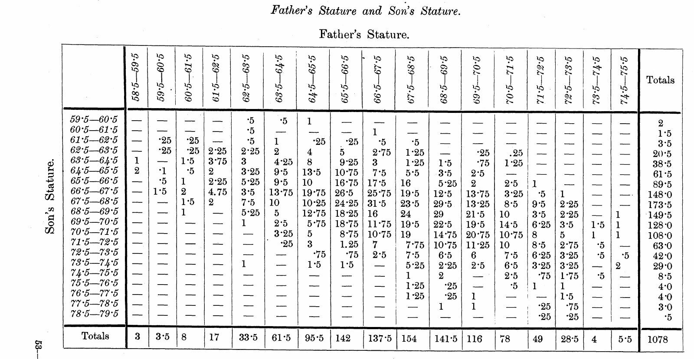
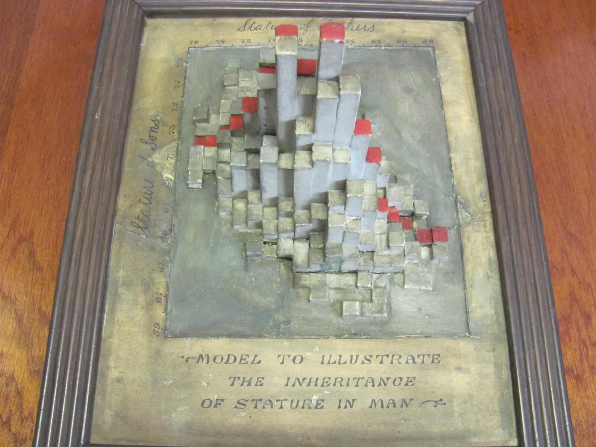
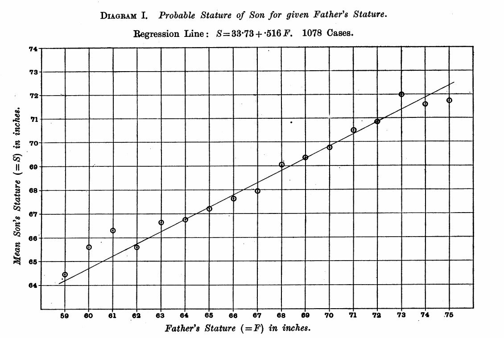
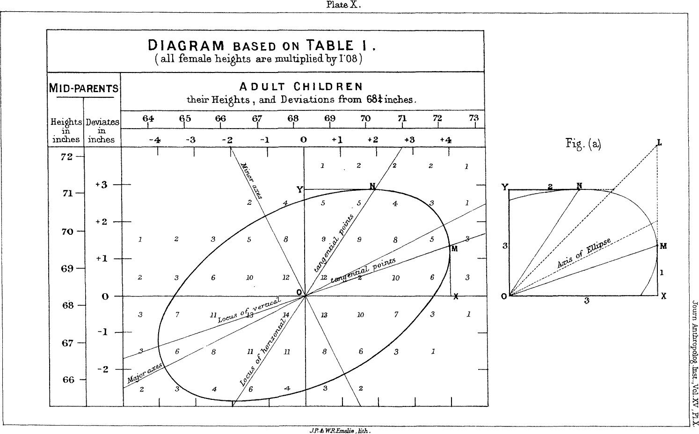
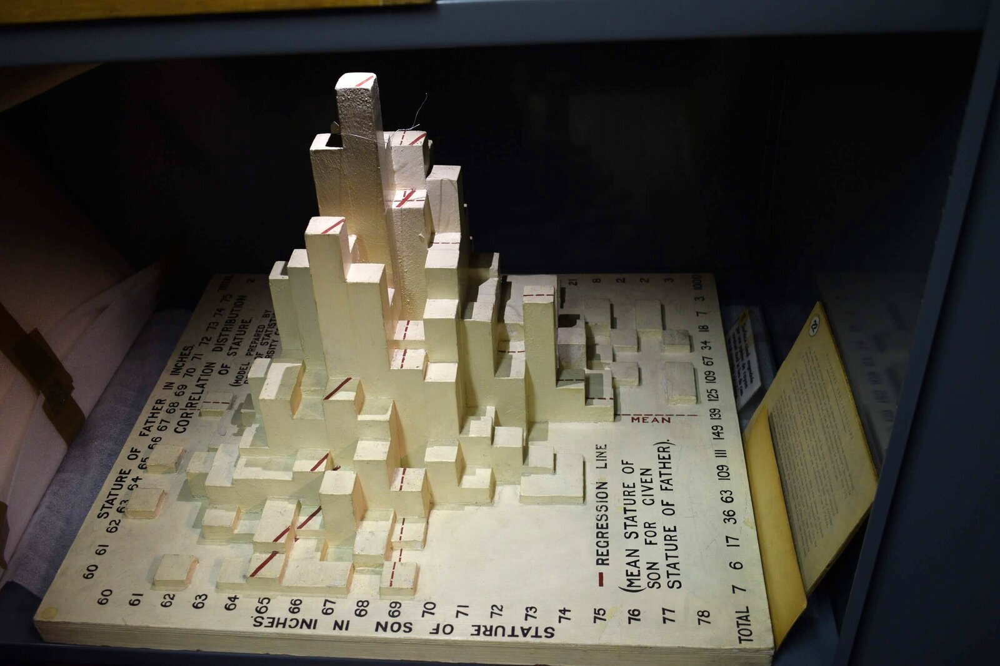

+++
author = "Yuichi Yazaki"
title = "Stand a Frequency Table Up as Columns and the Ridge Shows Its Direction: Pearson and Lee's Stature Model"
slug = "pearson-lee-stature-model"
date = "2026-11-01"
description = "A model that turns the frequency table of 1,078 father-son height pairs into the heights of columns. The peak of the distribution and the diagonal direction of its ridge (r = 0.514) show up as a shape, without reading the numbers."
categories = [
    "consume"
]
tags = [
    "data physicalization",
    "bivariate histogram",
    "correlation",
    "Karl Pearson"
]
image = "images/ucl-model-original.jpg"
+++

In the Department of Statistical Science at University College London (UCL), there is a framed model. It replaces a frequency table, in which the statures of 1,078 fathers and sons were counted on a grid in one-inch steps, with the heights of rectangular columns. Looking at the arrangement of the columns, you can see the peak of the distribution and the diagonal direction of its ridge (correlation coefficient r = 0.514) as a shape, without reading a table of numbers.

The data were collected by Karl Pearson and Alice Lee, and the original table is Table XXII of their 1903 paper "On the Laws of Inheritance in Man." No record has been found of who made the model or when. What follows is a reading based on the dataphys.org entry, which collects works of data physicalization, and on the 1903 paper.

<!--more-->

## 1893: Handing Out Cards to Measure Families

Pearson opens the paper by explaining why the measurements were begun: to supplement the family data Francis Galton used in *Natural Inheritance* with wider measurements (p.357).

The instructions were drawn up around 1893 with his colleague W. F. R. Weldon. The paper prints the circular asking for help, "FAMILY MEASUREMENTS." The families to be measured were a father, a mother, and at least one child aged 18 or over. The number of families needed is given as "1000—2000 families." Stature was to be measured with shoes off and a book held vertically against the head (p.359).

Students did much of the measuring, and it was Lee who supported the work of gathering the data.

> "In the course of four to five years about 1100 cards were filled in. The tabling of the data on these cards and the calculation of the statistical constants, some 78 tables in all, are due entirely to Dr Lee, and occupied her spare time for nearly two years."（p.358）

In short: about 1,100 cards were collected over four to five years, and Lee did all of the tabling into 78 tables and the calculation of the statistical constants, which took nearly two years of her spare time. The paper's byline is likewise "By KARL PEARSON, F.R.S., assisted by ALICE LEE, D.Sc."

Stature was recorded to the quarter inch and tabulated to the inch. For people measured with their shoes on, one inch was subtracted from the record (p.361).

## Counting 1,078 Pairs into 340 Cells

The father-son statures are compiled in Table XXII, "Father's Stature and Son's Stature" (p.415), in the paper's appendix.

Source: Karl Pearson and Alice Lee, *Biometrika* vol. 2 (1903), p.415 (published 1903)

| Item | Content |
|---|---|
| Number of pairs | 1,078 pairs (the grand total at the bottom right of the table) |
| Classes of father's stature | 17 classes, from 58.5–59.5 to 74.5–75.5 inches |
| Classes of son's stature | 20 classes, from 59.5–60.5 to 78.5–79.5 inches |
| Number of cells | 17 × 20 = 340. 179 have nonzero frequencies |
| Most populated cell | 31.5 pairs, father 66.5–67.5, son 67.5–68.5 |
| Correlation coefficient | .514 ± .015 (Table IV, p.378) |

The frequencies include fractions such as 0.25 and 0.5, and 129 of the 179 nonzero cells have fractions. This can be read as the result of splitting a pair equally between neighboring cells when a quarter-inch record fell on a class boundary. However, in the range I examined (pp.357–361 and the pages of the table), I have not found a passage that says so explicitly.

The shape of the distribution is already there in the table of numbers. But to read the position and direction of the peak from 340 cells, you have to compare the numbers one by one.

## Making Frequencies the Heights of Columns

The model turns this table into a solid object. Pierre Dragicevic, editor of dataphys.org, lists it as a bivariate histogram.

Photo: Richard Chandler (UCL Department of Statistical Science) / From dataphys.org, "1900 – Pearson and Lee's Height Correlation Chart"

The lower part of the frame reads "MODEL TO ILLUSTRATE THE INHERITANCE OF STATURE IN MAN," the top edge reads "Stature of Fathers," and the left edge reads "Stature of Sons." The correspondence between the data and the form is as follows.

| Data element | Form in the model | Certainty |
|---|---|---|
| Class of father's stature | Position along the horizontal direction. The scale on the top edge runs 76→58 from the left, so the right is lower | dataphys.org and the photo |
| Class of son's stature | Position along the depth direction. The scale on the left edge runs 59→79 from bottom to top | dataphys.org and the photo |
| Number of pairs in each cell | Height of a square column | dataphys.org (reproduced in R) |
| Cell with frequency 0 | No column; the surface of the base is visible | Reading from the photo |
| Red tops on some columns | Meaning unknown | No source explains it |
| Material | Not recorded. In the photo: gray, gold-tinged, and red | Photo only |

Dragicevic took the father-son pairs from the Pearson and Lee data in the R package HistData and drew them with `plot3D::hist3D`.

> "The following R code replicates the older model exactly, confirming that it shows the original dataset from Pearson and Lee"

That is, the code reproduces the old model exactly, confirming that it shows Pearson and Lee's original data.

In the photo, tall columns gather in the center and become lower and sparser toward the edges. The band of tall columns runs from the lower right to the upper left. Since the father's scale gets lower toward the right and the son's scale gets higher toward the top, this direction can be read as extending toward the side where the taller the father, the taller the son. **The position of the peak and the tilt of the ridge catch the eye without comparing the numbers in the table.**

Neither the maker nor the year of making is known. dataphys.org only estimates that it may have been made under Pearson's supervision around the same time as the data collection or a little later. The "1900" in the title is also an estimated year.

The rest of the history is in a letter from Richard Chandler, a former head of the Department of Statistical Science. He says he found it in a desk drawer when he arrived at UCL in 1994. It had broken into a great many pieces, and he writes that he had it restored.

## The Paper's Line and the Model's Peak

The paper shows the same 1,078 pairs in another form as well. Pearson writes that it was not possible to draw all 78 correlation tables, so three were chosen as representatives and drawn as diagrams. The first of them is Diagram I (p.362).

Source: Karl Pearson and Alice Lee, *Biometrika* vol. 2 (1903), p.362 (published 1903)

The diagram reads "Regression Line: S = 33·73 + ·516 F. 1078 Cases." Plugging into the formula, a father of 60 inches gives a son of about 64.7 inches, and a father of 74 inches gives about 71.9 inches. For each inch taller the father is, the son's expected height is about 0.5 inch greater.

What Diagram I shows is the mean for each class of father's stature and the line connecting them. What the model shows is the frequencies themselves, including the scatter around the mean. A relationship that the line condenses into a single slope can be read, in the model, as the width of the peak and the tilt of the ridge.

In his 1886 paper, Galton smoothed the frequency table of parents' and children's statures and joined points of the same value with lines.

> "The figures in it were first "smoothed" as described in the memoir, then lines were drawn through points corresponding to the same values, just as isobars or isotherms are drawn."（Galton 1886, p.263）

That is, points of the same value were joined, as isobars or isotherms are drawn. Galton writes that the lines came out as concentric ellipses.

Source: Francis Galton, *Journal of the Anthropological Institute* vol. 15 (1886), Plate X (public domain)

From here on is my own reading. Galton's ellipses can be read as contour lines that treat frequency as height. The UCL model can be read as turning that height into actual columns.

dataphys.org also carries a photo of another model, a later one from a different period and with different data.

Photo: Pierre Dragicevic (mathematical model collection of the Institut Henri Poincaré) / From dataphys.org, "1900 – Pearson and Lee's Height Correlation Chart"

It is a model held by the Institut Henri Poincaré in Paris, and its label reads "Model Prepared by Dept. of Statistics, University College London." Chandler writes that it resembles an exhibit made for a Royal Statistical Society event in the 1980s (he adds "I think" himself). Dragicevic examined it closely and writes that its data differ from the old model's.

From the photo, one can make out the red dashed line on the sides of the columns and the legend "REGRESSION LINE (MEAN STATURE OF SON FOR GIVEN STATURE OF FATHER)." The total in the margin reads "1000," which may mean different data, adjusted to 1,000 cases. Whereas the old model shows only the peak of frequencies, the later model can be read as laying a regression line over the peak.

## How Third Parties Have Seen This Model

Evaluations can be found in three directions, each with a different point.

### Placing it in the history of data physicalization

Dragicevic listed this object on dataphys.org as an example of a "Passive physical visualization." He recomputed the data to confirm that it matches the model, and also distinguished the similar later model as using different data. Chandler, on the side of the holder, writes:

> "It is quite a nice piece of 19th-century data visualisation, I think!"

That is, he thinks it is a rather fine piece of 19th-century data visualization.

### Recasting it as a one-point-per-pair scatter plot

In statistics courses, the same 1,078 pairs are taught as a scatter plot. A University of Chicago handout puts it this way.

> "The following scatter diagram shows the heights of 1,078 fathers and their full-grown sons, in England, circa 1900. There is one dot for each father-son pair."

That is, it explains the plot as a scatter diagram showing 1,078 father-son pairs in England around 1900, one dot per pair. A Brown University lecture slide describes the shape as like an American football and computes r = 0.5011627.

But the original source is a frequency table. Karl Broman's repository states the procedure of interpolating values from Table XXII and randomizing them slightly to create the pairs. The scatter-plot version's r of 0.501 differs from the paper's 0.514, and this can probably be read as due to that reconstruction.

### Reusing it as tables split by gender

Galton's data had aggregated parents and their sons and daughters together. To check the cause of the slight nonlinearity seen there (Galton's bend), Wachsmuth and colleagues used Pearson and Lee's tables in 2003. The HistData description says:

> "they used analogous data from English families at about the same time, tabulated by Karl Pearson and Alice Lee (1896, 1903), but where the heights of parents and children were each classified by gender of the parent."

That is, they used data from English families of about the same period, tabulated separately by the gender of the parent. The same Pearson and Lee tables are still being used today as a column model, a scatter plot, and frequency tables split by the parent's gender.

## Takeaways

What we can take away from this model is the idea of choosing, from the purpose, how to show a bivariate frequency table.

At least four forms have been made from the same kind of table: Galton's ellipses, Pearson's regression diagram, this model's columns, and the textbook scatter plot. Scatter plots, heatmaps, and 3D histograms can all be made from a "bivariate frequency table." What differs is what the frequencies are mapped to.

- Making frequencies the heights of columns shows the position of the peak and the direction of the ridge together. Even frequencies with fractions can be turned into shape as they are.
- Making frequencies the intensity of color (a heatmap) shows the same table on a flat plane, with no part hidden behind a column in front.
- To make a one-point-per-pair scatter plot, values must be reconstructed from the frequency table, and the statistics shift slightly.
- Turning only the means into a line (a regression diagram) condenses the relationship into a single slope and hides the scatter.

It is also instructive that the later model wrote a regression line on top of the columns. Overlaying the peak and the line lets you compare the movement of the mean and the actual scatter at once.

When showing a correlation, we sometimes stop after writing the value of r. This model puts in your hands the shape of the peak that r = 0.514 came from. Show the shape of the frequencies before the number. That is the takeaway.

## References

**Primary sources**

- Pierre Dragicevic, "1900 – Pearson and Lee's Height Correlation Chart," *List of Physical Visualizations* (dataphys.org). Includes the quotation from Richard Chandler's reply, the R code, and the photo credits. [dataphys.org](https://dataphys.org/list/pearson-lee-height-correlation-chart/) (mirror: [GitHub](https://github.com/yvonnejansen/dataphys.org-http))
- Karl Pearson (assisted by Alice Lee), "On the Laws of Inheritance in Man: I. Inheritance of Physical Characters," *Biometrika* 2(4): 357–462, 1903. pp.357–361 (background and measurement procedure), p.362 (Diagram I), p.378 (Table IV), p.415 (Table XXII). [JSTOR](https://www.jstor.org/stable/2331507) (scanned PDF: [kbroman/PearsonData](https://github.com/kbroman/PearsonData))
- HistData package (PearsonLee data and description). [CRAN](https://cran.r-project.org/package=HistData)
- Francis Galton, "Regression towards Mediocrity in Hereditary Stature," *Journal of the Anthropological Institute* 15: 246–263, 1886. [galton.org](https://galton.org/essays/1880-1889/galton-1886-jaigi-regression-stature.pdf)

**Secondary sources**

- Karl Broman, PearsonData (transcription of Table XXII, and the procedure for interpolating and randomizing it into per-pair values). [GitHub](https://github.com/kbroman/PearsonData)
- University of Chicago Stat 200 handout "Pearson's Father-Son Data". [PDF](https://galton.uchicago.edu/~wichura/Stat200/Handouts/C10.pdf)
- Brown University CS100 "A Brief History of Regression". [PDF](https://cs.brown.edu/courses/cs100/lectures/lecture15c.pdf)
- A. W. Wachsmuth, L. Wilkinson, G. E. Dallal, "Galton's bend," *The American Statistician* 57: 190–192, 2003 (introduced in the HistData description). [doi:10.1198/0003130031874](https://doi.org/10.1198/0003130031874)
