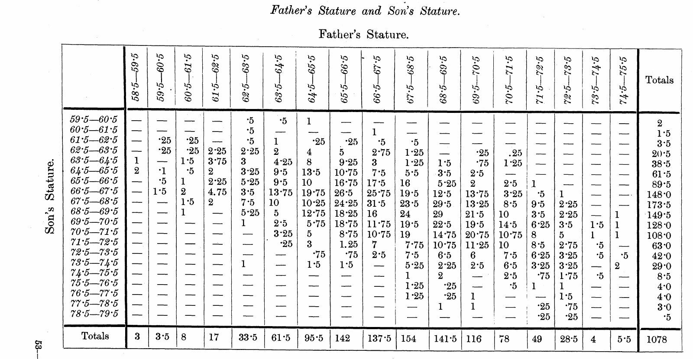
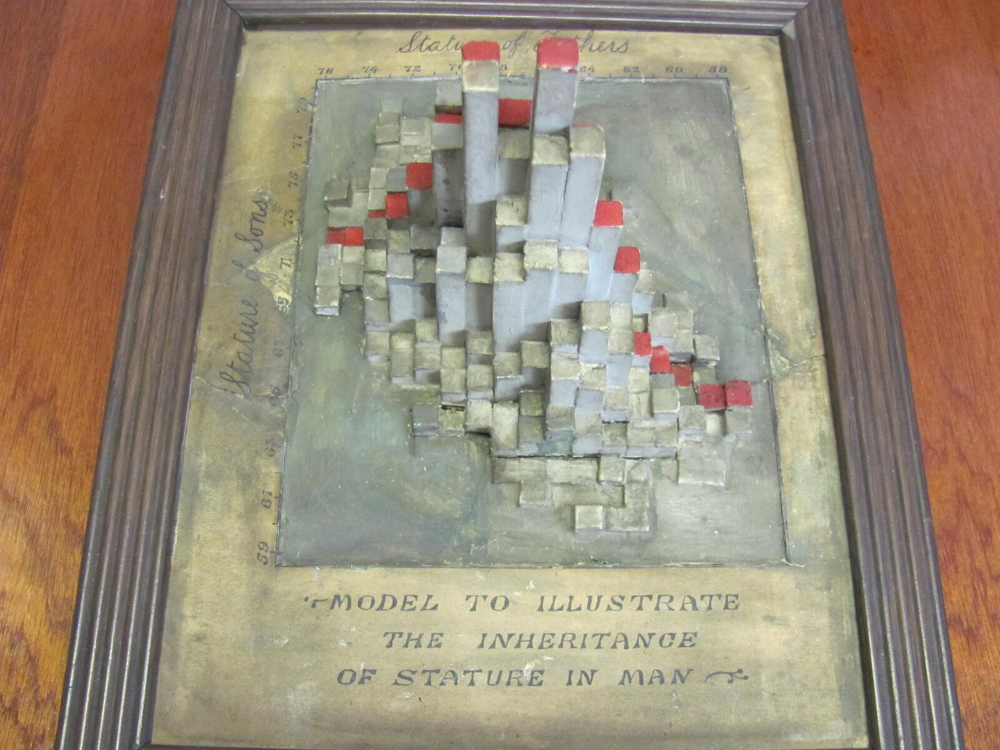
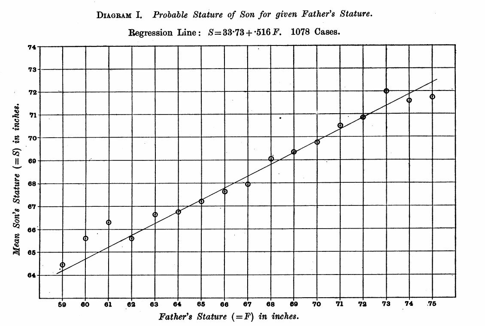
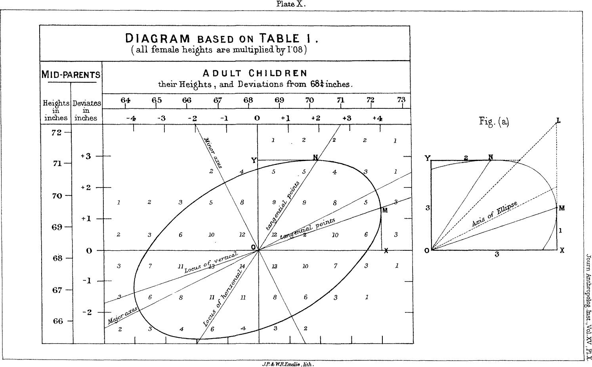
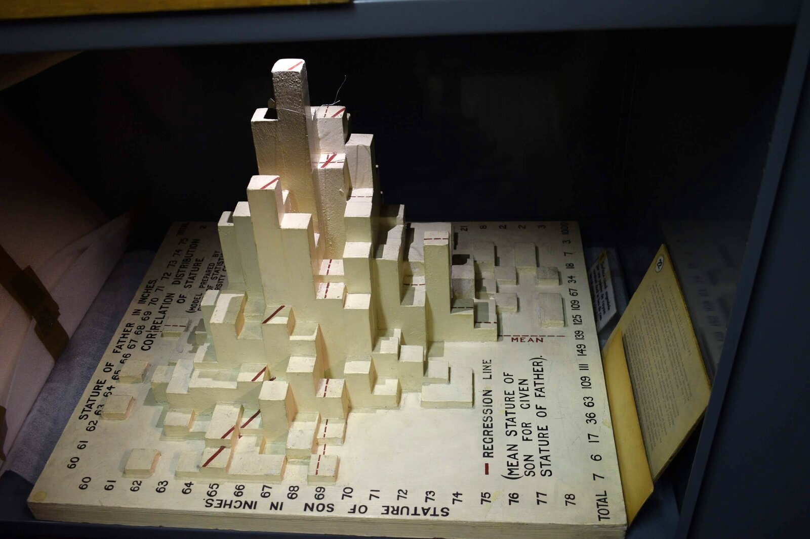

+++
author = "矢崎裕一"
title = "度数表を柱に立てると、尾根の向きが見える──Pearson と Lee の身長模型"
slug = "pearson-lee-stature-model"
date = "2026-11-01"
description = "父と息子1,078組の身長の度数表を、柱の高さにした模型です。分布の山と、その尾根が斜めに伸びる向き（r = 0.514）が、数字を読まずに形として見えます。"
categories = [
    "consume"
]
tags = [
    "データ物質化",
    "2変量ヒストグラム",
    "相関",
    "Karl Pearson"
]
image = "images/ucl-model-original.jpg"
series = ["data-physicalization"]
series_weight = 10
seriesByline = "Karl Pearson・Alice Lee"
seriesTitle = "度数表を柱に立てる──身長模型"
+++

ロンドン大学ユニバーシティ・カレッジ（UCL）の統計科学科に、額に入った模型があります。父と息子1,078組の身長を1インチ刻みの格子で数えた度数表を、角柱の高さに置き換えたものです。柱の並びを見ると、分布の山と、その尾根が斜めに伸びる向き（相関係数 r = 0.514）が、数字の表を読まなくても形として見えます。

データを集めたのは Karl Pearson（カール・ピアソン）と Alice Lee（アリス・リー）で、元の表は1903年の論文 "On the Laws of Inheritance in Man" の Table XXII です。模型を誰がいつ作ったかの記録は見つかっていません。以下は、データ物理化の作品を集めた dataphys.org の項目と、1903年の論文に沿って読みます。

<!--more-->

## 1893年、家族を測るカードを配る

Pearson は論文の冒頭で、計測を始めた理由を書いています。Francis Galton（フランシス・ゴルトン）が『Natural Inheritance』で使った家族のデータを、より広い計測で補うためでした（p.357）。

手順書は1893年ごろ、同僚の W. F. R. Weldon と作りました。協力を呼びかける文書「FAMILY MEASUREMENTS」が論文に載っています。測る家族は、父と母と、18歳以上の子ども1人以上。必要な家族の数は「1000—2000 families」とあります。身長は靴を脱ぎ、本を頭に垂直に当てて測るよう指示されていました（p.359）。

計測の多くは学生が担い、データ集めを支えたのは Lee でした。

> "In the course of four to five years about 1100 cards were filled in. The tabling of the data on these cards and the calculation of the statistical constants, some 78 tables in all, are due entirely to Dr Lee, and occupied her spare time for nearly two years."（p.358）

4〜5年で約1,100枚のカードが集まり、78の表の作成と統計量の計算はすべて Lee が行った。それが彼女の空き時間のほぼ2年を占めた、という内容です。論文の著者表記も「By KARL PEARSON, F.R.S., assisted by ALICE LEE, D.Sc.」です。

身長は1/4インチ単位で記録し、表には1インチ単位でまとめました。靴を履いたまま測った人は、記録から1インチを引いています（p.361）。

## 1,078組を、340のマス目に数える

父と息子の身長をまとめたのが、論文の付録にある Table XXII "Father's Stature and Son's Stature"（p.415）です。

Karl Pearson・Alice Lee／*Biometrika* 第2巻（1903）p.415より引用（1903年刊行）

| 項目 | 内容 |
|---|---|
| 組数 | 1,078組（表の右下の総計） |
| 父の身長の階級 | 58.5–59.5 から 74.5–75.5 インチまで、17階級 |
| 息子の身長の階級 | 59.5–60.5 から 78.5–79.5 インチまで、20階級 |
| マス目の数 | 17×20 = 340。度数が0でないのは179 |
| 最も多いマス目 | 父 66.5–67.5、息子 67.5–68.5 の 31.5組 |
| 相関係数 | .514 ± .015（Table IV, p.378） |

度数には 0.25 や 0.5 のような端数があり、0でない179マスのうち129マスが端数です。1/4インチ単位の記録が階級の境目に当たったとき、隣のマス目に等分して入れた結果と読めます。ただし、調べた範囲（p.357–361 と表のページ）では、明記した箇所が見つかっていません。

分布の形は、数字の表としてすでにここにあります。けれども、340のマス目から山の位置と向きを読むには、数字を一つずつ比べる必要があります。

## 度数を柱の高さにする

模型は、この表を立体にしたものです。dataphys.org の編者 Pierre Dragicevic（ピエール・ドラギチェヴィッチ）は、これを2変量ヒストグラムとして載せています。

写真：Richard Chandler（UCL 統計科学科）／dataphys.org「1900 – Pearson and Lee's Height Correlation Chart」より引用

額の下部に「MODEL TO ILLUSTRATE THE INHERITANCE OF STATURE IN MAN」、上辺に「Stature of Fathers」、左辺に「Stature of Sons」と書かれています。データと形の対応は、次のとおりです。

| データの要素 | 模型での形 | 確かさ |
|---|---|---|
| 父の身長の階級 | 横方向の位置。上辺の目盛りは左から 76→58 で、右ほど低い | dataphys.org と写真 |
| 息子の身長の階級 | 奥行き方向の位置。左辺の目盛りは下から上へ 59→79 | dataphys.org と写真 |
| 各マス目の組数 | 四角い角柱の高さ | dataphys.org（R で再現） |
| 度数0のマス目 | 柱がなく、台の面が見える | 写真からの読み |
| 一部の柱の赤い頂面 | 意味は不明 | 説明する資料なし |
| 素材 | 記録なし。写真では灰色・金色がかった色・赤 | 写真のみ |

Dragicevic は、R の HistData パッケージにある Pearson と Lee のデータから父と息子の組を取り出し、`plot3D::hist3D` で描きました。

> "The following R code replicates the older model exactly, confirming that it shows the original dataset from Pearson and Lee"

このコードで古い模型を正確に再現でき、Pearson と Lee の元のデータだと確かめられた、という意味です。

写真では、背の高い柱が中央に集まり、周りへ行くほど低く、まばらになります。高い柱の帯は、右下から左上へ伸びています。父の目盛りは右ほど低く、息子の目盛りは上ほど高いので、この向きは「父が高いほど、息子も高い」側へ伸びていると読めます。**山の位置と尾根の傾きが、表の数字を比べなくても目に入ります。**

制作者と制作年は分かっていません。dataphys.org は、データ収集と同じころか少し後に、Pearson の監督のもとで作られた可能性がある、と推定にとどめています。見出しの「1900」も推定の年です。

残った経緯は、統計科学科長だった Richard Chandler（リチャード・チャンドラー）の手紙にあります。1994年に UCL に着任したとき、机の引き出しで見つけたそうです。非常に多くの破片に壊れていたので、修復させた、と書いています。

## 論文の直線と、模型の山

同じ1,078組を、論文は別の形でも見せています。78の相関表すべては図にできないので、3つを代表として図にした、と Pearson は書いています。その最初が Diagram I です（p.362）。

Karl Pearson・Alice Lee／*Biometrika* 第2巻（1903）p.362より引用（1903年刊行）

図には「Regression Line: S = 33·73 + ·516 F. 1078 Cases.」とあります。式に当てはめると、父が60インチなら息子は約64.7インチ、74インチなら約71.9インチです。父が1インチ高いと、息子の予想は約0.5インチ高くなります。

Diagram I が示すのは、父の階級ごとの平均と、それを結ぶ直線です。模型が示すのは、平均の周りの散らばりを含めた度数そのものです。直線では一本の傾きにまとまる関係が、模型では山の幅と尾根の傾きとして見えると読めます。

Galton は1886年の論文で、親と子の身長の度数表を平滑化し、同じ値の点を線で結びました。

> "The figures in it were first "smoothed" as described in the memoir, then lines were drawn through points corresponding to the same values, just as isobars or isotherms are drawn."（Galton 1886, p.263）

等圧線や等温線のように、同じ値の点を結んだという説明です。その線は同心の楕円になった、と Galton は書いています。

Francis Galton／*Journal of the Anthropological Institute* 第15巻（1886）Plate X より引用（パブリックドメイン）

ここからは筆者の読みです。Galton の楕円は、度数を高さに見立てた等高線として読めます。UCL の模型は、その高さを実際の柱にした形と読めます。

dataphys.org には、もう一つ別の模型の写真が載っています。時代もデータも違う、後の模型です。

写真：Pierre Dragicevic（アンリ・ポアンカレ研究所の数学模型コレクション）／dataphys.org「1900 – Pearson and Lee's Height Correlation Chart」より引用

パリのアンリ・ポアンカレ研究所が持つ模型で、ラベルに "Model Prepared by Dept. of Statistics, University College London" とあります。Chandler は、1980年代（本人も「I think」と添えています）に王立統計学会の催しで作られた展示物に似ている、と書いています。Dragicevic は詳しく見て、古い模型とはデータが違うと書いています。

写真からは、柱の側面の赤い破線と「REGRESSION LINE (MEAN STATURE OF SON FOR GIVEN STATURE OF FATHER)」の凡例が読み取れます。縁の合計欄は「1000」と読め、1,000件にそろえた別のデータの可能性があります。古い模型が度数の山だけを見せるのに対し、後の模型は山の上に回帰直線を重ねていると読めます。

## 第三者はこの模型をどう見たか

評価は、論点の違う三つの方向から見つかります。

### データ物理化の歴史の中に置く

Dragicevic は、この物体を「Passive physical visualization」の一例として dataphys.org に載せました。データを計算し直して模型と一致することを確かめ、よく似た後の模型が別のデータであることも見分けています。所蔵する側の Chandler は、次のように書いています。

> "It is quite a nice piece of 19th-century data visualisation, I think!"

19世紀のデータ可視化として、なかなか良いものだと思う、という評です。

### 一組一点の散布図に作り直す

統計学の授業では、同じ1,078組が散布図として教えられています。シカゴ大学の配布資料はこう書きます。

> "The following scatter diagram shows the heights of 1,078 fathers and their full-grown sons, in England, circa 1900. There is one dot for each father-son pair."

1900年ごろのイングランドの父子1,078組を、一組一点で示した散布図だ、という説明です。ブラウン大学の講義スライドは、その形をアメリカンフットボールのようだと説明し、r = 0.5011627 と計算しています。

ただし、元の資料は度数表です。Karl Broman のリポジトリは、Table XXII から値を補間し、少しランダム化して組を作る手順を明記しています。散布図版の r が 0.501 で、論文の 0.514 とずれるのは、この作り直しのためである可能性が高いと読めます。

### 性別ごとの表として使い直す

Galton のデータは、父母と息子・娘をまとめて集計していました。そこに見られるわずかな非線形（Galton's bend）の原因を確かめるため、Wachsmuth らは2003年に Pearson と Lee の表を使いました。HistData の説明文はこう書きます。

> "they used analogous data from English families at about the same time, tabulated by Karl Pearson and Alice Lee (1896, 1903), but where the heights of parents and children were each classified by gender of the parent."

親の性別ごとに分けて集計された、同時期のイングランドの家族データを使った、という内容です。同じ Pearson と Lee の表が、柱の模型、散布図、親の性別で分けた度数表として、今も使われ続けています。

## 使い道

この模型から持ち帰れるのは、2変量の度数表をどの形で見せるかを、目的から選ぶという考え方です。

同じ種類の表から、少なくとも四つの形が作られてきました。Galton の楕円、Pearson の回帰図、この模型の柱、教科書の散布図です。散布図、ヒートマップ、3D ヒストグラムも、どれも「2変量の度数表」から作れます。違うのは、度数を何に対応させるかです。

- 度数を柱の高さにすると、山の位置と尾根の向きがまとまって見えます。端数のある度数でも、そのまま形にできます。
- 度数を色の濃さにすると（ヒートマップ）、平面のまま同じ表を見せられ、手前の柱に隠れる部分が出ません。
- 一組一点の散布図にするには、度数表から値を作り直す必要があり、統計量が少しずれます。
- 平均だけを直線にすると（回帰図）、関係は一本の傾きに要約され、ばらつきは見えなくなります。

後の模型が、柱の上に回帰直線を書き込んでいたことも参考になります。山と直線を重ねれば、平均の動きと実際の散らばりを一度に見比べられます。

相関を見せるとき、r の値だけを書いて終わることがあります。この模型は、r = 0.514 がどんな山の形から出てきたのかを、手元に置いて見せます。数字の前に、度数の形を見せる。使い道は、そこです。

## 参考・出典

**一次情報**

- Pierre Dragicevic, "1900 – Pearson and Lee's Height Correlation Chart," *List of Physical Visualizations*（dataphys.org）. Richard Chandler の返信の引用、R コード、写真のクレジットを含む. [dataphys.org](https://dataphys.org/list/pearson-lee-height-correlation-chart/)（ミラー：[GitHub](https://github.com/yvonnejansen/dataphys.org-http)）
- Karl Pearson (assisted by Alice Lee), "On the Laws of Inheritance in Man: I. Inheritance of Physical Characters," *Biometrika* 2(4): 357–462, 1903. p.357–361（経緯と測定手順）、p.362（Diagram I）、p.378（Table IV）、p.415（Table XXII）. [JSTOR](https://www.jstor.org/stable/2331507)（スキャンPDF：[kbroman/PearsonData](https://github.com/kbroman/PearsonData)）
- HistData パッケージ（PearsonLee データと説明）. [CRAN](https://cran.r-project.org/package=HistData)
- Francis Galton, "Regression towards Mediocrity in Hereditary Stature," *Journal of the Anthropological Institute* 15: 246–263, 1886. [galton.org](https://galton.org/essays/1880-1889/galton-1886-jaigi-regression-stature.pdf)

**第三者評価**

- Karl Broman, PearsonData（Table XXII の書き起こしと、一組ごとの値への補間・ランダム化の手順）. [GitHub](https://github.com/kbroman/PearsonData)
- シカゴ大学 Stat 200 配布資料 "Pearson's Father-Son Data". [PDF](https://galton.uchicago.edu/~wichura/Stat200/Handouts/C10.pdf)
- ブラウン大学 CS100 "A Brief History of Regression". [PDF](https://cs.brown.edu/courses/cs100/lectures/lecture15c.pdf)
- A. W. Wachsmuth, L. Wilkinson, G. E. Dallal, "Galton's bend," *The American Statistician* 57: 190–192, 2003（HistData の説明で紹介）. [doi:10.1198/0003130031874](https://doi.org/10.1198/0003130031874)
