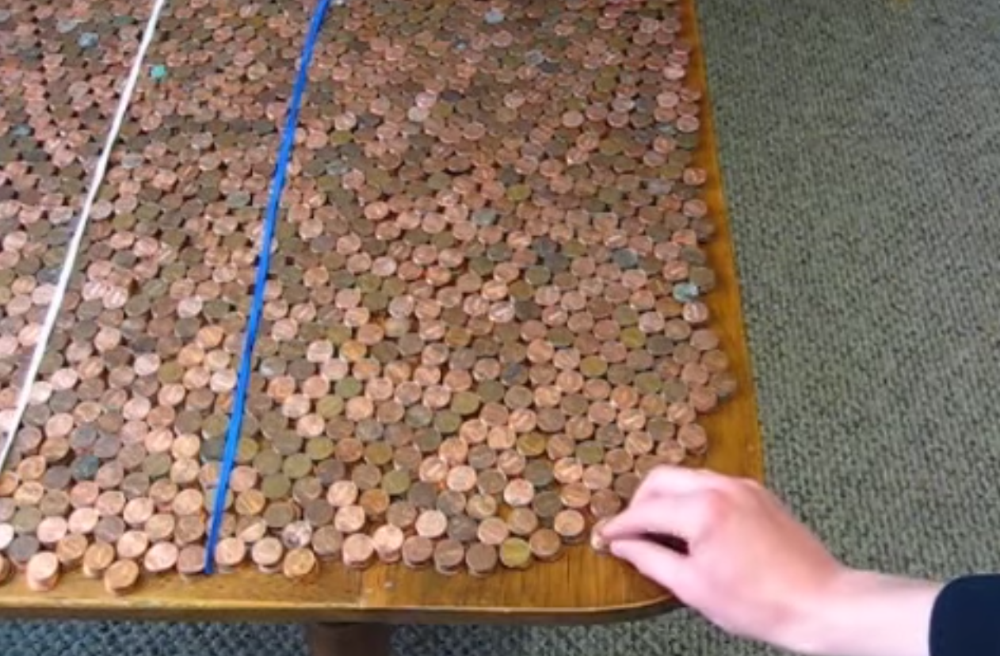
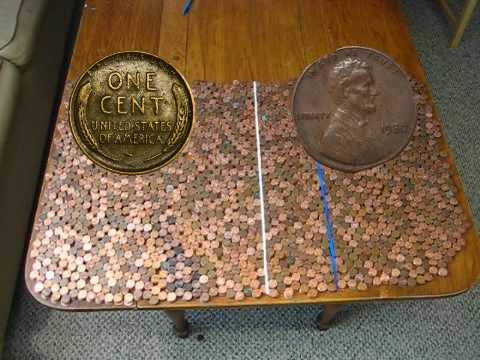
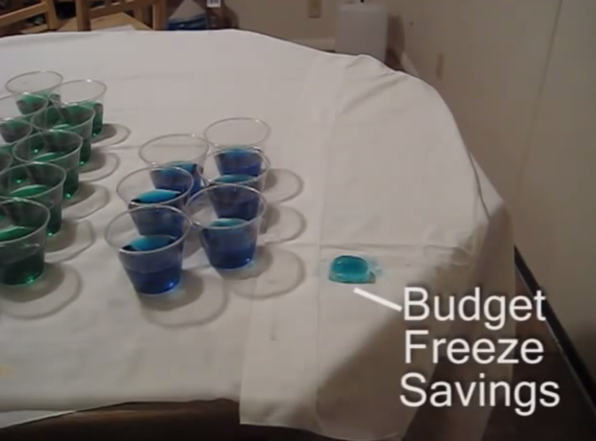

+++
author = "Yuichi Yazaki"
title = "Shrinking the Whole Budget to 8,880 Pennies, and Showing a $100 Million Cut as a Quarter of One: Matt Shapiro's Budget Video"
slug = "pennies-federal-budget"
date = "2026-11-03"
description = "In 2009, Matt Shapiro shrank the entire US budget to 8,880 pennies (one penny = $400 million) and showed a $100 million spending cut as one quarter of a single penny."
categories = [
    "consume"
]
tags = [
    "data physicalization",
    "scale",
    "Matt Shapiro"
]
image = "images/pennies-on-table.png"
series = ["data-physicalization"]
series_weight = 18
seriesByline = "Matt Shapiro (Political Math)"
seriesTitle = "Cuts Shown as a Quarter of a Penny: Political Math's Budget Video"
+++

In 2009, Matt Shapiro shrank the entire US federal budget to 8,880 pennies (one penny = $400 million). He then showed the $100 million spending cut announced by President Obama as one quarter of a single penny. The video is titled "Obama Budget Cuts Visualization."

The work is listed in the List of Physical Visualizations (dataphys.org), a collection of data physicalization works, under the heading "Federal Budget Explained with 10,000 Pennies." That heading was given by dataphys.org; the "10,000" comes from the name of the channel that posted it, "10000Pennies." I have not been able to watch the original video. What follows relies on what FactCheck.org confirmed with the author by email, the author's blog, and contemporary press coverage.

<!--more-->

## April 2009: An Order to Cut $100 Million

According to Joe Miller of FactCheck.org, on April 20, 2009, President Obama gathered his Cabinet and directed them to cut a total of $100 million in expenses within 90 days.

> On April 20, President Barack Obama caused a bit of a splash when he gathered members of his Cabinet and directed them to cut (collectively) $100 million in expenses within the next 90 days.

The same article introduced Shapiro's work as a video that helps put this $100 million in perspective.

Shapiro, the author, was a 28-year-old software developer living in Salt Lake City (FactCheck.org). The local station KSL spelled his name Matthias Shapiro and reported that he lived in nearby Holladay. The YouTube channel he posted to, "10000Pennies," says in its self-introduction that it visualizes policy so that anyone can understand it. The author later started a blog under the name "Political Math." However, the blog's first post is dated May 15, 2009, after this video. At the time of this work, the author was less a blogger than a video poster.

I have not been able to confirm the posting date on YouTube. Articles embedding the video appear from April 28 (GovExec), so it can be read as posted in the few days before that.

Source: Political Math (10000Pennies) / List of Physical Visualizations (dataphys.org)

dataphys.org presents this screen as one from "Obama Budget Cuts Visualization." What it shows is pennies spread on a desk and two lines, one white and one blue. I could not confirm from written sources how the coins were rearranged during the video or what the lines mark off.

## The Budget as 8,880 Pennies, the Cut as a Quarter of One

FactCheck.org confirmed the correspondence of numbers with the author by email.

> Matt, whose YouTube channel is entitled 10000 pennies, told us by e-mail that he actually uses 8,880 pennies in his video. The math checks out. Each penny represents $400 million in government spending, so that works out to a budget of $3.552 trillion — pretty close to Obama's proposed 2010 budget. Obama's pledge amounts to cutting one-fourth of one of those pennies.

In short: the video uses 8,880 pennies, not 10,000. Each penny stands for $400 million in government spending, the total comes to $3.552 trillion, and that is close to the 2010 fiscal year budget the Obama administration proposed. The President's $100 million is one quarter of one such penny. FactCheck.org wrote that "the math checks out."

The correspondence between the data and the objects is as follows.

| Data | Physical counterpart | Value |
|---|---|---|
| Total federal budget | Number of penny coins (quantity) | 8,880 pennies = $3.552 trillion |
| Conversion unit | One penny | 1 penny = $400 million |
| Cut announced by the President | A fraction of one penny | $100 million = one quarter of a penny |
| Share of the cut in the whole | Ratio of 8,880 pennies to a quarter of a penny | About 0.0028% (my calculation) |

Dividing $100 million by $3.552 trillion gives about 0.0028%, which equals a quarter of a penny divided by 8,880 pennies.

Here, the penny is not used at its original value of one cent. **One penny becomes a symbol for $400 million.** What the author replaced was not the unit of the $100 million sum but the ratio of the part to the whole, it can be read. The whole budget is shrunk by a single scale, and the cut is shown on that same scale. It can be read as the same idea as a scale model.

Around the same time, the economist Greg Mankiw explained the same ratio in another form. According to the Christian Science Monitor, Mankiw put the cut at 0.003% of the budget and wrote that for a household spending $100,000 a year it would be $3, about one latte at Starbucks. It can be read that Mankiw turned the ratio into "household units," while Shapiro turned it into "a scale that makes the whole a heap of coins."

The author wrote by email about the concern behind this form.

> I know that we have a really hard time intuitively grasping scale when we're dealing with two numbers that are orders of magnitude away from each other.

His concern is that it is very hard to grasp intuitively the difference in scale between two numbers that are many orders of magnitude apart. According to FactCheck.org, the author made this video as a way to see numbers "a little fresh," compared with the usual bar chart.

Source: 10000Pennies (Political Math) / YouTube, "Obama Budget Cuts Visualization"

The video is available on YouTube (https://www.youtube.com/watch?v=cWt8hTayupE ). According to dataphys.org, it has 1.7 million views.

I do not know whether the quarter penny was shown by cutting a coin or by a diagram. dataphys.org says "videos often end with a dramatic action," and lists examples such as cutting a penny in two or spilling several hundred coins off a table. But this describes the series as a whole and does not say which action belongs to this work.

## From Coins to Water and Ice: Repeating the Same Procedure

The author later made videos following the same procedure with water and ice. dataphys.org says that "not only coins, but also bills, water, and whiskey represent amounts of money and numbers of jobs," mentioning whiskey as well, and the channel also has a Lego video. However, I could not confirm the contents of these two.

On May 13, 2009, he released "Obama's $17 Billion Budget Cuts In Context." This time the $17 billion cut proposal is shown as a quantity of water. According to Brooks Jackson of FactCheck.org, the cut amounts to 2 liters. The video had initially given the difference between the Obama budget and the Bush budget ($3.107 trillion) as 9 gallons.

Source: 10000Pennies (Political Math) / YouTube, "Obama's $17 Billion Budget Cuts In Context"

The 9 gallons was an error, which FactCheck.org found. The correct figure was about 12 gallons. The author added a correction in text to the video and thanked FactCheck.org in the description. In the same description, he also wrote that a $100 million cut would not even be "a drop in the bucket."

In "What Does The Federal Budget Freeze Look Like?" (January 30, 2010), he showed a budget freeze with water and ice. The author devotes the first half of the blog post to explaining the data used in the video. He explains that if the budget is taken as 192 ounces of water divided into 4-ounce cups, all the calculations in the video work out. The first-year savings of $15 billion are 0.75 ounces of water frozen into ice, measured with one and a half tablespoons.

Source: Political Math (10000Pennies) / List of Physical Visualizations (dataphys.org)

Putting the three videos side by side gives the following.

| Video | Whole | Part taken out |
|---|---|---|
| Obama Budget Cuts Visualization (April 2009) | Budget $3.552 trillion = 8,880 pennies | $100 million cut = a quarter of a penny |
| Obama's $17 Billion Budget Cuts In Context (May 2009) | Budget = a quantity of water | $17 billion cut = 2 liters |
| What Does The Federal Budget Freeze Look Like? (January 2010) | Budget $3.7 trillion = 192 ounces of water | $15 billion savings = 0.75 ounces of ice |

Dividing $3.7 trillion by 192 ounces gives about $19.3 billion per ounce. 0.75 ounces is about $14.5 billion, which nearly matches $15 billion. Even as the material changes, the procedure appears to stay the same: fix the quantity of the whole first, then take the policy amount out as a part of it.

In one of his earliest blog posts, "The National Debt Road Trip" (May 15, 2009), the author writes that he tilted the numbers in Obama's favor so as to leave no room for the charge of fudging. This is not a statement about this work, but it offers a clue to how he handled numbers.

## How Third Parties Saw the Video

The first point is the verification of the numbers. FactCheck.org confirmed the number of coins and the unit value with the author and wrote that the math was right. In the follow-up, it found an error, confirmed that the author had fixed it, and then commented as follows.

> Thanks to Matt's helpful images, you don't have to be an accountant to grasp the size of the budget problem.

The assessment is that, thanks to Matt's clear images, you do not need to be an accountant to grasp the size of the budget problem. The first article also notes that the liberal economist Paul Krugman made the same point on his blog, that $100 million is small.

The second point is the response to the difficulty of large numbers. Megan McArdle of The Atlantic introduced this work in an April 2009 blog post.

> Numbers a million times bigger than our total lifetime earnings literally boggle the imagination.

In short, a number a million times our lifetime earnings is literally beyond imagination. McArdle introduced the author as an "ambitious video blogger" who took on that problem. Alyssa Rosenberg of GovExec also cited that post, embedded the video, and called it a "fun, educational video."

The third is a skeptical view. Adam Paul of The Think Tankard wrote on May 4, 2009, linking to McArdle's post.

> Video bloggers have taken to using piles of pennies to represent the budget ... The concern is great and if the goal is simply to inform people it's doing a good job. Yet any hopes that people might apply, or that that matter retain, their knowledge suffers from the same problems that "awareness" movements always have: how to turn knowledge into action.

His point: video bloggers have taken to representing the budget with piles of pennies, and if the aim is to inform, they do a good job. But whether the knowledge is retained or leads to action runs into the same problem that awareness campaigns always have.

dataphys.org introduces the author as someone who "criticizes the US policy" with statistics and handmade physical visualizations. The author himself wrote in the description of the follow-up that a $100 million cut would not even be "a drop in a bucket" ("weren't even a drop in a bucket"). According to KSL, in July 2009 Republican National Committee Chairman Michael Steele presented the author with a "Grassroots Logic Award." From these, it can be read that the video also had a partisan aim of criticizing the administration. At the same time, placing FactCheck.org's verification next to Krugman's identical point suggests that the way of presenting the ratio itself holds across party lines.

## Takeaways

The first thing to take from this video is to put the whole and the part on the same scale. Showing only $100 million does not settle whether it is large or small. The design of preparing the whole as a quantity of 8,880 pennies and assigning the cut a quarter of one penny can be read as a way of making the denominator of the ratio visible.

The second is to choose the unit's value from the size at which the whole fits. The value of $400 million per penny can be read as chosen so that the whole budget fits within a manageable quantity. At $100 million per penny the cut would take one penny, but the whole would exceed 35,000. The unit is decided by whether you want the whole or the part to be the more manageable quantity.

The third is to make the basis of the conversion checkable from outside. FactCheck.org confirmed the calculation just by asking for the number of coins and the unit value, and found an error in the follow-up. For the freeze video, the author published the conversion himself on his blog. If the basis is open, outsiders can give you the occasion to correct it.

Finally, the limits. As Adam Paul wrote, understanding scale and changing behavior are different things. The question this video answered was how to compare two numbers that differ by many orders of magnitude on a single scale. What comes after that is left to the viewer and to the places where the debate happens.

## References

**Primary sources**

- List of Physical Visualizations (dataphys.org), "2009 – Federal Budget Explained with 10,000 Pennies" (contributed by Pierre Dragicevic): https://dataphys.org/list/federal-budget-explained-with-10000-pennies/
- dataphys.org tag pages, storytelling: https://dataphys.org/list/tags/storytelling/ / budget: https://dataphys.org/list/tags/budget/
- 10000Pennies, "Obama Budget Cuts Visualization" (YouTube, April 2009): https://www.youtube.com/watch?v=cWt8hTayupE (title and poster confirmed via oEmbed: https://www.youtube.com/oembed?url=https://www.youtube.com/watch?v=cWt8hTayupE&format=json )
- YouTube channel 10000Pennies (video list, channel description): https://www.youtube.com/user/10000Pennies/videos
- 10000Pennies, "Obama's $17 Billion Budget Cuts In Context" (YouTube, 2009-05-13, description): https://www.youtube.com/watch?v=miIBp7ufxjk
- 10000Pennies, "What Does The Federal Budget Freeze Look Like?" (YouTube, 2010-01-30): https://www.youtube.com/watch?v=gMH9QZdjS2Y
- Political Math blog: https://www.politicalmathblog.com/
- Political Math, "What Does the Federal Budget Freeze Look Like?", 2010-01-31: https://www.politicalmathblog.com/2010/01/31/what-does-the-federal-budget-freeze-look-like/
- Political Math, "The National Debt Road Trip", 2009-05-15: https://www.politicalmathblog.com/2009/05/15/the-national-debt-road-trip/

**Secondary sources**

- Joe Miller, "What's in a Number?", FactCheck.org, 2009-05-07: https://www.factcheck.org/2009/05/whats-in-a-number/
- Brooks Jackson, "Drop in the Bucket? See for Yourself.", FactCheck.org, 2009-05-15: https://www.factcheck.org/2009/05/drop-in-the-bucket-see-for-yourself/
- Megan McArdle, "Penny Wise, Pound Foolish", The Atlantic, April 2009 (the original URL, http://meganmcardle.theatlantic.com/archives/2009/04/penny_wise_pound_foolish_1.php, no longer opens). Full-text reprint: https://thinkingonthemargin.blogspot.com/2009_04_26_archive.html
- Alyssa Rosenberg, "What $100 Million Looks Like", GovExec, 2009-04-28: https://www.govexec.com/federal-news/2009/04/what-100-million-looks-like/38913/
- Adam Paul, "Learning Large Numbers", The Think Tankard, 2009-05-04: https://thinktankard.blogspot.com/2009/05/learning-large-numbers.html
- Andrew Adams, "Utahn's YouTube video catches RNC's attention", KSL, 2009-07-08: https://www.ksl.com/article/7084161
- Legal Insurrection, "Obama Budget Cuts Visualization", 2009-04-29: https://legalinsurrection.com/2009/04/obama-budget-cuts-visualization/
- "Obama's $100 million budget cut amounts to a cup of coffee", Christian Science Monitor, 2009-04-21 (Mankiw's analogy; it does not mention this work): https://www.csmonitor.com/USA/Politics/The-Vote/2009/0421/obamas-100-million-budget-cut-amounts-to-a-cup-of-coffee
