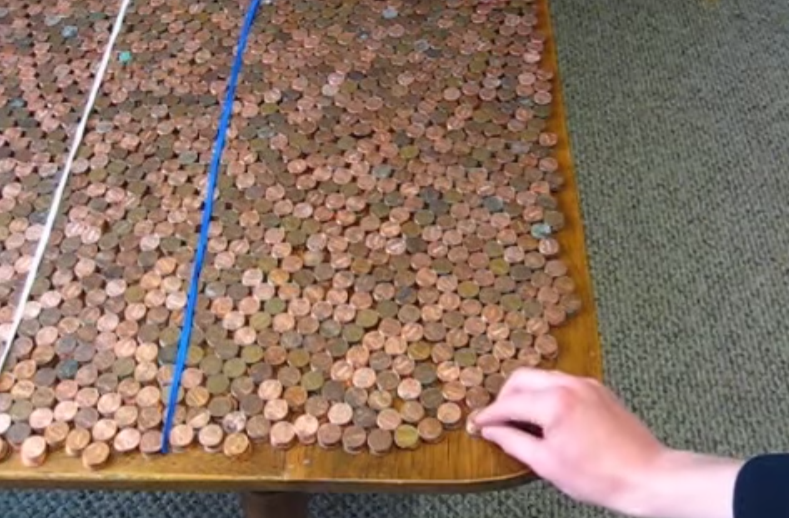
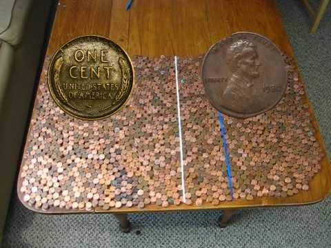
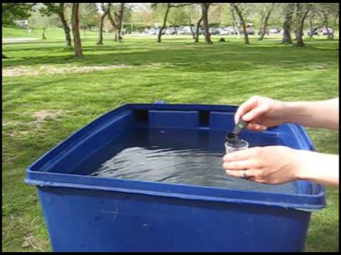
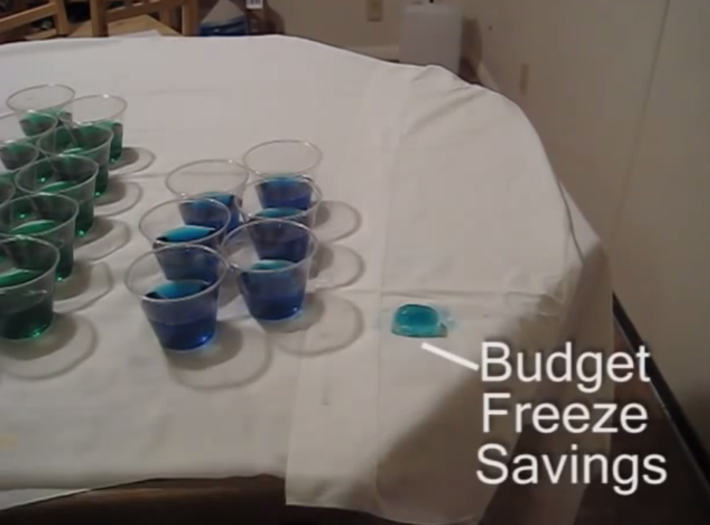

+++
author = "矢崎裕一"
title = "予算全体を8,880枚のペニーに縮め、1億ドルの削減を4分の1枚で示す──Matt Shapiro の予算動画"
slug = "pennies-federal-budget"
date = "2026-11-03"
description = "2009年、Matt Shapiro は米国の予算全体を8,880枚のペニー（1枚＝4億ドル）に縮め、1億ドルの歳出削減をペニー1枚の4分の1に当たるものとして示しました。"
categories = [
    "consume"
]
tags = [
    "データ物質化",
    "縮尺",
    "Matt Shapiro"
]
image = "images/pennies-on-table.png"
series = ["data-physicalization"]
series_weight = 16
seriesByline = "Matt Shapiro（Political Math）"
seriesTitle = "削減額をペニー4分の1枚に──Political Math の予算動画"
+++

2009年、Matt Shapiro（マット・シャピロ）は、米国の連邦予算全体を8,880枚のペニー（1枚＝4億ドル）に縮めました。そして、オバマ大統領が表明した1億ドルの歳出削減を、ペニー1枚の4分の1に当たるものとして示しました。動画の題は「Obama Budget Cuts Visualization」です。

この作品は、データ物理化の作品を集めた List of Physical Visualizations（dataphys.org）に「Federal Budget Explained with 10,000 Pennies」という見出しで載っています。この見出しは dataphys.org が付けたもので、「10,000」は投稿したチャンネル名「10000Pennies」から来ています。筆者は元の動画を視聴できていません。以下は、FactCheck.org が作者にメールで確かめた内容と、作者のブログ、同時期の報道に沿います。

<!--more-->

## 2009年4月、1億ドルの削減指示

FactCheck.org の Joe Miller によると、2009年4月20日、オバマ大統領は閣僚を集め、90日以内に合計1億ドルの経費を削るよう指示しました。

> On April 20, President Barack Obama caused a bit of a splash when he gathered members of his Cabinet and directed them to cut (collectively) $100 million in expenses within the next 90 days.

同じ記事は、この1億ドルを大局の中で見るのに役立つ動画として、Shapiro の作品を紹介しました。

作者の Shapiro は、当時28歳のソフトウェア開発者で、ソルトレイクシティに住んでいました（FactCheck.org）。地元局 KSL は Matthias Shapiro と表記し、近郊のホラデイ在住と伝えています。投稿先の YouTube チャンネル「10000Pennies」は、自己紹介で、政策を誰にでも分かる形で可視化すると書いています。のちに作者は「Political Math」の名でブログを始めます。ただしブログの最初の記事は2009年5月15日で、この動画より後です。本作の時点の作者は、ブロガーというより動画の投稿者でした。

YouTube 上の投稿日は確かめられていません。動画を埋め込んだ記事は4月28日（GovExec）から出ており、投稿はその前の数日と読めます。

Political Math（10000Pennies）／List of Physical Visualizations（dataphys.org）より引用

dataphys.org はこの画面を「Obama Budget Cuts Visualization」のものとして載せています。写っているのは、机の上に広げたペニーと、白と青の2本の線です。動画の中で硬貨をどう並べ替えたのか、線が何を区切っているのかは、文字資料では確かめられませんでした。

## 予算を8,880枚、削減を4分の1枚に

数の対応は、FactCheck.org が作者にメールで確かめています。

> Matt, whose YouTube channel is entitled 10000 pennies, told us by e-mail that he actually uses 8,880 pennies in his video. The math checks out. Each penny represents $400 million in government spending, so that works out to a budget of $3.552 trillion — pretty close to Obama's proposed 2010 budget. Obama's pledge amounts to cutting one-fourth of one of those pennies.

動画で使ったペニーは10,000枚ではなく8,880枚。1枚が4億ドルの政府支出を表し、全体は3.552兆ドルで、オバマ政権が提案した2010会計年度予算に近い。大統領の1億ドルは、そのペニー1枚の4分の1にあたる、という説明です。FactCheck.org は「計算は合っている」と書いています。

データと物の対応は次のとおりです。

| データ | 物理的な対応 | 値 |
|---|---|---|
| 連邦予算の総額 | ペニー硬貨の枚数（量） | 8,880枚 ＝ 3.552兆ドル |
| 換算の単位 | ペニー1枚 | 1枚 ＝ 4億ドル |
| 大統領が表明した削減額 | ペニー1枚の一部 | 1億ドル ＝ 1枚の4分の1 |
| 全体に対する削減の割合 | 8,880枚と、1枚の4分の1に当たるものの比 | 約0.0028%（筆者の計算） |

1億ドルを3.552兆ドルで割ると約0.0028%で、4分の1枚を8,880枚で割った値と同じです。

ここで、ペニーは1セントという本来の値では使われていません。**1枚が4億ドルを表す記号になっています。** 作者が置き換えたのは、1億ドルという金額の単位ではなく、全体に対する部分の比だった、と読めます。予算全体を一つの縮尺で縮め、同じ縮尺の上で削減額を示す。縮尺模型と同じ考え方だと読めます。

同じ時期、経済学者の Greg Mankiw（グレッグ・マンキュー）は、同じ比を別の形で説明しました。Christian Science Monitor によると、マンキューは削減を予算の0.003%とし、年10万ドルを使う家計なら3ドル、スタバのラテ1杯ほどだと書いています。マンキューは比を「家計の単位」に、Shapiro は「全体を硬貨の山にした縮尺」に置き換えた、と読めます。

この形の背景にある問題意識を、作者はメールでこう書いています。

> I know that we have a really hard time intuitively grasping scale when we're dealing with two numbers that are orders of magnitude away from each other.

桁がいくつも違う二つの数を扱うとき、規模の差を直感でつかむのはとても難しい、という問題意識です。FactCheck.org によると、作者はこの動画を、よくある棒グラフより「数字を少し新鮮に見る」方法として作りました。

10000Pennies（Political Math）／YouTube「Obama Budget Cuts Visualization」より引用

動画は YouTube で公開されています（https://www.youtube.com/watch?v=cWt8hTayupE ）。再生回数は、dataphys.org の記載で170万回です。

4分の1枚を、硬貨を切って見せたのか、図で示したのかは分かりません。dataphys.org は「動画はしばしば劇的な動作で終わる」とし、ペニーを二つに切る、テーブルから数百枚の硬貨をこぼす、などを挙げています。ただし、これはシリーズ全体の説明で、どの動作が本作のものかは書かれていません。

## 硬貨から水と氷へ、同じ手順を続ける

作者はその後、水と氷を使って、同じ手順の動画を作りました。dataphys.org は「硬貨だけでなく、紙幣、水、ウイスキーが金額や雇用の単位を表す」とウイスキーも挙げ、チャンネルにはレゴの動画もあります。ただし、この二つの中身は確かめられていません。

2009年5月13日には「Obama's $17 Billion Budget Cuts In Context」を公開しました。今度は170億ドルの削減案を、水の量で見せています。FactCheck.org の Brooks Jackson によると、削減額は2リットル分。動画は当初、オバマ予算とブッシュ予算（3.107兆ドル）の差を9ガロンとしていました。

10000Pennies（Political Math）／YouTube「Obama's $17 Billion Budget Cuts In Context」より引用

この9ガロンは誤りで、FactCheck.org が見つけました。正しくは約12ガロンです。作者は動画に訂正の文字を入れ、説明文で FactCheck.org に礼を書きました。同じ説明文で、作者は1億ドルの削減を「バケツの一滴にもならない」とも書いています。

2010年1月30日の「What Does The Federal Budget Freeze Look Like?」では、予算の凍結を水と氷で見せました。作者はブログ記事の前半を、動画に使ったデータの説明にあてています。予算を192オンスの水とし、4オンスのカップに分けたと考えれば、動画の計算はすべて合う、という説明です。初年度の節約150億ドルは0.75オンスの水を凍らせた氷で、大さじ1杯半で量りました。

Political Math（10000Pennies）／List of Physical Visualizations（dataphys.org）より引用

3本の動画の対応を並べると、次のようになります。

| 動画 | 全体 | 取り出した部分 |
|---|---|---|
| Obama Budget Cuts Visualization（2009年4月） | 予算3.552兆ドル ＝ ペニー8,880枚 | 1億ドルの削減 ＝ 4分の1枚 |
| Obama's $17 Billion Budget Cuts In Context（2009年5月） | 予算 ＝ 水の量 | 170億ドルの削減 ＝ 2リットル |
| What Does The Federal Budget Freeze Look Like?（2010年1月） | 予算3.7兆ドル ＝ 水192オンス | 節約150億ドル ＝ 氷0.75オンス |

3.7兆ドルを192オンスで割ると、1オンスは約193億ドルです。0.75オンスは約145億ドルで、150億ドルとほぼ合います。素材が替わっても、全体の量を先に決め、政策の金額をその一部として取り出す手順は変わっていない、と読めます。

ブログの最初期の記事「The National Debt Road Trip」（2009年5月15日）で、作者は、ごまかしたと言われる余地を残さないために数値をオバマに有利なほうへ倒した、と書いています。本作についての言葉ではありませんが、数の扱い方の手がかりになります。

## 第三者はこの動画をどう見たか

一つ目の論点は、数値の検証です。FactCheck.org は枚数と単価を作者に確かめ、計算は合っていると書きました。続編では誤りを見つけ、作者が直したことを確かめたうえで、こう評しています。

> Thanks to Matt's helpful images, you don't have to be an accountant to grasp the size of the budget problem.

Matt の分かりやすい映像のおかげで、会計士でなくても予算問題の大きさがつかめる、という評価です。最初の記事は、リベラルな経済学者 Paul Krugman（ポール・クルーグマン）も、1億ドルは小さいという同じ論点をブログで示したと紹介しています。

二つ目は、大きな数の分かりにくさへの答えです。The Atlantic の Megan McArdle（ミーガン・マカードル）は、2009年4月のブログで本作を紹介しました。

> Numbers a million times bigger than our total lifetime earnings literally boggle the imagination.

生涯収入の百万倍の数は、文字どおり想像が追いつかない、という一文です。マカードルは、その問題に取り組んだ「意欲的なビデオブロガー」として作者を紹介しました。GovExec の Alyssa Rosenberg も、この記事を引いて動画を埋め込み、「楽しく、ためになる動画」と書きました。

三つ目は、懐疑的な見方です。The Think Tankard の Adam Paul は、2009年5月4日、マカードルの記事にリンクしながら書きました。

> Video bloggers have taken to using piles of pennies to represent the budget ... The concern is great and if the goal is simply to inform people it's doing a good job. Yet any hopes that people might apply, or that that matter retain, their knowledge suffers from the same problems that "awareness" movements always have: how to turn knowledge into action.

ビデオブロガーたちはペニーの山で予算を表すようになった。知らせるのが目的なら役に立っている。だが、知識が残るか、行動につながるかは、啓発運動がいつも抱える問題と同じだ、という指摘です。

dataphys.org は作者を「統計と手作りの物理的な可視化で米国の政策を批判する（criticizes the US policy）」人として紹介しています。作者自身も続編の説明文で、1億ドルの削減を "weren't even a drop in a bucket" と書きました。KSL によると、2009年7月、共和党全国委員会の Michael Steele（マイケル・スティール）委員長が、作者に「Grassroots Logic Award」を贈っています。これらから、この動画には政権批判という党派的な目的もあった、と読めます。一方で、FactCheck.org の検証とクルーグマンの同じ論点を並べると、比の見せ方そのものは党派を超えて成り立つ、と読めます。

## 使い道

この動画から持ち帰れることの一つ目は、全体と部分を同じ縮尺に載せることです。1億ドルだけを見せても、大きいか小さいかは決まりません。全体を8,880枚という量として用意し、削減をその4分の1枚に当てる設計は、割合の分母を見える形にしておく方法と読めます。

二つ目は、単位の値を全体が収まる大きさから決めることです。1枚＝4億ドルという値は、予算全体が扱える量に収まるように選ばれた、と読めます。1枚を1億ドルにすれば削減は1枚で済みますが、全体は3万5千枚を超えます。全体と部分のどちらを扱いやすい量にしたいかで、単位は決まります。

三つ目は、換算の根拠を外から確かめられるようにしておくことです。FactCheck.org は枚数と単価を聞くだけで計算を確かめ、続編では誤りを見つけました。凍結の動画では、作者自身がブログで換算を公開しています。根拠を開いておけば、直すきっかけを外からもらえます。

最後に、限界も押さえておきます。Adam Paul が書いたように、規模が分かることと、行動が変わることは別です。この動画が答えたのは、桁の違う二つの数を一つの縮尺で比べるという問題でした。そこから先は、見る人と、議論の場に任されています。

## 参考・出典

**一次情報**

- List of Physical Visualizations（dataphys.org）, "2009 – Federal Budget Explained with 10,000 Pennies"（Pierre Dragicevic 登録）：https://dataphys.org/list/federal-budget-explained-with-10000-pennies/
- dataphys.org タグ一覧 storytelling：https://dataphys.org/list/tags/storytelling/ ／ budget：https://dataphys.org/list/tags/budget/
- 10000Pennies, "Obama Budget Cuts Visualization"（YouTube, 2009年4月）：https://www.youtube.com/watch?v=cWt8hTayupE （題と投稿者は oEmbed で確認：https://www.youtube.com/oembed?url=https://www.youtube.com/watch?v=cWt8hTayupE&format=json ）
- YouTube チャンネル 10000Pennies（動画一覧、チャンネル説明）：https://www.youtube.com/user/10000Pennies/videos
- 10000Pennies, "Obama's $17 Billion Budget Cuts In Context"（YouTube, 2009-05-13、説明文）：https://www.youtube.com/watch?v=miIBp7ufxjk
- 10000Pennies, "What Does The Federal Budget Freeze Look Like?"（YouTube, 2010-01-30）：https://www.youtube.com/watch?v=gMH9QZdjS2Y
- Political Math ブログ：https://www.politicalmathblog.com/
- Political Math, "What Does the Federal Budget Freeze Look Like?", 2010-01-31：https://www.politicalmathblog.com/2010/01/31/what-does-the-federal-budget-freeze-look-like/
- Political Math, "The National Debt Road Trip", 2009-05-15：https://www.politicalmathblog.com/2009/05/15/the-national-debt-road-trip/

**第三者評価**

- Joe Miller, "What's in a Number?", FactCheck.org, 2009-05-07：https://www.factcheck.org/2009/05/whats-in-a-number/
- Brooks Jackson, "Drop in the Bucket? See for Yourself.", FactCheck.org, 2009-05-15：https://www.factcheck.org/2009/05/drop-in-the-bucket-see-for-yourself/
- Megan McArdle, "Penny Wise, Pound Foolish", The Atlantic, 2009年4月（元の URL：http://meganmcardle.theatlantic.com/archives/2009/04/penny_wise_pound_foolish_1.php は現在開けない）。全文の転載：https://thinkingonthemargin.blogspot.com/2009_04_26_archive.html
- Alyssa Rosenberg, "What $100 Million Looks Like", GovExec, 2009-04-28：https://www.govexec.com/federal-news/2009/04/what-100-million-looks-like/38913/
- Adam Paul, "Learning Large Numbers", The Think Tankard, 2009-05-04：https://thinktankard.blogspot.com/2009/05/learning-large-numbers.html
- Andrew Adams, "Utahn's YouTube video catches RNC's attention", KSL, 2009-07-08：https://www.ksl.com/article/7084161
- Legal Insurrection, "Obama Budget Cuts Visualization", 2009-04-29：https://legalinsurrection.com/2009/04/obama-budget-cuts-visualization/
- "Obama's $100 million budget cut amounts to a cup of coffee", Christian Science Monitor, 2009-04-21（マンキューのたとえ。本作には触れていない）：https://www.csmonitor.com/USA/Politics/The-Vote/2009/0421/obamas-100-million-budget-cut-amounts-to-a-cup-of-coffee
