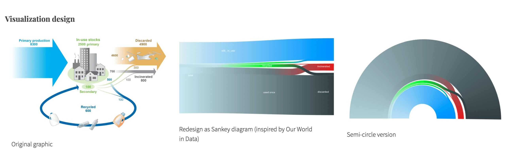
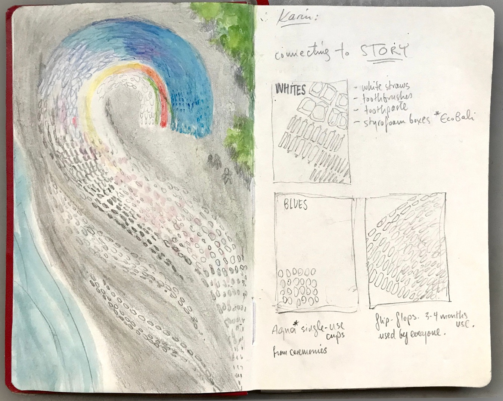
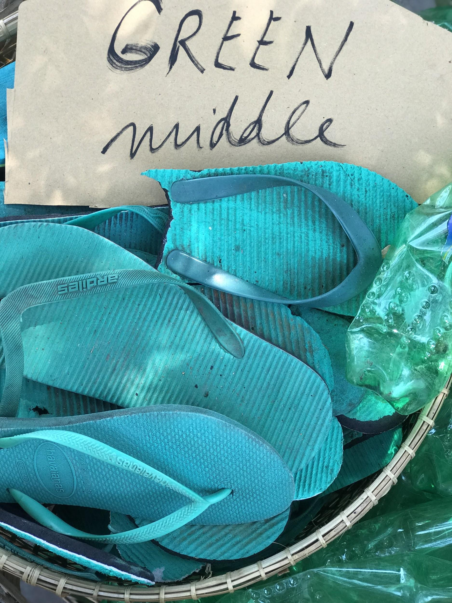
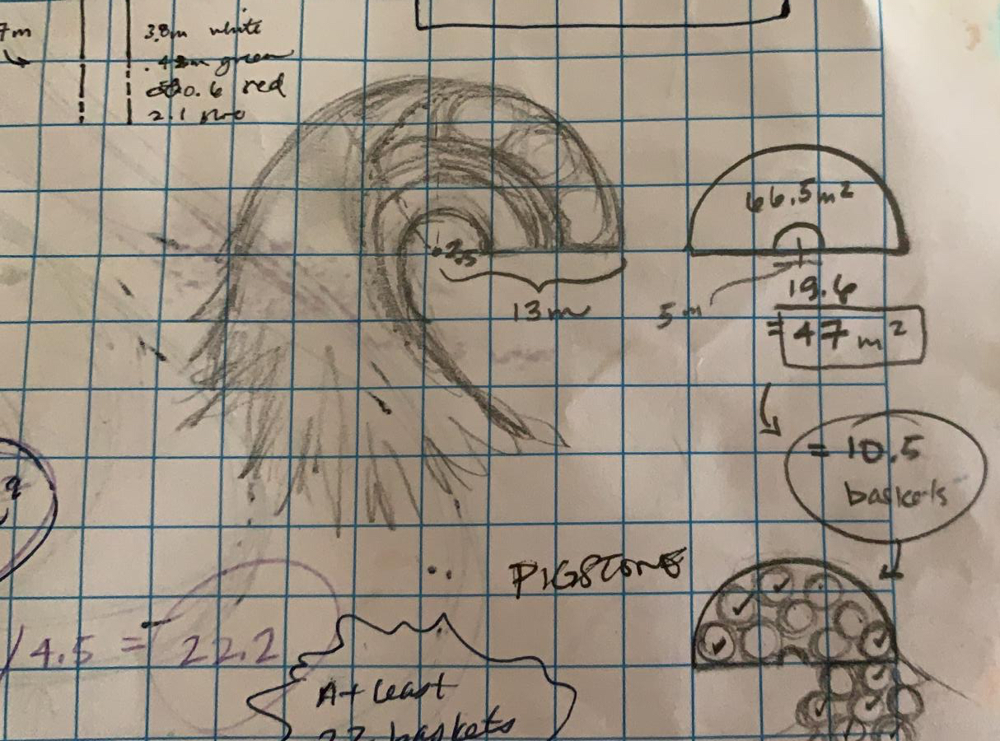
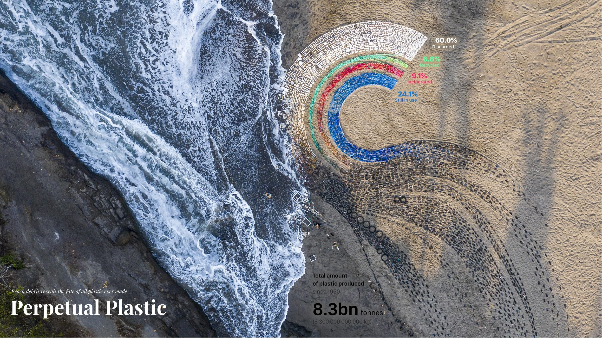

+++
author = "Yuichi Yazaki"
title = "Drawing the Same Flow in Three Forms, Then Laying It Out in Beach Trash: Perpetual Plastic"
slug = "perpetual-plastic"
date = "2026-11-01"
description = "A work that draws one flow, from a total quantity into four destinations, as a paper's flow diagram, a Sankey diagram and a semicircle, and finally lays it out in trash collected from a beach, chosen by color."
categories = [
    "consume"
]
tags = [
    "data physicalization",
    "Sankey diagram"
]
image = "images/cover.jpg"
series = ["data-physicalization"]
series_weight = 43
seriesByline = "Liina Klauss, Moritz Stefaner, and Skye Morét"
seriesTitle = "The Same Flow Laid Out in Beach Trash: Perpetual Plastic"
+++

*Perpetual Plastic* depicts the flow in which all the plastic ever made divides into four destinations: discarded, in use, incinerated and recycled. The creators show the same flow in three forms: the paper's flow diagram, a Sankey diagram and a semicircle. For the beach version, they collected trash by color rather than collecting all of it, and arranged it in bands. The author reads the color specification of the bands as being, at the same time, the instruction for which trash to pick up.

The work is a 14 m-diameter installation placed on a beach on Bali, Indonesia, in 2019. It was made by three people: Liina Klauss, Skye Morét and Moritz Stefaner. Below, I read it in the order of the figures, following the official site perpetual-plastic.net, the Truth & Beauty page by Stefaner, and the paper that is the source of the data.

<!--more-->

## It Starts from the Paper's Flow Diagram

The starting point is a 2017 paper by Geyer, Jambeck and Law in *Science Advances*. It estimates the fate of the plastic produced between 1950 and 2015. Its abstract reads as follows.

> We estimate that 8300 million metric tons (Mt) as of virgin plastics have been produced to date. As of 2015, approximately 6300 Mt of plastic waste had been generated, around 9% of which had been recycled, 12% was incinerated, and 79% was accumulated in landfills or the natural environment.

In short: the virgin plastic produced to date is 8,300 Mt (million metric tons). The waste generated by 2015 was about 6,300 Mt, of which 9% was recycled, 12% incinerated, and 79% accumulated in landfills or the natural environment.

Fig. 2 of the paper draws these destinations as a flow diagram with arrows and illustrations of buildings. It was drawn by the paper's authors, not by the creative team. The values are absolute quantities in million metric tons, and the text gives plastic in use as 2,500 Mt (30% of total production).

The four percentages shown in the work can be reproduced by calculation from the paper's figures. This is not the creators' explanation but something the author checked. Split the 6,300 Mt of waste into 9%, 12% and 79%, and take the 2,000 Mt left after subtracting 6,300 Mt from the total production of 8,300 Mt as "in use". Then divide everything by 8,300 Mt.

| Destination | Calculation | Amount (Mt) | Share of 8,300 Mt |
|---|---|---|---|
| Recycled | 6,300 × 0.09 | 567 | 6.8% |
| Incinerated | 6,300 × 0.12 | 756 | 9.1% |
| Discarded (landfill / environment) | 6,300 × 0.79 | 4,977 | 60.0% |
| In use | 8,300 − 6,300 | 2,000 | 24.1% |

**All four match the work's figures to one decimal place, and they sum to 8,300 Mt.** The match is with the work's figures, not with the paper's figure or with the text's "2,500 Mt (30%) in use". The paper's 8,300 Mt includes additives and there is secondary use of recycled material, so the items cannot simply be added and subtracted, which is probably the reason, but the creators give no explanation. It can be read that the work's four items have been recombined so that they total 100%.

## Redrawn as a Sankey Diagram, Bent into a Semicircle

In the "Visualization design" section of the official site, three figures appear in order: the paper's diagram, "Redesign as Sankey diagram (inspired by Our World in Data)", and "Semi-circle version".

Source: Truth & Beauty (Moritz Stefaner), "Perpetual Plastic". The left figure is based on Geyer, Jambeck & Law (2017) Fig. 2 (CC BY-NC 4.0)

The second is a [Sankey diagram](/en/sankey-diagram/). The illustrations of buildings and the arrows are gone, and quantity is expressed only by the thickness of the bands. The Truth & Beauty page states where the idea came from.

> The data platform "Our World in Data" created a reworked Sankey diagram, which served as inspiration for our semi-radial redesign.

The explanation is that a Sankey diagram reworked by Our World in Data served as the inspiration for the semi-radial redesign. The wording is "inspiration", and the intermediate Sankey diagram was redrawn by the team. The author has not been able to check either Our World in Data's diagram of that time or the figures in this Sankey diagram.

The third is the same flow bent into a semicircle. The thickest band, discarded (gray), is on the outside, the in-use band (blue) is on the inside, and thin green and red bands run between them. The Sankey diagram that stretched long from left to right has become an arc with a center. It can be read as moving closer to a form that people can lay out on a beach and look down on from above.

What the three share is the structure of the flow: a total divides into four destinations. The sources do not allow us to say that even the numbers are the same.

## Choosing by Color to Collect the Trash

On screen, the semicircle was painted in a gradient of gray, blue, green and red. In the beach version, the discarded band changes from gray to white. The official site describes how the trash was collected like this.

> instead of gathering all waste, the collection is focused on color, shifting perspective away from negative associations of waste to creative action.

Rather than picking up all the trash, they collect it by color. The explanation is that this shifts the perspective from the negative associations of waste to creative action. The discarded band turning white can be read as matching the colors of the trash that can be collected on the beach. Fifty volunteers collected trash from the west coast of Bali in three beach cleanups named "Make Art Not Waste".

The sketch made during production has the items to pick up written in by color, under the heading "connecting to STORY". WHITES are white straws, toothbrushes, toothpaste tubes and styrofoam boxes. BLUES are the single-use water cups "Aqua" handed out at ceremonies, and flip-flops. The flip-flops carry the note "3-4 months use. used by everyone."

Source: Perpetual Plastic team, from the Perpetual Plastic official site

In the sketch, items are listed under the names of colors. It can be read that the legend's colors function as a list of things to look for on the beach. The collected trash was sorted into baskets by color.

Source: Perpetual Plastic team, from the Perpetual Plastic official site

Based on the creators' explanation (an article Klauss posted to designboom) and the annotated photographs, the correspondence between data and material is summarized as follows.

| Data | Material / appearance | Value |
|---|---|---|
| Total production since 1950 | A band of mixed, dark-colored trash | 8.3bn tons |
| Discarded | White band (straws, styrofoam, etc.) | 60.0% |
| Recycled | Green band | 6.8% |
| Incinerated | Red band | 9.1% |
| In use | Blue band (flip-flops, water cups, etc.) | 24.1% |
| Amount for each destination | Band width (designboom explains it as "proportional to the numbers") | The shares above |
| Structure of the branching | A semicircle in which the band of the total arcs and divides into four | — |
| Source of the material | Trash picked up near the same beach | — |

The graph-paper sketch retains another calculation. What appear to be band widths read "3.8m white / .43m green / 0.6 red / 2.1 blue". The semicircle's area "66.5 m²" has the inside subtracted to give "47 m²", next to which are "10.5 baskets" and then "At least 22 baskets". Because it is handwritten, the reading is uncertain.

Source: Perpetual Plastic team, from the Perpetual Plastic official site

It can be read that they converted area into a number of baskets to estimate the amount of trash to collect. Note that the ratio of the written widths is close to the displayed shares but does not match them, and the exact method of proportion cannot be confirmed.

## Laying It Out on the Beach, Racing the Waves

The finished work has a diameter of 14 m and consists of 4,760 pieces of plastic trash. Laying it out took more than 12 hours. The official site tells the story up to the moment the aerial photograph was taken.

> Half into being finished, another wave washed over our ordered chaos. Again! … After the 4th attempt we had finally finished. … When a minute later our drone photographer came running towards us: I got it! I got the shot!

Halfway through, another wave destroyed it. On the fourth attempt it was finished, and a minute later the drone photographer came running to say they had got the shot.

Source: Liina Klauss, Skye Morét, Moritz Stefaner, from the Perpetual Plastic official site

The left side of the photograph is the sea, with waves coming in. The work stayed on the beach for only 36 hours and was dismantled within 6 hours (designboom).

The official site also says where the dismantled materials went. The flip-flops were to be used in the next work or recycled in partnership with Indosole. Other recyclable materials were handed to EcoBali. What could not be recycled, such as fishing nets and toothbrushes, went to landfill. It can be read that the work's own material also split into destinations: continued use, recycling and landfill.

The work won in the Ocean Plastic Innovation Challenge by National Geographic and Sky Ocean Ventures. The official site writes "First prize", and Truth & Beauty writes "won Gold". The category and rank come from the creators' side, and the author has not confirmed them against the organizers' records.

## How Third Parties Saw the Work

The researcher Dietmar Offenhuber takes up this work at the start of his paper on the physicality of data, "What we talk about when we talk about data physicality". He first writes that applying a measure of efficiency leads to a misreading.

> From the conventional logic of visualization, it is not a very efficient display: it uses a lot of material and space to express a handful of numbers, the ratios of the waste stream. But applying such a metric would lead to a complete misreading of the project

By the conventional logic of visualization, it is an inefficient display: it uses a lot of material and space to express a handful of numbers. But applying that measure would lead to a complete misreading of the work, he points out.

> The physicalization does not just represent data; it is data.

The physicalization does not merely represent data; it is data. Offenhuber also writes that the Sankey diagram on the beach works mainly as an icon. His reading is that the five numbers are a container, and the content is the specimens of material and the relations generated by the act of making. As examples he cites the degree of wear on the flip-flops and the number of sunscreen containers.

Jenn Schilling, in her review of *Making with Data*, names this work her favorite from the environment chapter and quotes the creators' reflection (p.330).

> We deliberately chose to create a "data visceralization" from physical, known objects—not only because they were colorful and relatable, but also because they allowed us to encode data variables into a tangible, situated form, at human scale

They chose familiar objects not only because they were colorful and relatable, but because it let them encode data variables into a form that is tangible, situated and at human scale. Schilling comments that a physical representation is larger than a digital one and takes a form that can be touched.

Lisa Wright of Dornob writes that what troubles her most is the black band representing the total since 1950. Note that the designboom article, which describes the encoding most concretely, is a post by the creators.

## Takeaways

What we can take away from this work is to keep the order in which the form was changed. The paper's diagram, the Sankey diagram and the semicircle line up the structure of the same flow in three forms. Shown side by side, others can trace where and what was decided.

Next is to recalculate the shares from the original data. By the author's calculation, the work's four numbers can be reproduced from the paper's abstract, and they also turn out to differ from the paper's "30% in use". A physical work is hard to fix once laid out, so it is worth confirming the source of the numbers beforehand.

Third is the relationship between color and material. The creators collected trash by color, and the discarded band, gray on screen, became white on the beach. The color was decided by the materials available, and the legend's color became the instruction "pick up white straws and styrofoam". It can be read that in physicalization, a color specification can also serve as a specification for the people who make it.

Finally, the fewer the numbers in a figure, the more room the material has to speak. The official site writes that on Bali, sealed water cups are handed out free and hundreds are left in the environment at a single event. Such circumstances do not appear in the width of a band. There is also a design that minimizes what is said with numbers and leaves the rest to the material and the place.

## References

**Primary sources**

- Liina Klauss, Skye Morét, Moritz Stefaner, *Perpetual Plastic*, 2019. Official site: https://perpetual-plastic.net/
- Truth & Beauty, "Perpetual Plastic": https://truth-and-beauty.net/projects/perpetual-plastic (Markdown version: https://truth-and-beauty.net/projects/perpetual-plastic.md )
- Truth & Beauty award article (National Geographic Ocean Plastic Innovation Challenge): https://truth-and-beauty.net/appearances/awards/national-geographic-ocean-plastic-innovation-challenge.md
- National Geographic, Ocean Plastic Innovation Challenge winners page (body text not checked): https://www.nationalgeographic.org/funding-opportunities/innovation-challenges/plastic/winners/#datawinner
- dataphys.org, "Perpetual Plastic" (registered by Petra Isenberg): https://dataphys.org/list/perpetual-plastic/
- designboom (an article posted by Liina Klauss, 2021-08-09): https://www.designboom.com/art/perpetual-plastic-data-sculpture-4760-pieces-of-trash-08-09-2021/
- Geyer, R., Jambeck, J. R., Law, K. L. (2017). Production, use, and fate of all plastics ever made. *Science Advances* 3(7): e1700782. doi:10.1126/sciadv.1700782 / https://advances.sciencemag.org/content/3/7/e1700782 / https://pmc.ncbi.nlm.nih.gov/articles/PMC5517107/
- Our World in Data, "Plastic Pollution" (linked by the creators; the Sankey diagram of that time not checked): https://ourworldindata.org/plastic-pollution#global-plastic-production-to-fate
- Moritz Stefaner, "Perpetual Plastic" (YouTube): https://www.youtube.com/watch?v=ua9fvPZB68M

**Secondary sources**

- Dietmar Offenhuber, "What we talk about when we talk about data physicality," arXiv:2006.04631, 2020 (for IEEE Computer Graphics & Applications): https://arxiv.org/abs/2006.04631
- Jenn Schilling, "Review: Making With Data…", *Nightingale*, 2023-03-29: https://nightingaledvs.com/book-review-making-with-data/
- Lisa Wright, "Bali's 'Perpetual Plastic' Sculpture is (Literally) Trash," *Dornob*, 2021-08-27: https://dornob.com/balis-perpetual-plastic-sculpture-is-literally-trash/
