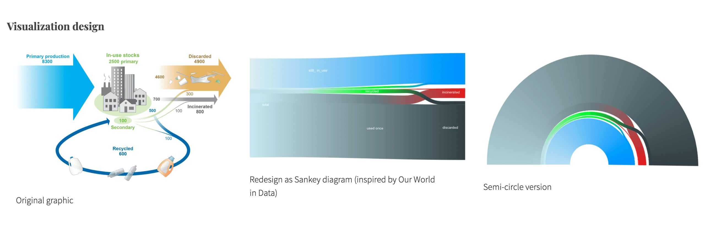
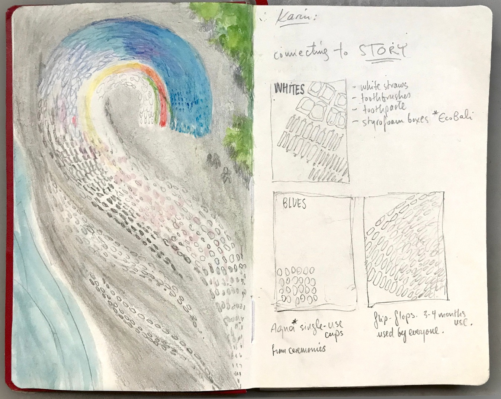
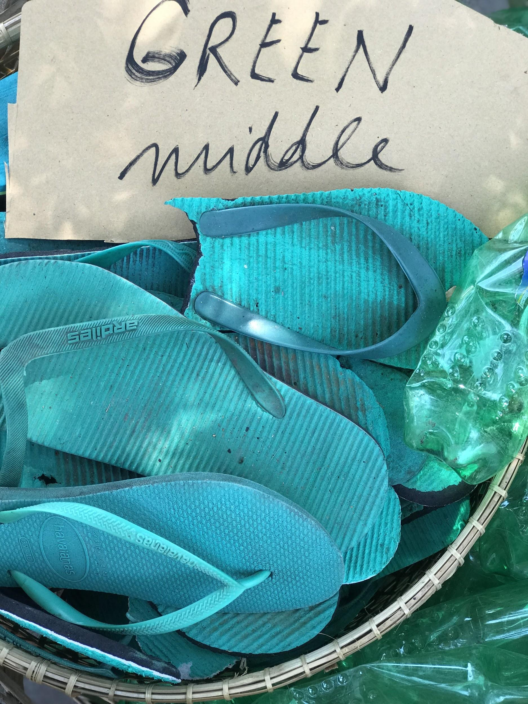
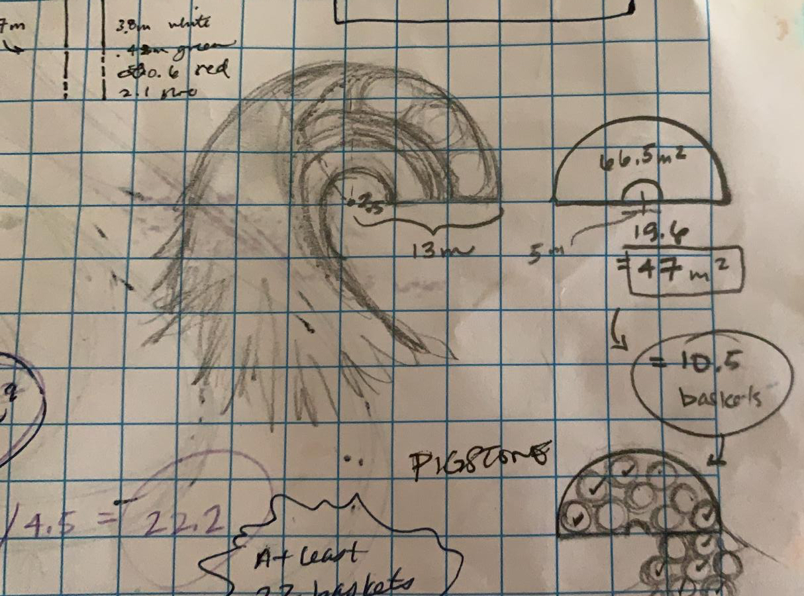
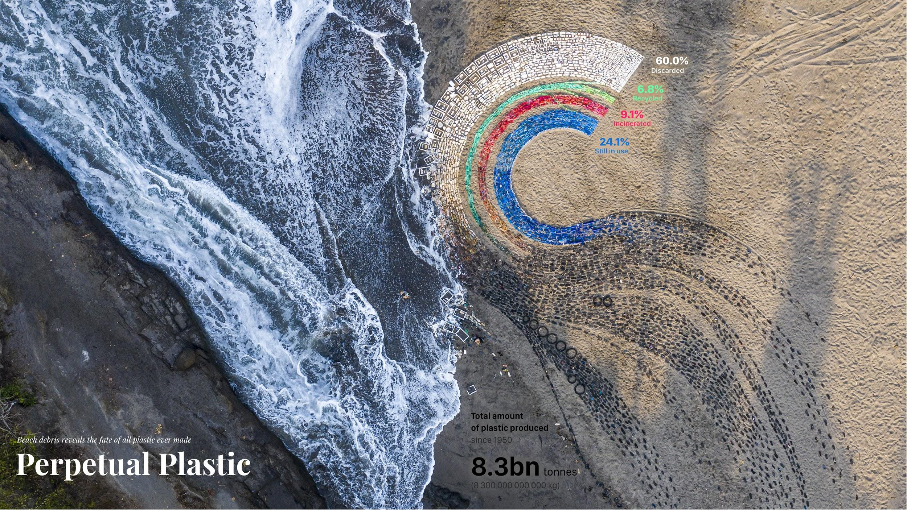

+++
author = "矢崎裕一"
title = "同じ流れを3つの形で描き、最後は浜のごみで並べる──『Perpetual Plastic』"
slug = "perpetual-plastic"
date = "2026-11-01"
description = "総量から4つの行方へ分かれる同じ流れを、論文の流れの図、サンキー図、半円と3つの形で描き、最後は色で選んで集めた浜のごみで並べた作品です。"
categories = [
    "consume"
]
tags = [
    "データ物理化",
    "サンキー・ダイアグラム"
]
image = "images/cover.jpg"
series = ["data-physicalization"]
series_weight = 9
seriesByline = "Liina Klauss・Moritz Stefaner・Skye Morét"
seriesTitle = "同じ流れを浜のごみで並べる──Perpetual Plastic"
+++

『Perpetual Plastic』は、これまでに作られたプラスチックの総量が、廃棄・使用中・焼却・リサイクルの4つの行方へ分かれる流れを描いた作品です。制作者は同じ流れを、論文の流れの図、サンキー図、半円の3つの形で並べて見せています。浜の作品では、ごみを全部ではなく色を基準に集め、帯に並べました。帯の色の指定が、そのまま拾うごみの指示になっている、と筆者は読みます。

作品は2019年、インドネシア・バリ島の浜に置かれた、直径14mのインスタレーションです。制作は Liina Klauss（リーナ・クラウス）、Skye Morét（スカイ・モレ）、Moritz Stefaner（モーリッツ・ステファナー）の3人です。以下は、公式サイト perpetual-plastic.net と Stefaner の Truth & Beauty のページ、データの出どころである論文に沿い、図の順に読みます。

<!--more-->

## 論文の流れの図から始まる

出発点は、Geyer（ガイヤー）、Jambeck、Law が2017年に *Science Advances* に載せた論文です。1950〜2015年に作られたプラスチックの行方を推計しています。要旨は次のとおりです。

> We estimate that 8300 million metric tons (Mt) as of virgin plastics have been produced to date. As of 2015, approximately 6300 Mt of plastic waste had been generated, around 9% of which had been recycled, 12% was incinerated, and 79% was accumulated in landfills or the natural environment.

これまでに作られた新しいプラスチックは8,300 Mt（百万トン）。2015年までに出た廃棄物は約6,300 Mt で、9%がリサイクル、12%が焼却、79%が埋め立てか自然環境に溜まった、という要旨です。

論文の Fig. 2 は、この行方を、矢印と建物のイラストで描いた流れの図です。描いたのは論文の著者で、制作チームではありません。数値は百万トン単位の絶対量で、本文は使用中を2,500 Mt（生産総量の30%）としています。

作品に書かれた4つの割合は、この論文の数値から計算で再現できます。これは制作者の説明ではなく、筆者が確かめたことです。廃棄物6,300 Mt を9%・12%・79%に分け、生産総量8,300 Mt から6,300 Mt を引いた2,000 Mt を「使用中」とします。そのうえで、全部を8,300 Mt で割ります。

| 行方 | 計算 | 量（Mt） | 8,300 Mt に対する割合 |
|---|---|---|---|
| リサイクル | 6,300 × 0.09 | 567 | 6.8% |
| 焼却 | 6,300 × 0.12 | 756 | 9.1% |
| 廃棄（埋め立て・環境中） | 6,300 × 0.79 | 4,977 | 60.0% |
| 使用中 | 8,300 − 6,300 | 2,000 | 24.1% |

**4つとも、作品の表示と小数第1位まで一致し、合計は8,300 Mt になります。** 一致するのは作品の表示とであって、論文の図や本文の「使用中2,500 Mt（30%）」とは合いません。論文の8,300 Mt には添加剤が含まれ、リサイクル材の二次利用もあるので、項目を単純に足し引きできないためと考えられますが、制作者の説明はありません。作品の4項目は、合計が100%になるように組み直されている、と読めます。

## サンキー図に描き直し、半円に曲げる

公式サイトの "Visualization design" の欄には、3枚の図が順に並んでいます。論文の図、"Redesign as Sankey diagram (inspired by Our World in Data)"、"Semi-circle version" です。

Truth & Beauty（Moritz Stefaner）／Truth & Beauty「Perpetual Plastic」より引用。左の図の元は Geyer, Jambeck & Law (2017) Fig. 2（CC BY-NC 4.0）

2枚目は、[サンキー・ダイアグラム](/sankey-diagram/)です。建物のイラストと矢印が消え、量は帯の太さだけで表されます。Truth & Beauty のページは、着想の出どころを書いています。

> The data platform "Our World in Data" created a reworked Sankey diagram, which served as inspiration for our semi-radial redesign.

Our World in Data が作り直したサンキー図が、半円・放射状への再設計の着想源になった、という説明です。言い方は "inspiration" で、途中のサンキー図はチームが描き直したものです。Our World in Data の当時の図も、このサンキー図の数値も、筆者は確かめられていません。

3枚目は、同じ流れを半円に曲げた図です。外側にいちばん太い廃棄の帯（グレー）、内側に使用中の帯（青）、そのあいだに緑と赤の細い帯が通ります。左右に長く伸びていたサンキー図が、中心のある弧になりました。人が浜に並べて、上から見下ろせる形に近づいた、と読めます。

3枚に共通するのは、総量が4つの行方へ分かれるという流れの構造です。数値まで同じだとは、資料からは言えません。

## 色で選んで、ごみを集める

画面の半円は、グレー、青、緑、赤のグラデーションで塗られていました。浜の作品では、廃棄の帯がグレーから白に変わっています。公式サイトは、ごみの集め方をこう書いています。

> instead of gathering all waste, the collection is focused on color, shifting perspective away from negative associations of waste to creative action.

ごみを全部拾うのではなく、色を基準に集める。ごみの否定的な印象から、創造的な行動へ視点を移すためだ、という説明です。廃棄の帯が白になったのは、浜で集められるごみの色に合わせたため、と読めます。ボランティア50人が、"Make Art Not Waste" と名づけた3回のビーチクリーンアップで、バリ島の西海岸からごみを集めました。

制作中のスケッチには、色ごとに拾う品目が書き込まれています。見出しは "connecting to STORY" です。WHITES は白いストロー、歯ブラシ、歯磨き粉のチューブ、発泡スチロールの箱。BLUES は、儀式で配られる使い捨ての水カップ "Aqua" と、ビーチサンダルです。サンダルには "3-4 months use. used by everyone." と添えてあります。

Perpetual Plastic チーム／Perpetual Plastic 公式サイトより引用

スケッチでは、色の名前の下に品目が並んでいます。凡例の色が、浜で探す物のリストとして働いている、と読めます。集めたごみは、色ごとの籠に仕分けられました。

Perpetual Plastic チーム／Perpetual Plastic 公式サイトより引用

制作者の説明（designboom に Klauss が投稿した記事）と注釈付きの写真から、データと素材の対応をまとめると、次のようになります。

| データ | 素材・見た目 | 値 |
|---|---|---|
| 1950年以降の生産総量 | 暗色の混ざったごみの帯 | 8.3bn トン |
| 廃棄 | 白の帯（ストロー、発泡スチロールなど） | 60.0% |
| リサイクル | 緑の帯 | 6.8% |
| 焼却 | 赤の帯 | 9.1% |
| 使用中 | 青の帯（サンダル、水カップなど） | 24.1% |
| 各行方の量 | 帯の幅（designboom は「数値に比例」と説明） | 上の割合 |
| 分岐の構造 | 総量の帯が弧を描き、4本に分かれる半円 | — |
| 素材の出どころ | 同じ浜の近くで拾ったごみ | — |

方眼紙のスケッチには、別の計算が残っています。帯の幅らしき "3.8m white / .43m green / 0.6 red / 2.1 blue"。半円の面積 "66.5 m²" から内側を引いて "47 m²"、その横に "10.5 baskets"、さらに "At least 22 baskets"。手書きなので、読み取りには不確かさがあります。

Perpetual Plastic チーム／Perpetual Plastic 公式サイトより引用

面積を籠の数に換算して、集めるごみの量を見積もっていた、と読めます。なお、書き込みの幅の比は、表示した割合と近いものの一致はせず、厳密な比例の方法は確かめられません。

## 浜で、波と競って並べる

完成した作品は直径14m、プラスチックごみ4,760個です。並べるのに12時間以上かかりました。公式サイトには、空撮の写真が撮れるまでの話が載っています。

> Half into being finished, another wave washed over our ordered chaos. Again! … After the 4th attempt we had finally finished. … When a minute later our drone photographer came running towards us: I got it! I got the shot!

半分できたところで、また波が崩した。4回目で完成し、1分後にドローンの撮影者が「撮れた」と走ってきた、という話です。

Liina Klauss・Skye Morét・Moritz Stefaner／Perpetual Plastic 公式サイトより引用

写真の左側は、波の寄せる海です。作品は浜に36時間だけ置かれ、6時間以内に解体されました（designboom）。

解体した素材の行き先も、公式サイトに書かれています。ビーチサンダルは次の作品に使うか、Indosole と組んでリサイクルする。ほかのリサイクルできる素材は EcoBali に渡す。漁網や歯ブラシなど、リサイクルできないものは埋め立てに回りました。作品の素材そのものも、使い続ける、リサイクル、埋め立てと、行方が分かれていったと読めます。

作品は National Geographic と Sky Ocean Ventures の Ocean Plastic Innovation Challenge で受賞しました。公式サイトは "First prize"、Truth & Beauty は "won Gold" と書いています。部門と順位は制作者側の記載によるもので、主催者側の記録では確かめていません。

## 第三者はこの作品をどう見たか

研究者の Dietmar Offenhuber（ディートマー・オッフェンフーバー）は、データの物理性を論じた論文 "What we talk about when we talk about data physicality" の冒頭で、この作品を取り上げています。まず、効率の物差しを当てると読み違える、と書きます。

> From the conventional logic of visualization, it is not a very efficient display: it uses a lot of material and space to express a handful of numbers, the ratios of the waste stream. But applying such a metric would lead to a complete misreading of the project

従来の可視化の論理では効率の悪い表示だ。わずかな数を表すのに、大量の素材と空間を使う。だが、その物差しを当てれば作品を完全に読み違える、という指摘です。

> The physicalization does not just represent data; it is data.

物理化はデータを表すだけでなく、それ自体がデータだ、という一文です。Offenhuber は、浜のサンキー図はおもにアイコンとして働くとも書きます。5つの数は器で、中身は素材の標本と、作る行為で生まれた関係だ、という読みです。例に、サンダルの劣化の度合いや、日焼け止めの容器の数を挙げています。

Jenn Schilling（ジェン・シリング）は、*Making with Data* の書評で、環境の章からこの作品をいちばん好きな作品に挙げ、制作者の振り返り（p.330）を引きました。

> We deliberately chose to create a "data visceralization" from physical, known objects—not only because they were colorful and relatable, but also because they allowed us to encode data variables into a tangible, situated form, at human scale

身近な物を素材に選んだのは、色があって親しみやすいからだけではない。データの変数を、触れられて、その場に根ざし、人の身体の大きさの形に符号化できたからだ、という言葉です。Schilling は、物理的な表現はデジタルより大きく、触れられる形になると評しています。

Dornob の Lisa Wright は、いちばん気がかりなのは1950年以降の総量を表す黒い帯だと書いています。なお、エンコーディングを最も具体的に書いた designboom の記事は、制作者側の投稿です。

## 使い道

この作品から持ち帰れるのは、形を変えた順番を残しておくことです。論文の図、サンキー図、半円と、同じ流れの構造を3つの形で並べています。並べて見せれば、どこで何を判断したかを、ほかの人がたどれます。

次に、割合を元のデータから計算し直すことです。筆者の計算では、作品の4つの数は論文の要旨から再現でき、論文の「使用中30%」とはずれることも分かりました。物理的な作品は並べると直しにくいので、数の出どころは先に確かめておく価値があります。

三つ目は、色と素材の関係です。制作者は色を基準にごみを集め、画面ではグレーだった廃棄の帯は、浜では白になりました。色が手に入る素材から決まり、凡例の色が「白いストローと発泡スチロールを拾う」という指示になった、と読めます。物理化では、色の指定が作る人への仕様書にもなりうる、ということです。

最後に、数が少ない図ほど、素材が語る余地が大きいことです。公式サイトは、バリ島では封をした水カップが無料で配られ、1回のイベントで何百個も環境に残されると書いています。そうした事情は、帯の幅には表れません。数で言うことを最小にして、残りを素材と場所に任せる設計もある、と読めます。

## 参考・出典

**一次情報**

- Liina Klauss, Skye Morét, Moritz Stefaner, *Perpetual Plastic*, 2019. 公式サイト：https://perpetual-plastic.net/
- Truth & Beauty, "Perpetual Plastic"：https://truth-and-beauty.net/projects/perpetual-plastic （Markdown 版：https://truth-and-beauty.net/projects/perpetual-plastic.md ）
- Truth & Beauty の受賞記事（National Geographic Ocean Plastic Innovation Challenge）：https://truth-and-beauty.net/appearances/awards/national-geographic-ocean-plastic-innovation-challenge.md
- National Geographic, Ocean Plastic Innovation Challenge 受賞者ページ（本文は未確認）：https://www.nationalgeographic.org/funding-opportunities/innovation-challenges/plastic/winners/#datawinner
- dataphys.org, "Perpetual Plastic"（Petra Isenberg 登録）：https://dataphys.org/list/perpetual-plastic/
- designboom（Liina Klauss が投稿した記事、2021-08-09）：https://www.designboom.com/art/perpetual-plastic-data-sculpture-4760-pieces-of-trash-08-09-2021/
- Geyer, R., Jambeck, J. R., Law, K. L. (2017). Production, use, and fate of all plastics ever made. *Science Advances* 3(7): e1700782. doi:10.1126/sciadv.1700782 ／ https://advances.sciencemag.org/content/3/7/e1700782 ／ https://pmc.ncbi.nlm.nih.gov/articles/PMC5517107/
- Our World in Data, "Plastic Pollution"（制作者がリンクした先。当時のサンキー図は未確認）：https://ourworldindata.org/plastic-pollution#global-plastic-production-to-fate
- Moritz Stefaner, "Perpetual Plastic"（YouTube）：https://www.youtube.com/watch?v=ua9fvPZB68M

**第三者評価**

- Dietmar Offenhuber, "What we talk about when we talk about data physicality," arXiv:2006.04631, 2020（IEEE Computer Graphics & Applications 向け）：https://arxiv.org/abs/2006.04631
- Jenn Schilling, "Review: Making With Data…", *Nightingale*, 2023-03-29：https://nightingaledvs.com/book-review-making-with-data/
- Lisa Wright, "Bali's 'Perpetual Plastic' Sculpture is (Literally) Trash," *Dornob*, 2021-08-27：https://dornob.com/balis-perpetual-plastic-sculpture-is-literally-trash/
