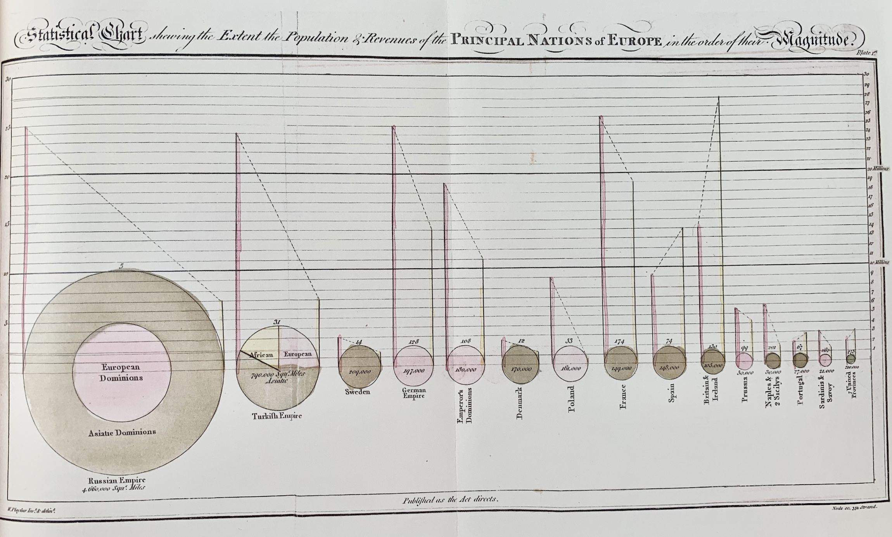
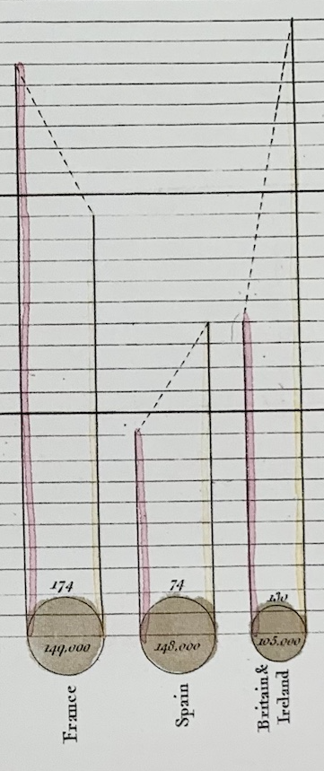
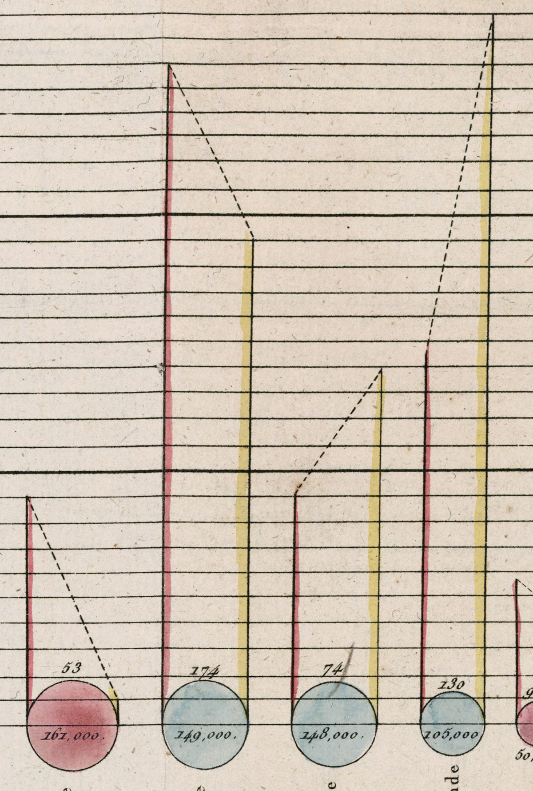

+++
author = "Yuichi Yazaki"
title = "A Country's Extent as the Area of a Circle, the Weight of Its Tax as the Direction of a Dotted Line: Playfair's The Statistical Breviary, Chart 1"
slug = "pie-chart-william-playfair-area"
date = "2025-10-12"
description = "In Chart 1 of the 1801 Breviary, Playfair drew each country's extent as the area of a circle, with population and revenue as vertical lines on one shared scale. His text says that which way a dotted line rises shows whether taxes are heavy relative to population."
categories = [
    "consume"
]
tags = [
    "William Playfair",
    "The Statistical Breviary",
    "proportional circles",
    "circle area chart",
    "encoding",
    "history of statistical graphics"
]
image = "images/cover.png"
series = ["dataviz-classics"]
series_weight = 1
seriesByline = "William Playfair"
seriesTitle = "Extent as Circles, Taxes as Dotted Lines: Playfair's Breviary"
+++

In 1801, in Chart 1 of *The Statistical Breviary*, William Playfair (1759–1823) drew the extent of the countries of Europe as the area of circles. Population and revenue are shown by vertical lines standing on either side of each circle, measured on the same scale. The tops of the two vertical lines are joined by a dotted line. In his text, Playfair writes that which way the dotted line rises shows whether taxes are heavy in proportion to population.

The sources are the book's preface, pp.13–16, where he explains how to read the chart, and the country-by-country tables. I read the text in the Bodleian Library copy on the Internet Archive. Because the foldout plates were not captured correctly in that scan, I show the chart from the 1802 French translation. How the circles are divided is covered in [an article comparing the two circles of 1801 and 1805](/en/pie-chart-william-playfair/), and the 1805 chart is covered in [an article on the 1805 United States pie chart](/en/pie-chart-william-playfair-part/).

<!--more-->

The whole plate, original drawing by William Playfair, engraved by Adam (French translation, 1802). Source: David Rumsey Map Collection, David Rumsey Map Center, Stanford Libraries / Internet Archive (CC BY-NC-SA 3.0)

## Four Charts Born from the Supplement to a Table

According to the preface, it began with helping with someone else's book. The editor of the English edition of Boetticher's statistical tables asked him for a table supplying the changes since publication. Partway through that work, he writes, he realized the following (preface p.3).

> it occurred to me, that tables are by no means a good form for conveying such information

In short: tables are not at all a good form for conveying this kind of information. On p.4 he says that when proportion and magnitude are at issue, appealing to the eye is the best and quickest way.

The book appeared in London in 1801. According to Chris Pritchard, it runs to 64 pages, most of them tables by country, with four plates. The contents of the four are listed on p.14.

1. Chart 1: Europe before the French Revolution
2. Chart 2: Europe as projected by the peace of Lunéville
3. Chart 3: The populations of the capitals of Europe
4. Chart 4: The countries of Hindustan

The original wording for Chart 1 is "Exhibits the powers of Europe as they were previous to the French Revolution." What is drawn is **Europe before the Revolution, not Europe as of 1801**. 1801 was the middle of the French Revolutionary Wars, and Chart 2 draws the picture after the Treaty of Lunéville in February (Pritchard 2021).

Charts built from lines were not new for Playfair. On p.15 he writes that about fifteen years earlier he had applied lines to commerce and finance; this refers to *The Commercial and Political Atlas*. *The Statistical Breviary* came out in Paris the following year, 1802, in a French translation by D.-F. Donnant, and the plates were re-engraved with French text.

## The Reading Instructions Are in Two Pages of the Text

Chart 1 has no legend. How to read it is set out in the text, pp.13–14. The key passage about the vertical lines is this.

> The yellow lines on the right of each nation represent the revenue in millions of pounds sterling, measured also upon the same divided scale with the population.

The yellow line on the right represents revenue in millions of pounds, measured on the same scale as population. Just before this he writes that the red line on the left represents population in millions, and that the scale, one division per million, is numbered "at both ends."

**Population and revenue are measured on one and the same scale.** The numbers appear at the left and right edges of the chart so that either can be read from both sides. It is not a dual axis, with the left for population and the right for revenue.

Turning the text's explanation into a table of data and appearance gives the following. The example is France (before the Revolution), with figures from the table on p.33.

| Data | Appearance | Example: France |
|---|---|---|
| Extent of the country (square miles) | Size of the circle; arranged from left in descending order of size | Circle |
| The extent figure | Number inside the circle | 149,000 |
| Population (millions) | Height of the red vertical line to the left of the circle | 26 |
| Revenue (millions of pounds) | Height of the yellow vertical line to the right of the circle, on the same scale as population | 19 |
| Weight of tax relative to population | Which way the dotted line joining the tops of the two vertical lines rises | Falls to the right |
| Population density (people per square mile) | Number directly above the circle | 174 |
| Maritime or land power | Color of the circle; green for maritime powers, pale red for land powers | — |

The number above each circle is population density, not revenue. The text itself gives examples: "5 over Russia, and 14 over Sweden." If you read France's 174 as revenue, it is wildly at odds with the table's £19 million.

In the French translation's plate, the circles are colored blue and red. France, Spain, Britain and others are blue; Poland, Prussia and others are red. The maritime powers that the English text calls "green" can be read as having become blue in the French translation.

Only the circles for Russia and Turkey are divided inside. In Russia the inner circle is European territory and the outer ring is Asian territory; Turkey is split into sectors by continent. The text does not explain this division. Here the colors stand for continents rather than maritime or land power. It can be read as the colors carrying two different meanings within a single chart.

## Making Countries' Shapes into the Same Circle

Why draw countries as circles? Playfair gives his reason on p.15.

> for where forms are not similar, the eye cannot compare them easily nor accurately. From this circumstance it happens, that we have a more accurate idea of the sizes of the planets, which are spheres, than of the nations of Europe which we see on the maps

Where forms are not similar, the eye cannot compare them easily or accurately; so we have a more accurate idea of the sizes of the planets, which are spheres, than of the nations of Europe that we see on maps. In the preface, p.6, he also writes that when the eye sees similar forms it cannot help comparing their sizes.

On how the size of a circle is determined, the text does not say "proportional to area." The preface's phrase is "proportional circles." I measured the plate of the French translation (the image above, 2000px wide): Russia's circle has a diameter of about 410px and France's about 68px. Taking France's diameter as 1, area-proportional circles would give Russia about 5.6, and diameter-proportional circles about 31. The measured ratio is about 6, so the diameter is roughly proportional to the square root of the extent. Even allowing for measurement error, this is a value consistent with area proportionality.

The circles are arranged from left to right in order of size. On p.7 Playfair writes that on seeing this chart one will be struck by the size of Russia and Turkey. He continues that one will also be struck by the smallness of the nations that have moved the world these five hundred years.

He also decides what not to draw. On p.15 he writes that he combined extent, population, and revenue in one chart because they are the foundation of a power that can be accurately measured. He goes on to say that the form of government and the virtue of individuals also affect a nation's strength, but cannot be shown in a chart.

## The Direction of the Dotted Line Divides at "One Pound per Person"

The explanation of the dotted line spans p.13 to p.14.

> The dotted lines drawn between the population and revenue, are merely intended to connect together the lines belonging to the same country. The ascent of those lines being from right to left, or from left to right, shews whether in proportion to its population the country is burdened with heavy taxes or otherwise.

The dotted lines are there to connect the two lines belonging to the same country. And which way a dotted line rises shows whether the country is burdened with heavy taxes in proportion to its population. Read only the first half, and the dotted line is merely a connector. It is the second sentence that gives the dotted line meaning.

Because population and revenue are on the same scale, a dotted line rises to the right when the revenue figure exceeds the population figure. That is, it is a country where tax per person exceeds one pound. Let us check against the tables in the text (£1 = 20 shillings).

| Country | Population (millions) | Revenue (millions of pounds) | Tax per person in the table | Dotted line |
|---|---|---|---|---|
| Russia | 25 | 7.3 | 6s 8d | Falls to the right |
| France | 26 | 19 | 14s 8d | Falls to the right |
| Spain | 11 | 14 | £1 5s 5d | Rises to the right |
| Britain and Ireland | 14 | 27 | £1 18s 3d | Rises to the right |

The figures are from the tables on pp.19, 33, 35 and 37. In the chart, the dotted line rises to the right for only four countries: Spain, Britain and Ireland, Portugal, and the United States. Those are also the only four countries whose tax per person in the tables exceeds one pound.

Detail cropped from Chart 1, original drawing by William Playfair, engraved by Adam (French translation, 1802). Source: David Rumsey Map Collection, David Rumsey Map Center, Stanford Libraries / Internet Archive (CC BY-NC-SA 3.0)

It matters that Playfair speaks only of the direction in which the line rises. On a common scale, direction works correctly as a binary split at "one pound per person." The text's explanation can be read as promising that much and no more.

The steepness of the slope is a separate matter. The two vertical lines stand touching the left and right edges of the circle, so the horizontal gap between them is the circle's diameter. The slope of the dotted line is the difference between revenue and population divided by that diameter. Russia has a large difference, but its circle is large, so its dotted line is gentle. Britain has a difference of 13 and a small circle, so its dotted line rises steeply. The country's extent gets mixed into the steepness of the slope.

## How Third Parties Saw the Chart

The David Rumsey Map Collection's catalog entry for the French translation quotes a comment by Akerman and Karrow. Their view is that the circles for countries' extent, the sectors of Turkey, and the lines for population and taxes are "a creative combination of different visual forms."

It was Pritchard (2021) who criticized the slope. He sums up the novelty as three things: the area-proportional circles, the division of Russia and Turkey, and the vertical lines with the sloping lines joining them. He then writes:

> a direct comparison of these lines, one country to another, is not possible because each gradient is affected by the radius (and hence the area of the country)

The point is that because the slope depends on the circle's radius, that is, on the country's extent, it cannot be compared from one country to another. Jonathan Sachs makes the same point in a note, naming Funkhouser (1937) and others. Incidentally, Pritchard writes that population is read on the left scale and the budget on the right, which conflicts with the text's "the same divided scale."

Sachs's main argument is in the history of ideas. He gives weight to the replacement of irregular national territories with "uniformly scaled circles." If wealth is measured as revenue, a quantity, then wealth is not the same as the extent of territory. He reads this chart as a rebuttal to those who held that territory and population are wealth.

Juliana Adelman (2018) of The Irish Times focuses on intent. She writes that what Playfair most wanted to show was the advantage of the United Kingdom, which raised large revenue from a small territory and a small population. She then adds that overseas colonies are not counted.

## Uses

There are four things to take away from Chart 1.

The first is to put things into the same shape before comparing sizes. On a map, countries' extents are hard to compare. Playfair replaced them with identical circles and left the work of comparing to the eye.

The second is that putting two quantities on the same scale lets you read the relationship between them. By putting population and revenue, which have different units, on one numerical scale, he made a dividing line of "one pound per person" appear on the chart.

The third is that **if you show a derived quantity by slope, you should keep the horizontal gap constant.** In Chart 1 the gap is the circle's diameter, itself data, and the country's extent got mixed into the weight of tax. If you want to show tax per person, drawing that value directly is more reliable.

The fourth is to put the instructions for reading beside the chart. In Chart 1, the reading instructions exist only in the text. If you cut out the chart alone, you could easily misread the population density above a circle as revenue.

On p.16 Playfair writes that the greatest criterion is what remains in the mind of someone who looks at it for the first few minutes. By my count, Chart 1 tried to show six things in those few minutes: extent, population, revenue, population density, maritime or land power, and the weight of tax. The slope of the dotted line can be read as the awkward part that this cramming produced.

## References

**Primary sources**

- William Playfair, *The Statistical Breviary; Shewing, on a Principle Entirely New, the Resources of Every State and Kingdom in Europe*, London, 1801 (Bodleian Library copy, digitized by Google). [Internet Archive](https://archive.org/details/statisticalbrev00playgoog) / [Full text](https://archive.org/download/statisticalbrev00playgoog/statisticalbrev00playgoog_djvu.txt) / [Google Books](https://books.google.com/books?id=Y4wBAAAAQAAJ)
- William Playfair (trans. D.-F. Donnant), French translation (Paris, 1802), Chart 1, "Carte statistique représentant l'étendue, la population et les revenus des principales nations de l'Europe". David Rumsey Map Collection. [Copy on the Internet Archive](https://archive.org/details/dr_carte-statistique-reprsentant-ltendue-la-population-et-les-revenus-des-14005003)

**Secondary sources**

- Chris Pritchard, "Life of Pie: William Playfair and the Impact of the Visual," Mathematical Association, Presidential Essay No.4, July 2021. [PDF](https://m-a.org.uk/resources/PE4LifeofPie.pdf)
- Jonathan Sachs, "1786/1801: William Playfair, Statistical Graphics, and the Meaning of an Event," *BRANCH*. [Article](https://branchcollective.org/?ps_articles=jonathan-sachs-17861801-william-playfair-statistical-graphics-and-the-meaning-of-an-event)
- Juliana Adelman, "The man with a finger in many pie charts," *The Irish Times*, 2018-03-05. [Article](https://www.irishtimes.com/news/science/the-man-with-a-finger-in-many-pie-charts-1.3415259)
- Catalog entry of the David Rumsey Map Collection for Chart 1 of the French translation (quoting Akerman & Karrow). [Copy on the Internet Archive](https://archive.org/details/dr_carte-statistique-reprsentant-ltendue-la-population-et-les-revenus-des-14005003)
