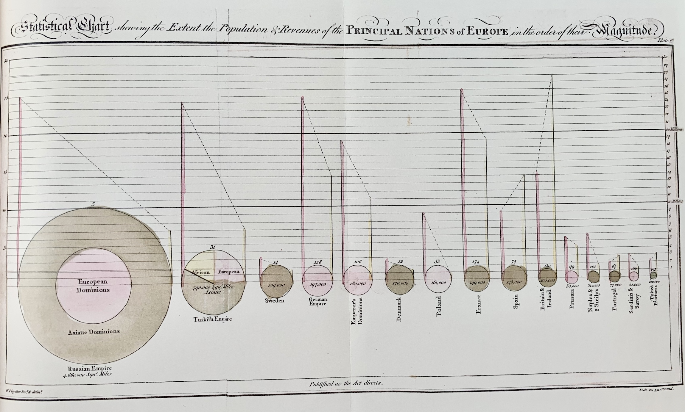
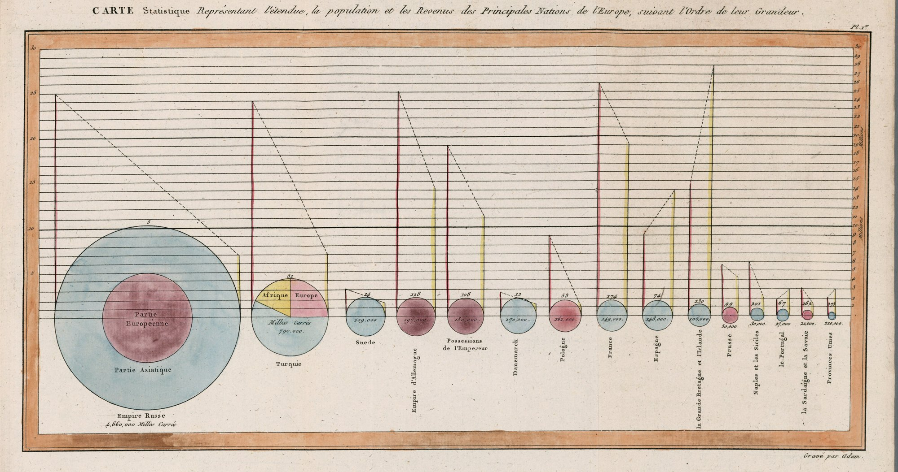
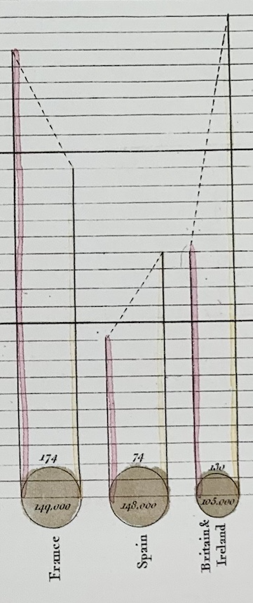
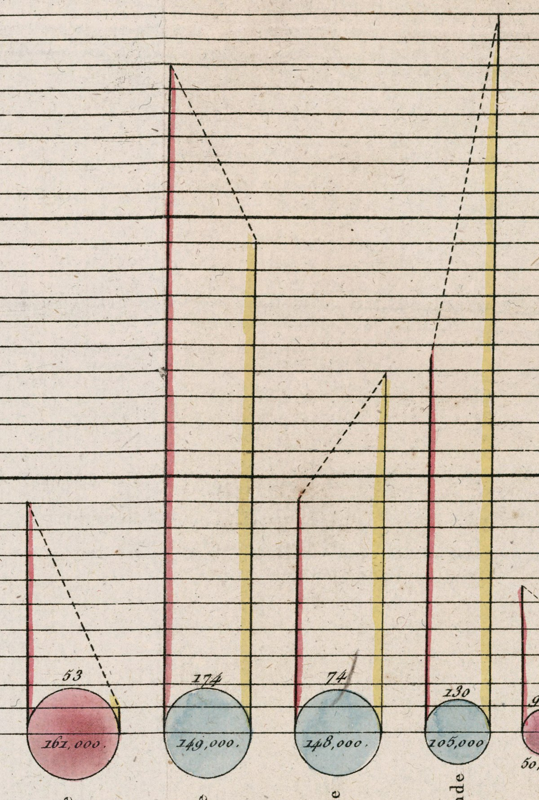

+++
author = "矢崎裕一"
title = "国の広さは円の面積、税の重さは点線の向き──プレイフェア『The Statistical Breviary』第1図"
slug = "pie-chart-william-playfair-area"
date = "2025-10-12"
description = "プレイフェアは1801年『Breviary』第1図で、国の広さを円の面積、人口と歳入を同じ目盛りの縦線で描きました。点線がどちら向きに上がるかで、人口に比べて税が重いかを示すと本文に書いています。"
categories = [
    "consume"
]
tags = [
    "William Playfair",
    "ウィリアム・プレイフェア",
    "The Statistical Breviary",
    "比例円",
    "円面積チャート",
    "エンコーディング",
    "統計グラフの歴史"
]
image = "images/cover.png"
series = ["dataviz-classics"]
series_weight = 1
seriesByline = "William Playfair"
seriesTitle = "広さは円、税は点線──プレイフェア『Breviary』第1図"
+++

1801年、ウィリアム・プレイフェア（William Playfair, 1759–1823）は『The Statistical Breviary』の第1図で、ヨーロッパ諸国の広さを円の面積で描きました。人口と歳入は、円の左右に立てた同じ目盛りの縦線で示しています。2本の縦線の上端は点線で結ばれます。点線がどちら向きに上がるかで、人口に比べて税が重いかを示すと、プレイフェアは本文に書いています。

出典は同書の序文と、図の読み方を説いた pp.13–16、国別の表です。本文は Internet Archive にあるボドリアン図書館本で読みました。このスキャンは折り込み図版が正しく撮れていないため、図は1802年の仏訳版で示します。円の分け方は[1801年と1805年の2つの円を比べた記事](/pie-chart-william-playfair/)が、1805年の図は[1805年の合衆国の円グラフの記事](/pie-chart-william-playfair-part/)が扱います。

<!--more-->

William Playfair 原図、Adam 彫版（仏訳版、1802）の図版全体。David Rumsey Map Collection, David Rumsey Map Center, Stanford Libraries／Internet Archive より引用（CC BY-NC-SA 3.0）

## 表の補遺から生まれた4枚の図

序文によると、きっかけは他人の本の手伝いでした。ベティヒャー（Boetticher）の『統計表』の英語版編者に、刊行後の変化を補う表を頼まれたのです。その作業の途中で、こう気づいたと書いています（序文 p.3）。

> it occurred to me, that tables are by no means a good form for conveying such information

表は、こうした情報を伝える形としてまったく良くない、という趣旨です。p.4 では、割合と大きさが問題になるときは、目に訴えるのが最もよく、最も手早いと述べます。

本はロンドンで1801年に出ました。Chris Pritchard（クリス・プリチャード）によると全64ページで、大半は国別の表、図版は4枚です。4枚の中身は p.14 に並んでいます。

1. 第1図：フランス革命前の欧州
2. 第2図：リュネヴィル条約の講和で予定された欧州
3. 第3図：欧州の首都の人口
4. 第4図：ヒンドゥスタンの国々

第1図の原文は「Exhibits the powers of Europe as they were previous to the French Revolution.」です。描かれているのは**1801年当時ではなく、革命前の欧州**です。1801年はフランス革命戦争のさなかで、2月のリュネヴィル条約後の姿は第2図が描きます（Pritchard 2021）。

線を使った図は、プレイフェアにとって初めてではありません。p.15 で、約15年前に商業と財政に線を使ったと書いています。『The Commercial and Political Atlas』のことです。『The Statistical Breviary』は翌1802年、ドナン（D.-F. Donnant）の仏訳でパリから出て、図版も仏語で彫り直されました。

## 読み方は、本文の2ページに書いてある

第1図の中に凡例はありません。読み方は本文の pp.13–14 にまとめてあります。縦線についての核心は、次の一節です。

> The yellow lines on the right of each nation represent the revenue in millions of pounds sterling, measured also upon the same divided scale with the population.

右の黄色い線は歳入を百万ポンド単位で表し、人口と同じ目盛りで測る、という意味です。左の赤い線は人口を百万人単位で表し、目盛りは1区切りが100万で「両端に」数字が振ってある、と直前に書いています。

**人口と歳入は、同じ1本の目盛りで測ります。** 数字が図の左右両端にあるのは、どちらからも読めるようにするためです。左が人口用、右が歳入用という二重の軸ではありません。

本文の説明を、データと見た目の対応表にすると次のようになります。例はフランス（革命前）で、数値は p.33 の表によります。

| データ | 見た目 | 例：フランス |
|---|---|---|
| 国の広さ（平方マイル） | 円の大きさ。左から広い順に並ぶ | 円 |
| 広さの数値 | 円の中の数字 | 149,000 |
| 人口（百万人） | 円の左に立つ赤い縦線の高さ | 26 |
| 歳入（百万ポンド） | 円の右に立つ黄色い縦線の高さ。人口と同じ目盛り | 19 |
| 人口に対する税の重さ | 2本の縦線の上端を結ぶ点線の、上がる向き | 右下がり |
| 人口密度（1平方マイルあたりの人数） | 円の真上の数字 | 174 |
| 海の国か、陸の国か | 円の色。緑が海の国、淡い赤が陸の国 | — |

円の上の数字は人口密度で、歳入ではありません。本文も「5 over Russia, and 14 over Sweden」と例を挙げています。フランスの174を歳入と読むと、表の1,900万ポンドと大きく食い違います。

仏訳版の図では、円が青と赤に塗り分けられています。フランス、スペイン、ブリテンなどが青、ポーランドやプロイセンなどが赤です。英語版の本文で「緑」とされた海の国が、仏訳版では青になったと読めます。

ロシアとトルコの円だけは、中が分けられています。ロシアは内側の円がヨーロッパ領、外側の環がアジア領、トルコは大陸ごとの扇形です。本文には、この分割の説明がありません。ここでは色が、海か陸かではなく大陸を表しています。1枚の中で、色が二通りの意味で使われていると読めます。

## 国の形を、同じ円にそろえる

なぜ国を円で描いたのか。プレイフェアは p.15 で理由を書いています。

> for where forms are not similar, the eye cannot compare them easily nor accurately. From this circumstance it happens, that we have a more accurate idea of the sizes of the planets, which are spheres, than of the nations of Europe which we see on the maps

形が似ていなければ、目は大きさを簡単にも正確にも比べられない。だから私たちは、地図で見る欧州の国々より、球である惑星の大きさのほうを正確に知っている、という趣旨です。序文 p.6 では、目は似た形を見ると思わず大きさを比べてしまう、とも書いています。

円の大きさの決め方について、本文は「面積に比例」とは書いていません。序文の言い方は「proportional circles」です。仏訳版の図版（上の画像、横2000px）で筆者が測ると、ロシアの円の直径は約410px、フランスは約68pxでした。フランスの直径を1とすると、面積比例ならロシアは約5.6、直径比例なら約31です。測った比は約6なので、直径はおおよそ広さの平方根に比例しています。目測の誤差を含めても、面積比例と見てよい値です。

円は広さの順に左から右へ並びます。p.7 でプレイフェアは、この図を見ればロシアとトルコの大きさに驚くはずだと書きます。この500年、世界を動かしてきた国々の小ささにも、と続けます。

描かないものも決めています。広さ、人口、歳入を一つの図にまとめたのは、それが正確に測れる力の土台だからだ、と p.15 で書きます。政体や人の徳も国の強さを左右するが、図には表せない、と続けます。

## 点線の向きは「1人1ポンド」で分かれる

点線の説明は、p.13 から p.14 へまたがっています。

> The dotted lines drawn between the population and revenue, are merely intended to connect together the lines belonging to the same country. The ascent of those lines being from right to left, or from left to right, shews whether in proportion to its population the country is burdened with heavy taxes or otherwise.

点線は同じ国の2本の線をつなぐためのものだ。そして、点線がどちら向きに上がるかで、人口に比べて税が重い国かどうかが分かる。前半だけ読むと、点線はただのつなぎです。後半の文で、点線に意味を持たせています。

人口と歳入が同じ目盛りにあるので、点線が右上がりになるのは、歳入の数字が人口の数字を上回るときです。つまり1人あたりの税が1ポンドを超える国です。本文の表で確かめます（1ポンド＝20シリング）。

| 国 | 人口（百万人） | 歳入（百万ポンド） | 表の1人あたりの税 | 点線 |
|---|---|---|---|---|
| ロシア | 25 | 7.3 | 6シリング8ペンス | 右下がり |
| フランス | 26 | 19 | 14シリング8ペンス | 右下がり |
| スペイン | 11 | 14 | 1ポンド5シリング5ペンス | 右上がり |
| ブリテンとアイルランド | 14 | 27 | 1ポンド18シリング3ペンス | 右上がり |

数値は pp.19, 33, 35, 37 の表によります。図で点線が右上がりなのは、スペイン、ブリテンとアイルランド、ポルトガル、連合州の4か国だけです。表で1人あたりの税が1ポンドを超えるのも、同じ4か国です。

William Playfair 原図、Adam 彫版（仏訳版、1802）の第1図から部分を切り出し。David Rumsey Map Collection, David Rumsey Map Center, Stanford Libraries／Internet Archive より引用（CC BY-NC-SA 3.0）

プレイフェアが上がる「向き」だけを言っている点は大事です。共通の目盛りの上では、向きは「1人1ポンド」を境にした二択として正しく働きます。本文の説明は、そこまでを約束していると読めます。

傾きの急さは別の話です。2本の縦線は円の左右の端に接して立つので、横の間隔は円の直径です。点線の傾きは、歳入と人口の差を直径で割った値になります。ロシアは差が大きいのに、円が大きいので点線はゆるやかです。ブリテンは差が13で円が小さいので、点線は急に上がります。傾きの急さには、国の広さが混ざります。

## 第三者はこの図をどう見たか

David Rumsey Map Collection の仏訳版の目録は、Akerman と Karrow の評を引いています。国の広さの円、トルコの扇形、人口と税の線という「a creative combination of different visual forms」だ、という見方です。

傾きを批判したのが Pritchard（2021）です。新しさを、面積比例の円、ロシアとトルコの分割、縦線とそれを結ぶ傾いた線の3つに整理したうえで、こう書きます。

> a direct comparison of these lines, one country to another, is not possible because each gradient is affected by the radius (and hence the area of the country)

傾きは円の半径、つまり国の広さに左右されるので、国どうしで比べられない、という指摘です。Jonathan Sachs（ジョナサン・サックス）も注で同じ点を、Funkhouser（1937）らの名を挙げて指摘しています。なお Pritchard は人口を左、予算を右の目盛りで読むと書いており、本文の「the same divided scale」と食い違います。

Sachs の主な論点は思想史です。不ぞろいな国土を「uniformly scaled circles」に置き換えた点を重く見ます。富を歳入として量で定めるなら、富は領土の広さと同じではない。この図を、領土と人口こそ富だとする人々への反論として読んでいます。

The Irish Times の Juliana Adelman（2018）は意図に注目し、プレイフェアが最も見せたかったのは、狭い国土と少ない人口で多くの歳入を上げる連合王国の優位だと書きます。そのうえで、海外の植民地を勘定に入れていない、と付け加えています。

## 使い道

第1図から持ち帰れることは、4つあります。

1つめは、形をそろえてから大きさを比べることです。地図のままでは国の広さは比べにくい。プレイフェアは同じ円に置き換え、比べる作業を目に任せました。

2つめは、2つの量を同じ目盛りに載せると、量どうしの関係が読めることです。単位の違う人口と歳入を同じ数字の目盛りに載せたので、「1人1ポンド」という境目が図の上に生まれました。

3つめは、**傾きで派生量を見せるなら、横の間隔を一定にすること**です。第1図では間隔が円の直径というデータそのもので、税の重さに国の広さが混ざりました。1人あたりの税を見せたいなら、その値を直接描くほうが確かです。

4つめは、読み方を図のそばに置くことです。第1図の読み方は本文にしかありません。図だけを切り出すと、円の上の人口密度を歳入と読み違えかねません。

プレイフェアは p.16 で、初めて数分眺めた人の心に何が残るかが最大の基準だ、と書いています。筆者の数え方では、第1図は面積、人口、歳入、人口密度、海陸の別、税の重さの6つを、その数分で見せようとした図です。点線の傾きは、その詰め込みが生んだ、扱いの難しい部分だと読めます。

## 参考・出典

**一次情報**

- William Playfair, *The Statistical Breviary; Shewing, on a Principle Entirely New, the Resources of Every State and Kingdom in Europe*, London, 1801（ボドリアン図書館本、Google によるデジタル化）. [Internet Archive](https://archive.org/details/statisticalbrev00playgoog) / [全文テキスト](https://archive.org/download/statisticalbrev00playgoog/statisticalbrev00playgoog_djvu.txt) / [Google Books](https://books.google.com/books?id=Y4wBAAAAQAAJ)
- William Playfair（D.-F. Donnant 訳）, 仏訳版（パリ、1802）の第1図「Carte statistique représentant l'étendue, la population et les revenus des principales nations de l'Europe」. David Rumsey Map Collection. [Internet Archive の写し](https://archive.org/details/dr_carte-statistique-reprsentant-ltendue-la-population-et-les-revenus-des-14005003)

**第三者評価**

- Chris Pritchard, "Life of Pie: William Playfair and the Impact of the Visual," Mathematical Association, Presidential Essay No.4, July 2021. [PDF](https://m-a.org.uk/resources/PE4LifeofPie.pdf)
- Jonathan Sachs, "1786/1801: William Playfair, Statistical Graphics, and the Meaning of an Event," *BRANCH*. [記事](https://branchcollective.org/?ps_articles=jonathan-sachs-17861801-william-playfair-statistical-graphics-and-the-meaning-of-an-event)
- Juliana Adelman, "The man with a finger in many pie charts," *The Irish Times*, 2018-03-05. [記事](https://www.irishtimes.com/news/science/the-man-with-a-finger-in-many-pie-charts-1.3415259)
- David Rumsey Map Collection の仏訳版第1図の目録（Akerman & Karrow の評を引用）. [Internet Archive の写し](https://archive.org/details/dr_carte-statistique-reprsentant-ltendue-la-population-et-les-revenus-des-14005003)
