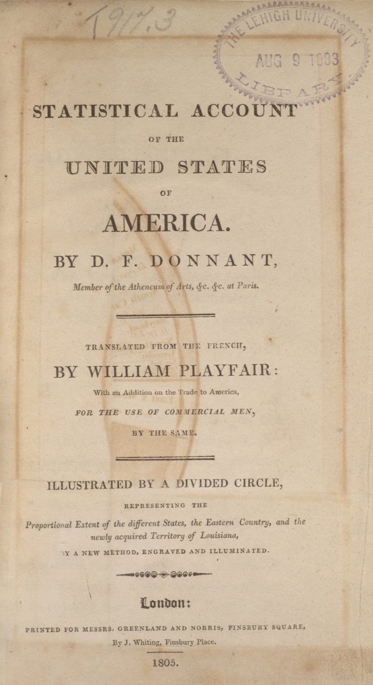
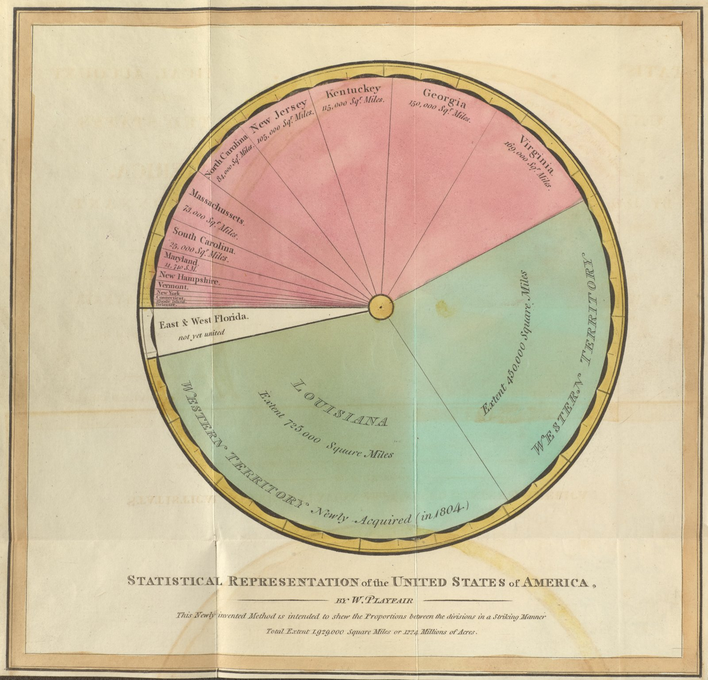
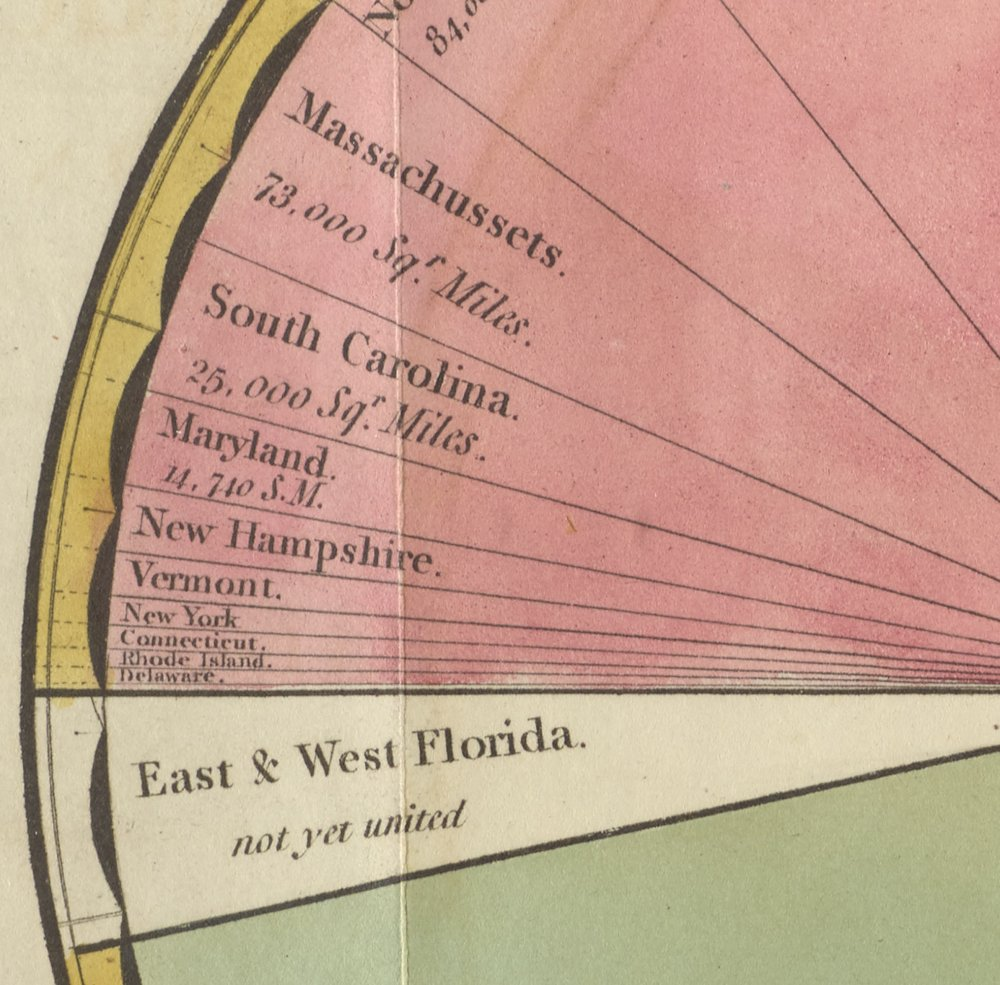

+++
author = "Yuichi Yazaki"
title = "Dividing the Size of the United States with One Circle: Playfair's 1805 \"Divided Circle\""
slug = "pie-chart-william-playfair-part"
date = "2025-10-12"
description = "In 1805, William Playfair translated Donnant's statistical account of the United States and added a figure that splits the area of the states and territories into sectors of a single circle. The engraved line beneath it calls the method newly invented, a Striking way to show proportions."
categories = [
    "consume"
]
tags = [
    "William Playfair",
    "D. F. Donnant",
    "pie chart",
    "divided circle",
    "history of statistical graphics"
]
image = "images/cover.png"
+++

In 1805, William Playfair translated D. F. Donnant's (Denis-François Donnant) statistical account of the United States into English and added a figure that divides the area of the states and territories into sectors of a single circle. Beneath the figure he had engraved "This Newly invented Method is intended to shew the Proportions between the divisions in a Striking Manner." In other words, the method is newly invented, and it is meant to show the ratios between divisions in a striking way.

The book's title is *Statistical Account of the United States of America* (London: Greenland and Norris, 1805). "Statistical Representation of the United States of America," which is often cited as if it were the name of the work, is the title of the plate, not of the book. What follows draws on the images of the copy held by the Lehigh University Libraries and on the text of the Harvard copy at the Internet Archive.

<!--more-->

## A Translation with Just One Added Figure

Playfair himself describes how the book came about, in his preface and in the translator's preface.

1. In 1801, Playfair publishes the *Statistical Breviary*.
2. Donnant in Paris translates it into French and adds an account of the United States.
3. Donnant sends the French translation to Playfair with an English letter dated November 1802.
4. Playfair translates the United States part into English, adds the figure, a dedication, and a treatise on trade at the end, and publishes it in 1805.

The title of the French translation is *Éléments de statistique* (1802). This comes not from the preface but from the bibliography of Bellhouse 2022.

In the translator's preface, Playfair says the translation is not literal and that he has supplemented the explanations with a divided circle. He also writes that Donnant, who has approved of his own way of showing statistics through geometry, will not take this as an alteration.

Source: Title page of D. F. Donnant, tr. William Playfair, *Statistical Account of the United States of America* (London, 1805), held by Lehigh University Libraries Special Collections / from Lehigh Library Exhibits (No Copyright – United States)

The title page is printed with "ILLUSTRATED BY A DIVIDED CIRCLE." It goes on to explain that the engraved, hand-colored figure shows the ratio of the extent of the states, the eastern territories, and the newly acquired Louisiana by a new method. The subtitle is "With an Addition on the Trade to America, for the use of Commercial Men." The advertisement at the end lists this figure first in the table of contents and describes it as "a Method entirely new, distinct, and EXPEDITIOUS." The readers he had in mind were people in business.

The dedication is addressed to President Thomas Jefferson. Playfair writes that Jefferson, while in France, approved of his method of using lines for finance, and he urges the government to put effort into collecting statistics. Twenty-five copies were sent to Jefferson (Brinton 1939, Pritchard 2021).

## How the Circle Was Divided

Source: William Playfair, "Statistical Representation of the United States of America" (folding plate), in the same book, held by Lehigh University Libraries Special Collections / from Lehigh Library Exhibits (No Copyright – United States)

The figure is a folding plate, and the creases show in the image. The correspondence between data and appearance is as follows. The numbers were read from Lehigh's high-resolution image, and the spellings are kept as they appear in the figure.

| Appearance | Data it encodes | Notation in the figure |
|---|---|---|
| The whole circle | Total area of the United States | "Total Extent 1,929,000 Square Miles or 1224 Millions of Acres" |
| Central angle of a sector | Area of each division (square miles) | Virginia 169,000, Georgia 150,000, and so on. The six small states have names only |
| Order of the sectors | States in descending order of area | Counterclockwise from Virginia at upper right to Delaware, followed by Florida, Louisiana, and the Western Territory |
| Color (hand-colored) | Kind of division | Pink = states, white = East & West Florida "not yet united", green = Western Territory and Louisiana |
| Lettering along the arc | Grouping of regions | "WESTERN TERRITORY" on the green at right; "Newly Acquired (in 1804)" and "LOUISIANA" on the green at bottom |

The Lehigh University Library exhibit explains the three colors as distinguishing states, territories, and the Spanish-held East and West Florida. The Louisiana Purchase treaty was signed on April 30, 1803, but the figure says "in 1804."

In the 1801 *Breviary*, what Playfair drew was a row of circles, one per country, to be compared by size. The notation of that figure is covered in [a separate article](/en/pie-chart-william-playfair-area/), and the difference between comparing by circle area and dividing by sector angle is covered in [the article on the two kinds of circles](/en/pie-chart-william-playfair/). This article is about **the 1805 circle, which divides a single whole into sectors**.

## The Line under the Figure, and a Passage in the Text

Two lines of lettering are engraved under the title of the plate. The first is the following sentence, and the second is the line giving the total area.

> This Newly invented Method is intended to shew the Proportions between the divisions in a Striking Manner

It means that this newly invented method is meant to show the ratios between divisions in a striking way.

On page 17 of the text, Playfair explains the figure as follows.

> The divided circle which represents the surface of the country, has been constructed for the purpose of shewing, in an easy and accurate manner, the proportional extent of the different provinces; and it is scarcely possible to look at it without a few important observations occurring to the mind.

In short, it was made to show the ratios of the extent of the regions easily and accurately, and on looking at it, it is hardly possible for a few important thoughts not to come to mind.

Examples of those thoughts follow. The differences in the size of the divisions are too great, so rearrangements will occur once the population evens out. The western territory will in time be divided into separate states. The ratio between Virginia and Delaware is absurd, and cannot stand as it is. He means the largest state at the upper right of the figure and the state at the far left that is a mere thin line.

The text calls the figure "easy and accurate," while the engraved line says "Striking." This can be read as Playfair asking both accuracy and impact of the same figure. The treatise on trade at the end says that the West was three-fifths the size of the United States before the Louisiana Purchase and is now two-thirds, and proposes a company to send British goods to the West. The green sector, which takes up a little over half of the circle, can be read as also serving to make this argument visible.

## Checking the Numbers

In 2022, the statistician David R. Bellhouse pointed out errors in this figure. New York and New Jersey are confused. Compared with a map from around 1805, the states' areas do not match. For each state, Playfair multiplied the length and width that Donnant gave to get an area, ignoring the fact that the states are not rectangles, Bellhouse says.

Source: An enlargement of the left side of the same plate. Lehigh University Libraries Special Collections / from Lehigh Library Exhibits (No Copyright – United States)

I also measured the sector angles on the Lehigh image. I picked up the radial boundary lines from the center, so an error of about 1° is possible. The table below sets the angle obtained by dividing each printed value by the total area and multiplying by 360° next to my measurement.

| Division | Printed in the figure | Angle from the printed value | My measurement |
|---|---|---|---|
| Virginia | 169,000 | 31.5° | about 32° |
| Georgia | 150,000 | 28.0° | about 27.5° |
| Kentuckey | 115,000 | 21.5° | about 21.5° |
| New Jersey | 105,000 | 19.6° | about 19.5° |
| North Carolina | 84,000 | 15.7° | about 15.5° |
| Massachussets | 73,000 | 13.6° | about 13.5° |
| South Carolina | 25,000 | 4.7° | about 8° |
| Maryland | 14,740 | 2.8° | about 5° |
| East & West Florida | none | — | about 12.5° |
| Louisiana | 725,000 | 135.3° | about 111° |
| Western Territory | 450,000 | 84.0° | about 84° |

The six large states and the Western Territory are close to proportional to the printed values. The ones that deviate are South Carolina, Maryland, and Louisiana. Louisiana is about 25° smaller than its printed value, and working back from the angle gives roughly 590,000 square miles.

The total does not close either. The ten divisions with printed values add up to 1,910,740 square miles, only 18,260 short of the total area. Florida and the six small states should fit into that remainder, yet the figure gives them about 23°, the equivalent of about 120,000 square miles. Since a circle closes at 360°, some sector cannot be drawn as printed. In this figure, it can be read as showing up in Louisiana.

There are other discrepancies. The figure names 14 states, and Pennsylvania's name is missing. Just before the summary table in the text, it says "Since then, the number of States has increased to sixteen." Louisiana's 725,000 square miles also differs from the 828,000 square miles that the U.S. National Archives gives for the purchased land.

## How Third Parties Saw the Figure

Willard C. Brinton dedicated his 1939 *Graphic Presentation* to Playfair. In the preface there is a scene in which he leafs through this book at the Huntington Library and exclaims, "This is the first example of a sector chart." Then he notices the engraved line beneath the one and only figure. On page 81 he writes "one of the first sector charts," but he also notes that in the 1801 *Breviary* the Turkish empire's circle was divided into three, and adds that that one might be the first.

Bellhouse distinguishes the 1801 figure as "An anticipation" and the 1805 figure as a "fully-fledged pie chart." His view is that in 1801 Playfair was not yet fully aware of what he had done. He cites David S. Moore's view that a pie chart can be used when emphasizing the relation between parts and a whole, and writes that this figure is an example of that.

Chris Pritchard, in 2021, looks at the figure from the book's origins and its political context. His assessment is that it shows both the ratios among the states and their ratios to the whole country, and makes plain the effect of the Louisiana Purchase two years earlier. He also writes that one of the 25 copies sent to Jefferson went to Humboldt.

The three accounts have different emphases. Brinton reads the figure as an early sector chart, Bellhouse from the quality of the data, and Pritchard from the context of the purchase.

## What to Take Away

Here are the points from this figure that can be carried back into visualization work.

- State the whole. With the total area written under the figure, the sectors can be read as quantities relative to the whole.
- Decide the order. Going around the circle from the largest state, the gap between Virginia and Delaware shows at a glance.
- Use color for kind. The three colors are not about quantity; they distinguish states, unincorporated land, and territory.
- Write the numbers on the sectors. Because the values are printed, a reader 200 years later can check them against the angles and find the discrepancies.
- **Check the total before drawing.** If the parts do not add up to the whole, the discrepancy will show up in some sector.

Playfair asked this figure for both "Striking" and "accurate." The impact comes from color, ordering, and the large green sector. The accuracy cannot be known without checking the numbers one by one. When drawing a pie chart, check these two separately.

## References

**Primary sources**

- D. F. Donnant, tr. William Playfair, *Statistical Account of the United States of America*, London: Greenland and Norris, 1805 (Harvard copy, Internet Archive). [archive.org](https://archive.org/details/statisticalacco00donngoog) / [Full OCR text](https://archive.org/stream/statisticalacco00donngoog/statisticalacco00donngoog_djvu.txt)
- Lehigh University Libraries, Special Collections, "Statistical Account of the United States of America." (Images of the title page and plate from the library's copy). [Lehigh Library Exhibits](https://exhibits.lib.lehigh.edu/items/show/3204)
- Lehigh University Library, "At a Glance: Selected Works in the History of Data Visualization," Case One: Playfair. [Exhibit page](https://exhibits.lib.lehigh.edu/exhibits/show/data_visualization/case_one/playfair)
- U.S. National Archives, "Louisiana Purchase Treaty (1803)." [archives.gov](https://www.archives.gov/milestone-documents/louisiana-purchase-treaty)

**Secondary sources**

- Willard C. Brinton, *Graphic Presentation*, New York: Brinton Associates, 1939 (preface pp. 11–12, p. 81). [archive.org](https://archive.org/details/graphicpresentat00brinrich)
- David R. Bellhouse, "William Playfair's Statistical Graphs," *CMS Notes*, 54(1), February 2022. [notes.math.ca](https://notes.math.ca/en/?p=11700)
- Chris Pritchard, "Life of Pie: William Playfair and the Impact of the Visual," Mathematical Association Presidential Essay No.4, July 2021. [PDF](https://m-a.org.uk/resources/PE4LifeofPie.pdf)
