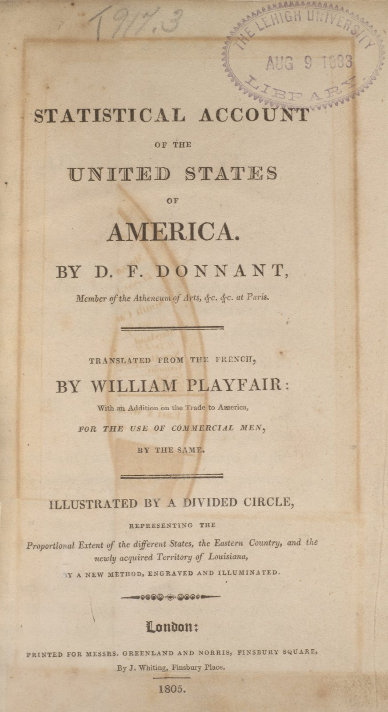
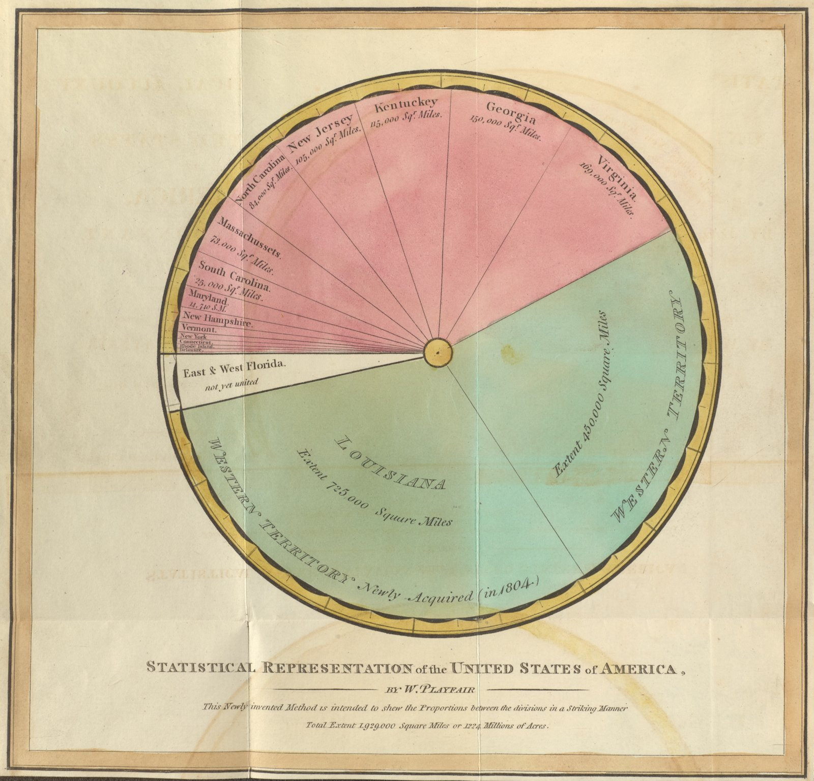
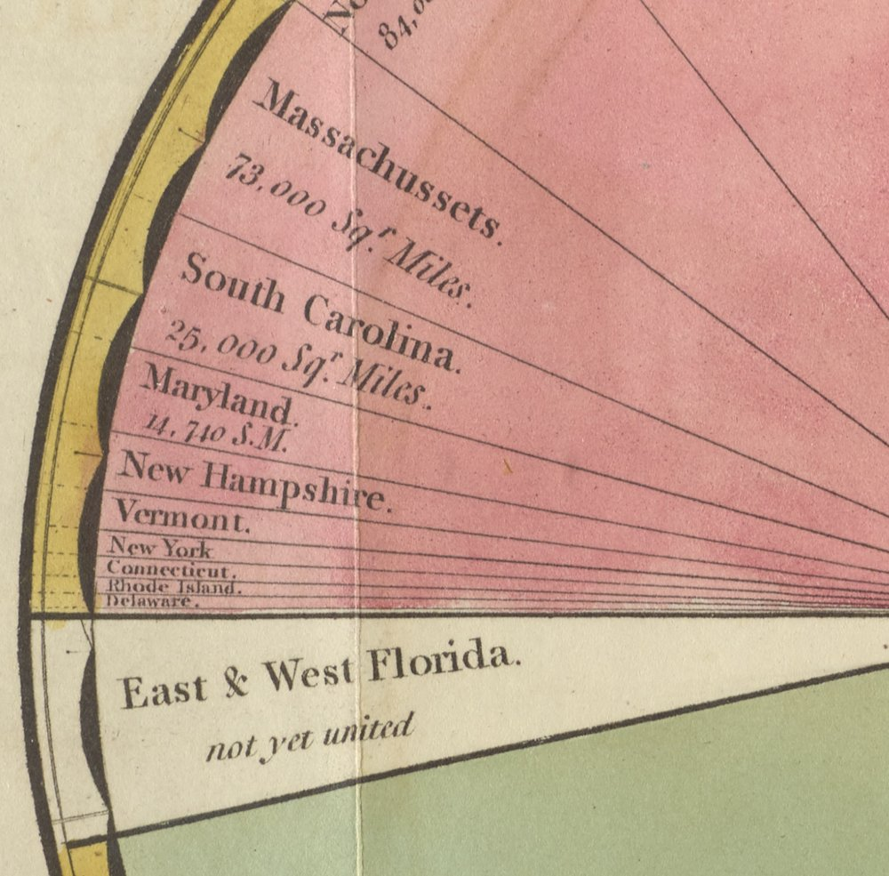

+++
author = "矢崎裕一"
title = "合衆国の広さを一つの円で分ける──プレイフェア、1805年の「divided circle」"
slug = "pie-chart-william-playfair-part"
date = "2025-10-12"
description = "1805年、プレイフェアはドナンの合衆国統計書を英訳し、州と領土の面積を一つの円の扇形に分けた図を加えました。図の下には、比率を印象的に見せる新しい方法だと刻んでいます。"
categories = [
    "consume"
]
tags = [
    "William Playfair",
    "ウィリアム・プレイフェア",
    "D. F. Donnant",
    "円グラフ",
    "divided circle",
    "統計グラフの歴史"
]
image = "images/cover.png"
series = ["dataviz-classics"]
series_weight = 3
seriesByline = "William Playfair"
seriesTitle = "合衆国の広さを扇形で分ける──プレイフェア 1805"
+++

1805年、ウィリアム・プレイフェア（William Playfair）は、D. F. ドナン（Denis-François Donnant）の合衆国統計書を英訳し、州と領土の面積を一つの円の扇形に分けた図を加えました。図の下には "This Newly invented Method is intended to shew the Proportions between the divisions in a Striking Manner" と刻んでいます。新しく発明したこの方法で、区分どうしの比率を印象的に見せる、という一文です。

本の題は『Statistical Account of the United States of America』（London: Greenland and Norris, 1805）です。作品名のように引かれる「Statistical Representation of the United States of America」は図版の題で、書名ではありません。以下は、Lehigh 大学図書館が公開する所蔵本の画像と、Internet Archive にある Harvard 大学所蔵本の本文に沿います。

<!--more-->

## 翻訳書に、一枚だけ加えた図

本の成り立ちは、プレイフェア自身が前書きと訳者の序に書いています。

1. 1801年、プレイフェアが『Statistical Breviary』を出す。
2. パリのドナンがこれを仏訳し、合衆国の記述を書き足す。
3. ドナンは1802年11月付の英語の手紙を添えて、仏訳書をプレイフェアに送る。
4. プレイフェアは合衆国の部分を英訳し、図と献辞と巻末の通商論を加えて、1805年に出す。

仏訳書の題は『Éléments de statistique』（1802年）です。これは前書きではなく、Bellhouse 2022 の参考文献によります。

訳者の序では、訳は逐語的ではなく、分割した円（divided circle）で説明を補った、と断っています。ドナンは幾何で統計を示す自分のやり方を認めているので、改変とは受け取らないだろう、とも書きます。

D. F. ドナン著、ウィリアム・プレイフェア英訳『Statistical Account of the United States of America』（London, 1805）の扉、Lehigh University Libraries Special Collections 所蔵／Lehigh Library Exhibits より引用（No Copyright – United States）

扉には "ILLUSTRATED BY A DIVIDED CIRCLE" と刷られています。続けて、州と東部と新しく得たルイジアナの広さの比を、新しい方法で示した、彫版して手で彩色した図だ、と説明しています。副題は "With an Addition on the Trade to America, for the use of Commercial Men" です。巻末の広告は、目次の1番目にこの図を挙げ、"a Method entirely new, distinct, and EXPEDITIOUS" と書いています。想定した読者は、商売に携わる人でした。

献辞は、トマス・ジェファーソン（Thomas Jefferson）大統領に宛てています。フランス駐在中のジェファーソンが、財政に線を使う自分の方法を認めてくれた、と書き、政府が統計の収集に力を入れるよう求めています。ジェファーソンには25部が送られました（Brinton 1939、Pritchard 2021）。

## 円をどう割ったか

William Playfair, "Statistical Representation of the United States of America"（折り込み図版）、同書所収、Lehigh University Libraries Special Collections 所蔵／Lehigh Library Exhibits より引用（No Copyright – United States）

図は折り込みの図版で、画像にも折り目が写っています。データと見た目の対応は次のとおりです。数字は Lehigh の高解像度画像で読み、綴りは図のままにしました。

| 見た目 | 対応させたデータ | 図の表記 |
|---|---|---|
| 円全体 | 合衆国の総面積 | "Total Extent 1,929,000 Square Miles or 1224 Millions of Acres" |
| 扇形の中心角 | 各区分の面積（平方マイル） | Virginia 169,000、Georgia 150,000 など。小さい6州は名前だけ |
| 扇形の並び | 州は面積の大きい順 | 右上の Virginia から反時計回りに Delaware まで。続いてフロリダ、ルイジアナ、西部領土 |
| 色（手彩色） | 区分の種類 | ピンク＝州、白＝East & West Florida "not yet united"、緑＝Western Territory と Louisiana |
| 弧に沿った文字 | 地域のまとまり | 右の緑に "WESTERN TERRITORY"、下の緑に "Newly Acquired (in 1804)" と "LOUISIANA" |

Lehigh 大学図書館の展示は、3色を、州・領土・スペインが支配する東西フロリダの区別だと説明しています。ルイジアナ買収の条約は1803年4月30日の署名ですが、図の表記は "in 1804" です。

1801年の『Breviary』でプレイフェアが描いたのは、国ごとの円を並べて大きさで比べる図でした。その図の符号は[別の記事](/pie-chart-william-playfair-area/)で、円の面積で比べる描き方と扇形の角度で分ける描き方の違いは[2種類の円の記事](/pie-chart-william-playfair/)で扱います。この記事が扱うのは、**一つの全体を扇形に分けた1805年の円**です。

## 図の下の一文と、本文の一節

図版の題の下に、2行の文字が刻まれています。1行目が次の一文で、2行目が総面積の行です。

> This Newly invented Method is intended to shew the Proportions between the divisions in a Striking Manner

新しく発明したこの方法は、区分どうしの比率を印象的に見せるためのものだ、という意味です。

本文17ページでは、図をこう説明しています。

> The divided circle which represents the surface of the country, has been constructed for the purpose of shewing, in an easy and accurate manner, the proportional extent of the different provinces; and it is scarcely possible to look at it without a few important observations occurring to the mind.

各地域の広さの比を、たやすく正確に示すために作った。見れば、いくつかの重要な考えが浮かばないことはまずない、という趣旨です。

その「考え」の例も続きます。区分の大きさの差が大きすぎるので、人口がならされれば組み替えが起きる。西の領土はいずれ別々の州になる。ヴァージニアとデラウェアの比はばかげていて、このままでは済まない。図の右上の最大の州と、左端の細い線のような州のことです。

本文は図を「easy and accurate」と書き、刻字は「Striking」と書いています。正確さと印象の強さの両方を、同じ図に求めていたと読めます。巻末の通商論は、西部はルイジアナ買収の前で合衆国の5分の3、いまは3分の2の広さだと書き、西部へイギリス製品を送る会社を提案します。円の半分あまりを占める緑の扇形は、この主張を目で見せる役も持っていたと読めます。

## 数字を確かめると

統計学者の David R. Bellhouse（デイヴィッド・ベルハウス）は2022年に、この図の誤りを指摘しています。ニューヨークとニュージャージーを取り違えている。1805年ごろの地図と比べると、州の面積が合わない。ドナンが州ごとに挙げた縦と横の長さを、プレイフェアは掛け合わせて面積にした。州が長方形でないことは無視された、といいます。

同じ図版の左側を拡大したもの。Lehigh University Libraries Special Collections 所蔵／Lehigh Library Exhibits より引用（No Copyright – United States）

筆者も、Lehigh の画像で扇形の角度を測りました。中心から放射状の境界線を拾ったもので、誤差は1°ほどあり得ます。表記の値を総面積で割り、360°を掛けた角度と並べます。

| 区分 | 図の表記 | 表記からの角度 | 筆者の計測 |
|---|---|---|---|
| Virginia | 169,000 | 31.5° | 約32° |
| Georgia | 150,000 | 28.0° | 約27.5° |
| Kentuckey | 115,000 | 21.5° | 約21.5° |
| New Jersey | 105,000 | 19.6° | 約19.5° |
| North Carolina | 84,000 | 15.7° | 約15.5° |
| Massachussets | 73,000 | 13.6° | 約13.5° |
| South Carolina | 25,000 | 4.7° | 約8° |
| Maryland | 14,740 | 2.8° | 約5° |
| East & West Florida | なし | — | 約12.5° |
| Louisiana | 725,000 | 135.3° | 約111° |
| Western Territory | 450,000 | 84.0° | 約84° |

大きい6州と西部領土は、表記にほぼ比例しています。ずれているのは、サウスカロライナ、メリーランド、ルイジアナです。ルイジアナは表記より25°ほど小さく、角度から逆算するとおよそ59万平方マイルです。

合計も閉じません。表記のある10区分を足すと1,910,740平方マイルで、総面積との差は18,260しかありません。そこにフロリダと小さい6州が入るはずですが、図はそれに約23°、12万平方マイル分ほどを割いています。円は360°で閉じるので、どこかの扇形が表記どおりには描けません。この図では、それがルイジアナに出ていると読めます。

ほかにも食い違いがあります。図に名前の出る州は14で、ペンシルベニアの名はありません。本文の要約表の直前には "Since then, the number of States has increased to sixteen" とあります。ルイジアナの725,000平方マイルも、米国国立公文書館が挙げる買収地の面積828,000平方マイルとは違います。

## 第三者はこの図をどう見たか

Willard C. Brinton（ウィラード・C・ブリントン）は、1939年の『Graphic Presentation』をプレイフェアに捧げています。序文には、Huntington Library でこの本をめくり、「これが扇形図（sector chart）の最初の例だ」と声を上げた場面があります。そのあとで、唯一の図の下に、あの刻字があるのに気づきます。81ページでは "one of the first sector charts" と書きつつ、1801年の『Breviary』でトルコ帝国の円が3つに分けられていたことにも触れ、そちらが最初かもしれないと添えています。

ベルハウスは、1801年の図を "An anticipation"、1805年の図を "fully-fledged pie chart" と呼び分けます。1801年の時点では、自分のしたことを十分に意識していなかった、という見方です。円グラフは部分と全体の関係を強調するときに使える、という David S. Moore の見方を引き、この図はその例だとも書いています。

Chris Pritchard（クリス・プリチャード）は2021年に、本の成り立ちと政治の文脈から見ています。州どうしの比と、国全体に対する比を示し、2年前のルイジアナ買収の効果をはっきり見せた図だ、という評価です。ジェファーソンに送られた25部のうち1部は、Humboldt に渡ったとも書いています。

三者の論点は分かれます。ブリントンは最初期の扇形図として、ベルハウスはデータの質から、プリチャードは買収の文脈から、この図を読んでいます。

## 使い道

この図から、可視化の仕事に持ち帰れることを挙げます。

- 全体を書き添える。図の下の総面積があるので、扇形を全体に対する量として読めます。
- 並べ順を決める。州を大きい順に回したので、ヴァージニアとデラウェアの差が一目で出ます。
- 色は種類に使う。3色は量ではなく、州・未編入の土地・領土の区別です。
- 数字を扇形に書く。表記があるから、200年後の読者が角度と照らし合わせて、ずれを見つけられます。
- **描く前に合計を確かめる**。部分の合計が全体と合わないと、ずれはどこかの扇形に出ます。

プレイフェアは、この図に「Striking」と「accurate」の両方を求めました。印象の強さは、色と並べ順と大きな緑の扇形で出ています。正確さは、数字を一つずつ確かめないと分かりません。円グラフを描くときは、この二つを別々に点検します。

## 参考・出典

**一次情報**

- D. F. Donnant, tr. William Playfair, *Statistical Account of the United States of America*, London: Greenland and Norris, 1805（Harvard 大学所蔵本、Internet Archive）. [archive.org](https://archive.org/details/statisticalacco00donngoog) / [OCR 全文](https://archive.org/stream/statisticalacco00donngoog/statisticalacco00donngoog_djvu.txt)
- Lehigh University Libraries, Special Collections, "Statistical Account of the United States of America."（所蔵本の扉と図版の画像）. [Lehigh Library Exhibits](https://exhibits.lib.lehigh.edu/items/show/3204)
- Lehigh University Library, "At a Glance: Selected Works in the History of Data Visualization," Case One: Playfair. [展示ページ](https://exhibits.lib.lehigh.edu/exhibits/show/data_visualization/case_one/playfair)
- U.S. National Archives, "Louisiana Purchase Treaty (1803)." [archives.gov](https://www.archives.gov/milestone-documents/louisiana-purchase-treaty)

**第三者評価**

- Willard C. Brinton, *Graphic Presentation*, New York: Brinton Associates, 1939（序文 pp.11–12、p.81）. [archive.org](https://archive.org/details/graphicpresentat00brinrich)
- David R. Bellhouse, "William Playfair's Statistical Graphs," *CMS Notes*, 54(1), February 2022. [notes.math.ca](https://notes.math.ca/en/?p=11700)
- Chris Pritchard, "Life of Pie: William Playfair and the Impact of the Visual," Mathematical Association Presidential Essay No.4, July 2021. [PDF](https://m-a.org.uk/resources/PE4LifeofPie.pdf)
