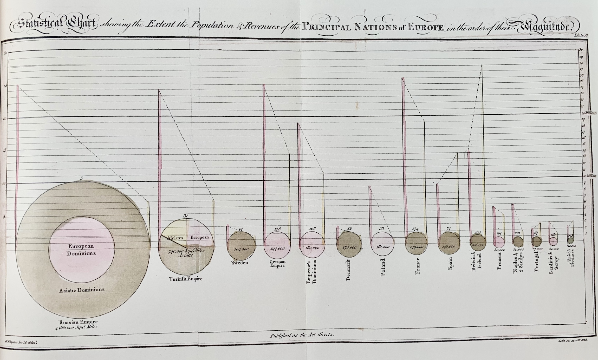
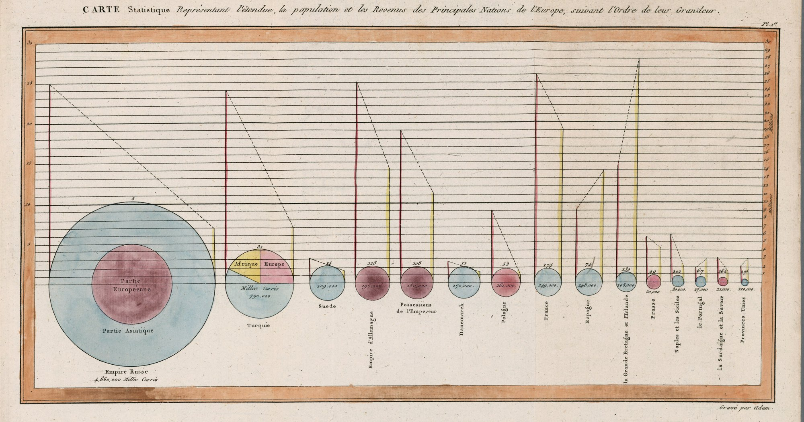
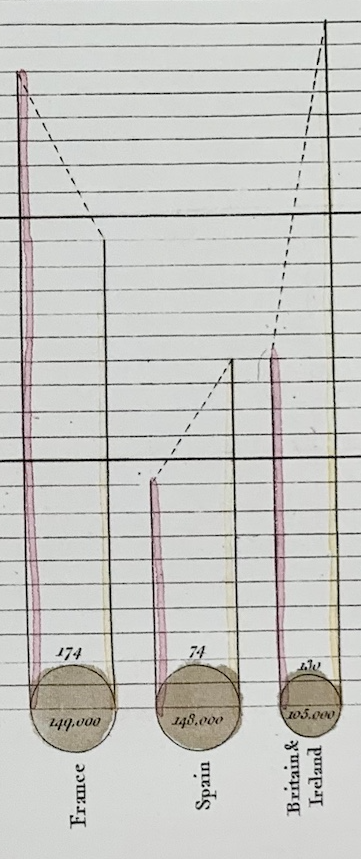
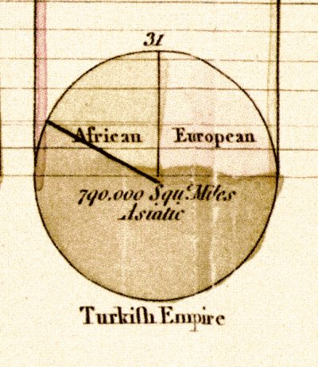
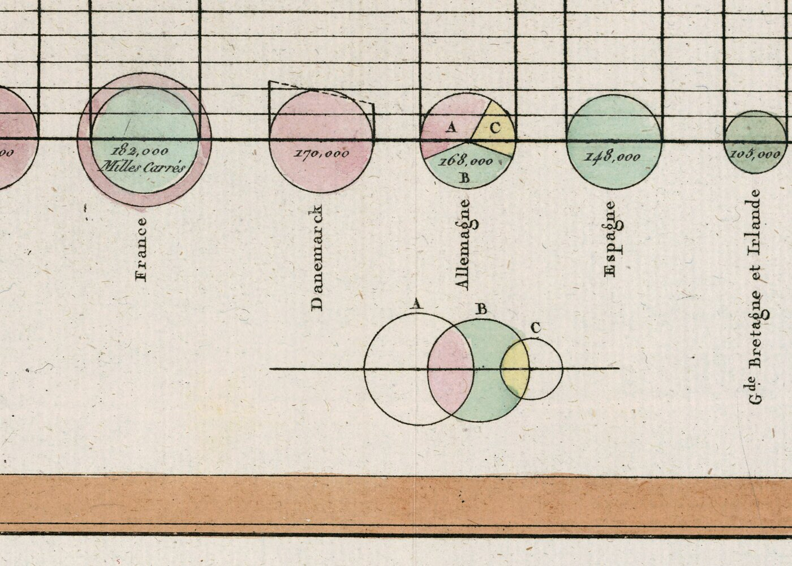
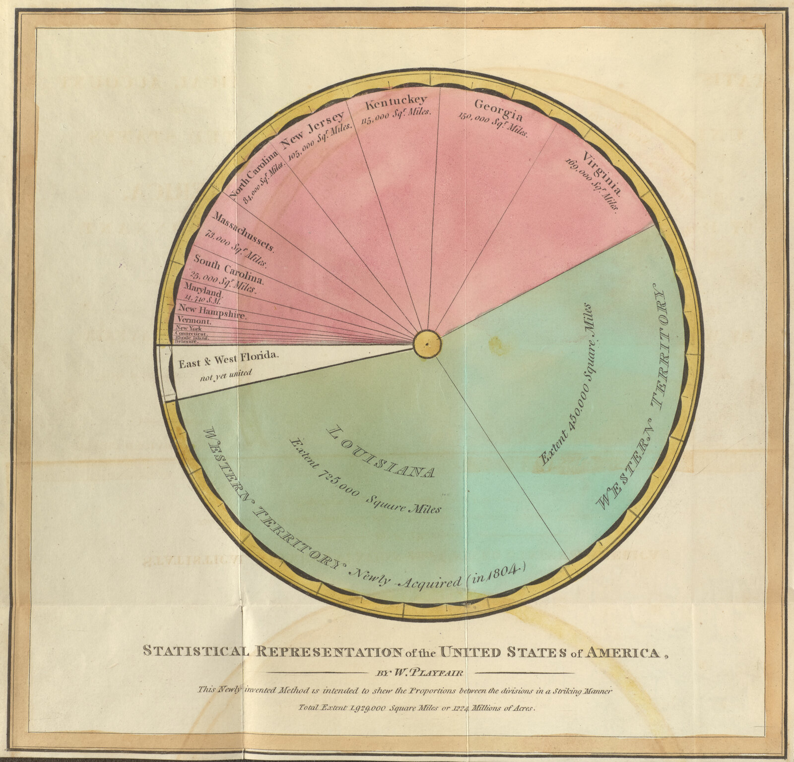

+++
author = "Yuichi Yazaki"
title = "The Same Square Miles, Drawn as the Area of a Circle and as the Angle of a Sector: Playfair in 1801 and 1805"
slug = "pie-chart-william-playfair"
date = "2025-10-12"
description = "William Playfair drew the same quantity, a country's extent in square miles, in two ways: as the area of a separate circle for each country in 1801, and as the angle of a sector cut from one divided circle in 1805."
categories = [
    "consume"
]
tags = [
    "William Playfair",
    "pie chart",
    "circle area chart",
    "The Statistical Breviary",
    "encoding"
]
image = "images/cover.png"
+++

William Playfair (1759–1823) drew the same quantity, a country's extent in square miles, in two ways. In his 1801 chart, he drew it as the area of a separate circle for each country. In his 1805 chart, he drew it as the angle of a sector cut from a single circle. In his own words, the former is meant to show the sizes of countries to the eye, and the latter the proportions among the extents of the provinces.

The 1801 chart is Chart 1 of Playfair's book *The Statistical Breviary*. The 1805 chart appears in *Statistical Account of the United States of America*, Playfair's English translation of a book by D. F. Donnant. Following the two original books, both readable on the Internet Archive, this article looks at what each circle lets the eye compare and what it does not.

<!--more-->

## 1801: Lining Up Countries by the Size of Circles

*The Statistical Breviary* appeared in London in 1801. Its title page says it is accompanied by stained copper-plate charts. Chart 1, in the text's own description, shows the countries of Europe before the French Revolution. The image below is the same chart from the French translation published the following year.

The whole plate, original drawing by William Playfair, engraved by Adam (French translation, 1802). Source: David Rumsey Map Collection, David Rumsey Map Center, Stanford Libraries / Internet Archive (CC BY-NC-SA 3.0)

The explanation on p.13 of the text is brief. Each circle stands for one country, the countries are arranged in order of extent, and the number inside each circle is that country's square miles. The preface calls this a way of representing the sizes of countries with "proportional circles." The reason for using circles is given on p.15.

> The present charts are in like manner intended to aid statistical studies, by shewing to the eye the sizes of different countries represented by similar forms, for where forms are not similar, the eye cannot compare them easily nor accurately.

Show the sizes of countries in similar forms: where forms are not similar, the eye cannot compare them easily or accurately. Countries on a map have irregular shapes, he continues, so we have a more accurate idea of the sizes of the planets, which are spheres.

In the text's table, Russia is 4,650,000 square miles and Turkey is 790,000. Turkey is 0.17 times Russia. When I measured the diameters on the French translation's plate, Russia came to about 411 pixels and Turkey about 171. The ratio of areas is 0.17, which nearly matches the ratio in the text. The ratio of diameters is 0.42. From this measurement, the circles can be read as drawn so that **area, not diameter, is proportional to square miles**.

How to read the vertical lines for population and revenue and the like is left to [the article reading Chart 1 of 1801](/pie-chart-william-playfair-area/).

## Cutting Inside the Circle: Russia's Ring, Turkey's Sectors, Germany's Overlapping Circles

In Chart 1, only Russia and Turkey have their circles divided inside. Russia's circle is double: the inner circle is "European Dominions" and the outer ring is "Asiatic Dominions." Turkey's circle is divided by lines from the center into three parts: "European," "African," and "Asiatic."

Source: William Playfair (1801) / Wikimedia Commons (scan from the Cambridge University Press 2005 reprint). Public domain

The figures for this breakdown appear nowhere in the book. When I measured the French translation's plate, Russia's inner circle was about 24% of the area of the outer circle, and Turkey's European sector was almost a quadrant. But with no numbers to compare against, there is no way to check whether the divisions match the actual extents.

In Chart 2 of the same book (Europe after the Peace of Lunéville), the ways of using circles multiply. According to the explanation around p.50, the whole of the German Empire, the Emperor's (Austria's) dominions, and Prussia's dominions are drawn as three overlapping circles, A, B and C. Red is Austria's share, yellow is Prussia's share, and only the remaining green is the German Empire in the true sense. France's circle is surrounded by a pale red circle that represents the combined extent of the countries under its control.

Source: David Rumsey Map Collection, David Rumsey Map Center, Stanford Libraries / Internet Archive (part of Chart 2 of Donnant's French translation *Élémens de statistique*, 1802, cropped). CC BY-NC-SA 3.0

In the 1801 book alone, there are at least three ways of dividing within a circle: concentric circles (Russia, France), sectors (Turkey), and overlapping circles (Germany). In Russia and Turkey, the circle's area remains the extent of the whole country, and a further division is laid over its interior. Germany's overlapping circles are a different matter. Chris Pritchard (2021) sees this as a diagram of relationships that pays no attention to size ("relationships with carefree attention to scale; they are simply representational").

Playfair himself does not write why Russia gets a ring and Turkey gets sectors. Pritchard presents one possibility: a theory from an anonymous blog by a company called Geolytix. The circle was small, with no room to color Turkey's three parts as a triple of concentric rings, so he may have divided it radially just this once. Turkey is the second-largest country in Chart 1, so the point of the story is not the smallness of the country but that there were three parts.

## 1805: Cutting Up a Single Circle

In 1802, Donnant published *Élémens de statistique* in Paris, a French translation of *The Statistical Breviary* to which he added an account of the United States. Playfair translated that part into English and published it in London in 1805 through Greenland and Norris. According to the translator's preface, the translation is not literal, and he supplemented it with a "divided circle." The title page says this circle was drawn "BY A NEW METHOD," and beneath the figure is the following sentence.

> This Newly invented Method is intended to shew the Proportions between the divisions in a Striking Manner

That is, a new method meant to show the ratios among divisions in a way that catches the eye.

Source: William Playfair / Lehigh University Libraries, Special Collections. No Copyright – United States

Below it is "Total Extent 1,929,000 Square Miles or 1224 Millions of Acres." The extent of the whole United States is given by this sentence, not by the size of the circle.

The extent of each state and region is expressed by the central angle of its sector. They run counterclockwise in descending order of size, starting from Virginia at upper right. According to the Lehigh University exhibit's explanation, the colors distinguish three things: states, territories, and the East and West Florida held by Spain. Florida is an uncolored sector labeled "East & West Florida not yet united." The newly acquired territory is drawn as Louisiana, marked "Newly Acquired (in 1804)." The figure on its sector is 725,000 square miles, about 38% of the total. Taken at face value, the angle would be about 135°.

On p.17 of the text, the purpose of the circle is stated as follows.

> The divided circle which represents the surface of the country, has been constructed for the purpose of shewing, in an easy and accurate manner, the proportional extent of the different provinces…

It was made to show the proportions among the extents of the provinces simply and accurately. Right after this he goes on to say that the proportions of Virginia and Delaware are too out of balance. This is a comparison of part with part inside the circle. A little earlier on the same page is a sentence saying that even a third-rate province (a third rate province) is as large as France with its enlarged dominions. This comparison with Europe is made in the text, not in the circle.

Note that the data in this figure contains errors. According to David Bellhouse, New York and New Jersey are confused, and the area of each state was obtained by multiplying length by width. The details are covered in [the article reading the 1805 United States pie chart](/pie-chart-william-playfair-part/).

## What the Two Circles Let You Compare, and What They Do Not

The table below shows which appearance corresponds to the same square miles in the two charts.

| Data | 1801 Chart 1 (countries of Europe) | 1805 chart (United States) |
|---|---|---|
| Extent of a country, state, or region | Area of a separate circle for each country | Central angle of a sector within a single circle |
| The extent figure | Written inside the circle | Written inside the sector |
| Extent of the whole | — | The sentence under the figure; the size of the circle does not represent it |
| Breakdown | Concentric circles for Russia, sectors for Turkey (no figures) | All sectors |
| Color | Green = maritime powers, pale red = land powers | Distinguishes states, territories, and East and West Florida |

By my own sorting, what the eye can compare divides as follows.

| | 1801 circles of quantity | 1805 divided circle |
|---|---|---|
| Number of circles / size of the circle | One per country / data | One / not data |
| Easy to compare | One country's extent against another's | Part with whole, part with part |
| Cannot be told from the figure alone | Each country's share of the whole; the values of the Russia and Turkey breakdowns | The ratio of the United States' extent to other countries' |

The 1801 chart can be read as a chart for comparing one country with another. But how much of Europe as a whole Russia takes up cannot be known without adding up all the circles.

The 1805 chart can be read as the reverse. At a glance you can see that Louisiana's sector is the largest division. But whether the United States is larger or smaller than Russia cannot be told. If drawn on the 1801 scale, the United States' circle would come to about 0.41 times Russia's in area and about 0.64 times in diameter. The comparison with France being written in the text can be read as due to the fact that this circle cannot show it.

The 1805 circle takes the size of the circle out of the data and gives meaning only to the divisions. Bellhouse sees Playfair in 1801 as not fully aware of what he had done. From that view, the "newly invented method" of 1805 can be read as pointing to making the angle of the sector the lead.

## How Third Parties Saw the Two Circles

Pritchard calls the 1801 Turkey circle the first pie chart. The Wikipedia "Pie chart" entry takes the same position. Pritchard also asks why there were two ways of dividing. He treats the view that likens Germany's overlapping circles to the later Venn diagram as a reasonable one.

David Bellhouse (2022) draws a different line.

> In terms of an actual pie chart, Playfair was not fully aware of what he had done at that point. His fully-fledged pie chart, which appeared in 1805…

His position is that the 1801 chart was only a forerunner and that the real pie chart is the 1805 chart. He then points out the errors in the data seen above.

In the abstract of "No Humble Pie" (2005), Ian Spence writes that the origin of the pie is unclear and that the idea most likely came from the logic diagrams of Llull, Euler, and others.

On p.14, Playfair wrote that the eye compares sizes with almost unrivaled accuracy. Later perception research has produced different results. William S. Cleveland and Robert McGill (1984) proposed a hypothesis that ranks the accuracy of reading a quantity in this order: position on a common scale, length, angle, area, volume. Both the area of 1801 and the angle of 1805 fall on the side that is harder to read than position or length.

Drew Skau and Robert Kosara (2016) examined what the eye relies on in pie charts.

> Data is encoded in pie and donut charts in three ways: arc length, center angle, and segment area… Both studies point to angle being the least important visual cue for both charts

Data is encoded in three ways, arc length, center angle, and segment area, and angle turned out to be the least effective cue. When a single circle is cut up, the three have the same ratio, so the proportions do not change whichever you read by.

However, what Playfair was comparing were the irregular shapes of countries on a map against uniform circles. The later studies compare circles with bars and the like. Because the questions differ, they can be read side by side rather than against each other.

## Uses

The first is to decide, before drawing, what the reader is to compare with what. If you want items compared with one another, line up separate shapes as in 1801. If you want to show proportions within a whole, cut up a single shape as in 1805. Which one you choose swaps the comparisons that are visible with those that are not.

The second is that if you draw by area, make the area proportional to the data. If you make the diameter proportional, Turkey looks 0.42 times Russia rather than 0.17 times.

The third is that if you layer two roles onto one circle, you should show the interior values too. The Russia and Turkey breakdowns have no figures, so the reader cannot check whether the divisions are right.

The fourth is to be aware that in a divided circle, the size of the circle represents nothing. Add the value of the whole in a sentence, and prepare another means for comparison with outside countries. And even if you draw the angles accurately, errors in the original data are not fixed.

## References

**Primary sources**

- William Playfair, *The Statistical Breviary; Shewing, on a Principle Entirely New, the Resources of Every State and Kingdom in Europe*, London: J. Wallis et al., 1801. (Preface, pp.13–16, the chapters on Russia and Turkey, explanation of Chart 2 around p.50) [Internet Archive](https://archive.org/details/statisticalbrev00playgoog) / [OCR text](https://archive.org/download/statisticalbrev00playgoog/statisticalbrev00playgoog_djvu.txt)
- D. F. Donnant, *Statistical Account of the United States of America*, translated by William Playfair, London: Greenland and Norris, 1805. (Title page, translator's preface pp.v–vi, p.17) [Internet Archive](https://archive.org/details/statisticalacco00donngoog) / [OCR text](https://archive.org/download/statisticalacco00donngoog/statisticalacco00donngoog_djvu.txt)
- Lehigh University Libraries, Special Collections, "Statistical Representation of the United States of America" (images of the 1805 chart and title page) [Exhibit item](https://exhibits.lib.lehigh.edu/items/show/3204) / [Exhibit "At a Glance" commentary](https://exhibits.lib.lehigh.edu/exhibits/show/data_visualization/case_one/playfair)
- Plates of Donnant's translation *Élémens de statistique* (Paris, 1802), David Rumsey Map Collection (mirrored on the Internet Archive): [Chart 1](https://archive.org/details/dr_carte-statistique-reprsentant-ltendue-la-population-et-les-revenus-des-14005003) / [Chart 2](https://archive.org/details/dr_carte-statistique-reprsentant-ltendue-la-population-et-les-revenus-des-14005004)
- Wikimedia Commons, "File:Playfair-piechart.jpg" (Turkey's circle of 1801) [Commons](https://commons.wikimedia.org/wiki/File:Playfair-piechart.jpg)

**Secondary sources**

- Chris Pritchard, "Life of Pie: William Playfair and the Impact of the Visual," Mathematical Association Presidential Essay No. 4, 2021. [PDF](https://www.m-a.org.uk/resources/PE4LifeofPie.pdf)
- David Bellhouse, "William Playfair's Statistical Graphs," *CSHPM Notes / Notes de la SMC*, 54(1), 2022. [PDF](https://notes.math.ca/wp-content/uploads/2022/02/William-Playfairs-Statistical-Graphs-Notes-de-la-SMC.pdf)
- Ian Spence, "No Humble Pie: The Origins and Usage of a Statistical Chart," *Journal of Educational and Behavioral Statistics*, 30(4), 2005, pp. 353–368. (Abstract) [IDEAS/RePEc](https://ideas.repec.org/a/sae/jedbes/v30y2005i4p353-368.html) / [doi:10.3102/10769986030004353](https://doi.org/10.3102/10769986030004353)
- Drew Skau and Robert Kosara, "Arcs, Angles, or Areas: Individual Data Encodings in Pie and Donut Charts," *Computer Graphics Forum*, 35(3), 2016, pp. 121–130. [eagereyes](https://eagereyes.org/publications/Skau-EuroVis-2016)
- William S. Cleveland and Robert McGill, "Graphical Perception: Theory, Experimentation, and Application to the Development of Graphical Methods," *Journal of the American Statistical Association*, 79(387), 1984, pp. 531–554. (The ranking is taken from lecture materials) [Cornell INFO 3312 lecture slides](https://info3312.infosci.cornell.edu/slides/04-graphical-perception.html)
- Ian Spence and Stephan Lewandowsky, "Displaying Proportions and Percentages," *Applied Cognitive Psychology*, 5(1), 1991, pp. 61–77. (Abstract) [Introduction by the ISU Graphics Group](https://isu-graphicsgroup.github.io/gg-blog/posts/2023-Spring/2023-03-09-paper-discussion/index.html)
- Wikipedia, "Pie chart" (History section) [Wikipedia](https://en.wikipedia.org/wiki/Pie_chart) / "William Playfair" [Wikipedia](https://en.wikipedia.org/wiki/William_Playfair)
