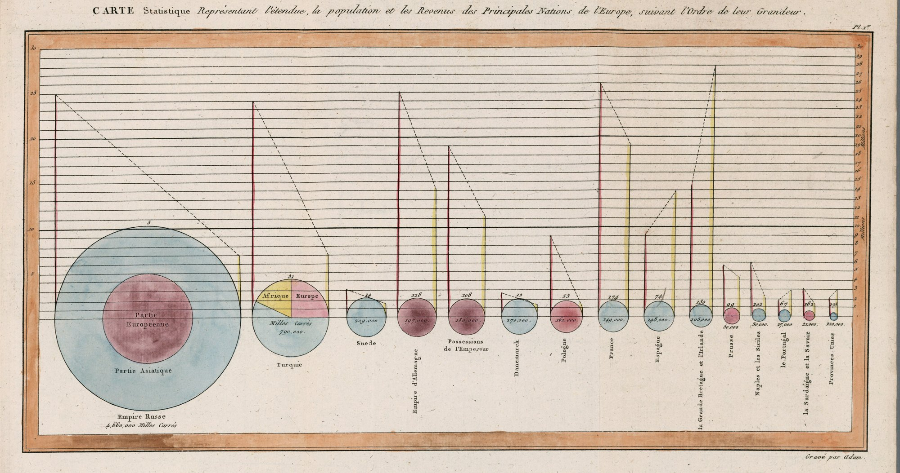
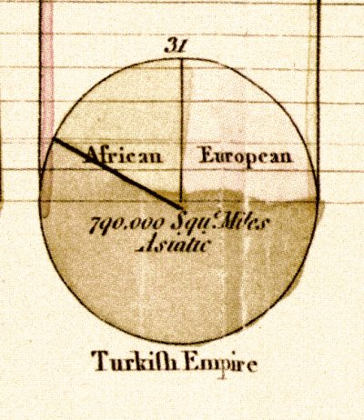
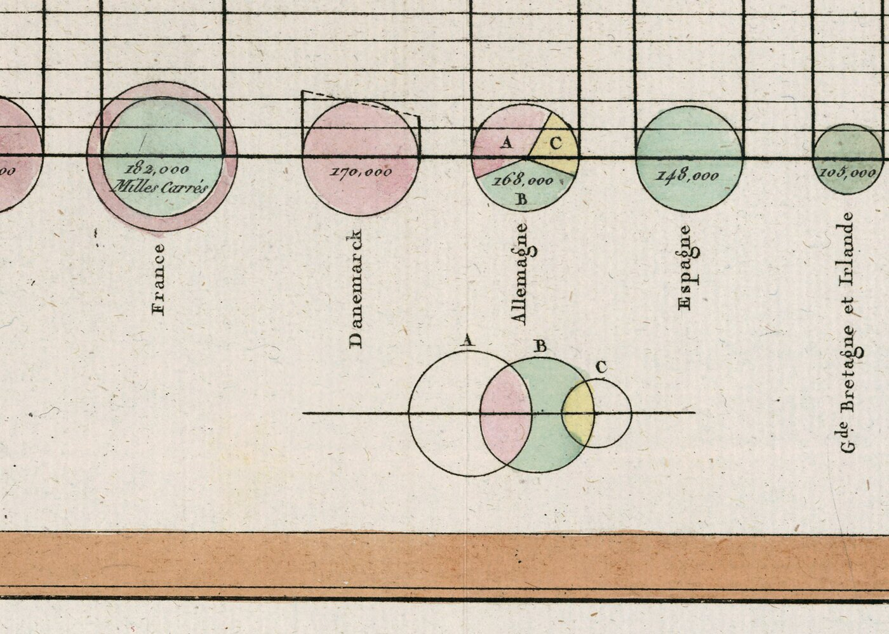
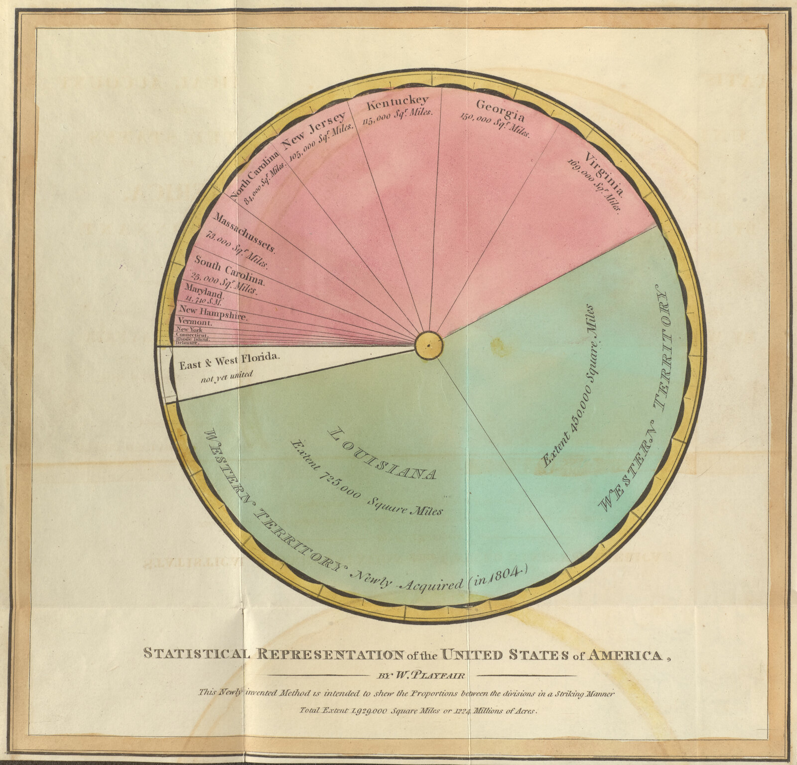

+++
author = "矢崎裕一"
title = "同じ平方マイルを、円の面積と扇形の角度で描いた──プレイフェアの1801年と1805年"
slug = "pie-chart-william-playfair"
date = "2025-10-12"
description = "プレイフェアは同じ国土の広さ（平方マイル）を2通りに描きました。1801年の図では国ごとの円の面積で、1805年の図では一つの円を切り分けた扇形の角度で描いています。"
categories = [
    "consume"
]
tags = [
    "William Playfair",
    "円グラフ",
    "円面積チャート",
    "The Statistical Breviary",
    "エンコーディング"
]
image = "images/us-divided-circle-1805.jpg"
series = ["dataviz-classics"]
series_weight = 2
seriesByline = "William Playfair"
seriesTitle = "円の面積と扇形の角度──プレイフェア 1801／1805"
+++

William Playfair（ウィリアム・プレイフェア, 1759–1823）は、同じ「国土の広さ（平方マイル）」を、2通りに描きました。1801年の図では、国ごとの円の面積で描いています。1805年の図では、一つの円を切り分けた扇形の角度で描いています。本人の言葉では、前者は国々の大きさを、後者は各州の広さの割合を、目に見せるための図です。

1801年の図は、プレイフェアの著書『The Statistical Breviary』の第1図です。1805年の図は、D. F. Donnant（ドナン）の本をプレイフェアが英訳した『Statistical Account of the United States of America』に入っています。以下は、Internet Archive で読める2冊の原本に沿って、2つの円がそれぞれ何を比べさせ、何を比べさせないかを見ていきます。

<!--more-->

## 1801年、国を円の大きさで並べる

『The Statistical Breviary』は1801年にロンドンで出ました。扉には、彩色した銅版の図（stained copper-plate charts）を添えたとあります。第1図は、本文の説明ではフランス革命の前のヨーロッパ諸国を描いた図です。下の画像は、翌年に出た仏訳版の同じ図です。

William Playfair 原図、Adam 彫版（仏訳版、1802）の図版全体。David Rumsey Map Collection, David Rumsey Map Center, Stanford Libraries／Internet Archive より引用（CC BY-NC-SA 3.0）

本文 13ページの説明は短いものです。円の一つ一つが一つの国を表し、国は広さの順に並ぶ。円の中の数字は、その国の平方マイルである。序文はこれを「比例する円（proportional circles）」で国の大きさを表す方法と呼びます。なぜ円なのかは、15ページに書かれています。

> The present charts are in like manner intended to aid statistical studies, by shewing to the eye the sizes of different countries represented by similar forms, for where forms are not similar, the eye cannot compare them easily nor accurately.

国の大きさを、似た形どうしで目に見せる。形が似ていなければ、目は簡単にも正確にも比べられない。地図の上の国は形が不揃いなので、球である惑星の大きさのほうが、むしろ正確に分かる、と続きます。

本文の表では、ロシアは4,650,000平方マイル、トルコは790,000です。トルコはロシアの0.17倍です。筆者が仏訳版の図で直径を測ると、ロシアは約411ピクセル、トルコは約171ピクセルでした。面積の比は0.17で、本文の比とほぼ合います。直径の比は0.42です。この測定からは、**直径ではなく面積が平方マイルに比例するように**円が描かれている、と読めます。

人口と歳入の縦線などの読み方は、[1801年の第1図を読む記事](/pie-chart-william-playfair-area/)に任せます。

## 円の中を切る──ロシアの環、トルコの扇形、ドイツの重なる円

第1図で、円の中まで分けてあるのは、ロシアとトルコだけです。ロシアの円は二重で、内側の円が "European Dominions"、外側の環が "Asiatic Dominions" です。トルコの円は、中心から線を引いて "European"、"African"、"Asiatic" の3つに分けてあります。

William Playfair（1801）／Wikimedia Commons より引用（Cambridge University Press 2005年の復刻版からのスキャン）。パブリックドメイン

この内訳の数字は、本のどこにもありません。筆者が仏訳版の図で測ると、ロシアの内側の円は外側の円の面積の約24%で、トルコのヨーロッパの扇形はほぼ四分円でした。けれども比べる数字がないので、区切りが実際の広さに合っているかは確かめられません。

同じ本の第2図（リュネヴィル和約の後のヨーロッパ）では、使い方がさらに増えます。50ページ前後の説明によれば、ドイツ帝国の全体、皇帝（オーストリア）の領地、プロイセンの領地を、3つの円 A・B・C として重ねて描いた。赤がオーストリアの取り分、黄がプロイセンの取り分で、残りの緑だけが本当の意味でのドイツ帝国だ、という説明です。フランスの円は、支配下の国々を合わせた広さを表す、薄い赤の円に囲まれています。

David Rumsey Map Collection, David Rumsey Map Center, Stanford Libraries／Internet Archive より引用（Donnant による仏訳版『Élémens de statistique』1802年の第2図の一部を切り出し）。CC BY-NC-SA 3.0

1801年の本だけで、円の中の分け方は少なくとも3通りあります。同心円（ロシア、フランス）、扇形（トルコ）、重なる円（ドイツ）です。ロシアとトルコでは、円の面積は国全体の広さのままで、その内側に別の区切りを重ねています。ドイツの重なる円は事情が違います。Chris Pritchard（2021）は、これを関係を示す図で、大きさには頓着していないと見ています（"relationships with carefree attention to scale; they are simply representational"）。

ロシアは環で、トルコは扇形である理由を、プレイフェア本人は書いていません。Pritchard は、Geolytix という企業の匿名ブログの説を「一つの可能性」として紹介しています。円が小さく、トルコの3つの部分を同心円の3重で塗り分ける余地がなかったので、そのときだけ放射状に分けたのかもしれない、という説です。トルコは第1図で2番目に大きい国なので、話の要点は国の小ささではなく、部分が3つあったことです。

## 1805年、一つの円を切り分ける

1802年、Donnant は『The Statistical Breviary』を仏訳した『Élémens de statistique』をパリで出し、合衆国の記述を加えました。プレイフェアはその部分を英訳し、1805年にロンドンの Greenland and Norris から出します。訳者序文によれば、訳は逐語的ではなく、「分割した円（divided circle）」で説明を補いました。扉には、この円を「新しい方法で（BY A NEW METHOD）」描いたとあり、図の下には次の一文があります。

> This Newly invented Method is intended to shew the Proportions between the divisions in a Striking Manner

区分どうしの割合を、目を引くかたちで見せる新しい方法だ、という意味です。

William Playfair／Lehigh University Libraries, Special Collections より引用。No Copyright – United States

その下には "Total Extent 1,929,000 Square Miles or 1224 Millions of Acres" とあります。合衆国全体の広さは、円の大きさではなく、この文で示されています。

各州・各地域の広さは、扇形の中心角で表されています。右上のヴァージニアから、大きな州の順に反時計回りに並びます。Lehigh 大学の展示の説明によれば、色は州、領土、スペインが支配する東西フロリダの3つを分けています。フロリダは "East & West Florida not yet united" と書かれた、色のない扇形です。新しく得た領土として描かれているのはルイジアナで、"Newly Acquired (in 1804)" とあります。その扇形の表記は725,000平方マイルで、総面積の約38%です。数字どおりなら角度は約135°になります。

本文 17ページには、円の目的がこう書かれています。

> The divided circle which represents the surface of the country, has been constructed for the purpose of shewing, in an easy and accurate manner, the proportional extent of the different provinces…

各州の広さの割合を、簡単かつ正確に見せるために作った、という説明です。すぐあとには、ヴァージニアとデラウェアの割合は釣り合わなすぎる、と続きます。円の中の、部分と部分の比較です。同じページの少し前には、三等の州（a third rate province）でも、版図を広げたフランスと同じ広さがある、という一文があります。こちらのヨーロッパとの比較は、円ではなく文章で書かれています。

なお、この図のデータには誤りがあります。David Bellhouse によれば、ニューヨークとニュージャージーが取り違えられ、州の面積は長さと幅を掛けて出されています。詳しくは[1805年の合衆国の円グラフを読む記事](/pie-chart-william-playfair-part/)で扱います。

## 2つの円で、比べられるもの・比べられないもの

2つの図で、同じ平方マイルがどの見た目に対応しているかを、表にします。

| データ | 1801年の第1図（ヨーロッパ諸国） | 1805年の図（合衆国） |
|---|---|---|
| 国・州・地域の広さ | 国ごとの円の面積 | 一つの円の中の扇形の中心角 |
| 広さの数値 | 円の中に数字で記入 | 扇形の中に数字で記入 |
| 全体の広さ | ― | 図の下の文。円の大きさは表さない |
| 内訳 | ロシアは同心円、トルコは扇形（数値なし） | すべて扇形 |
| 色 | 緑＝海の国、薄い赤＝陸の国 | 州、領土、東西フロリダを塗り分け |

筆者の整理では、目が比べられるものは次のように分かれます。

| | 1801年の量の円 | 1805年の分割する円 |
|---|---|---|
| 円の数／円の大きさ | 国の数だけ／データ | 1つ／データではない |
| 比べやすいもの | 国と国の広さ | 部分と全体、部分と部分 |
| 図だけでは分からないもの | 各国が全体に占める割合、ロシアとトルコの内訳の値 | 合衆国と他国の広さの比 |

1801年の図は、国と国を比べる図と読めます。けれども、ロシアがヨーロッパ全体のどれだけを占めるかは、円を全部足さないと分かりません。

1805年の図は、その逆と読めます。ルイジアナの扇形が最も大きい区分であることは、ひと目で分かります。けれども、合衆国がロシアより大きいか小さいかは分かりません。1801年の目盛りで描けば、合衆国の円は面積でロシアの約0.41倍、直径で約0.64倍になる計算です。フランスとの比較が文章で書かれたのも、この円では示せないからだと読めます。

1805年の円は、円の大きさをデータから外し、区切りだけに意味を持たせています。Bellhouse は、1801年の時点のプレイフェアは自分のしたことを十分に自覚していなかった、と見ます。その見方に立つと、1805年の「新しく考案した方法」は、扇形の角度を主役にしたことを指す、と読めます。

## 第三者は2つの円をどう見たか

Pritchard は、1801年のトルコの円を最初のパイチャートと呼びます。Wikipedia の "Pie chart" の項も同じ立場です。Pritchard は2通りの分け方の理由も問うています。ドイツの重なる円は、のちのベン図になぞらえる見方を、無理のないものとしています。

David Bellhouse（2022）は、別の線を引きます。

> In terms of an actual pie chart, Playfair was not fully aware of what he had done at that point. His fully-fledged pie chart, which appeared in 1805…

1801年の図は先駆けにすぎず、本格的なパイチャートは1805年の図だ、という立場です。そのうえで、先に見たデータの誤りを指摘しています。

Ian Spence は "No Humble Pie"（2005）の要旨で、パイの起源ははっきりせず、着想はルルスやオイラーらの論理図から来た可能性が高い、と書いています。

プレイフェアは14ページで、目は大きさを「ほとんど比類のない正確さ」で比べる、と書きました。後の知覚研究は、別の結果を出しています。William S. Cleveland と Robert McGill（1984）は、量の読み取りの正確さを、共通の目盛の上の位置、長さ、角度、面積、体積の順に並べる仮説を立てました。1801年の面積も1805年の角度も、位置や長さより読み取りにくい側に入ります。

Drew Skau と Robert Kosara（2016）は、円グラフで目が何を手がかりにするかを調べました。

> Data is encoded in pie and donut charts in three ways: arc length, center angle, and segment area… Both studies point to angle being the least important visual cue for both charts

データは弧の長さ、中心角、扇形の面積の3つで表され、角度はいちばん効いていない手がかりだった、という結果です。一つの円を切り分ける場合、3つは同じ比になるので、どれで読んでも割合は変わりません。

ただし、プレイフェアが比べていたのは、地図の不揃いな国の形と、そろった円です。後の研究は、円と棒などを比べています。問いが違うので、並べて読むものだと読めます。

## 使い道

一つめは、描く前に、何と何を比べさせるかを決めることです。項目どうしを比べるなら、1801年のように別々の形を並べます。全体の中の割合を見せるなら、1805年のように一つの形を切り分けます。どちらを選ぶかで、見える比較と見えない比較が入れ替わります。

二つめは、面積で描くなら、面積をデータに比例させることです。直径で比例させると、トルコはロシアの0.17倍ではなく、0.42倍に見えてしまいます。

三つめは、一つの円に2つの役目を重ねるなら、内側の値も示すことです。ロシアとトルコの内訳は数字がないので、読者は区切りが正しいかを確かめられません。

四つめは、分割した円では、円の大きさが何も表さないと意識することです。全体の値は文で添え、外の国との比較には別の手段を用意します。そして、角度を正確に描いても、もとのデータの誤りは直りません。

## 参考・出典

**一次情報**

- William Playfair, *The Statistical Breviary; Shewing, on a Principle Entirely New, the Resources of Every State and Kingdom in Europe*, London: J. Wallis ほか, 1801.（序文、pp.13–16、ロシアとトルコの章、第2図の説明 p.50 前後）[Internet Archive](https://archive.org/details/statisticalbrev00playgoog) ／ [OCR テキスト](https://archive.org/download/statisticalbrev00playgoog/statisticalbrev00playgoog_djvu.txt)
- D. F. Donnant, *Statistical Account of the United States of America*, translated by William Playfair, London: Greenland and Norris, 1805.（扉、訳者序文 pp.v–vi、p.17）[Internet Archive](https://archive.org/details/statisticalacco00donngoog) ／ [OCR テキスト](https://archive.org/download/statisticalacco00donngoog/statisticalacco00donngoog_djvu.txt)
- Lehigh University Libraries, Special Collections, "Statistical Representation of the United States of America"（1805年の図と扉の画像）[展示の項目](https://exhibits.lib.lehigh.edu/items/show/3204) ／ [展示「At a Glance」の解説](https://exhibits.lib.lehigh.edu/exhibits/show/data_visualization/case_one/playfair)
- Donnant 訳『Élémens de statistique』（Paris, 1802）の図版、David Rumsey Map Collection（Internet Archive のミラー）：[第1図](https://archive.org/details/dr_carte-statistique-reprsentant-ltendue-la-population-et-les-revenus-des-14005003) ／ [第2図](https://archive.org/details/dr_carte-statistique-reprsentant-ltendue-la-population-et-les-revenus-des-14005004)
- Wikimedia Commons, "File:Playfair-piechart.jpg"（1801年のトルコの円）[Commons](https://commons.wikimedia.org/wiki/File:Playfair-piechart.jpg)

**第三者評価**

- Chris Pritchard, "Life of Pie: William Playfair and the Impact of the Visual," Mathematical Association Presidential Essay No. 4, 2021. [PDF](https://www.m-a.org.uk/resources/PE4LifeofPie.pdf)
- David Bellhouse, "William Playfair's Statistical Graphs," *CSHPM Notes / Notes de la SMC*, 54(1), 2022. [PDF](https://notes.math.ca/wp-content/uploads/2022/02/William-Playfairs-Statistical-Graphs-Notes-de-la-SMC.pdf)
- Ian Spence, "No Humble Pie: The Origins and Usage of a Statistical Chart," *Journal of Educational and Behavioral Statistics*, 30(4), 2005, pp. 353–368.（要旨）[IDEAS/RePEc](https://ideas.repec.org/a/sae/jedbes/v30y2005i4p353-368.html) ／ [doi:10.3102/10769986030004353](https://doi.org/10.3102/10769986030004353)
- Drew Skau and Robert Kosara, "Arcs, Angles, or Areas: Individual Data Encodings in Pie and Donut Charts," *Computer Graphics Forum*, 35(3), 2016, pp. 121–130. [eagereyes](https://eagereyes.org/publications/Skau-EuroVis-2016)
- William S. Cleveland and Robert McGill, "Graphical Perception: Theory, Experimentation, and Application to the Development of Graphical Methods," *Journal of the American Statistical Association*, 79(387), 1984, pp. 531–554.（順位は講義資料による）[Cornell INFO 3312 の講義資料](https://info3312.infosci.cornell.edu/slides/04-graphical-perception.html)
- Ian Spence and Stephan Lewandowsky, "Displaying Proportions and Percentages," *Applied Cognitive Psychology*, 5(1), 1991, pp. 61–77.（要旨）[ISU Graphics Group の紹介](https://isu-graphicsgroup.github.io/gg-blog/posts/2023-Spring/2023-03-09-paper-discussion/index.html)
- Wikipedia, "Pie chart"（History 節）[Wikipedia](https://en.wikipedia.org/wiki/Pie_chart) ／ "William Playfair" [Wikipedia](https://en.wikipedia.org/wiki/William_Playfair)
