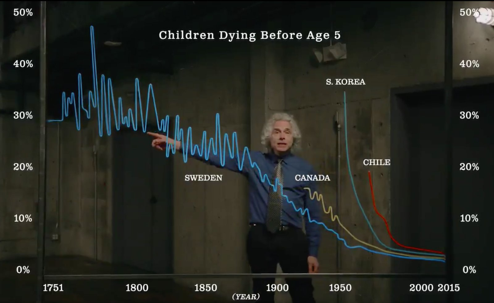
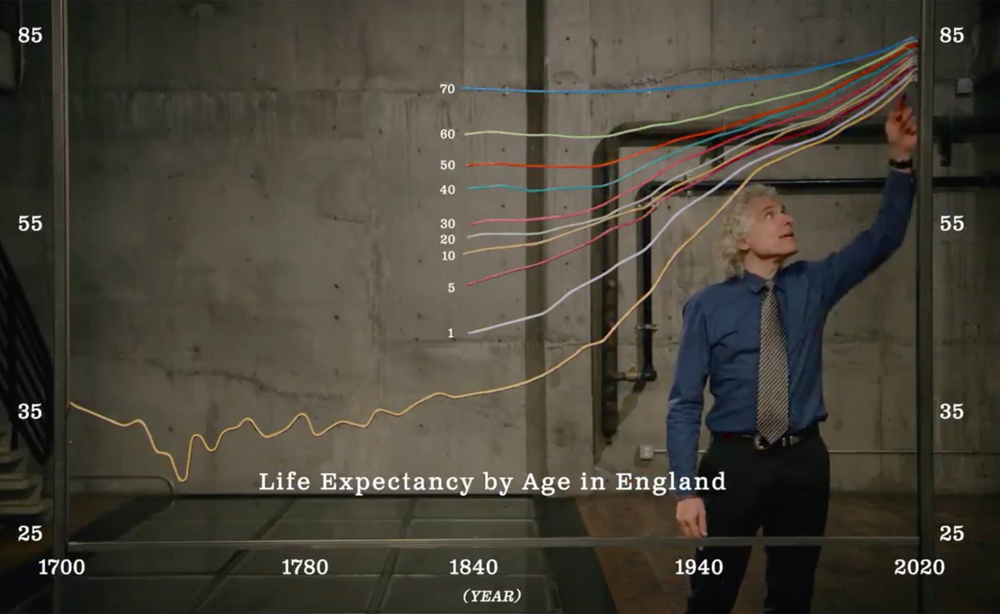

+++
author = "Yuichi Yazaki"
title = "The Lines Appear to Be Physical; the Scales Are Text Added Afterward — Steven Pinker's Glowing Line Charts"
slug = "pinker-physical-line-charts"
date = "2026-11-03"
description = "In a 2018 video released by Bill Gates, the line charts in front of Steven Pinker appear, judging from the footage, to be real glowing lines bent and hung in place. The scales, titles, and country names are text added over the video afterward."
categories = [
    "consume"
]
tags = [
    "data physicalization",
    "line chart",
    "Steven Pinker",
    "video"
]
image = "images/child-mortality-chart.jpg"
+++

In a video released in 2018 on Bill Gates's channel, the line charts in front of Steven Pinker appear, judging from the footage, to be real glowing lines bent and hung in place. The scales, titles, and country names are text added over the video afterward. I have not found any explanation from the production side. The video runs about two and a half minutes and shows three line charts: global life expectancy, life expectancy by age in England, and the share of children who die before age 5.

My entry point is the item "Steven Pinker explains Global Life Expectancy with Physical Line Charts" in dataphys.org, a catalog of data physicalization. The observations and timestamps below are based on the video Gates posted on X (formerly Twitter; about 2 minutes 29 seconds) and its English subtitles. The YouTube version matches in subject, publisher, and timing, but I have not compared the two frame by frame.

<!--more-->

## February 2018: Two and a Half Minutes on Gates's Channel

The video is titled "Humanity is fighting back against the Grim  Reaper". It was published on Bill Gates's YouTube channel on February 13, 2018 ([YouTube](https://www.youtube.com/watch?v=zXJPlwaYKzo)). The description is a single line.

> Author Steven Pinker explains how life spans have skyrocketed in the past two centuries.

In other words, the video presents Pinker explaining how much life spans have grown over the past two centuries. The link in the description redirects to the page for Bill and Melinda Gates's 2018 Annual Letter, and the URL contains a tracking string, "AnnualLetter2018_Pinker". I have not been able to read the body of the destination page, but the link suggests the video was made to accompany the Annual Letter.

Eleven days later, on February 24, 2018, Gates posted the video on X.

> People today are living longer, healthier, and happier lives than ever before. I asked @sapinker to explain why.

The post says that people today live longer, healthier, and happier lives than ever before, and that Gates asked Pinker to explain why. Because it says "I asked", the video can be read as one requested from Gates's side.

| Item | Details |
|---|---|
| Speaker | Steven Pinker. The opening name caption reads "Author / Psychologist / Professor / Harvard University" |
| Published by | Bill Gates's YouTube channel (February 13, 2018); X (February 24, 2018) |
| End screen | The book title "ENLIGHTENMENT NOW" drawn in glowing lines, followed by the "gatesnotes" logo |
| Production company / director | Not shown in the video or in any text source; cannot be identified |

*Enlightenment Now* is a book Pinker published with Viking in 2018. Its official site describes it as "In 75 jaw-dropping graphs". I have not been able to confirm which figures in the book correspond to the three graphs in the video.

The dataphys.org entry is titled "Global Life Expectancy", but the video shows three graphs.

| | Title on screen | Time on screen | Lines |
|---|---|---|---|
| A | Global Life Expectancy by Age | about 0:07–0:45 | 1 red line |
| B | Life Expectancy by Age in England | about 0:45–1:22 | 10 lines (at birth, and at ages 1 to 70) |
| C | Children Dying Before Age 5 | about 1:22–2:20 | 4 lines, then 1 more added for 5 |

The longest is C (about one minute), which is not in the entry's title. C is also where a country is added.

## The Lines Can Be Held in the Hand

The footage offers four clues that the lines are physical objects.

- In the close-up from 0:05 to 0:09, Pinker's hand grips the end of A's red line.
- In the wide shots at 0:04 and 2:20, the three graphs stand in separate places in the same room. Pinker's head comes in front of B's lines and hides them.
- In the close-up from 2:04 to 2:06, a hand brings in a yellow line and hangs it on C's frame. The line sways and settles into place.
- In the close-ups, the way the lines look changes with the camera angle.

Source: frame from the Bill Gates (Gates Notes) video / dataphys.org

In the close-up around 1:39, Sweden's line is visible. It is a thin wire bent into the shape of the data and glowing blue all over. It can be read as an EL wire (a thin cable that glows with electricity) or an LED light tube of some kind. I have not found any source that discloses the material. The Ethiopia line that is brought in bends, so the material is somewhat flexible.

The frame is a metal post standing on the floor. The left and right edges of each graph line up with the posts. The horizontal line at the bottom also looks like a physical crossbar, but that is a reading from appearance.

There are things I could not confirm. dataphys.org writes that the graphs sway slightly when Pinker touches them. **In still frames, I could not tell a sway caused by touch apart from camera shake.** The line clearly moves when the Ethiopia line is brought in. I have also found no source in which the production side says the lines were built physically, so from the footage alone I cannot fully rule out CG compositing.

## The Scales and Country Names Sit on Top of the Footage

Unlike the lines, the text attached to the graphs is not physical. The deciding scene is the final wide shot around 2:20. Only the lines of the three graphs appear in the room, with no scales, titles, or country names. The same lines are on screen without the text, so the text can be identified as something laid over the footage in editing.

Source: frame from the Bill Gates (Gates Notes) video / dataphys.org

Sorting the correspondence between data and appearance by physical object versus overlaid text gives the following.

| Data | Appearance | Physical or overlaid text (judgment from the footage) |
|---|---|---|
| Values (years of life expectancy, share dying before 5) | Height of the line | Physical line |
| Year | Horizontal position of the line | Physical line |
| Series (age in B, country in C) | Color of the line | Physical line (the lines appear to glow by themselves) |
| Series names (ages, country names) | White text near the line | Overlaid text |
| Scales, axis numbers, titles | White text at the left, right, and bottom of the screen | Overlaid text |
| Frame | Metal posts | Physical |
| Adding a series | A line is brought by hand and hung | Physical action |

The physical object handles the shape of the lines, and the video handles the annotation needed to read that shape as numbers. It can be read as the two together making a graph that can actually be read.

Source: frame from the Bill Gates (Gates Notes) video / dataphys.org

Measuring the frames with the overlaid scales as a ruler also reveals how the axes are built. B's vertical axis has tick intervals that get tighter toward the top, so they are not evenly spaced. The ticks on A's horizontal axis are 1770, 1820, 1870, 1913, 1950, 1973, 2000, and 2015. The gaps between years vary from 50 years to 15 years, yet the spacing between ticks on screen is nearly equal at about 130–170 px, and the bends in the line sit at those years' positions. This can be read as a line laid out horizontally by the order of the data points, not by the length of time. As a result, the second half, 102 years from 1913 to 2015 (about 630 px), looks wider than the first half, 143 years from 1770 to 1913 (about 430 px).

The scales are overlaid, but the source of the data is not shown anywhere in the video, nor in the YouTube description. Comparing against the current Our World in Data (OWID) series gives the following.

| Graph | Series compared | Points that match | Points that do not match |
|---|---|---|---|
| A World | OWID life expectancy | The years on the scale are a subset of the years in OWID's world series | From 1913 to 1973, the video's values are 3–5 years higher |
| B England | OWID life expectancy at different ages | The age-specific lines start in the 1840s | The video's value for 1841 is lower |
| C Under-5 deaths | OWID child mortality | Sweden starts at about 30% in 1751, with a peak in the 1770s | The years where the Canada and Chile lines start differ |

For C, Sweden's starting year and peak position match well. But all of these are comparisons with the current versions, and I cannot tell whether the differences come from the 2018 versions or from reading error. The source cannot be determined.

## Tracing and Adding Lines: Narration and Hand Movements

Because the lines are handled as physical objects, as they appear to be, Pinker's hand movements double as the steps of the explanation. The correspondence between narration and screen is as follows.

| Time | Narration | Screen |
|---|---|---|
| 0:01–0:12 | Newborns long ago could expect to live only 30 years | From a wide shot to a close-up of a hand gripping the end of the red line |
| 0:12–0:24 | Newborns today can expect 70 years or more, and 80 or more in developed regions | A finger traces A's line from left to right and points to the high point at the right end |
| 0:45–1:22 | Looking at the lines by age, using England as an example | The hand moves up from the lower lines to the upper lines |
| 1:50–1:58 | Chile cut its child mortality in 30 years | The hand indicates the steep drop of the red line |
| 2:04–2:07 | Looking at an African country such as Ethiopia | A hand brings in the yellow line and hangs it; in the next shot the text "ETHIOPIA" is added |

In C, the lines are not all there from the start.

> Take an African country like Ethiopia. In 1980, almost a quarter of the children died before their fifth birthday.

The narration says that in Ethiopia in 1980, almost a quarter of children died before their fifth birthday. On this sentence, Pinker brings in the yellow line by hand. The movement of one line being added coincides with the turn in the story toward "progress is happening in developing countries too". The narration also says, "Each line shows a country representing a different continent." The five countries can be read as one each for Europe, North America, Asia, South America, and Africa. The subtitles name only Sweden, Chile ("In Latin America"), and Ethiopia ("an African country").

Because the line is brought and hung by hand, it sways and takes a moment to settle. The addition of a new series is visible as a movement. By choosing physical lines, the video seems to have been able to act out, on screen, the steps of the explanation: tracing with a finger, raising a hand, adding one line.

## How Third Parties Saw This Video

The dataphys.org entry was registered by Yvonne Jansen, with information contributed by Cedric Honnet.

> At first glance it appears that line charts are digitally overlaid on the video. However, closeups and a light swaying of the graphs when Steven Pinker touches them, as well as the addition of another country towards the end of the video indicate that the graphs visible in this video are actually physical line graphs.

The reading is that, at first glance, the line charts look digitally overlaid on the video, but the close-ups, the sway on touch, and the addition of a country near the end show that they are physical line charts. The category is "Passive physical visualization", and the tags are "rearrangeable" and "storytelling". On the lines, this matches the clues in the footage, but the text really is digitally overlaid. As for the sway, I could not confirm it in still frames.

Jansen, Pierre Dragicevic, and Jean-Daniel Fekete presented an evaluation experiment on physical visualizations at CHI 2013 ([article in Japanese](/en/evaluating-physical-visualizations/)). The abstract says:

> The efficiency of physical visualizations seems to stem from features that are unique to physical objects, such as their ability to be touched and their perfect visual realism.

The conclusion is that the efficiency of physical visualizations seems to come from properties unique to physical objects, such as being touchable and looking perfectly real. The subject was 3D bar charts, not line charts. Even so, being touchable does not reach the video's viewers; it belongs only to Pinker on screen. Visual realism survives the trip through the video. This video can be read as handing only the latter to its viewers.

In May 2018, Jeremy Lent criticized how the graphs in *Enlightenment Now* were chosen. While granting that the book's 75 graphs do show progress, he calls it a "selective view of progress", that is, a view that looks only at the progress that suits the argument. The way the video adds countries one line at a time can also be read as connecting to the point that the impression changes depending on which countries are chosen.

## Takeaways for Use

What this video offers to take away is a way of dividing what is made physical from what is left to the video. Only the shape of the lines, which appear to be physical, was placed in the room; all the text needed for reading was overlaid in editing. The lines can be grabbed by hand, and the text stays legible even when a person stands in front of it.

When filming a physical graph, make physical the things the hand touches in the explanation and the things that get added or removed. Overlay what should be readable from any angle, such as numbers and names. Ending with a wide shot without text lets viewers check how much was physical.

The action of adding a series is also usable. Bringing in one line by hand, as with the Ethiopia line, leaves the moment a new comparison joins as a visible movement. It can be read as marking a break in the story more clearly than drawing in an extra line on screen.

What this video lacks is also a point to take away. The source of the data appears nowhere on screen, and A's horizontal axis was not proportional to the length of years. Physical objects catch the eye, and for that reason the construction of the axes and the source are easy to overlook. Precisely when showing something physically, the source and the construction of the axes need to be written in the overlaid text or in the description.

## References

**Primary sources**

- dataphys.org, "Steven Pinker explains Global Life Expectancy with Physical Line Charts": https://dataphys.org/list/steven-pinker-explains-global-life-expectancy-with-physical-line-charts/
- Bill Gates, "Humanity is fighting back against the Grim  Reaper", YouTube, February 13, 2018: https://www.youtube.com/watch?v=zXJPlwaYKzo
- YouTube oEmbed (title and publisher): https://www.youtube.com/oembed?url=https://www.youtube.com/watch?v=zXJPlwaYKzo&format=json
- Bill Gates's post on X, February 24, 2018: https://twitter.com/BillGates/status/967449421238579201
- X video streaming playlist (video file and English subtitles): https://video.twimg.com/amplify_video/963248646262284289/pl/2kD1mFd_Szq2Ipmo.m3u8
- Link in the YouTube description: http://b-gat.es/2Eac9LN (redirects to https://www.gatesnotes.com/2018-Annual-Letter ; body not checked)
- Steven Pinker, *Enlightenment Now: The Case for Reason, Science, Humanism, and Progress*, Viking, 2018. Introduction on the official site: https://stevenpinker.com/publications/enlightenment-now-case-reason-science-humanism-and-progress
- Series used for comparing the data (current versions)
  - Our World in Data, "Life expectancy": https://ourworldindata.org/grapher/life-expectancy (metadata: https://ourworldindata.org/grapher/life-expectancy.metadata.json )
  - Our World in Data, "Life expectancy at different ages": https://ourworldindata.org/grapher/life-expectancy-at-different-ages
  - Our World in Data, "Child mortality": https://ourworldindata.org/grapher/child-mortality (metadata: https://ourworldindata.org/grapher/child-mortality.metadata.json )
  - Max Roser, "Twice as long — life expectancy around the world", Our World in Data, 2018: https://ourworldindata.org/life-expectancy-globally
  - James C. Riley, "Estimates of Regional and Global Life Expectancy, 1800–2001," 2005. [doi:10.1111/j.1728-4457.2005.00083.x](https://doi.org/10.1111/j.1728-4457.2005.00083.x)

**Secondary sources**

- Yvonne Jansen, Pierre Dragicevic, Jean-Daniel Fekete, "Evaluating the Efficiency of Physical Visualizations," CHI 2013. [doi:10.1145/2470654.2481359](https://doi.org/10.1145/2470654.2481359) / HAL: https://inria.hal.science/hal-00781831
- Jeremy Lent, "Steven Pinker's Ideas About Progress Are Fatally Flawed. These Eight Graphs Show Why.", Patterns of Meaning, May 17, 2018: https://patternsofmeaning.com/2018/05/17/steven-pinkers-ideas-about-progress-are-fatally-flawed-these-eight-graphs-show-why/
- Douglas Fischer's introduction to Lent's article, EHN, May 18, 2018: https://www.ehn.org/steven-pinkers-ideas-about-progress-are-fatally-flawed-these-eight-graphs-show-why-resilience
- M. Özgür Nevres, "People today are living longer, healthier, and happier lives than ever before", March 13, 2018: https://ourplnt.com/people-living-longer-healthier-happier
