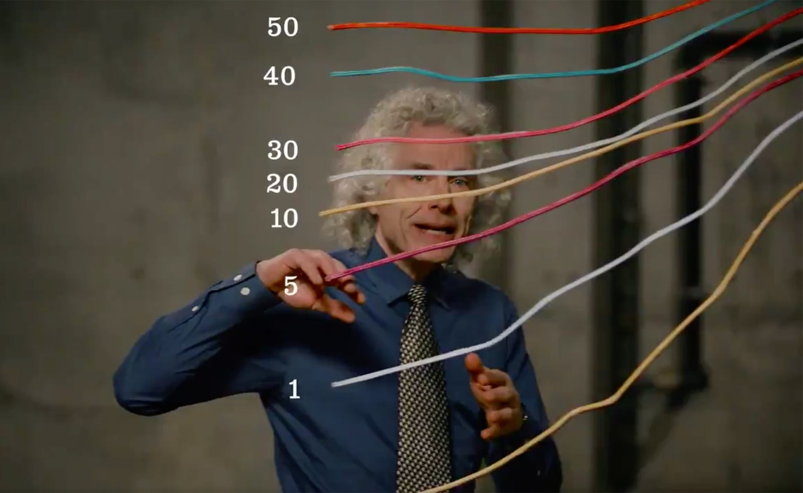
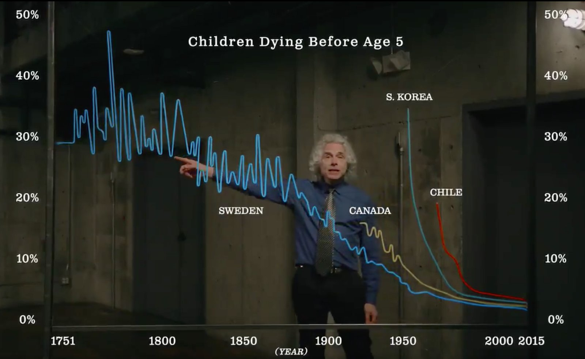
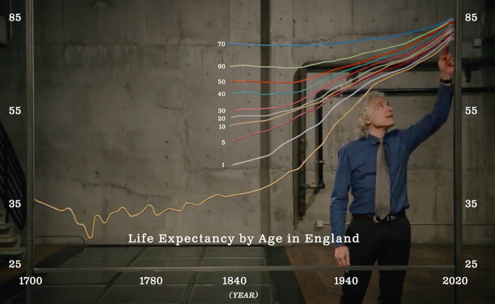

+++
author = "矢崎裕一"
title = "線は実物に見え、目盛りはあとから重ねた文字──Steven Pinker の光る折れ線グラフ"
slug = "pinker-physical-line-charts"
date = "2026-11-03"
description = "2018年に Bill Gates が公開した動画で、Pinker の前の折れ線は、映像から見るかぎり、光る線を曲げて吊るした実物とみられます。目盛り、題名、国名は、あとから映像に重ねた文字です。"
categories = [
    "consume"
]
tags = [
    "データ物質化",
    "折れ線グラフ",
    "Steven Pinker",
    "動画"
]
image = "images/child-mortality-chart.jpg"
series = ["data-physicalization"]
series_weight = 38
seriesByline = "Steven Pinker・Gates Notes"
seriesTitle = "線は実物に見え、目盛りはあとから重ねる──Pinker の光る折れ線"
+++

2018年に Bill Gates（ビル・ゲイツ）のチャンネルが公開した動画で、Steven Pinker（スティーブン・ピンカー）の前にある折れ線は、映像から見るかぎり、光る線を曲げて吊るした実物とみられます。目盛り、題名、国名は、あとから映像に重ねた文字です。制作側の説明は見つかっていません。動画は2分半ほどで、世界の平均寿命、イングランドの年齢別の平均寿命、5歳になる前に亡くなる子どもの割合の、3つの折れ線が出てきます。

入口は、データ物理化の目録 dataphys.org の項目「Steven Pinker explains Global Life Expectancy with Physical Line Charts」です。以下の観察と時刻は、ゲイツが X（旧 Twitter）に投稿した動画（約2分29秒）と、その英語字幕によります。YouTube 版とは題材・公開元・時期が一致しますが、映像を1コマずつ突き合わせてはいません。

<!--more-->

## 2018年2月、ゲイツのチャンネルに出た2分半

動画の題は "Humanity is fighting back against the Grim  Reaper"。2018年2月13日に、Bill Gates の YouTube チャンネルで公開されました（[YouTube](https://www.youtube.com/watch?v=zXJPlwaYKzo)）。説明文は1行です。

> Author Steven Pinker explains how life spans have skyrocketed in the past two centuries.

ピンカーが、この2世紀で寿命がどれほど延びたかを説明する、という紹介です。説明文のリンクは、ゲイツ夫妻の2018年の Annual Letter のページへ転送され、URL に "AnnualLetter2018_Pinker" という計測用の文字列が入っています。転送先の本文は読めていませんが、Annual Letter に合わせた映像だと読めます。

11日後の2018年2月24日、ゲイツは X にこの動画を投稿しました。

> People today are living longer, healthier, and happier lives than ever before. I asked @sapinker to explain why.

いまの人は、かつてなく長く、健康で、幸せに生きている。その理由をピンカーに説明してもらった、という投稿です。"I asked" とあるので、ゲイツの側から頼んだ映像だと読めます。

| 項目 | 内容 |
|---|---|
| 出演 | Steven Pinker。冒頭の名前テロップは "Author / Psychologist / Professor / Harvard University" |
| 公開元 | Bill Gates の YouTube チャンネル（2018年2月13日）、X（2018年2月24日） |
| 終わりの画面 | 光る線で描いた本の題 "ENLIGHTENMENT NOW"、続いて "gatesnotes" のロゴ |
| 制作会社・監督 | 映像にも文字資料にも表示がなく、特定できない |

『Enlightenment Now』は、ピンカーが2018年に Viking から出した本です。公式サイトは "In 75 jaw-dropping graphs" と紹介しています。動画の3つのグラフが本のどの図に当たるかは、確かめられていません。

dataphys.org の項目名は "Global Life Expectancy" ですが、動画に出るグラフは3つです。

| | 映像上の題名 | 出る時間 | 線 |
|---|---|---|---|
| A | Global Life Expectancy by Age | 0:07〜0:45ごろ | 赤1本 |
| B | Life Expectancy by Age in England | 0:45〜1:22ごろ | 10本（出生時と、1〜70歳の年齢ごと） |
| C | Children Dying Before Age 5 | 1:22〜2:20ごろ | 4本、のちに1本足して5本 |

いちばん長いのは、項目名にない C（約1分）です。国が足されるのも C です。

## 線は、手でつかめる

映像には、線が実物だと考えられる手がかりが四つあります。

- 0:05〜0:09 の寄りの画で、ピンカーの手が A の赤い線の端をつかんでいる。
- 0:04 と 2:20 の引きの画で、3つのグラフが同じ部屋の別々の場所に並ぶ。ピンカーの頭が B の線の手前に来て、線を隠している。
- 2:04〜2:06 の寄りの画で、手が黄色い線を持ち込み、C の枠に掛ける。線は揺れながら所定の位置に収まる。
- 寄りの画では、カメラの角度によって線の見え方が変わる。

Bill Gates（Gates Notes）の動画のコマ／dataphys.org より引用

1:39ごろの寄りの画では、スウェーデンの線が見えます。細い線材をデータの形に折り曲げたもので、全体が青く光っています。EL ワイヤー（電気で光る細いケーブル）や、LED を使った光るチューブのような線材だと読めます。素材を明かした資料は見つかっていません。持ち込まれるエチオピアの線はしなるので、ある程度柔らかい線材です。

枠は、床に立てた金属の支柱です。グラフの左右の端が、支柱の位置と重なります。下端の横線も物理的な横棒に見えますが、これは見た目からの読みです。

確かめられなかったこともあります。dataphys.org は、ピンカーが触れるとグラフがわずかに揺れる、と書いています。**触れたときの揺れは、静止したコマではカメラの揺れと区別できませんでした。** 線がはっきり動くのは、エチオピアの線を持ち込む場面です。制作側が「実物で作った」と述べた資料も見つかっておらず、映像だけでは CG 合成の可能性を完全には否定できません。

## 目盛りと国名は、映像の上にある

線とちがって、グラフに付いた文字は実物ではありません。決め手は、2:20ごろの最後の引きの画です。3つのグラフの線だけが部屋に映り、目盛りも題名も国名もありません。同じ線が映っていて文字だけがないので、文字は編集で重ねたものだと分かります。

Bill Gates（Gates Notes）の動画のコマ／dataphys.org より引用

データと見た目の対応を、実物か重ねた文字かで分けると、次のようになります。

| データ | 見た目 | 実物か、重ねた文字か（映像から見た判断） |
|---|---|---|
| 値（寿命の年数、5歳未満で亡くなる割合） | 線の高さ | 実物の線 |
| 年 | 線の横の位置 | 実物の線 |
| 系列（B は年齢、C は国） | 線の色 | 実物の線（線が自分で光っているように見える） |
| 系列の名前（年齢、国名） | 線の近くの白い文字 | 重ねた文字 |
| 目盛り、軸の数字、題名 | 画面の左右と下の白い文字 | 重ねた文字 |
| 枠 | 金属の支柱 | 実物 |
| 系列の追加 | 線を1本、手で持ってきて掛ける | 実物の動作 |

線の形は実物が受け持ち、その形を数字として読むための注記は映像が受け持つ。両方がそろって、はじめて読めるグラフになっていると読めます。

Bill Gates（Gates Notes）の動画のコマ／dataphys.org より引用

重ねた目盛りを物差しにしてコマを測ると、軸の作りも見えてきます。B の縦軸は、上ほど目盛りの間が詰まっていて、等間隔ではありません。A の横軸の目盛りは 1770、1820、1870、1913、1950、1973、2000、2015 です。年の間隔は50年から15年までばらばらなのに、画面上の目盛りの間隔は約130〜170px でほぼ等しく、線の折れ目もその年の位置にあります。時間の長さではなく、データ点の順番で横に並べた線だと読めます。そのため、143年分の前半（1770〜1913年、約430px）より、102年分の後半（1913〜2015年、約630px）のほうが広く見えます。

目盛りは重ねてありますが、データの出典は動画のどこにも示されていません。YouTube の説明文にもありません。現在の Our World in Data（OWID）の系列と照らし合わせると、次のとおりです。

| グラフ | 照らし合わせた系列 | 合う点 | 合わない点 |
|---|---|---|---|
| A 世界 | OWID の平均寿命 | 目盛りの年は、OWID の世界の系列にある年の一部 | 1913〜1973年で、動画の値が3〜5歳高い |
| B イングランド | OWID の年齢別平均寿命 | 年齢別の線が1840年代から始まる | 1841年の値が、動画のほうが低い |
| C 5歳未満の死亡 | OWID の子どもの死亡率 | スウェーデンは1751年に約30%で始まり、1770年代に山がある | カナダとチリの線の始まる年が違う |

C のスウェーデンは、始まりの年と山の位置がよく合います。ただ、どれも現在の版との比較で、差が2018年当時の版によるのか、読み取りの誤差かは分かりません。出典は確定できません。

## 線をたどり、線を足す──語りと手の動き

実物と見られる線を手で扱うので、ピンカーの手の動きがそのまま説明の手順になっています。語りと画面の対応は次のとおりです。

| 時間 | 語り | 画面 |
|---|---|---|
| 0:01〜0:12 | 昔の新生児は30年しか生きられないと見込まれた | 引きの画から、赤い線の端を手でつかむ寄りの画へ |
| 0:12〜0:24 | いまの新生児は70年以上、先進地域では80年以上 | A の線を左から右へ指でたどり、右端の高いところを指す |
| 0:45〜1:22 | イングランドを例に、年齢ごとの線を見る | 下の線から上の線へと手を上げていく |
| 1:50〜1:58 | チリは30年で子どもの死亡率を下げた | 赤い線の急な下がりを手で示す |
| 2:04〜2:07 | エチオピアのようなアフリカの国を見る | 手が黄色い線を持ち込んで掛け、続く画で "ETHIOPIA" の文字が加わる |

C では、線が最初から全部はそろっていません。

> Take an African country like Ethiopia. In 1980, almost a quarter of the children died before their fifth birthday.

エチオピアでは、1980年に子どものほぼ4分の1が5歳までに亡くなっていた、という語りです。この一文に合わせて、ピンカーが黄色い線を手で持ち込みます。1本が加わる動きが、「途上国でも進んでいる」という話の転換と重なります。語りは "Each line shows a country representing a different continent." とも言います。5か国は、ヨーロッパ、北米、アジア、南米、アフリカに一つずつ当たると読めます。字幕が名指ししているのは、スウェーデン、チリ（"In Latin America"）、エチオピア（"an African country"）だけです。

手で持ってきて掛けるので、線は揺れ、収まるまでに一瞬かかります。新しい系列が加わったことが、動作として見えます。物理の線を選んだことで、指でたどる、手を上げる、1本足す、という説明の手順を画面の中で演じられた、と読めます。

## 第三者はこの動画をどう見たか

dataphys.org の項目は、Yvonne Jansen（イヴォンヌ・ジャンセン）が登録し、Cedric Honnet が情報を寄せたものです。

> At first glance it appears that line charts are digitally overlaid on the video. However, closeups and a light swaying of the graphs when Steven Pinker touches them, as well as the addition of another country towards the end of the video indicate that the graphs visible in this video are actually physical line graphs.

一見、折れ線は映像にデジタルで重ねたように見える。しかし寄りの画、触れたときの揺れ、終盤の国の追加から、実物の折れ線だと分かる、という読み解きです。カテゴリは "Passive physical visualization"、タグは "rearrangeable" と "storytelling" です。線については映像の手がかりと合いますが、文字は実際にデジタルで重ねてあります。揺れは、静止したコマでは確かめられませんでした。

Jansen、Pierre Dragicevic、Jean-Daniel Fekete は、2013年の CHI で物理可視化の評価実験を発表しました（[記事](/evaluating-physical-visualizations/)）。要旨にはこうあります。

> The efficiency of physical visualizations seems to stem from features that are unique to physical objects, such as their ability to be touched and their perfect visual realism.

物理可視化の効率は、触れられることや見た目の本物らしさといった、物ならではの性質から来るらしい、という結論です。対象は3D棒グラフで、折れ線ではありません。それでも、触れられることは、動画の視聴者には届かず、画面の中のピンカーだけのものです。見た目の本物らしさは、映像を通しても残ります。この動画は、後者だけを視聴者へ渡していると読めます。

Jeremy Lent は2018年5月に、『Enlightenment Now』のグラフの選び方を批判しました。本の75のグラフが進歩を示すこと自体は認めたうえで、それを "selective view of progress"、つまり都合のよい進歩だけを見ていると書いています。動画で国を1本ずつ足していく見せ方も、どの国を選ぶかで印象が変わる、という論点につながると読めます。

## 使い道

この動画から持ち帰れるのは、何を実物にし、何を映像に任せるかの分け方です。実物と見られる線の形だけを置き、読むための文字はすべて編集で重ねていました。線は手でつかめ、文字は人物の前に出ても読めます。

実物のグラフを撮るときは、説明の中で手が触れるもの、足し引きするものを実物にする。数字や名前のように、どの角度からも読めてほしいものは重ねる。最後に文字のない引きの画を入れると、どこまでが実物だったかを視聴者が確かめられます。

系列を足す動作も使えます。エチオピアの線のように、1本を手で持ち込めば、比べる相手が加わる瞬間が動作として残ります。画面上で線を描き足すよりも、話の区切りがはっきりすると読めます。

この動画に欠けているものも、持ち帰るべき点です。データの出典は画面のどこにもなく、A の横軸は年の長さに比例していませんでした。実物は目を引くぶん、軸の作りや出典が見過ごされやすいと読めます。実物で見せるときこそ、出典と軸の作りを、重ねる文字か説明文に書いておく必要があります。

## 参考・出典

**一次情報**

- dataphys.org「Steven Pinker explains Global Life Expectancy with Physical Line Charts」：https://dataphys.org/list/steven-pinker-explains-global-life-expectancy-with-physical-line-charts/
- Bill Gates「Humanity is fighting back against the Grim  Reaper」YouTube、2018年2月13日：https://www.youtube.com/watch?v=zXJPlwaYKzo
- YouTube oEmbed（題名・公開元）：https://www.youtube.com/oembed?url=https://www.youtube.com/watch?v=zXJPlwaYKzo&format=json
- Bill Gates の X 投稿、2018年2月24日：https://twitter.com/BillGates/status/967449421238579201
- X の動画配信プレイリスト（動画ファイルと英語字幕）：https://video.twimg.com/amplify_video/963248646262284289/pl/2kD1mFd_Szq2Ipmo.m3u8
- YouTube 説明文のリンク：http://b-gat.es/2Eac9LN （転送先 https://www.gatesnotes.com/2018-Annual-Letter 。本文は未確認）
- Steven Pinker, *Enlightenment Now: The Case for Reason, Science, Humanism, and Progress*, Viking, 2018. 公式サイトの紹介：https://stevenpinker.com/publications/enlightenment-now-case-reason-science-humanism-and-progress
- データの照らし合わせに使った系列（現在の版）
  - Our World in Data「Life expectancy」：https://ourworldindata.org/grapher/life-expectancy （metadata：https://ourworldindata.org/grapher/life-expectancy.metadata.json ）
  - Our World in Data「Life expectancy at different ages」：https://ourworldindata.org/grapher/life-expectancy-at-different-ages
  - Our World in Data「Child mortality」：https://ourworldindata.org/grapher/child-mortality （metadata：https://ourworldindata.org/grapher/child-mortality.metadata.json ）
  - Max Roser「Twice as long — life expectancy around the world」Our World in Data、2018：https://ourworldindata.org/life-expectancy-globally
  - James C. Riley, "Estimates of Regional and Global Life Expectancy, 1800–2001," 2005. [doi:10.1111/j.1728-4457.2005.00083.x](https://doi.org/10.1111/j.1728-4457.2005.00083.x)

**第三者評価**

- Yvonne Jansen, Pierre Dragicevic, Jean-Daniel Fekete, "Evaluating the Efficiency of Physical Visualizations," CHI 2013. [doi:10.1145/2470654.2481359](https://doi.org/10.1145/2470654.2481359) / HAL：https://inria.hal.science/hal-00781831
- Jeremy Lent「Steven Pinker's Ideas About Progress Are Fatally Flawed. These Eight Graphs Show Why.」Patterns of Meaning、2018年5月17日：https://patternsofmeaning.com/2018/05/17/steven-pinkers-ideas-about-progress-are-fatally-flawed-these-eight-graphs-show-why/
- Douglas Fischer による Lent の記事の紹介、EHN、2018年5月18日：https://www.ehn.org/steven-pinkers-ideas-about-progress-are-fatally-flawed-these-eight-graphs-show-why-resilience
- M. Özgür Nevres「People today are living longer, healthier, and happier lives than ever before」2018年3月13日：https://ourplnt.com/people-living-longer-healthier-happier
