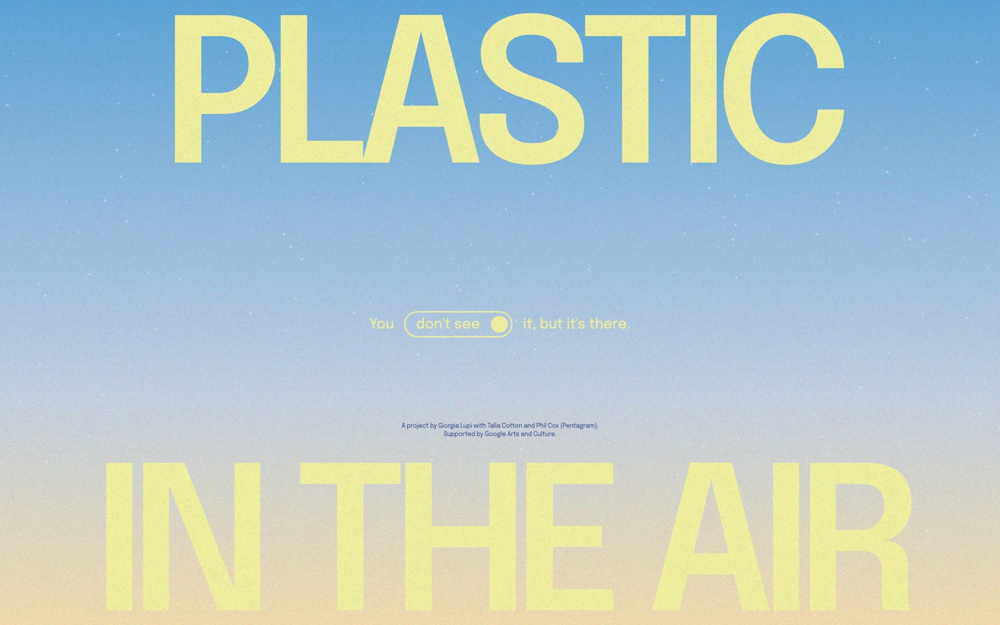
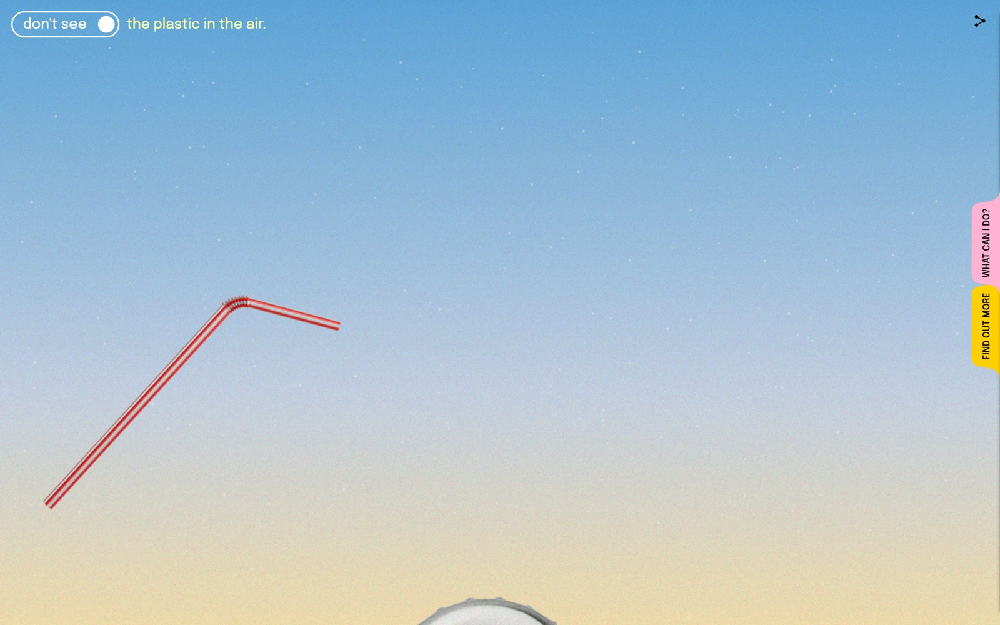
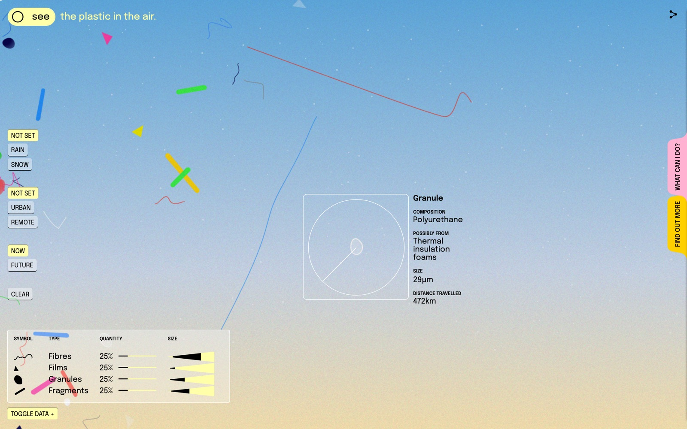
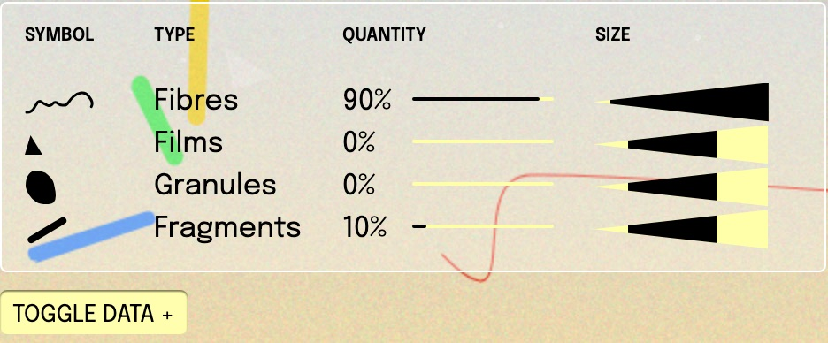
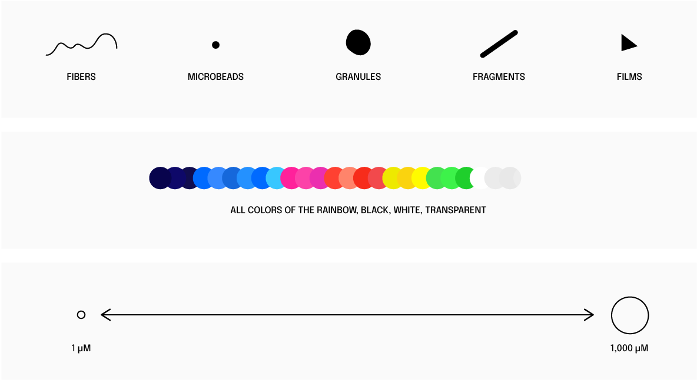

+++
author = "Yuichi Yazaki"
title = "Showing an Unmeasurable Sky as a Speculative Window: Giorgia Lupi's 'Plastic Air'"
slug = "plastic-air"
date = "2026-08-16"
description = "A web experience that shows airborne microplastics not as an exact diagram but as a speculative window onto an approximation. The phrase is the author's own: Giorgia Lupi called it that herself."
categories = [
    "consume"
]
tags = [
    "original visual transformation",
]
image = "images/cover.jpg"
+++

Giorgia Lupi calls *Plastic Air*, her web experience about airborne microplastics, a speculative "window" onto a data-driven approximation. She also writes that the visualization methodology itself was work with speculative information that was still limited. This is a work whose author names its uncertainty herself. This article reads it as a piece designed not to be an exact scientific diagram but to make you feel that something unseen is in the sky.

The work was released on Earth Day 2021 in collaboration with Google Arts & Culture. It was made by Lupi with Pentagram's Talia Cotton and Phil Cox. It is also one of the *Heartbeat of the Earth* series of climate experiments run by the UNFCCC and Google. What follows draws on the project pages of Lupi and Pentagram, the introduction on Experiments with Google, and the explanatory text of the experience itself, and reads the work in the order a visitor encounters it.

<!--more-->

## It Starts with "You Don't See It, but It's There"

The experience is published at [artsexperiments.withgoogle.com/plasticair](https://artsexperiments.withgoogle.com/plasticair/). When you open it, "PLASTIC / IN THE AIR" appears in large type, with a single sentence at the center.

> You don’t see it, but it's there.

This sentence can be read as summing up the question the work asks. The switch at the center starts the experience. Press it, and particles drift across a screen made to resemble the sky.

Source: Giorgia Lupi / Pentagram / Google Arts & Culture, *Plastic Air*

The descriptions of the controls below follow the official design. In the current public version, things sometimes do not work as described. This start switch, for example, sits behind the full-screen particle canvas, so clicks do not reach it. In each section I note such cases briefly.

At the top left of the main part is a switch between see and don't see. In the official description this is the *seen/unseen dichotomy*. In the official design, see shows abstracted particles drifting, and don't see makes everyday objects such as straws and bottle caps float in the sky. In the current public version it is not an instant swap: the everyday objects enter gradually from the bottom of the screen.

Source: Giorgia Lupi / Pentagram / Google Arts & Culture, *Plastic Air*

Fuorisalone.it summarizes the experience as first asking whether you want to see the problem at all. The author reads see / don't see as a switch of perception, and also as a performance of a society that chooses not to look.

The creators speak about the difficulty of the subject as well. In an interview with It's Nice That, Lupi says that, unlike climate stripes or footage of plastic in the ocean, airborne microplastics have few images of harm that one can point to intuitively. The creators' response published in Communication Arts likewise says that because the subject is literally *out of sight, out of mind*, they needed to tell the story of plastic disposition in a visceral way.

## Approach a Particle and "Possibly From" Appears

The particles drifting in the sky of the main part are drawn in four shapes. A thin waveform is a fibre (Fibre), a right triangle is a film (Film), an irregular lump is a granule (Granule), and a thick diagonal bar is a fragment (Fragment). The official "About this website" explains the interactions in the order Inspect, Deposit, Don't see.

The first, Inspect, is a hover, not a click. When you bring the cursor near a particle, only that particle stops, and a magnifying lens and an attribute panel appear. This inspection still works in the current public version. The panel has five fields.

| Field | Content |
|---|---|
| Type | Fibre / Film / Granule / Fragment |
| Composition | The presumed chemical composition, such as nylon, polyurethane, or polystyrene |
| Possibly from | The presumed original product, such as a sweater, insulation foam, or a shopping bag |
| Size | In micrometers (μm) |
| Distance travelled | Distance travelled (km) |

Source: Giorgia Lupi / Pentagram / Google Arts & Culture, *Plastic Air*

What deserves attention is that the field for origin says **possibly from**, not "from". It's Nice That reports an example in which an orange triangle is polystyrene that may come from cutlery. A thread-like particle is polyester that may come from a sweater. Both are "may".

The contents of this field are assigned at random from a product list prepared for each type. For fibres: sweaters, fishing nets, nylon toothbrush bristles. For granules: bottles, bumpers, disposable cutlery. For films: shopping bags, shower curtains, straws. For fragments: CDs, flooring, keyboards. The single word "possibly" can be read as a mark showing that the display is an estimate.

In her manifesto "Data Humanism," Lupi wrote that being data-driven does not mean absolute truth. She also states that visualization should embrace imperfection and approximation. She writes that *Plastic Air* is a practice of Data Humanism. The author reads the single word in the hover as that principle moved into interaction.

The next, Deposit, is described officially as follows: when you click the sky, the everyday object corresponding to the daily act named by the label beside the cursor (Drink a latte, Do my laundry, and so on) breaks down and becomes particles. In the current public version, the label receives the click, and the breakdown is barely visible.

## Rain, City, Future: The Logic of the Sky Changes

On the left of the screen are three sets of buttons that change conditions. Weather is Not Set / Rain / Snow, place is Not Set / Urban / Remote, and time is Now / Future. Hover over a button and a short explanation appears of what that condition does to the particles.

| Set | Gist of the explanation |
|---|---|
| Weather | Rain carries particles in raindrops, so there are more. Snow: in the Arctic they become smaller, travel farther, and fragment |
| Place | Urban has more fibres because of clothing and everyday goods. Remote: they become smaller, travel farther, and fragment |
| Time | Future: there is no means of removal, and the equivalent of 12 billion tonnes will accumulate by 2050 |

When you choose a condition, the numbers in the legend at the lower left change, and the makeup of the particles in the sky follows. These conditions and the legend still work in the current public version. In the initial state, each of the four types of Quantity is 25%. This does not mean the world average is even; it is the default when no condition is selected. Choose Urban and fibres become 90% and fragments 10%, with films and granules at 0%. Combine Remote and Rain and fibres are 66%, with the other three types at 11.3% each.

Source: Giorgia Lupi / Pentagram / Google Arts & Culture, *Plastic Air*

Google's brief was to visualize the danger of plastic pollution. There were two constraints. The subject is invisible to the naked eye. And research on airborne microplastics was then still in its infancy, with no single definitive dataset. Experiments with Google states that scientists from the University of Strathclyde and Utah State University carried out the scientific review.

As far as the author could trace the proportions on screen, the behavior for each weather and place seems to be built not from one integrated dataset but from the logic of separate site-specific studies. Read that way, the ratios in the sky are not measurements of the whole sky but **an approximate model that bundles the logic of site-specific studies**. The experience itself also writes that the greatest risk is what we do not know.

The Clear button on the left does not erase the sky either. Press it and an explanation appears: "Did you really think that would work?" It goes on to say that plastic is made to be durable, and once it is there, it does not disappear.

## Answering "Yes! Well, sort of."

In the official design, opening Find out More at the right edge of the screen shows an explanation of how it works and the papers it drew on. In the current public version, this tab often does not open. The legend for how the particles are drawn (Fig. 2) is also inside this panel. The shapes correspond to a classification seen under the microscope, and the colors are a palette of the full rainbow plus black, white, and transparent. Size is drawn as a continuous quantity from 1μm (about the size of a red blood cell) to 1,000μm (1mm).

Source: Giorgia Lupi / Pentagram / Google Arts & Culture, *Plastic Air*

Lupi writes that she chose bright, glossy colors like plastic itself. The author reads the colors not as a code for telling types apart but as a reflection of the fact that real particles are found in a variety of colors.

On the accuracy of the visualization, the official answer is as follows.

> Yes! Well, sort of.

It goes on to say that the shapes are based on microscope classification, but that the visualization is an abstraction. An answer that neither claims exactness nor calls the work pure invention can be read as showing the work's position well.

Lupi herself describes the experience this way.

> a speculative “window” onto a data-driven approximation

She also writes that the visualization methodology itself was work with speculative information that was still limited. Speculative design sets up conditions and makes a reality or future that is not now visible something that can be discussed. This article reads data visualization and speculative design as meeting in this self-definition. Being speculative can be read not as letting go of science but as taking on the gaps in the data as a premise of the visualization.

## How Third Parties Saw the Work

The reviews right after release came mainly from design media. Here are three with different points.

- **It's Nice That** (2021-04-22) headlined the piece *beautiful yet alarming*. In the interview it conveys, in Lupi's own words, that the research has only just begun and that showing the invisible is an abstract challenge.
- **Fast Company** headlined the causal link by which lattes and takeout connect to the air you breathe. It writes that the aim was a beauty worth lingering in, away from the typical murky depiction of pollution. It also records the division of roles: Cox worked out with researchers "what kind of site raises awareness," and Cotton took the colors from the look of the microplastics themselves.
- **PRINT Magazine** summarized Data Humanism as "humanizing facts and numbers to frame the problem." It calls the work *deeply captivating and approachable*, while mocking the confetti that flies in Deposit as a "shitty pollution party."

In the author's reading, none of the three reviews tests accuracy. It's Nice That looks at the author's self-awareness, Fast Company at the causal link to daily life, and PRINT at the danger of beauty. PRINT's sarcasm can be read as pointing at the ambiguity that the beauty reproduces the very allure of plastic.

## Takeaways

What *Plastic Air* offers visualization work is a way of showing things when data is lacking.

The first is to put uncertainty into the language of the screen. In the panel that appears every time you hover over a particle, the field for origin reads possibly from. The estimate is not pushed into a footnote; it is placed at the spot where the reader looks at the details.

The second is, when there is no integrated data, to line up studies with different logics as "conditions." The rain, city, and remote buttons swap the particle ratios each time you choose. Rather than posing as one correct map, letting readers choose which premise's sky they are looking at helps them gauge the range of the approximation.

The third is the judgment to set the goal not at "getting the quantities read correctly" but at "making it felt that it is there." This is a judgment that cannot be used in work where accuracy is required. Even so, for a subject where research is in its infancy and images of harm are scarce, the author thinks that getting people to acknowledge the existence first is the first step.

Lupi made being an approximation the work's own declaration. The author reads it as a work that, on top of that, went as far as making you feel what is in the sky. The honesty of a visualization is not determined by accuracy alone. It can also be kept by making how much is not known part of how it is shown.

## References

**Primary sources**

- Giorgia Lupi, [Plastic Air](https://giorgialupi.com/plastic-air)
- [Plastic Air (the experience itself)](https://artsexperiments.withgoogle.com/plasticair/)
- Pentagram, [Plastic Air](https://www.pentagram.com/work/plastic-air)
- Experiments with Google, [Plastic Air](https://experiments.withgoogle.com/plastic-air)
- Alexander Saier, [Heartbeat of the Earth: interpreting our planet’s data](https://blog.google/company-news/outreach-and-initiatives/arts-culture/heartbeat-of-the-earth-interpreting-our-planets-data/) (UNFCCC / Google, 2021-04-20)
- Giorgia Lupi, [Data Humanism, The Revolution will be Visualized](https://giorgialupi.com/data-humanism-my-manifesto-for-a-new-data-wold)
- [Communication Arts WebPicks](https://www.commarts.com/webpicks/plastic-air) (includes responses from Cotton, Cox, and Lupi)

**Secondary sources**

- [It's Nice That](https://www.itsnicethat.com/news/plastic-air-giorgia-lupi-pentagram-google-arts-and-culture-digital-220421) (2021-04-22)
- [Fast Company](https://www.fastcompany.com/90627950/drink-lattes-order-takeout-youre-breathing-in-invisible-toxins)
- [PRINT Magazine](https://www.printmag.com/web-interactive-design/plastic-air-is-an-interactive-experience-showing-just-how-prevalent-airborne-microplastics-are/)
- [Fuorisalone.it](https://www.fuorisalone.it/en/magazine/focus/article/508/plastic-air-microplastics) (2021-05-11)
