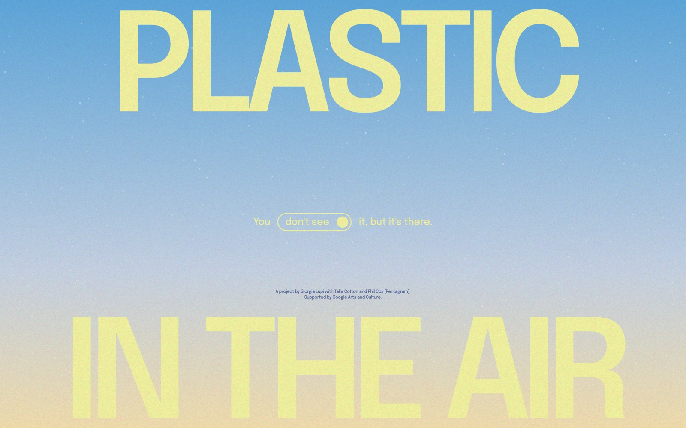
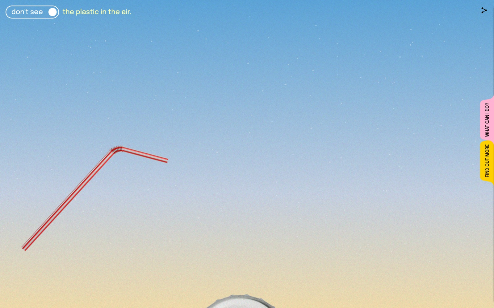
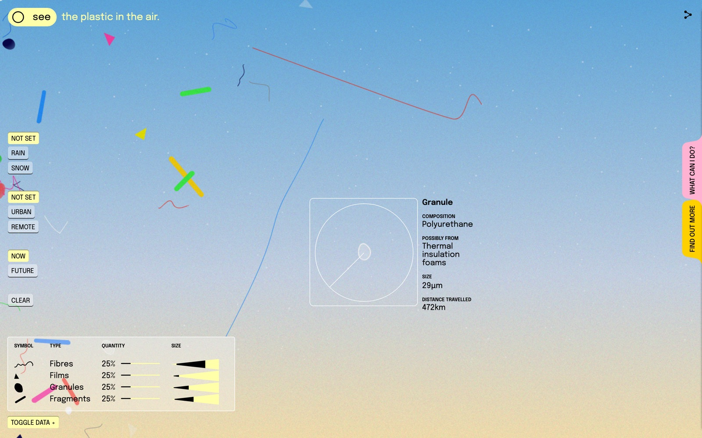
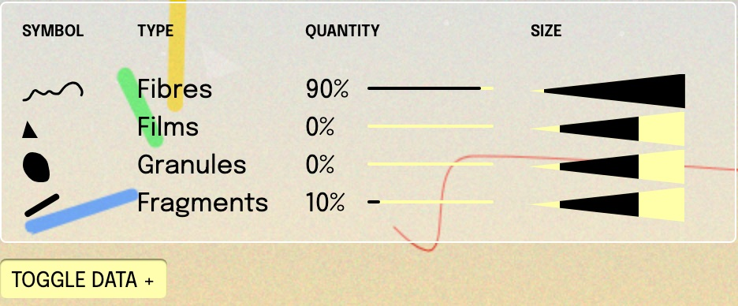
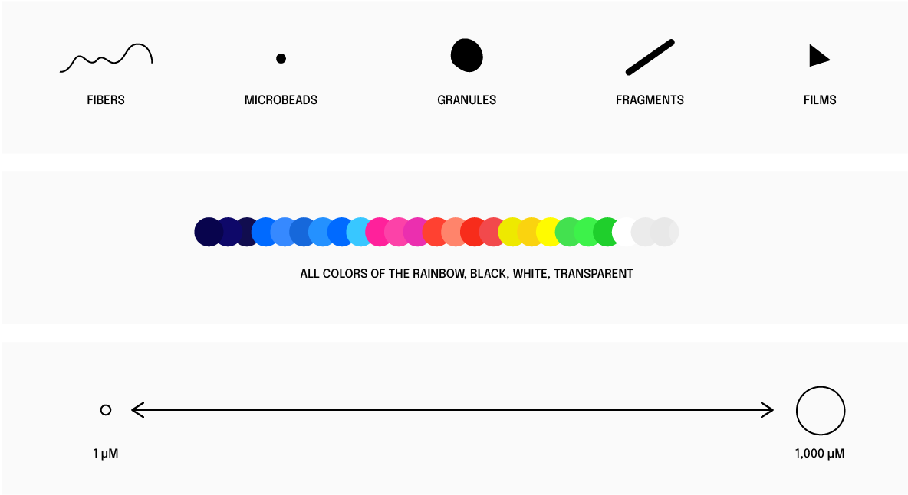

+++
author = "矢崎裕一"
title = "測りきれない空を、推測の窓として見せる──Giorgia Lupi『Plastic Air』"
slug = "plastic-air"
date = "2026-08-16"
lastmod = "2026-11-01"
description = "Giorgia Lupi は『Plastic Air』を、データに基づく近似を覗く推測的な「窓」と呼び、可視化の方法論そのものが、まだ限られた推測的な情報を扱う作業だったと書いています。大気中のマイクロプラスチックを正確な科学図にせず、見えないものが空にあると感じさせるところまでを設計した作品と読めます。"
categories = [
    "consume"
]
tags = [
    "オリジナルのビジュアル変換",
]
image = "images/cover.jpg"
series = ["speculative-design"]
series_weight = 2
seriesByline = "Giorgia Lupi"
seriesTitle = "測りきれない空を、推測の窓に"
+++

Giorgia Lupi（ジョルジア・ルピ）は、大気中のマイクロプラスチックを見せるウェブ体験『Plastic Air』を、データに基づく近似を覗く推測的（speculative）な「窓」と呼んでいます。可視化の方法論そのものが、まだ限られた推測的な情報を扱う作業だった、とも書いています。作者が自分で不確かさを名乗っている作品です。この記事では、正確な科学図の代わりに、見えないものが空にあると感じさせるところまでを設計した作品として読みます。

作品は 2021年の Earth Day に、Google Arts & Culture との協働で公開されました。制作は Lupi と、Pentagram の Talia Cotton、Phil Cox です。UNFCCC と Google が展開した気候実験のシリーズ *Heartbeat of the Earth* の一つでもあります。以下は、Lupi と Pentagram の作品ページ、Experiments with Google の紹介、体験本体の説明文に沿い、鑑賞者が作品に出会う順に読みます。

<!--more-->

## 「見えないけれど、そこにある」から始まる

体験は [artsexperiments.withgoogle.com/plasticair](https://artsexperiments.withgoogle.com/plasticair/) で公開されています。開くと、大きく「PLASTIC / IN THE AIR」と出て、中央に一文が置かれます。

> You don’t see it, but it's there.

見えないが、そこにある。この一文が、作品の問いを要約していると読めます。公式の設計では、中央のスイッチが体験を始める操作で、押すと空を模した画面に色とりどりの粒子が漂い始めます。

Giorgia Lupi・Pentagram／Google Arts & Culture『Plastic Air』より引用

以下の操作の説明は、公式の設計に沿います。現行の公開版では、説明どおりに操作できないことがあります。たとえばこの開始スイッチは、全面の粒子キャンバスより後ろにあり、クリックが届きません。各節で、そうした箇所を短く注記します。

本編の左上には、see と don’t see を切り替えるスイッチがあります。公式の説明では、これは *seen/unseen dichotomy*、見えるものと見えないものの二分法です。公式の設計では、see で抽象化された粒子が漂い、don’t see でストローやキャップといった日用品が空に浮かびます。現行の公開版では即時の総入れ替えではなく、日用品が画面下から少しずつ入ってきます。

Giorgia Lupi・Pentagram／Google Arts & Culture『Plastic Air』より引用

Fuorisalone.it は、この体験がまず「問題を見たいかどうか」を問う、と要約しています。筆者には、see / don’t see は認識のスイッチであり、見ないことを選ぶ社会の状態の演技でもある、と読めます。

題材の難しさは、作者側も語っています。Lupi は It's Nice That の取材で、気候ストライプや海のプラスチック映像と違い、大気中のマイクロプラスチックには直感的に指せる被害の画像が乏しい、と述べています。Communication Arts に掲載された制作者の応答も、題材が文字どおり *out of sight, out of mind* なので、plastic disposition の過程を内臓的に語る必要があった、と書いています。

## 粒子に近づくと「possibly from」と出る

本編の空に漂う粒子は、四つの形に描き分けられています。細い波形は繊維（Fibre）、直角三角形はフィルム（Film）、いびつな塊は顆粒（Granule）、太い斜めの棒は破片（Fragment）です。公式の「About this website」は、操作を Inspect、Deposit、Don’t see の順で説明しています。

最初の Inspect は、クリックではなくホバーです。粒子にカーソルを近づけると、その粒子だけが止まり、拡大レンズと属性のパネルが出ます。この検査は、現行の公開版でも読めます。パネルの項目は五つです。

| 項目 | 中身 |
|---|---|
| Type | Fibre / Film / Granule / Fragment |
| Composition | ナイロン、ポリウレタン、ポリスチレンなど、想定される化学組成 |
| Possibly from | セーター、断熱フォーム、買い物袋など、想定される元の製品 |
| Size | マイクロメートル（μm） |
| Distance travelled | 移動距離（km） |

Giorgia Lupi・Pentagram／Google Arts & Culture『Plastic Air』より引用

目を留めたいのは、出自の欄が「from」ではなく **possibly from** になっていることです。It's Nice That は、オレンジの三角形がポリスチレンで、カトラリー由来かもしれない例を報告しています。糸状の粒子はポリエステルで、セーター由来かもしれない。どちらも「かもしれない」です。

この欄の中身は、種類ごとに用意された製品リストからランダムに割り当てられます。繊維ならセーター、漁網、ナイロンの歯ブラシ毛。顆粒ならボトル、バンパー、使い捨てカトラリー。フィルムなら買い物袋、シャワーカーテン、ストロー。破片なら CD、床材、キーボード。possibly の一語は、表示が推定であることを示す印だと読めます。

Lupi は、マニフェスト「Data Humanism」で、データ駆動は紛れもない真実を意味しない、と書いていました。可視化は不完全さと近似を引き受けるべきだ、とも述べています。『Plastic Air』について、彼女は Data Humanism の実践だと書いています。筆者は、ホバーの一語を、その原則をインタラクションに移したものと読みます。

次の Deposit は、公式の説明では、空をクリックすると、カーソル横のラベル（Drink a latte、Do my laundry など）が示す日常行為に対応した日用品が分解され、粒子になる操作です。現行の公開版では、クリックをそのラベルが受け取ってしまい、分解はほぼ見えません。

## 雨・都市・未来で、空の論理が変わる

画面の左には、条件を変えるボタンが三組あります。天候は Not Set / Rain / Snow、場所は Not Set / Urban / Remote、時間は Now / Future です。ボタンにホバーすると、その条件が粒子に何をするかの短い説明が出ます。

| 組 | 説明文の要旨 |
|---|---|
| 天候 | Rain は雨粒が運ぶので粒子が増える。Snow は北極で小さくなり、遠くまで行き、砕ける |
| 場所 | Urban は衣類と日用品のため繊維が増える。Remote は小さくなり、遠くまで行き、砕ける |
| 時間 | Future は除去手段がなく、2050年までに 120億トン相当が蓄積する |

条件を選ぶと、左下の凡例の数字が変わり、空の粒子構成がそれに従います。この条件と凡例は、現行の公開版でも動きます。初期状態では、四種の Quantity がどれも 25% です。これは世界の平均が均等だという意味ではなく、条件を選んでいないときの既定値です。Urban を選ぶと、繊維が 90%、破片が 10% になり、フィルムと顆粒は 0% になります。Remote と Rain を重ねると、繊維が 66%、ほか三種が各 11.3% です。

Giorgia Lupi・Pentagram／Google Arts & Culture『Plastic Air』より引用

Google 側の依頼は、プラスチック汚染の危険を視覚化することでした。制約は二つありました。対象が肉眼で見えないこと。そして大気中マイクロプラスチックの研究は当時まだ萌芽期で、単一の決定的なデータセットがなかったことです。Experiments with Google は、University of Strathclyde と Utah State University の科学者が、科学的な検証にあたったと明記しています。

筆者が画面の比率を追った限りでは、天候や場所ごとの挙動は、一つの統合データではなく、別々の地点研究の論理で組まれているように見えます。そう読むと、空の比率は空全体の実測ではなく、**地点研究の論理を束ねた近似モデル**です。体験自身も、最大のリスクは「分かっていないこと」だと書いています。

左の Clear も、空を消しません。押すと「本当にそれでうまくいくと思ったのか」という説明が出ます。プラスチックは耐久性のために作られていて、一度そこにあると消えない、と続きます。

## 「Yes! Well, sort of.」と答える

公式の設計では、画面右端の Find out More を開くと、仕組みの説明と、参照した論文が並びます。現行の公開版では、このタブは開かないことが多いです。粒子の描き方の凡例（Fig. 2）も、このパネルの中にあります。形は顕微鏡で見た分類に対応し、色は虹の全色に黒・白・透明を足したパレットです。サイズは 1μm（赤血球ほど）から 1,000μm（1mm）までの連続量で描かれます。

Giorgia Lupi・Pentagram／Google Arts & Culture『Plastic Air』より引用

Lupi は、プラスチックそのもののように明るく光沢のある色を選んだと書いています。筆者には、色は種類を見分けるコードではなく、実際の粒子がさまざまな色で見つかることを写したものと読めます。

可視化の正確さについて、公式の答えは次のとおりです。

> Yes! Well, sort of.

形は顕微鏡分類に基づくが、可視化は抽象である、と続きます。正確だと言い切らず、まったくの創作だとも言わない答え方で、作品の立ち位置をよく示していると読めます。

Lupi 自身は、この体験を次のように呼んでいます。

> a speculative “window” onto a data-driven approximation

データに基づく近似を覗く、推測的な「窓」という意味です。可視化の方法論そのものが、まだ限られた推測的な情報を扱う作業だった、とも書いています。スペキュラティブ・デザインは、条件を立てて、いま見えていない現実や将来を議論できるものにします。この記事では、データ可視化とスペキュラティブ・デザインが交わるのは、この自己規定においてだと読みます。推測的であることは、科学を手放したことではなく、データの欠けを可視化の前提として引き受けたことだ、と読めます。

## 第三者はこの作品をどう見たか

公開直後の評は、デザインメディアが中心でした。論点の違う三つを挙げます。

- **It's Nice That**（2021-04-22）は、*beautiful yet alarming*（美しいが、警告的）と見出しを付けました。取材では、研究がまだ始まったばかりであること、見えないものを見せるのが抽象的な難題であることを、Lupi 自身の言葉で伝えています。
- **Fast Company** は、ラテやテイクアウトが、自分の吸う空気につながるという因果を見出しにしました。典型的な曇った汚染の描写から離れ、滞在したくなる美しさを狙ったと書いています。Cox は研究者と「どんなサイトが認知を上げるか」を詰め、Cotton は色をマイクロプラスチック自体の見た目から取った、と役割の分担も記しています。
- **PRINT Magazine** は、Data Humanism を「事実と数字を人間化して問題を枠づける」と要約しました。*deeply captivating and approachable*（深く惹きつけ、近づきやすい）と評しつつ、Deposit で舞う紙吹雪（confetti）を「shitty pollution party」と皮肉っています。

筆者の読みでは、三つの評は精度を検証していません。It's Nice That は作者の自覚を、Fast Company は日常との因果を、PRINT は美しさの危うさを見ています。PRINT の皮肉は、美しさがプラスチックの誘惑そのものを再現してしまう、という両義性を突いたものと読めます。

## 使い道

『Plastic Air』から可視化の仕事に持ち帰れることは、データが足りないときの見せ方です。

一つ目は、不確かさを画面の言葉にすることです。粒子にホバーするたびに出るパネルで、出自の欄は possibly from と書かれています。推定であることを脚注に追いやらず、読み手が詳細を見るその場所に置いています。

二つ目は、統合データがないとき、論理の違う研究を「条件」として並べることです。雨・都市・遠隔地のボタンは、選ぶたびに粒子の比率を差し替えます。一つの正しい地図を装うより、どの前提の空かを選ばせるほうが、読み手は近似の範囲を測れます。

三つ目は、目標を「量を正しく読ませる」ではなく「あると感じさせる」に置く判断です。正確さが求められる仕事では使えない判断です。それでも、研究が萌芽期で、被害の画像も乏しい題材では、まず存在を認めさせることが最初の一歩になる、と筆者は考えます。

Lupi は、近似であることを作品の名乗りにしました。筆者は、そのうえで空にあるものを感じさせるところまでを作った作品だと読みます。可視化の誠実さは、正確さだけで決まりません。どこまでが分かっていないかを、見せ方の一部にすることでも保てます。

## 参考・出典

**一次情報**

- Giorgia Lupi, [Plastic Air](https://giorgialupi.com/plastic-air)
- [Plastic Air（体験本体）](https://artsexperiments.withgoogle.com/plasticair/)
- Pentagram, [Plastic Air](https://www.pentagram.com/work/plastic-air)
- Experiments with Google, [Plastic Air](https://experiments.withgoogle.com/plastic-air)
- Alexander Saier, [Heartbeat of the Earth: interpreting our planet’s data](https://blog.google/company-news/outreach-and-initiatives/arts-culture/heartbeat-of-the-earth-interpreting-our-planets-data/)（UNFCCC / Google, 2021-04-20）
- Giorgia Lupi, [Data Humanism, The Revolution will be Visualized](https://giorgialupi.com/data-humanism-my-manifesto-for-a-new-data-wold)
- [Communication Arts WebPicks](https://www.commarts.com/webpicks/plastic-air)（Cotton、Cox、Lupi の応答を掲載）

**第三者評価**

- [It's Nice That](https://www.itsnicethat.com/news/plastic-air-giorgia-lupi-pentagram-google-arts-and-culture-digital-220421)（2021-04-22）
- [Fast Company](https://www.fastcompany.com/90627950/drink-lattes-order-takeout-youre-breathing-in-invisible-toxins)
- [PRINT Magazine](https://www.printmag.com/web-interactive-design/plastic-air-is-an-interactive-experience-showing-just-how-prevalent-airborne-microplastics-are/)
- [Fuorisalone.it](https://www.fuorisalone.it/en/magazine/focus/article/508/plastic-air-microplastics)（2021-05-11）
