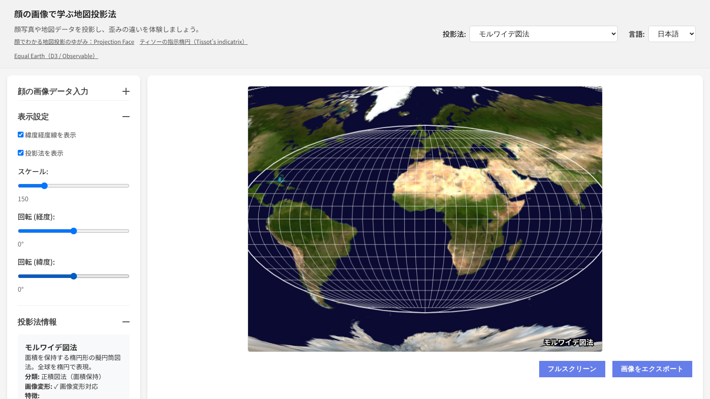

+++
author = "Yuichi Yazaki"
title = "Projecting a Face Photo Like a Map to See the Distortion: Learning Map Projections with Face Images"
slug = "projection-face-photo"
date = "2026-11-23"
description = "An interactive page that projects a face photo or GeoJSON with eight map projections, so you can compare how shape and area are distorted by each. It accepts uploaded images, a webcam, and sample data."
categories = [
    "principle"
]
tags = [
    "interactive",
    "map projection",
    "map",
    "D3.js"
]
image = "images/cover-mercator.png"
series = ["interactive-explainers"]
series_weight = 40
seriesTitle = "Projecting a Face Photo Like a Map: Learning Map Projections with Face Images"
+++

"Kao no gazō de manabu chizu tōeihō" (Learning Map Projections with Face Images) is an interactive page that projects a face photo or GeoJSON with map projections, so you can compare how the distortion differs by projection. Switching among eight projections changes the shape and area of the same image. It accepts uploaded images, a webcam, and sample data.

**[Open "Learning Map Projections with Face Images"](https://projection-face-photo.vercel.app/?lang=en)**

This page introduces it. The page is at the link above and runs in the browser. It can be switched between Japanese and English.

<!--more-->

## What data you can put in

| Input | Details |
|---|---|
| Image | PNG or JPEG files, added by drag and drop or by choosing a file |
| Webcam | Uses an image taken on the spot |
| GeoJSON | Takes map data |
| Samples | Three: a world map (a NASA Blue Marble image in the equirectangular projection), a selfie, and a standard test image for image processing |

About images taken with the webcam, the page states that nothing is saved on the server side.

## Switching among eight projections

The eight projections you can choose are Mercator, stereographic, Equal Earth, Mollweide, azimuthal equidistant, orthographic, gnomonic, and Natural Earth.

Yuichi Yazaki / Screen of "Learning Map Projections with Face Images"

In the left column you can toggle the graticule and change the scale and the rotation in longitude and latitude. For each projection, the page shows its class (conformal, equal-area, and so on) and a description of its characteristics. The projected result can be viewed full screen or exported as an image.

## What it shows

The distortion of a world map is hard to notice because the map is so familiar. Projecting an image whose original shape you know well, such as a face photo, shows at once where it is stretched and where it shrinks. Because the projection is switched while the image stays the same, you can compare projections directly.

The idea of using a face to show projection distortion is introduced in [the article on Projection Face](/en/projection-face/). A way to show distortion with ellipses is in [the article on Tissot's indicatrix](/en/tissots-indicatrix/).

## References

- Learning Map Projections with Face Images. [projection-face-photo.vercel.app](https://projection-face-photo.vercel.app/?lang=en)
- Explorable Explanations, "Learning Map Projections with Face Images" (introduction page). [explorable-explanations.com/en/p/projection-face-photo](https://explorable-explanations.com/en/p/projection-face-photo/)
- NASA Visible Earth, "Blue Marble" (source of the world map sample). [visibleearth.nasa.gov](https://visibleearth.nasa.gov/images/57752/blue-marble-land-surface-shallow-water-and-shaded-topography)
