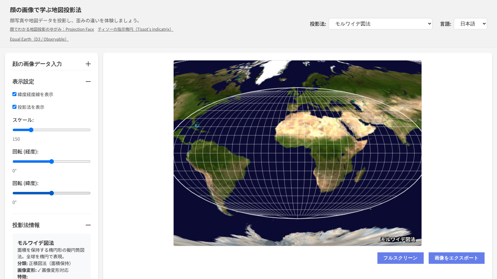

+++
author = "矢崎裕一"
title = "顔写真を地図のように投影して、ゆがみを見る──顔の画像で学ぶ地図投影法"
slug = "projection-face-photo"
date = "2026-11-23"
description = "顔写真や GeoJSON を8種類の地図投影法で投影し、投影法ごとの形や面積のゆがみの違いを見比べられるインタラクティブなページです。画像のアップロード、Webカメラ、サンプルデータに対応しています。"
categories = [
    "principle"
]
tags = [
    "インタラクティブ",
    "地図投影法",
    "地図",
    "D3.js"
]
image = "images/cover-mercator.png"
series = ["interactive-explainers"]
series_weight = 40
seriesTitle = "顔写真を地図のように投影する──顔の画像で学ぶ地図投影法"
+++

「顔の画像で学ぶ地図投影法」は、顔写真や GeoJSON を地図投影法で投影し、投影法ごとのゆがみの違いを見比べられるインタラクティブなページです。8種類の投影法を切り替えると、同じ画像の形や面積が変わります。画像のアップロード、Webカメラ、サンプルデータに対応しています。

**[「顔の画像で学ぶ地図投影法」を開く](https://projection-face-photo.vercel.app/?lang=ja)**

このページは、その紹介です。本編は上のリンク先にあり、ブラウザでそのまま動きます。日本語と英語を切り替えられます。

<!--more-->

## 入れられるデータ

| 入力 | 内容 |
|---|---|
| 画像 | PNG、JPEG のファイル。ドラッグ＆ドロップか、ファイルの選択で入れます |
| Webカメラ | その場で撮った画像を使います |
| GeoJSON | 地図データを入れます |
| サンプル | 世界地図（NASA Blue Marble の正距円筒図法の画像）、自撮り写真、画像処理の標準テスト画像の3つ |

Webカメラで撮った画像について、ページは、サーバ側では一切保存していないと書いています。

## 8種類の投影法を切り替える

選べる投影法は、メルカトル図法、ステレオ図法、イコールアース図法（Equal Earth）、モルワイデ図法、正距方位図法、正射図法、心射図法、ナチュラルアース図法の8種類です。

矢崎裕一／「顔の画像で学ぶ地図投影法」の画面

左の欄では、緯度経度線の表示、スケール、経度と緯度の回転を変えられます。投影法ごとに、分類（正角図法、正積図法など）と特徴の説明が出ます。投影した結果は、フルスクリーンで見たり、画像として書き出したりできます。

## 何が分かるか

世界地図のゆがみは、見慣れているので気づきにくいものです。顔写真のように、元の形をよく知っている画像を投影すると、どこが引き伸ばされ、どこが縮むかがすぐ分かります。同じ画像のまま投影法を切り替えるので、投影法ごとの違いを直接比べられます。

顔を使って投影のゆがみを見せる考え方は、[Projection Face の記事](/projection-face/)で紹介しています。ゆがみを楕円で示す方法は、[ティソーの指示楕円の記事](/tissots-indicatrix/)にあります。

## 参考・出典

- 顔の画像で学ぶ地図投影法. [projection-face-photo.vercel.app](https://projection-face-photo.vercel.app/?lang=ja)
- Explorable Explanations「顔の画像で学ぶ地図投影法」（紹介ページ）. [explorable-explanations.com/p/projection-face-photo](https://explorable-explanations.com/p/projection-face-photo/)
- NASA Visible Earth「Blue Marble」（世界地図のサンプルの出典）. [visibleearth.nasa.gov](https://visibleearth.nasa.gov/images/57752/blue-marble-land-surface-shallow-water-and-shaded-topography)
