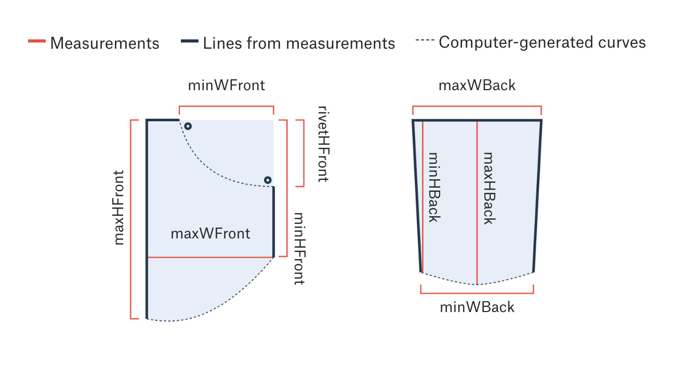
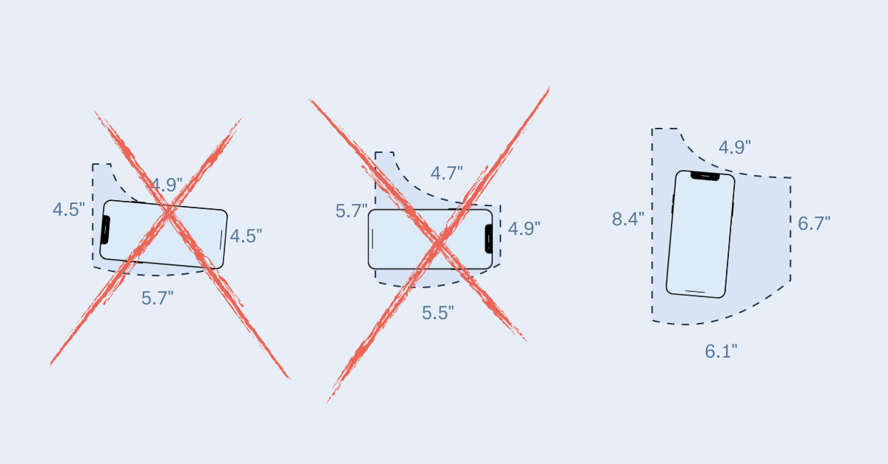

+++
author = "Yuichi Yazaki"
title = "Overlaid at One Scale, Compared by Whether a Smartphone Fits: The Pudding's \"Women's Pockets are Inferior\""
slug = "pudding-womens-pockets"
date = "2026-11-07"
description = "The Pudding measured the front pockets of 80 pairs of jeans from 20 brands, overlaid men's and women's outlines at the same scale, then recast the gap as whether a smartphone or other objects fit."
categories = [
    "consume"
]
tags = [
    "data journalism",
    "Information is Beautiful Awards",
    "scrollytelling",
    "gender"
]
image = "images/cover-phone-pockets.jpg"
series = ["dataviz-journalism"]
series_weight = 12
seriesByline = "Jan Diehm and Amber Thomas (The Pudding)"
seriesTitle = "Showing the Gap by Whether a Phone Fits: Women's Pockets are Inferior"
+++

The Pudding's "Women's Pockets are Inferior" (August 2018) measured the front pockets of 80 pairs of jeans from 20 US brands. From the measurements it drew outlines for men and women at the same scale and overlaid them, then recast the gap as whether a smartphone or other objects fit.

The authors are Jan Diehm and Amber Thomas. What follows reads the work in the order a reader meets the graphics, drawing on the project page, the Methods, and the measurement data, README, and drawing code published on GitHub. Some of the figures are set beside values that our researcher recalculated from the public data.

<!--more-->

## Summer 2018: Measuring a Complaint

The authors state their motive this way.

> "like so many things on the internet, we could find complaints and anecdotes galore but little data illustrating just how inferior women's pockets really are to men's. So, we went there."

In short: the internet is full of complaints and anecdotes but has almost no data, so they went and measured.

What they measured, according to the page and the data README, is as follows.

| Item | Details |
|---|---|
| Sample | 80 pairs from 20 popular US brands. Four per brand: men's and women's, in skinny and straight |
| Size | All waist 32 inches (per each brand's size chart) |
| Measurements | 5 front-pocket and 4 back-pocket dimensions (cm). Front pockets measured on the right side, empty |
| Period and places | June 29 to August 6, 2018. In-person stores in Nashville, New York, and Seattle |
| Published | Measurement data (CSV and JSON), measurement sheet (PDF), drawing code |

The authors explain the choice of 32 inches by writing that "these jeans were all made to fit the same size person." This answers the objection that men are bigger. The README also notes, however, that 32 inches is smaller than the median waist of US women. The reason given is that it is a size easily available to both men and women.

The limitations the authors list are these. There are only four pairs per brand. Some brands call skinny "slim," and where there was no straight cut they used boot-cut. Where there was no standard or mid-rise, they substituted high-rise or low-rise. A sewn-shut fake pocket was replaced with another item of the same style. Buttons and zippers were opened and the pockets measured from the inside.

Stores and brands are described only as "popular." It can be read that **the page gives no criteria for choosing stores or brands, and says nothing about variability or significance testing**.

## Drawing Same-Scale Outlines from Five Measurements

The front pocket was measured in five lengths. The README's diagram distinguishes the measured lengths, the lines drawn from them, and the computer-generated curves.

Source: Jan Diehm, Amber Thomas / [the-pudding/data (GitHub)](https://github.com/the-pudding/data/tree/master/pockets) (the repository is under the MIT License)

The authors state in Methods that the curves were not measured.

> "While the overall height and width of the pockets was measured, the curvature of the pocket displayed in this article was computer generated."

That is, height and width were measured, but the curves shown in the article were generated by computer.

The first graphic moves as you scroll. The outlines of all 80 pairs overlap as thin lines; then the average outlines for men and women appear side by side, and then overlap in the same position. The correspondences that can be read from the drawing code (bundle.js) are as follows.

| Data | Appearance | Specifics |
|---|---|---|
| 5 front-pocket dimensions (cm) | One closed outline per pair | Joined by straight lines and quadratic Bézier curves. The curves are computed |
| Height and width | Position and length | A common scale of 0 to 29 cm. The same scale for men and women |
| Each of the 80 pairs | Overlaid thin lines | Line opacity 0.1 |
| Average by gender | Filled outlines | Translucent red-ish and yellow-ish |
| Object dimensions | Images at true proportions | iPhone X is 7×14 cm, for example |
| Fits or not | Opacity | Brands where it does not fit are shown faintly |
| Largest rectangle that fits the object | Image position and angle | Computed with d3plus's largestRect() |

Because men and women share one scale, the difference between the overlaid outlines is the difference in size.

## "48% Shorter": Shorter Than What?

The page sums up the front-pocket difference in one sentence.

> "On average, the pockets in women's jeans are 48% shorter and 6.5% narrower than men's pockets."

By style, it gives skinny as "3.5 inches (48%) shorter" and straight as "3.4 inches (46%) shorter."

The formula for these percentages is written neither on the page nor in the README. So our researcher recalculated them from measurements.csv in the public data. Two percentages are given: the difference divided by the men's average, and the difference divided by the average of the men's and women's means.

| Front pocket | Page's statement | Women's mean | Men's mean | Difference / men | Difference / mean of the two |
|---|---|---|---|---|---|
| Max height (all 80) | 48% | 14.33 cm | 23.13 cm | 38.1% | 47.0% |
| Max height (skinny) | 3.5 in (48%) | 14.27 cm | 23.18 cm | 38.5% | 47.6% |
| Max height (straight) | 3.4 in (46%) | 14.38 cm | 23.07 cm | 37.7% | 46.4% |
| Max width (all 80) | 6.5% | 15.19 cm | 16.37 cm | 7.2% | 7.5% |
| Max width (skinny) | 0.3 in (6%) | 15.07 cm | 16.07 cm | 6.2% | 6.4% |

(Our researcher's calculation. Slim is included in skinny; boot-cut and regular are included in straight.)

The differences in inches match the 3.5 and 3.4 inches in the text. Taking men as the base gives about 38%, and women's height is about 62% of men's. Dividing the difference by the average of men and women gives 47 to 48%, which nearly matches the page's figure. The authors seem to have used this formula, but they do not explain it. The 6.5% for width is closer to the skinny value than to the all-80 value (7.2 to 7.5%), and we could not confirm which aggregation it came from.

The same difference gives different numbers depending on the base. When a reader sees "48% shorter than men's," it can be read that they take it as a ratio with men as the base. On that ratio, the pocket is about 38% shorter, that is, about 60% of the length. Another case where the impression changes with the divisor is the country rankings in [Green to Grey](/en/green-to-grey/).

## Does a Smartphone Fit?

The second half asks "What can actually fit?" When you pick an object, small diagrams of each brand's front pocket line up by gender, with the object's image placed inside. This is the structure of [Small Multiples](/en/small-multiples/), which lines up identically shaped diagrams to show only the differences. There are seven objects: three smartphone models, a front-pocket wallet, a pen, a woman's hand, and a man's hand.

Source: Jan Diehm, Amber Thomas / [The Pudding "Women's Pockets are Inferior"](https://pudding.cool/2018/08/pockets/) (the page's social image)

Methods describes the test as follows.

> "we used the largestRect() function from the d3plus library to determine the largest rectangle that could fit in each pocket that had the same aspect ratio (width:height) of the object in question."

The procedure finds the largest rectangle that fits in the pocket with the same aspect ratio as the object. If the object is larger than that rectangle, or wider than the pocket opening, it is judged "does not fit." For hands, it counted as fitting if the four fingers other than the thumb went in to the base. The test was done on empty pockets, not while worn.

The page summarizes the result this way.

> "Only 40 percent of women's front pockets can completely fit one of the three leading smartphone brands."

It also says that a front-pocket wallet fits in fewer than half.

The original says only "one of the three leading smartphone brands," with no per-model values. Our researcher redid the judgment using the largest rectangles in measurementRectangles.json and the width of the pocket opening, with the following results.

| Object (dimensions) | Women's front pockets | Men's front pockets |
|---|---|---|
| iPhone X (7×14 cm) | 40% | 100% |
| Samsung Galaxy (6.9×14.7 cm) | 20% | 95% |
| Google Pixel (7.6×15.7 cm) | 5% | 85% |
| Woman's hand (7×12 cm) | 10% | 100% |

(Our researcher's calculation. The JSON has no cm values for the wallet, so it could not be rechecked.)

The page's 40% matches the iPhone X value. The 10% for the hand also agrees with what Diehm said on a New Zealand program in 2020: "Only 10 per cent can fit the average women's hand."

## How Third Parties Saw the Work

Each assessment points to a different aspect. The first is an award. At the Kantar Information is Beautiful Awards 2018, it received JOINT BRONZE in the People, Language & Identity category. The blurb is the same as the authors' summary: "48% shorter and 6.5% narrower."

The second is its treatment in a theory book. Catherine D'Ignazio and Lauren F. Klein's *Data Feminism* (2020) takes up the work in Chapter 4, pp. 107–108.

> "Now, the designers of any particular pair of women's jeans are almost certainly not thinking: 'Let's oppress women by making their pockets too small.' They are probably only thinking about what looks nice. But what looks nice has a history too."

The point is that the designers are not trying to oppress women, but "what looks nice" has a history too. It can be read that the book uses the work as an example of inequality appearing in the dimensions of everyday objects even without ill intent. The book also writes "40 percent … can fit a smartphone," dropping the condition "one of the three brands."

The third is a statistics-education perspective. In a 2021 blog post, Jessica Hartnett praised the release of the data and recommended it as material for teaching the t-test.

> "Honestly, that is good science and good transparency."

That is, frankly, good science and good transparency. However, the sources disagree on who did the measuring.

| Source | Description of who measured |
|---|---|
| Data README | "manual measurements by Jan Diehm and Amber Thomas" (the two authors measured) |
| Hartnett's blog (2021) | "sent research assistants to measure the pockets" (assistants measured) |

We could not confirm which is correct.

In press coverage, the figures were reworded. The Daily Beast (September 2, 2018) introduced it as an "informal study" while writing that the pockets were "just half the size." "48% shorter" has become "half the size." We found no article that criticized the method head-on.

## Takeaways

There are four judgments to carry back to visualization work.

The first is to overlay the two things being compared at the same scale. This work drew a sample matched at 32 inches on a single scale. Overlaying after conditions are matched lets the difference show as a shape.

The second is to recast the difference as something the reader carries. "Fits an iPhone X or not" can be checked against your own pocket in a way that "how many cm shorter" cannot. The procedure of finding the largest rectangle with the object's aspect ratio can be used for other "does it fit" comparisons.

The third is to state the base of a percentage. By our researcher's calculation, dividing the difference in maximum height by the men's value gives about 38%. The authors' 48% is close to the value divided by the average of men and women, and the formula is not explained. When the formula is not written, it can be read that the figure is easily taken as a ratio to men.

The fourth is to separate what was measured from what was made, and to release the data. The README diagram distinguished computer-generated curves in its legend. The recalculation in this article was also possible only because the CSV and JSON were public. It can be read that the readers' ability to check for themselves when a number raises doubts is what supports the claim.

## References

**Primary sources**

- Jan Diehm & Amber Thomas, "Women's Pockets are Inferior," *The Pudding*, 2018-08. [Article](https://pudding.cool/2018/08/pockets/)
- Drawing code of the same page (bundle.js). [JS](https://pudding.cool/2018/08/pockets/bundle.js)
- Data of the same page. [measurements.csv](https://pudding.cool/2018/08/pockets/assets/data/measurements.csv) / [measurementsRectangles.json](https://pudding.cool/2018/08/pockets/assets/data/measurementsRectangles.json)
- Measurement sheet (MeasurementGuide.pdf). [PDF](https://pudding.cool/2018/08/pockets/assets/images/MeasurementGuide.pdf)
- the-pudding/data, pockets (README, CSV, JSON). [GitHub](https://github.com/the-pudding/data/tree/master/pockets) / [README](https://raw.githubusercontent.com/the-pudding/data/master/pockets/README.md)
- License of the-pudding/data (MIT License). [LICENSE](https://raw.githubusercontent.com/the-pudding/data/master/LICENSE)
- the-pudding/pockets (source code). [GitHub](https://github.com/the-pudding/pockets) / [rect-calc-template.js](https://github.com/the-pudding/pockets/blob/master/src/js/pudding-chart/rect-calc-template.js)
- d3plus, largestRect. [Documentation](https://d3plus.org/docs/#largestRect)

**Secondary sources**

- Catherine D'Ignazio & Lauren F. Klein, *Data Feminism*, MIT Press, 2020. Chapter 4, pp. 107–108, Figure 4.4. [Open-access edition](https://archive.org/details/mit_press_book_9780262358521) / [Full text](https://archive.org/download/mit_press_book_9780262358521/mit_press_book_9780262358521_djvu.txt)
- Kantar Information is Beautiful Awards 2018 winners list. [Article](https://informationisbeautifulawards.com/news/323-information-is-beautiful-awards-2018-the-winners) / [Showcase](https://informationisbeautifulawards.com/showcase/3250)
- Jessica Hartnett, "Women's pockets are crap: An empirical investigation," *Not Awful and Boring*, 2021-06. [Blog](https://notawfulandboring.blogspot.com/2021/06/womens-pockets-are-crap-empirical.html)
- Victoria Albert, "Science Proves Women's Pants Pockets Suck," *The Daily Beast*, 2018-09-02. [Article](https://www.thedailybeast.com/science-proves-womens-pants-pockets-suck)
- "Fair Go investigates: Are women's pants pockets really smaller then men's?," *1News*, 2020-03-16. [Article](https://www.1news.co.nz/2020/03/16/fair-go-investigates-are-womens-pants-pockets-really-smaller-then-mens)
