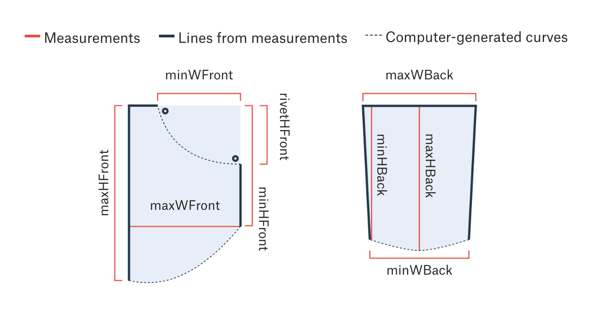
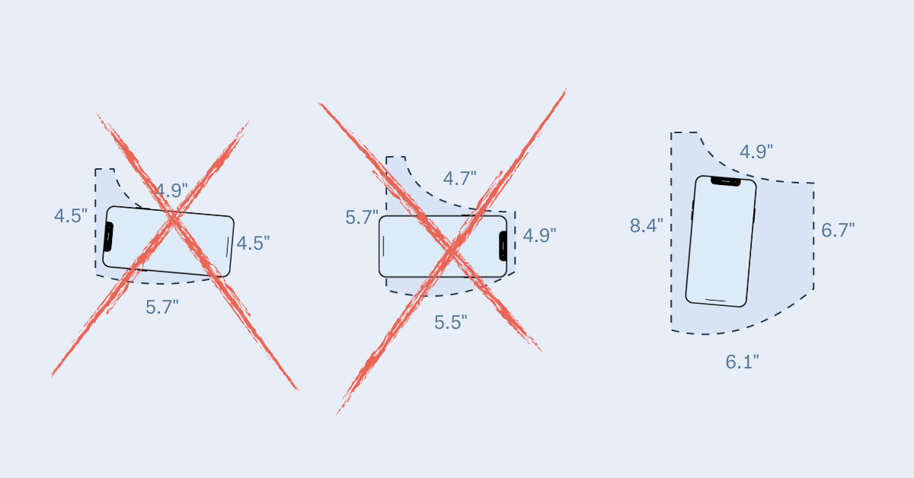

+++
author = "矢崎裕一"
title = "同じ縮尺で重ね、スマートフォンが入るかで比べる──The Pudding「Women's Pockets are Inferior」"
slug = "pudding-womens-pockets"
date = "2026-11-07"
description = "The Pudding は、20ブランド80本のジーンズの前ポケットを測り、男女別に同じ縮尺の輪郭で重ね、さらにスマートフォンなどが入るかどうかに置き換えて、大きさの差を見せました。"
categories = [
    "consume"
]
tags = [
    "データジャーナリズム",
    "Information is Beautiful Awards",
    "スクロールテリング",
    "ジェンダー"
]
image = "images/cover-phone-pockets.jpg"
series = ["dataviz-journalism"]
series_weight = 12
seriesByline = "Jan Diehm・Amber Thomas（The Pudding）"
seriesTitle = "スマホが入るかで差を見せる──Women's Pockets are Inferior"
+++

The Pudding の「Women's Pockets are Inferior」（2018年8月）は、米国の20ブランド・80本のジーンズの前ポケットを測りました。測った寸法から男女別に同じ縮尺の輪郭を描いて重ね、さらにスマートフォンなどが入るかどうかに置き換えて、大きさの差を見せています。

作者は Jan Diehm（ジャン・ディーム）と Amber Thomas（アンバー・トーマス）です。以下は、作品のページと Methods、GitHub で公開された測定データと README、描画のコードに沿い、読者が図を見る順に読みます。数字の一部は、調査担当が公開データで計算し直した値と並べて示します。

<!--more-->

## 2018年夏、愚痴を測る

作者は、調べた動機をこう書いています。

> "like so many things on the internet, we could find complaints and anecdotes galore but little data illustrating just how inferior women's pockets really are to men's. So, we went there."

ネット上に不満や体験談はいくらでもあるが、データはほとんどない。だから測りに行った、という話です。

測ったものは、ページとデータの README で次のとおりです。

| 項目 | 内容 |
|---|---|
| 対象 | 米国で人気の20ブランド、80本。1ブランドにつき男女 × skinny／straight の4本 |
| サイズ | すべてウエスト32インチ（各ブランドのサイズ表による） |
| 寸法 | 前ポケット5つ、後ろポケット4つ（cm）。前ポケットは右側を空の状態で測る |
| 期間と場所 | 2018年6月29日〜8月6日。ナッシュビル、ニューヨーク、シアトルの実店舗 |
| 公開物 | 測定データ（CSV・JSON）、測定シート（PDF）、描画コード |

32インチに揃えた理由を、作者は「these jeans were all made to fit the same size person」と書いています。男性のほうが体が大きい、という反論への答えです。一方で README には、32インチが米国の女性のウエストの中央値より小さいことも書いてあります。男女どちらでも手に入りやすいサイズとして選んだ、という理由です。

作者が挙げた限界は、次のとおりです。1ブランドにつき4本だけである。skinny が slim のブランドもあり、straight がなければ boot-cut を使った。standard／mid-rise がなければ high-rise／low-rise で代用した。縫い閉じた偽のポケットは、同じ型の別の品に替えた。ボタンとジッパーを開け、内側から測った。

店やブランドについては「popular」とあるだけです。**店やブランドの選び方の基準と、ばらつきや検定の話は書かれていない**と読めます。

## 5つの寸法から、同じ縮尺の輪郭を描く

前ポケットで測ったのは、5つの長さです。README の図は、測った長さ、そこから引いた線、コンピュータで作った曲線を描き分けています。

Jan Diehm、Amber Thomas／[the-pudding/data（GitHub）](https://github.com/the-pudding/data/tree/master/pockets) より引用（リポジトリは MIT License）

作者は Methods で、曲線を測っていないことを明記しています。

> "While the overall height and width of the pockets was measured, the curvature of the pocket displayed in this article was computer generated."

高さと幅は測ったが、記事に出る曲線はコンピュータで作った、という意味です。

最初の図は、スクロールに合わせて動きます。80本の輪郭が薄い線で重なり、次に男女別の平均の輪郭が左右に並び、同じ位置に重なります。描画コード（bundle.js）から読み取れる対応は、次のとおりです。

| データ | 見た目 | 具体的な値 |
|---|---|---|
| 前ポケットの5寸法（cm） | 1本につき1つの閉じた輪郭 | 直線と二次ベジェ曲線でつなぐ。曲線は計算で作る |
| 高さ・幅 | 位置と長さ | 0〜29 cm の共通スケール。男女で同じ縮尺 |
| 80本それぞれ | 細い線を重ねる | 線の不透明度 0.1 |
| 男女別の平均 | 塗った輪郭 | 赤系と黄系の半透明 |
| 物の寸法 | 実寸比の画像 | iPhone X は 7×14 cm など |
| 入るかどうか | 濃さ | 入らないブランドは薄く表示 |
| 物が入る最大の長方形 | 画像の位置と角度 | d3plus の largestRect() で計算 |

縮尺を男女で一つにしたので、重ねた輪郭の差が、そのまま大きさの差になります。

## 「48% shorter」は、何に対して短いのか

ページは、前ポケットの差を一文でまとめています。

> "On average, the pockets in women's jeans are 48% shorter and 6.5% narrower than men's pockets."

平均すると、女性のポケットは男性より48%短く、6.5%狭い、という文です。スタイル別には、skinny が「3.5 inches (48%) shorter」、straight が「3.4 inches (46%) shorter」とあります。

この割合の計算式は、ページにも README にも書かれていません。そこで調査担当が、公開データの measurements.csv で計算し直しました。割合は2通り出しています。差を男性の平均で割ったものと、差を男女の平均値の平均で割ったものです。

| 前ポケット | ページの記述 | 女性の平均 | 男性の平均 | 差÷男性 | 差÷男女の平均 |
|---|---|---|---|---|---|
| 最大の高さ（80本） | 48% | 14.33 cm | 23.13 cm | 38.1% | 47.0% |
| 最大の高さ（skinny） | 3.5 in（48%） | 14.27 cm | 23.18 cm | 38.5% | 47.6% |
| 最大の高さ（straight） | 3.4 in（46%） | 14.38 cm | 23.07 cm | 37.7% | 46.4% |
| 最大の幅（80本） | 6.5% | 15.19 cm | 16.37 cm | 7.2% | 7.5% |
| 最大の幅（skinny） | 0.3 in（6%） | 15.07 cm | 16.07 cm | 6.2% | 6.4% |

（調査担当の計算。slim は skinny に、boot-cut と regular は straight に含めた）

インチでの差は、本文の3.5インチ・3.4インチと合います。割合は、男性を基準にすると約38%で、女性の高さは男性の約62%です。差を男女の平均で割ると47〜48%になり、ページの数字にほぼ合います。作者はこの式を使ったと読めますが、説明はありません。幅の6.5%は、80本全体（7.2〜7.5%）より skinny の値に近く、どの集計から出たかは確かめられませんでした。

同じ差でも、何を基準にするかで数字が変わります。「男性より48%短い」と書かれると、読者は男性を基準にした比として受け取ると読めます。その比なら、約38%短い、つまり約6割の長さです。何で割るかで印象が変わる例は、[Green to Grey](/green-to-grey/) の国の順位でも見られます。

## スマートフォンは、入るか

後半は「What can actually fit?」と問います。物を選ぶと、ブランドごとの前ポケットの小さな図が男女別に並び、物の画像が中に置かれます。同じ形の図を並べて違いだけを見せる、[Small Multiples](/small-multiples/) の作りです。物は、3機種のスマートフォン、前ポケット用の財布、ペン、女性の手、男性の手の7つです。

Jan Diehm、Amber Thomas／[The Pudding「Women's Pockets are Inferior」](https://pudding.cool/2018/08/pockets/) より引用（ページのソーシャル用画像）

判定の方法は、Methods にこう書かれています。

> "we used the largestRect() function from the d3plus library to determine the largest rectangle that could fit in each pocket that had the same aspect ratio (width:height) of the object in question."

物と同じ縦横比で、ポケットに入る最大の長方形を求める、という手順です。物がそれより大きいか、ポケットの口より広ければ「入らない」とします。手は、親指を除く4本の指が付け根まで入れば「入る」としました。判定は、はいていない空のポケットで行っています。

ページは、結果をこうまとめています。

> "Only 40 percent of women's front pockets can completely fit one of the three leading smartphone brands."

女性の前ポケットのうち、大手3ブランドのスマートフォンのどれかが完全に入るのは40%だけ、という文です。前ポケット用の財布が入るのは半分未満、とも書いています。

原文は「three leading smartphone brands」のどれか、と書くだけで、機種ごとの値はありません。調査担当が measurementRectangles.json の最大の長方形と、ポケットの口の幅で判定し直すと、次のとおりでした。

| 物（寸法） | 女性の前ポケット | 男性の前ポケット |
|---|---|---|
| iPhone X（7×14 cm） | 40% | 100% |
| Samsung Galaxy（6.9×14.7 cm） | 20% | 95% |
| Google Pixel（7.6×15.7 cm） | 5% | 85% |
| 女性の手（7×12 cm） | 10% | 100% |

（調査担当の計算。財布は JSON に cm の値がなく、検算できなかった）

ページの40%は、iPhone X の値と一致します。手の10%は、Diehm が2020年にニュージーランドの番組で話した「Only 10 per cent can fit the average women's hand.」とも合います。

## 第三者はこの作品をどう見たか

評価は、それぞれ別の点に向いています。一つ目は、賞です。Kantar Information is Beautiful Awards 2018 で、People, Language & Identity 部門の JOINT BRONZE を受けました。紹介文は、作者の要約と同じ「48% shorter and 6.5% narrower」です。

二つ目は、理論書での扱いです。Catherine D'Ignazio（キャサリン・ディグナツィオ）と Lauren F. Klein（ローレン・F・クライン）の『Data Feminism』（2020）は、第4章 p.107〜108 でこの作品を取り上げました。

> "Now, the designers of any particular pair of women's jeans are almost certainly not thinking: 'Let's oppress women by making their pockets too small.' They are probably only thinking about what looks nice. But what looks nice has a history too."

設計者は女性を抑圧しようとは考えていない、だが「見た目の良さ」にも歴史がある、という話です。同書は、悪意がなくても不平等が日用品の寸法に表れる例として使っていると読めます。同書は「40 percent … can fit a smartphone」とも書いていて、「3ブランドのどれか」という条件が落ちています。

三つ目は、統計教育の視点です。Jessica Hartnett（ジェシカ・ハートネット）は2021年のブログで、データの公開を評価し、t 検定の教材に勧めました。

> "Honestly, that is good science and good transparency."

正直なところ、良い科学で、良い透明性だ、という評価です。ただし、誰が測ったかについて、資料の記述が食い違います。

| 資料 | 測定者の記述 |
|---|---|
| データの README | "manual measurements by Jan Diehm and Amber Thomas"（作者2人が測った） |
| Hartnett のブログ（2021） | "sent research assistants to measure the pockets"（助手に測らせた） |

どちらが正しいかは、確かめられませんでした。

報道では、数字が言い換えられました。The Daily Beast（2018年9月2日）は「informal study」と紹介しつつ、ポケットは「just half the size」と書いています。48%短いが、半分の大きさになっています。方法を正面から批判した記事は、調査では見つかりませんでした。

## 使い道

可視化の仕事に持ち帰れる判断は、四つあります。

一つ目は、比べる二つを同じ縮尺で重ねることです。この作品は32インチに揃えた標本を、一つのスケールで描きました。条件を揃えてから重ねると、差が形のまま見えます。

二つ目は、差を読者の持ち物に置き換えることです。「何cm短い」より「iPhone X が入るか」のほうが、自分のポケットで確かめられます。物と同じ縦横比の長方形を求める手順は、ほかの「収まるか」の比較にも使えます。

三つ目は、割合には基準を書くことです。調査担当の計算では、最大の高さの差を男性で割ると約38%です。作者の48%は男女の平均で割った値に近く、式の説明はありません。式が書かれていないと、男性比として読まれやすいと読めます。

四つ目は、測ったものと作ったものを分け、データを出すことです。README の図は、計算で作った曲線を凡例で区別していました。この記事の再計算も、公開された CSV と JSON があったからできました。数字に疑問が出たとき、読者が自分で確かめられることが、主張を支えていると読めます。

## 参考・出典

**一次情報**

- Jan Diehm & Amber Thomas, "Women's Pockets are Inferior," *The Pudding*, 2018-08. [記事](https://pudding.cool/2018/08/pockets/)
- 同ページの描画コード（bundle.js）. [JS](https://pudding.cool/2018/08/pockets/bundle.js)
- 同ページのデータ. [measurements.csv](https://pudding.cool/2018/08/pockets/assets/data/measurements.csv) / [measurementsRectangles.json](https://pudding.cool/2018/08/pockets/assets/data/measurementsRectangles.json)
- 測定シート（MeasurementGuide.pdf）. [PDF](https://pudding.cool/2018/08/pockets/assets/images/MeasurementGuide.pdf)
- the-pudding/data, pockets（README、CSV、JSON）. [GitHub](https://github.com/the-pudding/data/tree/master/pockets) / [README](https://raw.githubusercontent.com/the-pudding/data/master/pockets/README.md)
- the-pudding/data のライセンス（MIT License）. [LICENSE](https://raw.githubusercontent.com/the-pudding/data/master/LICENSE)
- the-pudding/pockets（ソースコード）. [GitHub](https://github.com/the-pudding/pockets) / [rect-calc-template.js](https://github.com/the-pudding/pockets/blob/master/src/js/pudding-chart/rect-calc-template.js)
- d3plus, largestRect. [ドキュメント](https://d3plus.org/docs/#largestRect)

**第三者評価**

- Catherine D'Ignazio & Lauren F. Klein, *Data Feminism*, MIT Press, 2020. 第4章 p.107–108、図4.4. [オープンアクセス版](https://archive.org/details/mit_press_book_9780262358521) / [全文テキスト](https://archive.org/download/mit_press_book_9780262358521/mit_press_book_9780262358521_djvu.txt)
- Kantar Information is Beautiful Awards 2018 受賞一覧. [記事](https://informationisbeautifulawards.com/news/323-information-is-beautiful-awards-2018-the-winners) / [ショーケース](https://informationisbeautifulawards.com/showcase/3250)
- Jessica Hartnett, "Women's pockets are crap: An empirical investigation," *Not Awful and Boring*, 2021-06. [ブログ](https://notawfulandboring.blogspot.com/2021/06/womens-pockets-are-crap-empirical.html)
- Victoria Albert, "Science Proves Women's Pants Pockets Suck," *The Daily Beast*, 2018-09-02. [記事](https://www.thedailybeast.com/science-proves-womens-pants-pockets-suck)
- "Fair Go investigates: Are women's pants pockets really smaller then men's?," *1News*, 2020-03-16. [記事](https://www.1news.co.nz/2020/03/16/fair-go-investigates-are-womens-pants-pockets-really-smaller-then-mens)
