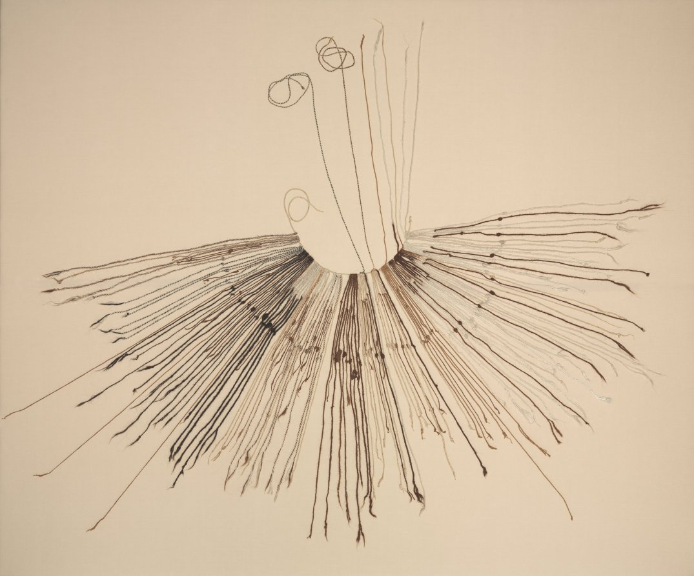
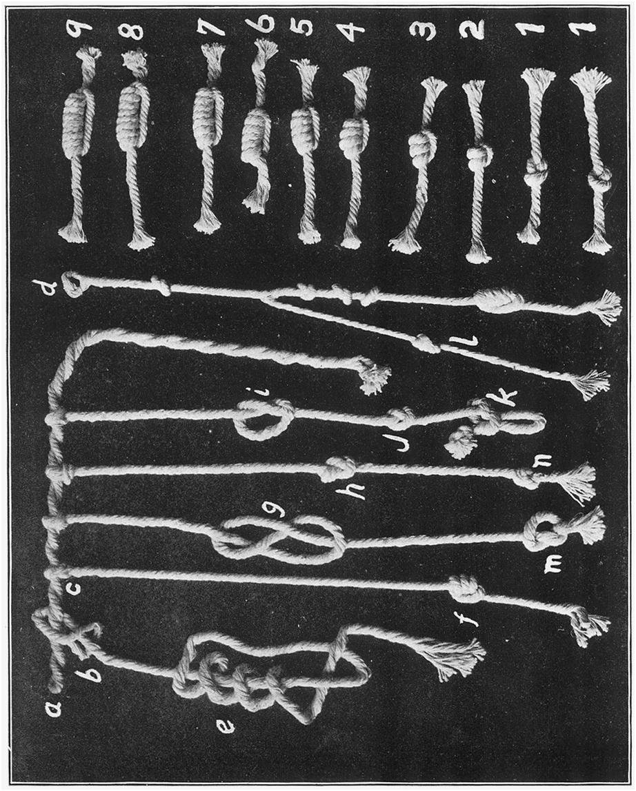
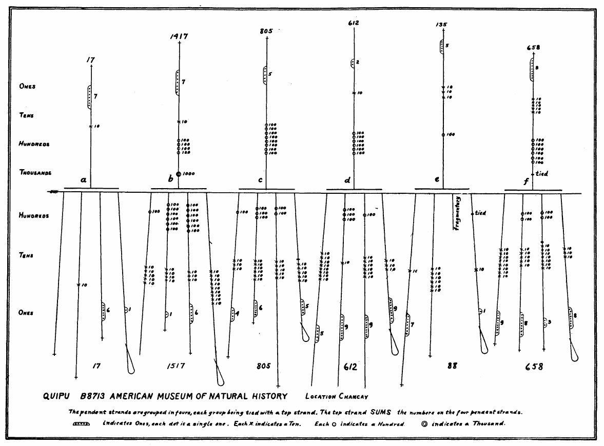
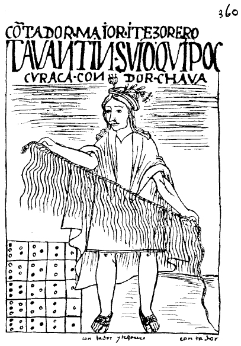

+++
author = "Yuichi Yazaki"
title = "Recording Numbers by Knot Type and Position on a Cord: The Andean Quipu"
slug = "quipu"
date = "2026-11-01"
description = "The Andean quipu recorded numbers by the type and number of knots and their position on a cord (a decimal place-value system). According to Garcilaso, items were distinguished by the color and order of the cords."
categories = [
    "consume"
]
tags = [
    "data physicalization",
    "quipu",
    "L. Leland Locke"
]
image = "images/cleveland-inka-khipu.jpg"
+++

The quipu (also spelled khipu) was a recording device that distinguished numbers by "the type and number of knots × their position on the cord (decimal place value)" and items by "the color and order of the cords." Dozens of cords hang from a main cord, and a number is knotted into each one. Garcilaso testifies that the color and order of the cords showed what the numbers were counting. However, the meaning of the colors cannot be generalized beyond the specimens studied.

The materials here are two primary sources. One is the *Royal Commentaries of the Incas* (*Comentarios Reales*), published in 1609 by Inca Garcilaso de la Vega, born in Cusco, who writes about his own experience of reading quipus. The other is a paper by L. Leland Locke in *American Anthropologist* in 1912, which demonstrated the decimal place-value system on actual specimens. The quipu is also listed in dataphys.org's collection of data physicalization examples. What follows reads the quipu along these two sources.

<!--more-->

## Position on the cord gives the place; the shape of the knot gives the value

A quipu has a thick main cord with thinner cords hanging from it like a fringe. According to Locke, pendent cords rarely exceed 0.5 meters, and their number ranges from one or two to over a hundred. The materials are cotton and wool.

Source: The Cleveland Museum of Art, Gift of John Wise, 1940.469 / Cleveland Museum of Art Open Access (CC0)

Garcilaso had already described how numbers were written. The topmost knot is the ten-thousands place, followed downward by thousands and hundreds, and the lowest is the ones place.

> The knots of each number, and each thread, were placed in a line with each other, exactly in the way a good accountant places his figures to make a long addition sum.

Summary: Knots of the same place were lined up in a row. Garcilaso compares this to a skilled accountant aligning the digits of figures for a long addition.

Locke confirms this on actual specimens. In the general description, a single knot in the row farthest from the main cord stands for 1, in the next row for 10, and in the one after that for 100. A group holds at most nine single knots, and he writes "the number system being strictly decimal." In the Huando type, such as B8713, only the ones place is written with a different kind of knot. The numbers 2 to 9 are "long knots," and the number of turns wound is the value. The number 1 is a figure-eight knot (this is a reading of Locke's illustration by the Khipu Field Guide). Zero is expressed by leaving that place without a knot.

Source: L. Leland Locke, "The Ancient Quipu, a Peruvian Knot Record" (*American Anthropologist*, 1912), Plate XXI (published in 1912; public domain in the United States)

In the upper row of samples, the larger the number, the more turns the knot has.

Changing the form only for the ones place has a practical benefit. In researchers' notation (s = single knot, L = long knot, E = figure-eight knot, X = blank), 731 is written "7s, 3s, E" and 804 is "8s, X, 4L." When a ones-place knot appears, the number ends there. This is why 107 and 51 can be tied one after the other on a single cord (1s, X, 7L, 5s, E). It can be read as **changing the form of the value itself to mark where a number ends**, without using a delimiter.

## 1912: the upward cord reveals the sum

Locke took B8713 of the American Museum of Natural History as his representative specimen for confirming the decimal reading. It was excavated at Huando, on the coast north of Lima. Its pendent cords are divided into six groups of four, and each group has one upward cord (top cord) passed through it.

> The top cord sums the numbers on the pendent cords through which it is looped, thus giving an accurate key to the numerical character of the knots.

Summary: The top cord adds up the numbers on the pendent cords it passes through. That, Locke argues, is a reliable key to the knots being numbers.

Source: L. Leland Locke, "The Ancient Quipu, a Peruvian Knot Record" (*American Anthropologist*, 1912), Plate XXIII (published in 1912; public domain in the United States)

In the leftmost group, a, the pendent cords are 0, 10, 6, and 1, and the upward cord is 17. The sums of each group, shown below the figure, are 17, 1517, 805, 612, 88, and 658. The values of the upward cords are 17, 1417, 805, 612, 135, and 658. They agree in four of the six groups. Group b differs by 100, and group e has a missing cord. In the text, Locke writes that the fourth cord of b shows traces of having had a subsidiary cord attached, and that there is a discrepancy in the numbers (p. 328).

Locke estimated that this specimen is a record of "six periods (or six years) × four kinds of things." His conclusions include the following.

> 1. These knots were used purely for numerical purposes.
> 3. The quipu was not used for counting or calculating but for record keeping.

Summary: The knots were used only for numbers. The quipu was not a tool for counting or calculating but a tool for keeping records.

David Eugene Smith, who contributed an introduction, wrote that this is probably the oldest decimal notation known to the Western world, at least the oldest portable one.

The sum cord is not a trick limited to this one specimen. Manuel Medrano and Ashok Khosla reported in 2024 that at least 74% of 650 quipus have summation relationships between cords. It can be read as meaning that the key for checking whether a reading was correct was built into the data itself. Garcilaso also writes that every village, however small, had at least four record keepers, who checked one another's work. This was a mechanism for verifying one record through multiple readers.

## Color and order show what is being counted

What showed what was being counted was color and order. Garcilaso writes that some cords were of a single color and others combined two or three colors, and that every color had a meaning.

> The thing to which a string referred was understood by its colour: for instance, a yellow string referred to gold, a white one to silver, and a red one to soldiers.

Summary: What a cord referred to was known by its color. For example, a yellow cord referred to gold, a white one to silver, and a red one to soldiers.

What could not be shown by color was shown by order. For grain, the order was wheat, barley, beans, and millet. In a census, the first cord was men aged 60 and over, the second men in their fifties, and so on, ending with infants. The convention was to arrange items from the most important.

Breakdowns were shown with thin subsidiary cords of the same color. Garcilaso gives the example of attaching one to the cord for married men to record the number of widowers, and Locke also confirms that most old quipus have subsidiary cords.

However, no table of color correspondences survives. For B8713, Locke concludes that if the six groups record the same four kinds of things, the colors have no special meaning and were chosen by the maker's preference or convenience. He does not rule out that there may have been a rough rule for colors. The Khipu Field Guide writes that color information is clearly important, but that its symbolic meaning has been lost.

Of traditions of history, law, and ritual, Garcilaso writes as follows.

> But the Indian who had not received the traditions by means of his memory was as uninformed concerning them as a Spaniard or any other stranger.

Summary: An Indian who had not received the traditions through memory was as uninformed about them as a Spaniard. On the other hand, regarding tribute accounts, Garcilaso writes that he himself soon became able to read them "as well as the Indians themselves."

The people who made and read quipus were specialists in charge of records. In the English translation of Garcilaso they are the Quipu-camayu, "He who has charge of the accounts." Garcilaso does not write about a legend for the colors, but it can be read that such a legend likewise lay in these people's memories. In 1583, the Third Council of Lima prohibited quipus that recorded offerings to non-Christian gods as idolatrous objects and ordered them burned. Because the legend existed only in the readers' memories, it can be read that only the numerical part remained readable.

Source: Felipe Guaman Poma de Ayala, c.1615 (the original is a 17th-century work; 1936 facsimile, p. 360) / Wikimedia Commons

A quipu record keeper drawn by Guaman Poma around 1615.

## Listing the variables on the cord

The correspondences so far are laid out in a table.

| Data | Physical property on the cord | Example | Certainty |
|---|---|---|---|
| Value of each digit (1-9) | Number of knots gathered in one place | Above the tens place, the number of single knots; at most 9 per group | Established (Locke) |
| Value of the ones place | Type of knot | 2-9 are the number of turns of a long knot; 1 is a figure-eight knot | Established (Locke, KFG) |
| Place (1, 10, 100...) | Position on the cord (distance from the main cord) | The row farthest from the main cord is the ones place | Established (Locke, Garcilaso) |
| 0 | Absence of a knot | Leave that place empty | Established (KFG) |
| Sum | Upward cord passed through a group | B8713: 17 = 0 + 10 + 6 + 1 | Established (in B8713). A minority across the corpus |
| Item | Color of the cord (single or multicolor) | Yellow = gold, white = silver, red = soldiers | Contemporary testimony. Cannot be generalized |
| Item not expressible by color | Order of the cords | Wheat, barley, beans, millet | Contemporary testimony |
| Breakdown, exception | Thin subsidiary cord of the same color | Number of widowers on the cord for married men | Contemporary testimony; confirmed by Locke on specimens |
| Grouping | Bundle of cords of the same color | May represent a kin group (ayllu) | Hypothesis (KFG) |
| Binary information | Direction of twist (S/Z), way of attachment to the main cord | May represent moieties (hanan/hurin), etc. | Hypothesis (KFG, Medrano & Urton) |

dataphys.org lists "rope length" alongside color, knot position, and knot type. I could not find a primary source that supports this. Garcilaso writes that cords were of a fixed length of about two feet, and Locke also says that what determines the place is the distance from the main cord.

Dating also calls for care. The heading "2600 BC" on dataphys.org rests on a 2005 announcement that the "oldest quipu" had been found at the Caral site, but this is not a well-verified claim. The oldest quipu confirmed by radiocarbon dating is from Wari, dated 780-1024. Most of the 31 Inca quipus date to 1500-1600.

## How third parties have seen the quipu

On the visualization research side, Yvonne Jansen, Pierre Dragicevic, and others cite the quipu as a historical example of data physicalization in their CHI 2015 paper.

> The Incas never even developed a writing system but relied on Quipus – complex assemblies of knotted ropes – for data storage and retrieval.

Summary: The Incas had no writing system and used quipus, assemblies of knotted ropes, to store and retrieve data. It can be read as treating the quipu not as a display for showing, but as a device for storage and retrieval.

In anthropology, Sabine Hyland announced in 2017 that two letter quipus preserved in the village of Collata, dating to the 18th century, contain 95 kinds of signs. Her claim is that family names are expressed by combinations of color, fiber type (vicuña, alpaca, deer, and others), and direction of twist.

> The reader must often feel the cords by hand to distinguish the fibre sources of these three-dimensional texts.

Summary: To tell the fibers apart, the reader often has to feel the cords by hand. However, the subject is colonial-period quipus, and the possibility that they were influenced by European writing has also been pointed out.

On the data science side, Medrano and Khosla look for coding conventions across the whole corpus. The abstract of their 2024 paper says that the summation relationships carried by upward cords are a minority, and suggests that white pendent cords may have been used as boundaries of summation groups. The Khipu Field Guide, created by Khosla, is a database of 703 quipus redrawn from the specimens. It says:

> It's difficult to understand a khipu from tables. A rendering is necessary.

Summary: A quipu is hard to understand from tables, and a redrawn rendering is needed. It can be read that Locke redrew B8713 as a diagram of symbols in 1912 out of the same need. To read quipus, researchers visualize them anew.

## Takeaways

There are four things to take away from the quipu.

The first is assigning quantity and category to different variables. Applied to Bertin's visual variables, it can be read as corresponding to the separate use of position, shape, hue, and arrangement. However, I found no research that connects the two. Rather than declaring it a "prototype of the visual variables," it is more accurate to say that "a corresponding division of roles can be seen."

The second is changing the form for each kind of value. By writing only the ones place with a different knot, the quipu can be read as marking where a number ends without a delimiter. It is a clue for asking, before adding a legend or dividing lines, whether the form itself can make the distinction.

The third is building a structure that allows checking into the data. The sum cord works like the total row of a spreadsheet, and Locke took it as a reliable key to the numerical character of the knots.

The fourth is keeping the legend outside the maker's head. Numbers written under the shared convention of the decimal system can still be read today. Because the meaning of the colors lay only in the record keepers' memories, it can be read that they are unreadable now. The quipu shows what happens to a record whose legend was never written down.

## References

**Primary sources**

- Garcilaso de la Vega, *First Part of the Royal Commentaries of the Yncas*, Vol. II, trans. Clements R. Markham, Hakluyt Society, 1871, Book VI, ch. VIII–IX (original *Comentarios Reales*, 1609). [archive.org](https://archive.org/details/firstpartofroyal02vega)
- L. Leland Locke, "The Ancient Quipu, a Peruvian Knot Record," *American Anthropologist* n.s. 14(2): 325–332, 1912. [archive.org](https://archive.org/details/jstor-659935)
- A. Cherkinsky & G. Urton, "Radiocarbon chronology of Andean khipus," *Open Journal of Archaeometry* 2(1), 2014. doi:10.4081/arc.2014.5260 [OpenAlex](https://api.openalex.org/works/doi:10.4081/arc.2014.5260)
- S. Hyland, "Writing with Twisted Cords," *Current Anthropology* 58(3), 2017. doi:10.1086/691682 / University of St Andrews, "Lost writing of the Inkas discovered," 2017-04-20. [news.st-andrews.ac.uk](https://news.st-andrews.ac.uk/archive/lost-writing-of-the-inkas-discovered/)
- M. Medrano & G. Urton, *Ethnohistory* 65(1): 1–23, 2018. doi:10.1215/00141801-4260638
- M. Medrano & A. Khosla, "How Can Data Science Contribute to Understanding the Khipu Code?," *Latin American Antiquity*, 2024. [Cambridge Core](https://www.cambridge.org/core/journals/latin-american-antiquity/article/how-can-data-science-contribute-to-understanding-the-khipu-code/E2D0E68A0515F3F9582A23C63693F4CE)
- The Cleveland Museum of Art, Inka Khipu (Fiber Recording Device), 1940.469. [clevelandart.org](https://clevelandart.org/art/1940.469) / [Open Access API](https://openaccess-api.clevelandart.org/api/artworks/1940.469)
- Reuters report on the announcement of the "oldest quipu," NBC News, 2005-07-19. [nbcnews.com](https://www.nbcnews.com/id/wbna8633818)
- dataphys.org, "2600 BC – Quipus," 2013-09-22 (Added by Pierre Dragicevic). [dataphys.org](https://dataphys.org/list/peruvian-quipus/)

**Secondary sources**

- Y. Jansen, P. Dragicevic, P. Isenberg et al., "Opportunities and Challenges for Data Physicalization," CHI 2015. doi:10.1145/2702123.2702180 [HAL](https://inria.hal.science/hal-01120152)
- Ashok Khosla, Khipu Field Guide. [khipufieldguide.com](https://khipufieldguide.com/) / [Introduction](https://www.khipufieldguide.com/guidebook/Introduction.html) / [Khipu Signs](https://www.khipufieldguide.com/guidebook/KhipuSigns.html) / [Khipu Data Visualization](https://www.khipufieldguide.com/databook/KhipuDataVisualization.html)
- Wikipedia, "Quipu" (chronology dispute, the 1583 ban, number of surviving specimens, examples of numerical notation). [en.wikipedia.org](https://en.wikipedia.org/wiki/Quipu)
- Felipe Guaman Poma de Ayala, *El primer nueva corónica y buen gobierno*, c.1615, p. 360 (illustration). [Wikimedia Commons](https://commons.wikimedia.org/wiki/File:Nueva_cor%C3%B3nica_y_buen_gobierno_(1936_facsimile)_p360.png)
