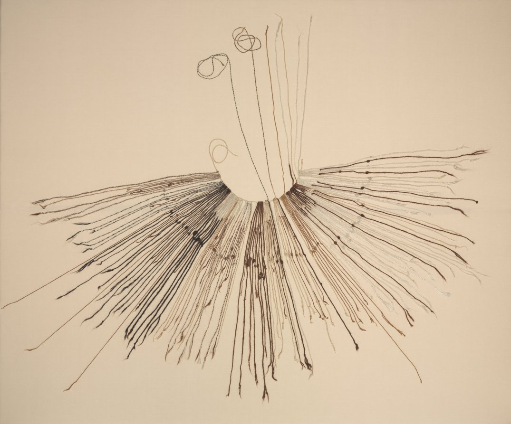
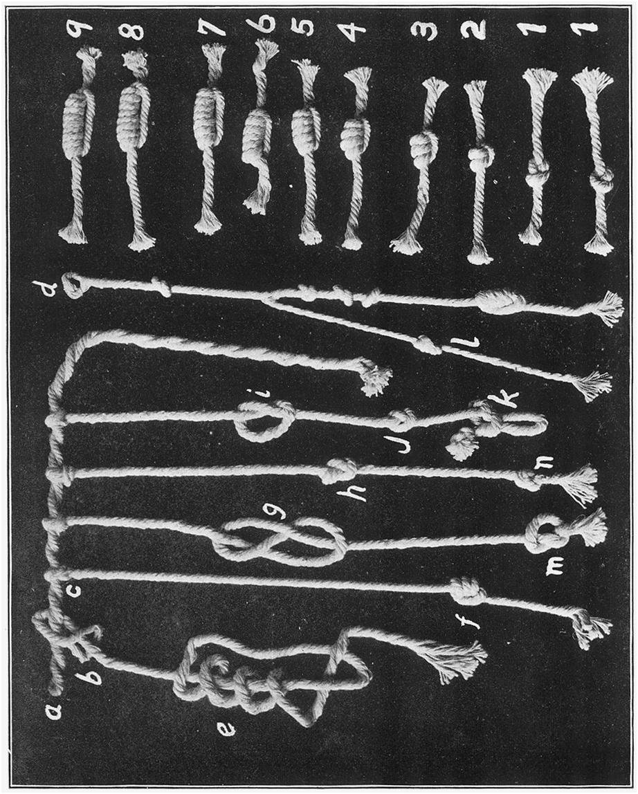
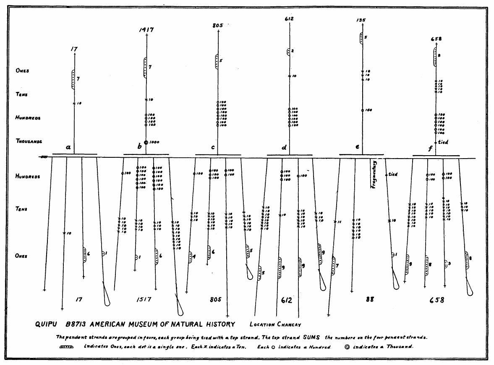
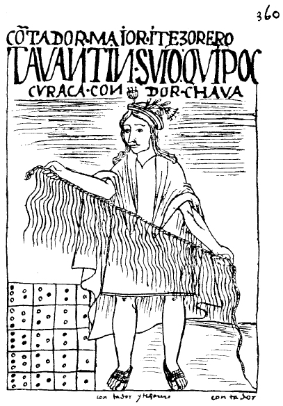

+++
draft = true
author = "矢崎裕一"
title = "数は結び目と位置に、項目は色と並びに──アンデスのキープ"
slug = "quipu"
date = "2026-11-01"
description = "アンデスのキープは、数を結び目の種類と数、縄の上の位置（十進の位取り）で表し、何の数かを縄の色と並び順で表し分けた、縄の記録装置です。"
categories = [
    "consume"
]
tags = [
    "データ物理化",
    "キープ",
    "L. Leland Locke"
]
image = "images/cleveland-inka-khipu.jpg"
+++

キープ（quipu／khipu）は、数を「結び目の種類と数×縄の上の位置（十進の位取り）」で、項目を「縄の色と並び順」で表し分けた記録装置です。主縄から何十本もの縄を下げ、1本の縄に一つの数を結びます。何の数かは、その縄の色と、何番目に下がっているかで示します。量とカテゴリを、別々の物理的な性質に割り当てていたことになります。

材料は二つの一次資料です。一つは、クスコ生まれの Inca Garcilaso de la Vega（インカ・ガルシラーソ・デ・ラ・ベーガ）が1609年に出した『インカ皇統記』で、本人がキープを読んだ経験を書いています。もう一つは、L. Leland Locke（L・リーランド・ロック）が1912年に *American Anthropologist* に載せた論文で、十進の位取りを実物で証明しました。キープは、データ物理化の事例集 dataphys.org にも載っています。以下は、この二つの資料に沿って読みます。

<!--more-->

## 縄の上の位置が位を、結び目の形が値を表す

キープは、太い主縄から細い縄が房のように下がる形をしています。Locke によれば、下垂縄は0.5メートルを超えることがまれで、本数は1〜2本から100本以上です。素材は綿と羊毛です。

The Cleveland Museum of Art, Gift of John Wise, 1940.469／Cleveland Museum of Art Open Access より引用（CC0）

クリーブランド美術館の標本（c.1400–1532年、113 × 137.2 cm）です。縄の色が、白、淡い茶、濃い茶と分かれています。

数の書き方は、Garcilaso がすでに書いています。いちばん上の結び目が万の位で、下へ千、百と続き、いちばん下が一の位です。

> The knots of each number, and each thread, were placed in a line with each other, exactly in the way a good accountant places his figures to make a long addition sum.

要旨：どの縄でも、同じ位の結び目が横一列にそろっていた。腕のよい会計係が、長い足し算のために数字の桁をそろえて書くのと同じだ、という証言です。

Locke はこれを実物で確かめます。単結びは、主縄から最も遠い列なら1、次の列なら10、その次なら100を表します。1つの群に単結びは9個までで、「the number system being strictly decimal」と書いています。1の位だけは別の結び方で書きます。2〜9は「長結び」で、巻き付けた回数が値になります。1は8の字結びです（Khipu Field Guide による Locke の図の読み）。0は、その位に結び目を作らないことで表します。

L. Leland Locke／"The Ancient Quipu, a Peruvian Knot Record"（*American Anthropologist*, 1912）Plate XXI より引用（1912年刊、米国でパブリックドメイン）

上段の見本では、数が大きいほど巻き数の多い結び目になります。

1の位だけ形を変えたことには、実用上の効き目があります。研究者の表記（s＝単結び、L＝長結び、E＝8の字結び、X＝空白）で書くと、731は「7s, 3s, E」、804は「8s, X, 4L」です。1の位の結び目が来たら、そこで数が終わります。そのため、1本の縄に107と51を続けて結べます（1s, X, 7L, 5s, E）。区切り記号を使わずに、**値の形そのものを変えて数の切れ目を示した**と読めます。

## 1912年、上向きの縄が合計を明かす

結び目が本当に十進数なのか。Locke に確信を与えたのは、アメリカ自然史博物館の標本 B8713 でした。リマの北の海岸、Huando から出土したものです。下垂縄は4本ずつ6つの群に分かれ、各群に上向きの縄（top cord）が1本通されています。

> The top cord sums the numbers on the pendent cords through which it is looped, thus giving an accurate key to the numerical character of the knots.

要旨：上向きの縄は、それが通された下垂縄の数を合計している。それが、結び目が数であることの確かな鍵になる、という主張です。

L. Leland Locke／"The Ancient Quipu, a Peruvian Knot Record"（*American Anthropologist*, 1912）Plate XXIII より引用（1912年刊、米国でパブリックドメイン）

左端の群 a では、下垂縄が0、10、6、1で、上向きの縄は17です。図の下に並ぶ各群の合計は 17、1517、805、612、88、658 です。上向きの縄の値は 17、1417、805、612、135、658 です。6群のうち4群で一致します。b の群には100の食い違いがあり、Locke は補助縄が付いていた跡に触れています。e の群には、欠けた縄があります。

Locke は、この標本を「6期間（または6年）× 4種類の物の記録」と推定しました。結論には、こうあります。

> 1. These knots were used purely for numerical purposes.
> 3. The quipu was not used for counting or calculating but for record keeping.

要旨：結び目は数のためだけに使われた。キープは数えたり計算したりする道具ではなく、記録の道具だった、という結論です。

論文に紹介文を寄せた David Eugene Smith は、これを西洋世界で知られる最古の十進表記だろうと書いています。

合計の縄は、この1点に限った工夫ではありません。Manuel Medrano と Ashok Khosla は2024年、650点のキープの少なくとも74%に、縄どうしの合計関係があると報告しています。読み方の正しさを確かめる鍵が、データ自身の中に入っていたと読めます。Garcilaso も、どんな小さな村にも4人以上の記録係を置き、互いに照合させたと書いています。1つの記録を、複数の読み手で確かめる仕組みです。

## 色と並び順が、何の数かを示す

何の数かを示したのは、色と並び順です。Garcilaso は、縄が1色のもの、2色・3色を組み合わせたものがあり、どの色にも意味があったと書きます。

> The thing to which a string referred was understood by its colour: for instance, a yellow string referred to gold, a white one to silver, and a red one to soldiers.

要旨：縄が何を指すかは色で分かった。たとえば黄色の縄は金、白は銀、赤は兵士を指した、という証言です。

色で表せないものは、並び順で表しました。穀物なら、小麦、大麦、豆、キビの順。武器なら、槍、投げ槍、弓矢、盾、斧、投石器の順です。人口調査では、1本目が60歳以上の男性、2本目が50代、3本目が40代と続き、最後が乳児でした。女性も同じ順に数えます。重要なものから順に並べる、という約束です。

内訳は、細い補助縄で表しました。既婚男性の縄に同じ色の細い縄を付けて、同じ年齢の寡夫の数を記す、という例を Garcilaso は挙げています。Locke も、古いキープのほとんどに補助縄があることを実物で確かめています。

ただし、色の対応表は残っていません。Locke は B8713 について、6つの群が同じ4種類の物の記録なら、色に特別な意味はなく、作り手の好みや都合で選ばれたのだろうと結論しています。大まかな色の決まりがあった可能性は否定していません。Khipu Field Guide は、色の情報が重要なのは明らかだが、その象徴的な意味は失われた、と書いています。

Garcilaso には、こういう一文もあります。

> But the Indian who had not received the traditions by means of his memory was as uninformed concerning them as a Spaniard or any other stranger.

要旨：記憶によって言い伝えを受け継いでいない者は、スペイン人やほかのよそ者と同じく、何も分からなかった、という証言です。

キープを作って読んだのは、記録を担う専門職でした。Garcilaso の英訳では Quipu-camayu、「He who has charge of the accounts」です。色の凡例は、縄の上ではなく、この人たちの記憶の中にあったと読めます。1583年、第3回リマ教会会議は、キープを偶像崇拝の物として禁止し、焼却を命じました。凡例が読み手の記憶にしかなかったため、数の部分だけが読める状態で残ったと読めます。

Felipe Guaman Poma de Ayala, c.1615（1936年ファクシミリ, p.360）／Wikimedia Commons より引用（パブリックドメイン）

1615年ごろに Guaman Poma が描いた、キープの記録係です。

## 縄の上の変数を一覧にする

ここまでの対応を、確度と合わせて表にします。

| データ | 縄の上の物理的な性質 | 例 | 確度 |
|---|---|---|---|
| 各桁の値（1〜9） | 1か所に集めた結び目の数 | 10の位より上は単結びの個数。1群に9個まで | 確立（Locke） |
| 1の位の値 | 結び目の種類 | 2〜9は長結びの巻き数、1は8の字結び | 確立（Locke、KFG） |
| 位（1・10・100…） | 縄の上の位置（主縄からの距離） | 主縄から最も遠い列が1の位 | 確立（Locke、Garcilaso） |
| 0 | 結び目がないこと | その位を空ける | 確立（KFG） |
| 合計 | 群に通した上向きの縄 | B8713 の 17＝0＋10＋6＋1 | 確立（Locke） |
| 項目 | 縄の色（単色・複色） | 黄＝金、白＝銀、赤＝兵士 | 当時の証言。一般化できない |
| 色で表せない項目 | 縄の並び順 | 小麦→大麦→豆→キビ | 当時の証言 |
| 内訳・例外 | 同じ色の細い補助縄 | 既婚男性の縄に寡夫の数 | 当時の証言、Locke が実物で確認 |
| まとまり | 同じ色の縄の束 | 家族集団（ayllu）を表す可能性 | 仮説（KFG） |
| 二値の情報 | 撚りの向き（S/Z）、主縄への付け方 | 半族（hanan/hurin）などを表す可能性 | 仮説（KFG、Medrano & Urton） |

dataphys.org は、色、結び目の位置、結び目の種類と並べて「rope length（縄の長さ）」も挙げています。これを裏づける一次資料は見つかりませんでした。Garcilaso は縄の長さを「3/4バラ（約2フィート）」と決まった寸法で書いています。Locke も、位を決めるのは主縄からの距離だとしています。

年代にも注意が要ります。dataphys.org の見出し「2600 BC」は、カラル遺跡で「最古のキープ」が見つかったという2005年の発表に基づきますが、十分に検証された説ではありません。放射性炭素年代で確かめられた最古のキープは、ワリの780–1024年のものです。インカのキープ31点の多くは1500–1600年でした。現存するキープは、博物館と個人のコレクションで1,400点弱です。

## 第三者はキープをどう見たか

可視化研究の側では、Yvonne Jansen、Pierre Dragicevic らが CHI 2015 の論文で、キープをデータ物理化の歴史的な例に挙げています。

> The Incas never even developed a writing system but relied on Quipus – complex assemblies of knotted ropes – for data storage and retrieval.

要旨：インカは文字を持たず、結んだ縄を複雑に組み合わせたキープで、データを保存し、取り出していた、という位置づけです。この論文は、キープを見せるための図ではなく、データを保存し取り出す装置として見ていると読めます。dataphys.org の分類が「Passive physical visualization」なのも、同じ見方です。

人類学の Sabine Hyland は2017年、18世紀のコジャタ村に残る書簡のキープ2点に95種類の記号があると発表しました。色、繊維の種類（ビクーニャ、アルパカ、シカなど）、撚りの向きの組み合わせで家系名を表す、という主張です。

> The reader must often feel the cords by hand to distinguish the fibre sources of these three-dimensional texts.

要旨：繊維の違いを見分けるには、読み手は縄を手で触って確かめなければならないことが多い、という指摘です。ただし対象は植民地期のキープで、ヨーロッパの文字の影響を受けた可能性も指摘されています。

データサイエンスの側では、Medrano と Khosla が、コーパス全体から符号の約束事を探しています。上向きの縄が担う合計関係は少数派で、白い下垂縄が合計のまとまりの境界になっている、と2024年の論文の抄録にあります。Khosla が作る Khipu Field Guide は、703点のキープを描き起こしたデータベースです。そこには、こうあります。

> It's difficult to understand a khipu from tables. A rendering is necessary.

要旨：キープは表からは理解しにくく、描き起こした図が要る、という指摘です。結び目の種類、S/Z、色、付け方を描き分けることを、図の要件に挙げています。Locke が1912年に B8713 を記号の図に描き起こしたのも、同じ必要からだったと読めます。キープを読むために、研究者はキープを可視化し直しています。

## 使い道

キープから持ち帰れることは、四つあります。

一つ目は、量とカテゴリを別の変数に割り当てることです。ベルタンの視覚変数に当てはめると、位置、形、色相、配置の使い分けに相当すると読めます。ただし、両者を結びつけた研究は見つかっていません。「視覚変数の原型」と言い切るより、「相当する使い分けが見られる」くらいが正確です。

二つ目は、値の種類ごとに形を変えることです。1の位だけを別の結び目で書いたので、区切り記号なしで数の切れ目が分かりました。凡例や区切り線を足す前に、形そのもので読み分けられないかを考える手がかりになります。

三つ目は、検算できる構造をデータの中に入れることです。合計の縄は、表計算の合計行のように働き、Locke はそれで読み方を証明しました。

四つ目は、凡例を作り手の頭の外に残すことです。十進法という共通の約束で書かれた数は、いまも読めます。記録係の記憶の中にしかなかった色の意味は、読めません。キープは、凡例を書き残さなかった記録がどうなるかを示しています。

## 参考・出典

**一次情報**

- Garcilaso de la Vega, *First Part of the Royal Commentaries of the Yncas*, Vol. II, trans. Clements R. Markham, Hakluyt Society, 1871, Book VI, ch. VIII–IX（原著 *Comentarios Reales*, 1609）. [archive.org](https://archive.org/details/firstpartofroyal02vega)
- L. Leland Locke, "The Ancient Quipu, a Peruvian Knot Record," *American Anthropologist* n.s. 14(2): 325–332, 1912. [archive.org](https://archive.org/details/jstor-659935)
- A. Cherkinsky & G. Urton, "Radiocarbon chronology of Andean khipus," *Open Journal of Archaeometry* 2(1), 2014. doi:10.4081/arc.2014.5260 [OpenAlex](https://api.openalex.org/works/doi:10.4081/arc.2014.5260)
- S. Hyland, "Writing with Twisted Cords," *Current Anthropology* 58(3), 2017. doi:10.1086/691682 ／ University of St Andrews, "Lost writing of the Inkas discovered," 2017-04-20. [news.st-andrews.ac.uk](https://news.st-andrews.ac.uk/archive/lost-writing-of-the-inkas-discovered/)
- M. Medrano & G. Urton, *Ethnohistory* 65(1): 1–23, 2018. doi:10.1215/00141801-4260638
- M. Medrano & A. Khosla, "How Can Data Science Contribute to Understanding the Khipu Code?," *Latin American Antiquity*, 2024. [Cambridge Core](https://www.cambridge.org/core/journals/latin-american-antiquity/article/how-can-data-science-contribute-to-understanding-the-khipu-code/E2D0E68A0515F3F9582A23C63693F4CE)
- The Cleveland Museum of Art, Inka Khipu (Fiber Recording Device), 1940.469. [clevelandart.org](https://clevelandart.org/art/1940.469) ／ [Open Access API](https://openaccess-api.clevelandart.org/api/artworks/1940.469)
- Reuters 配信「最古のキープ」発表の報道, NBC News, 2005-07-19. [nbcnews.com](https://www.nbcnews.com/id/wbna8633818)
- dataphys.org, "2600 BC – Quipus," 2013-09-22（Added by Pierre Dragicevic）. [dataphys.org](https://dataphys.org/list/peruvian-quipus/)

**第三者評価**

- Y. Jansen, P. Dragicevic, P. Isenberg et al., "Opportunities and Challenges for Data Physicalization," CHI 2015. doi:10.1145/2702123.2702180 [HAL](https://inria.hal.science/hal-01120152)
- Ashok Khosla, Khipu Field Guide. [khipufieldguide.com](https://khipufieldguide.com/) ／ [Introduction](https://www.khipufieldguide.com/guidebook/Introduction.html) ／ [Khipu Signs](https://www.khipufieldguide.com/guidebook/KhipuSigns.html) ／ [Khipu Data Visualization](https://www.khipufieldguide.com/databook/KhipuDataVisualization.html)
- Wikipedia, "Quipu"（年代論争、1583年の禁令、現存数、数値表記の例）. [en.wikipedia.org](https://en.wikipedia.org/wiki/Quipu)
- Felipe Guaman Poma de Ayala, *El primer nueva corónica y buen gobierno*, c.1615, p.360（図版）. [Wikimedia Commons](https://commons.wikimedia.org/wiki/File:Nueva_cor%C3%B3nica_y_buen_gobierno_(1936_facsimile)_p360.png)
