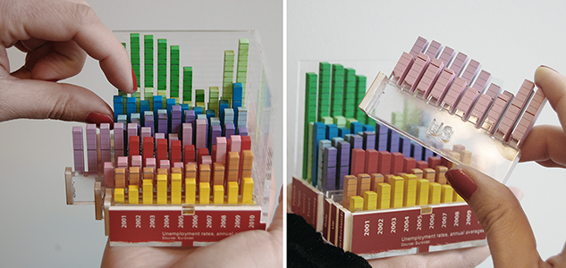
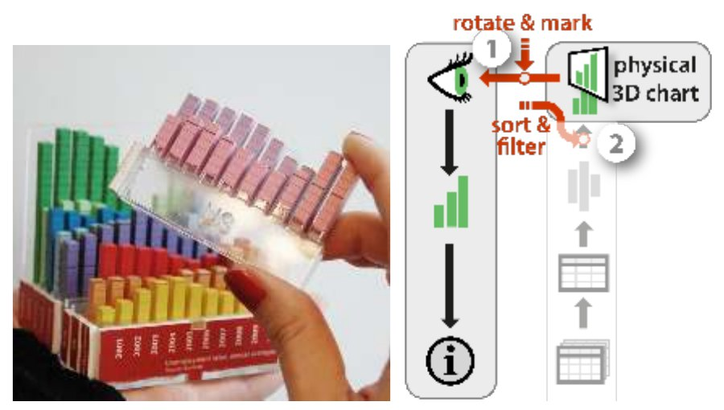

+++
author = "Yuichi Yazaki"
title = "Pulling Out and Rearranging One Chart per Country: The Rearrangeable 3D Bar Chart"
slug = "rearrangeable-bar-chart"
date = "2026-11-01"
description = "A physical chart in which each country's 2D bar chart can be pulled out and pushed back in. It shows unemployment rates for 10 countries over 10 years, and people sort, extract, and superimpose the parts by hand to compare them."
categories = [
    "consume"
]
tags = [
    "data physicalization",
    "3D bar chart",
    "interaction",
    "Yvonne Jansen",
    "Pierre Dragicevic"
]
image = "images/pulling-out-country-rows.png"
+++

The Rearrangeable 3D Bar Chart is a physical 3D bar chart showing unemployment rates for 10 countries over 10 years. Each country's 2D bar chart is a separate part that can be pulled out and pushed back in. People move the parts by hand to sort the countries, pull them out, and superimpose them to compare.

The creators are Yvonne Jansen and Pierre Dragicevic, then at the AVIZ team of Inria. The work is presented as one of eight case studies in their paper "An Interaction Model for Visualizations Beyond The Desktop" (IEEE TVCG, 2013). In dataphys.org, the catalog of data physicalization examples, it is listed as a 2012 example. What follows is based on this paper and the dataphys.org entry.

<!--more-->

## Ten 2D Bar Charts in One Piece

The dataphys.org entry describes the work in a single sentence.

> A modular physical visualization like this rearrangeable 3D bar chart allows people to sort, filter, compare and examine data by direct physical manipulation.

In other words, a physical visualization made of separate parts lets people sort, filter, compare, and examine data by moving the parts directly with their hands. The entry was added by Dragicevic, and it is classified as "Passive physical visualization," meaning it has no electronic components.

According to the paper, the chart shows "unemployment rates over 10 years for 10 countries." With 10 countries and 10 years, that makes 100 bars by calculation. The parts were cut automatically from the data with a laser cutter, and painting and assembly were done by hand.

Source: Yvonne Jansen and Pierre Dragicevic, dataphys.org, "2012 – Rearrangeable 3D Bar Chart"

In the left photo, a finger lifts a blue row. On the right, a whole pink row has been pulled out. Each row has a different color, and year labels beginning with "2001" line up on the red base at the front. The paper does not explain what the colors or the base mean, so what follows here is a reading from the photos. The table below summarizes how data maps to physical properties.

| Data | Physical property | Basis |
|---|---|---|
| Unemployment rate (quantity) | Bar height | Paper. Scale values and proportions are unknown |
| Country (10 countries) | A row in the depth direction. One country is one part that can be pulled out and pushed back in | Paper |
| Year (10 years) | The horizontal arrangement of bars within each row. Fixed within the part | The 10 years are from the paper; the arrangement is a reading from the photos |
| Order of countries | Not determined by the data. Can be changed by hand | Paper |
| Distinguishing countries | Color per row | A reading from the photos |
| Year labels | The base at the front | A reading from the photos |

As the source for how it was built, the paper cites the same authors' CHI 2013 paper. That paper's physical 3D bar chart and its evaluation experiment are covered in another article, "[Faster than On-Screen 3D Bar Charts, but Not Faster than 2D](/en/evaluating-physical-visualizations/)." I could not confirm whether the two are the same object or different specimens made in the same way. I also could not confirm the materials or dimensions for this work.

## Pull Out, Move Apart, Superimpose

The paper divides the operations possible with this bar chart into two levels. The first is operations that change how the chart is seen, such as rotating the chart or pressing a finger on a data point. The second is operations that move the parts.

> Each country is a 2D bar chart that can be taken out and manipulated separately. This simple design choice enables a user to perform a range of additional tasks (2): she can sort countries, filter them out by moving them away, or compare countries by superimposing them.

The paper contrasts this with an example of a single-piece model: a 3D-printed coral model used as a tool for manipulating a screen.

Source: Yvonne Jansen and Pierre Dragicevic, "An Interaction Model for Visualizations Beyond The Desktop" (IEEE TVCG, 2013), Fig. 9

The right side of Figure 9 is a diagram that describes these operations with the paper's model. The arrow at (1) is labeled "rotate & mark" and the one at (2) "sort & filter."

In the paper's terms, filtering means "moving the parts away," and comparing means "superimposing" them. Filtering here is not a process that deletes data but one that takes parts out of view, which can be read this way. Both can be read as leaving the data itself untouched.

## Sorting Rewrites a "Free" Variable

The core of the paper is a model of the visualization pipeline. It divides the path into stages: raw data becomes a figure, the figure takes on a physical form, and a person reads it. The key to the explanation of sorting is free visual variables.

> We call those free visual variables, to contrast them with encoding visual variables that are constrained by the visual mapping.

Visual variables that are not constrained by the mapping from data are called free visual variables, as opposed to encoding visual variables. In the paper's example, the box plot as a mapping does not determine where along the horizontal axis each box is placed.

Free visual variables are fixed at the stage of the presentation mapping. The paper calls assigning them so as to make the chart easier to read optimization, and gives the example of ordering box plots by participant ID. It also distinguishes operations that locally override a uniform process: moving the nodes of a graph by hand, for instance, is an optimization-overriding operation. For this bar chart, the paper writes:

> rearranging the visualization amounts to modifying free visual variables at the presentation mapping level, or more specifically, performing optimization overriding operations.

The order of countries is a variable the data never determined in the first place. Sorting changes neither the unemployment values nor the bar heights; only the placement changes. This work can be read as turning that free variable into a physical part and handing it to the user's hands. The order of years, on the other hand, is fixed inside each part and cannot be changed by hand. The paper does not state this explicitly; it is a reading from the structure.

## On a Screen, Separate Instruments; by Hand, One Motion

The paper describes the difference from a screen as follows.

> Such operations are supported through true direct manipulation and are very versatile. In contrast, on a desktop system these tasks would typically be considered separately and supported by different instruments.

In the paper, an instrument is something that mediates between a person and a visualization; a sort button or a filter slider are examples. With this bar chart, every task comes down to one motion: pinching a part and moving it. It can be read as not needing to add an instrument for each task.

The same paper also describes the limits of manual operation in its conclusion.

> Still we will always need instrumental operations as those allow to carry out complex tasks that have no real world counterpart (e.g., automatic sorting, brushing & linking).

Tasks with no real-world counterpart, such as automatic sorting or brushing and linking, will always need operations through instruments. Elsewhere, the paper also writes that tasks too complex or too repetitive to do by hand, such as reordering a matrix, are better left to the computer.

Another limit is the link to the data. The paper gives printed matter and 3D fabrication as examples of one-shot propagation: if the source data changes after the object is made, the form is not updated. This bar chart, too, is described as built by "semi-automatic one-shot propagation."

## How Third Parties Saw This Work

The evaluations fall into three: what the way of dividing parts means, users' hesitation, and rearrangement by machine.

The first is a survey of the physicalization fabrication process presented at EuroVis in 2021 by H. Djavaherpour et al.

> the way in which a physicalization is designed to be assembled can determine what types of interactions end-users can have with its represented data.

The point is that how a piece is designed to be assembled determines what kinds of operations users can perform on the data. The survey goes on to write that if Jansen et al.'s assembled 3D bar chart had been glued together, users could not have engaged with the data so deeply. However, the survey cites the CHI 2013 paper, and I have not confirmed whether it refers to the same object as this work. Also, Jansen is among the co-authors, so this is not a fully independent third party.

The second is Simon Stusak of LMU Munich. A different group built a physical visualization aimed at sorting and filtering by separating layers. A 2013 poster says that with a model whose layers can each be rotated, similar items can be grouped only along the time axis, and values within a layer cannot be reordered. In his 2016 doctoral thesis, he built a modular version whose parts are joined with hook-and-loop fasteners and compared it with a fixed version.

> Four participants did not disassemble the modular physical visualization, two because it seemed impractical, two because of fear to break something.

Four participants did not take the modular version apart: two because it seemed troublesome, and two out of fear of breaking it. One participant who tried to take it apart broke a part. This was not Jansen et al.'s bar chart, but it can be read as showing that being able to pull parts out and push them back is different from people actually doing so.

The third is EMERGE by Faisal Taher et al. It is a physical bar chart with 10 x 10 bars raised and lowered by motors. The 2015 paper names the drawbacks of passive physical visualizations as being static and, once made, cut off from the data source. The IEEE VIS 2016 paper reports that in a presentation setting, some participants swapped rows and columns and built elaborate ways of showing the data. Jansen is a co-author of both.

## Takeaways

In the 2015 paper "Opportunities and Challenges for Data Physicalization," the same group wrote about the degree of freedom in rearranging parts as follows.

> However, limited reconfigurability can be desirable. Information as to which states and operations are meaningful can be conveyed as physical constraints

Limiting how a piece can be reconfigured can be desirable, and which states and operations are meaningful can be conveyed through physical constraints. What can be taken from this work overlaps with this passage.

The first is to decide where to split the parts starting from the operations you want to allow. This bar chart is divided between countries, so the order of countries can change and the order of years is preserved. The position of the split decides at once which operations are allowed and which are not. Whether to glue, to make parts pull-out, or to make them snap in is part of the same decision.

The second is to think of sorting as separate from changing the data. In the paper's framing, sorting is overriding a free visual variable, and no value changes. On a screen, too, if you treat the order as a variable the data does not determine, you can add operations like dragging rows without strain.

The third is to build ease of pulling out and putting back into the design. In Stusak's observations, some people did not disassemble the piece for fear of breaking it. The design needs a form that shows a part may be pulled out and is easy to return.

The fourth is to identify the operations not to leave to the hand. With 10 countries, sorting by hand works, but as rows increase it is better left to computation. The fact that data is not updated once the object is made is also worth considering before choosing physicalization.

## References

**Primary sources**

- dataphys.org, "2012 – Rearrangeable 3D Bar Chart" (Added by Pierre Dragicevic): https://dataphys.org/list/rearrangeable-3d-bar-chart/
- Yvonne Jansen, Pierre Dragicevic, "An Interaction Model for Visualizations Beyond The Desktop," *IEEE TVCG* 19(12): 2396–2405, 2013. [doi:10.1109/TVCG.2013.134](https://doi.org/10.1109/TVCG.2013.134) / Full text I read (mirror): https://typeset.io/pdf/an-interaction-model-for-visualizations-beyond-the-desktop-3p3eh2iru9.pdf / HAL (not checked by the author): https://hal.science/hal-00847218 / Authors' page (the author could not connect): http://www.aviz.fr/beyond
- dataphys.org, "2012 – Putting Physical Visualizations to the Test": https://dataphys.org/list/testing-physical-visualizations/
- Yvonne Jansen, Pierre Dragicevic, Petra Isenberg, Jason Alexander, Abhijit Karnik, Johan Kildal, Sriram Subramanian, Kasper Hornbæk, "Opportunities and Challenges for Data Physicalization," *CHI '15*, pp. 3227–3236: https://eprints.lancs.ac.uk/id/eprint/72691/1/OA_2015_04_CHI_DataPhys.pdf
- Yvonne Jansen, Pierre Dragicevic, Jean-Daniel Fekete, "Evaluating the Efficiency of Physical Visualizations," *CHI '13*, pp. 2593–2602 (cited by the paper as the source for how it was built; the author has not read the full text): https://hal.archives-ouvertes.fr/hal-00781831

**Secondary sources**

- H. Djavaherpour, F. Samavati, A. Mahdavi-Amiri, F. Yazdanbakhsh, S. Huron, R. Levy, Y. Jansen, L. Oehlberg, "Data to Physicalization: A Survey of the Physical Rendering Process," *Computer Graphics Forum* 40(3), 2021 (EuroVis STAR): https://arxiv.org/pdf/2102.11175
- Simon Stusak, Aurélien Tabard, Andreas Butz, "Can Physical Visualizations Support Analytical Tasks?" IEEE VIS 2013 poster: https://www.medien.ifi.lmu.de/pubdb/publications/pub/stusak2013visPoster/stusak2013visPoster.pdf
- Simon Stusak, *Exploring the Potential of Physical Visualizations*, Dissertation, LMU München, 2016: https://edoc.ub.uni-muenchen.de/20190/1/Stusak_Simon.pdf
- Faisal Taher, John Hardy, Abhijit Karnik, Christian Weichel, Yvonne Jansen, Kasper Hornbæk, Jason Alexander, "Exploring Interactions with Physically Dynamic Bar Charts," *CHI '15*: https://www.kasperhornbaek.dk/papers/CHI2015_Emerge.pdf
- Faisal Taher, Yvonne Jansen, Jonathan Woodruff, John Hardy, Kasper Hornbæk, Jason Alexander, "Investigating the Use of a Dynamic Physical Bar Chart for Data Exploration and Presentation," *IEEE TVCG* 23(1), 2017: https://yvonnejansen.fr/articles/VIS2016%20-%20Investigating%20the%20Use%20of%20a%20Dynamic%20Physical%20Bar%20Chart%20for%20Data%20Exploration%20and%20Presentation.pdf
