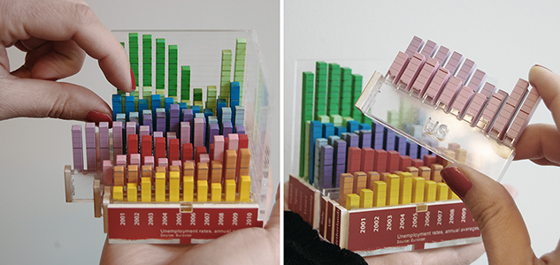
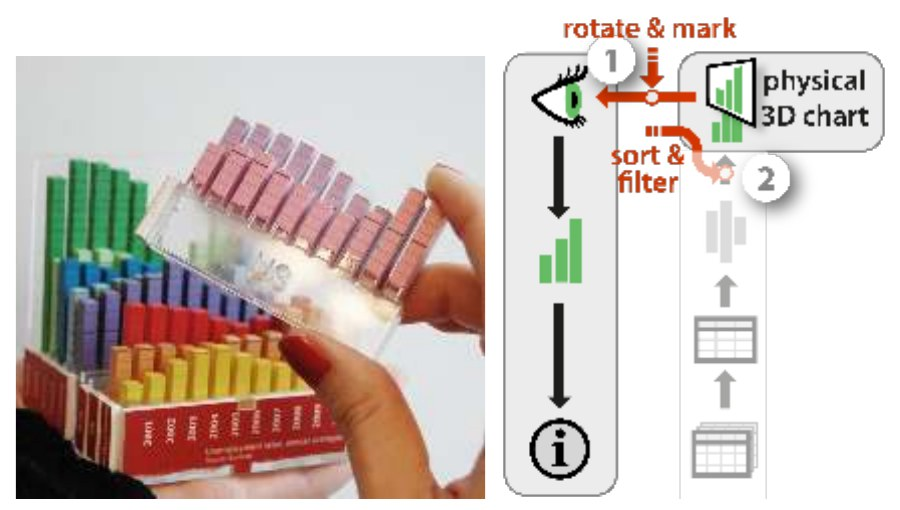

+++
author = "矢崎裕一"
title = "国ごとの1枚を抜き差しして並べ替える──Rearrangeable 3D Bar Chart"
slug = "rearrangeable-bar-chart"
date = "2026-11-01"
description = "国ごとの2D棒グラフを1枚ずつ抜き差しできる物理グラフです。10か国・10年の失業率を表し、並べ替え、抜き出し、重ねての比較を、部品を手で動かして行えます。"
categories = [
    "consume"
]
tags = [
    "データ物質化",
    "3D棒グラフ",
    "インタラクション",
    "Yvonne Jansen",
    "Pierre Dragicevic"
]
image = "images/pulling-out-country-rows.png"
series = ["data-physicalization"]
series_weight = 18
seriesByline = "Jansen・Dragicevic"
seriesTitle = "国ごとに抜き差しする──Rearrangeable 3D Bar Chart"
+++

Rearrangeable 3D Bar Chart は、10か国・10年の失業率を表した物理的な3D棒グラフです。国ごとの2D棒グラフが1枚ずつの部品になっていて、抜き差しできます。使う人は部品を手で動かして、国の並べ替え、抜き出し、重ねての比較を行えます。

作者は Yvonne Jansen（イヴォンヌ・ジャンセン）と Pierre Dragicevic（ピエール・ドラギチェヴィッチ）で、当時は Inria の AVIZ チームにいました。作品は、2人の論文 "An Interaction Model for Visualizations Beyond The Desktop"（IEEE TVCG、2013）で、8つのケーススタディの一つとして紹介されています。データ物理化の事例集 dataphys.org には、2012年の事例として載っています。以下は、この論文と dataphys.org の項目に沿います。

<!--more-->

## 10枚の2D棒グラフを、1台に並べる

dataphys.org の項目の説明は、1文だけです。

> A modular physical visualization like this rearrangeable 3D bar chart allows people to sort, filter, compare and examine data by direct physical manipulation.

部品に分かれた物理可視化なら、手で直接動かして、データの並べ替え、絞り込み、比較、観察ができる、という説明です。項目を追加したのは Dragicevic です。分類は「Passive physical visualization」、電子部品を持たない物理可視化に入っています。

論文の記述は、もう少し具体的です。

> It shows unemployment rates over 10 years for 10 countries.

10か国の10年分の失業率を表している、という一文です。棒は全部で100本になります。作り方は "pieces were automatically laser-cut from the data, then painted and assembled manually" と書かれています。データからレーザーカッターで部品を自動的に切り出し、塗装と組み立ては手で行った、ということです。

Yvonne Jansen・Pierre Dragicevic／dataphys.org「2012 – Rearrangeable 3D Bar Chart」より引用

左の写真では、指で青い列を引き上げています。右の写真では、ピンクの列が1枚、丸ごと抜き出されています。列ごとに色が違い、1列の中は1色に見えます。手前の赤い台座には「2001」から始まる年のラベルが並びます。色や台座の意味は、論文本文には書かれていません。ここまでは写真からの読みです。

データと物の対応を表にまとめます。「写真からの読み」とした行は、論文に書かれていない筆者の読みです。

| データ | 物の性質 | 根拠 |
|---|---|---|
| 失業率（量） | 棒の高さ | 論文の「physical 3D bar chart」。目盛りの値や縮尺は不明 |
| 国（10か国） | 奥行き方向の列。1か国が抜き差しできる1枚の部品 | 論文 |
| 年（10年） | 各列の中の、棒の横の並び。部品の中で固定 | 10年は論文。横に並ぶことは写真からの読み |
| 国の並び順 | データが決めない。手で変えられる | 論文 |
| 国の区別 | 列ごとの色 | 写真からの読み |
| 年のラベル | 手前の台座 | 写真からの読み |

論文は作り方の出典として、同じ著者たちの CHI 2013 の論文を挙げています。その論文の物理3D棒グラフと評価実験は、別の記事「[画面の3D棒グラフより速く、2Dには届かない](/evaluating-physical-visualizations/)」で扱いました。ただし、二つが同じ物なのか、同じ作り方の別の個体なのかは、筆者は資料で確かめられませんでした。素材や寸法も、この作品については本文で確認できていません。

## 回して見る操作と、並べ方を変える操作

論文は、この棒グラフでできる操作を2段に分けて書いています。一つ目は、物を動かさずに見え方を変える操作です。

> The object is passive, i.e., it contains no electronics, but interactions are still possible at the percept transformation level (1), including rotating the chart, or using fingers to mark data points [33].

電子部品はないが、チャートを回す、指でデータの点を押さえる、といった操作はできる、という要旨です。論文の用語では、見え方（percept transformation）の段の操作です。

二つ目が、部品を抜き差しする操作です。

> In contrast to the monolithic model in Figure 8, this bar chart is modular. Each country is a 2D bar chart that can be taken out and manipulated separately. This simple design choice enables a user to perform a range of additional tasks (2): she can sort countries, filter them out by moving them away, or compare countries by superimposing them.

図8の一体の模型と違い、この棒グラフは部品に分かれている。国ごとの2D棒グラフを抜き出し、別々に扱える。この単純な設計の選択で、国の並べ替え、離して置くことでの絞り込み、重ねての比較ができる、という要旨です。図8は、3Dプリントしたサンゴの模型を、画面を操作する道具として使う例です。

Yvonne Jansen・Pierre Dragicevic／"An Interaction Model for Visualizations Beyond The Desktop"（IEEE TVCG, 2013）Fig. 9 より引用

図9の右側は、論文のモデルでこの操作を描いた図式です。(1) の矢印には「rotate & mark」、(2) の矢印には「sort & filter」というラベルが付いています。

言葉の使い方にも注意が要ります。**ここでの絞り込みは、データを消す処理ではありません。** 部品を離れた場所に置き、視野から外すことです。比較も、横に並べるのではなく、重ねて行うと書かれています。どちらも、データには手を付けていません。

## 並べ替えは「空いている変数」を書き換える

論文の中心は、可視化のパイプラインのモデルです。生データが加工され、図になり、物として現れ、人に読まれるまでを段に分けています。この作品の並べ替えも、そのモデルの言葉で説明されます。鍵は free visual variables（自由視覚変数）です。

> We call those free visual variables, to contrast them with encoding visual variables that are constrained by the visual mapping.

データとの対応づけに縛られた視覚変数に対して、縛られていないものを自由視覚変数と呼ぶ、という定義です。論文の例は箱ひげ図です。箱ひげ図という対応づけは、縦の目盛りや、箱を左右のどこに置くかを決めていません。

自由視覚変数は、表示の割り当て（presentation mapping）の段で決まります。論文はこの段の操作を4つに分け、その一つを最適化（optimization）と呼びます。

> Optimization consists in assigning free visual variables in a way that facilitates the reading of a visualization. An example is sorting boxplots from left to right per participant ID.

読みやすくなるように自由視覚変数を割り当てるのが最適化で、例は箱ひげ図を参加者 ID の順に左から並べること、という要旨です。論文は、一律の処理を局所的に上書きする操作も区別しています。例は "Adjusting a graph node manually overrides optimization."、グラフのノードを手で動かすのは最適化の上書きだ、というものです。

そのうえで、この棒グラフについてこう書きます。

> These interactions can be seen as modifying a conceptual pipeline: rearranging the visualization amounts to modifying free visual variables at the presentation mapping level, or more specifically, performing optimization overriding operations.

並べ替えは、表示の割り当ての段で自由視覚変数を変えることで、より細かく言えば最適化を上書きする操作だ、という要旨です。conceptual pipeline（概念上のパイプライン）は、具体化すれば同じ物ができるはずの、仮想のパイプラインを指します。この棒グラフにはコンピュータがないので、こうした言い方になります。

国の並び順は、もともとデータが決めていない変数です。並べ替えても、失業率の値も棒の高さも変わりません。変わるのは置き方だけです。この作品は、空いている変数を部品の形にして、使う人の手に渡した、と読めます。一方、年の並びは各部品の中に固定されていて、手では変えられません。論文に明記はなく、構造からの読みです。

## 画面なら別々の道具、手なら一つの動作

論文は続けて、画面との違いを書いています。

> Such operations are supported through true direct manipulation and are very versatile. In contrast, on a desktop system these tasks would typically be considered separately and supported by different instruments.

こうした操作は真の直接操作で支えられ、用途が広い。画面のシステムなら、これらの作業は別々に扱われ、別々の道具で支えられるだろう、という要旨です。

論文は、操作の手段を instrument（道具）として扱います。ねじ回しが人とねじを仲立ちするように、道具は人と可視化を仲立ちする、という考え方です。画面なら、並べ替えのボタンや絞り込みのスライダーがこれに当たります。論文は、真の直接操作がどこで得られるかも書いています。

> the ultimate experience of directness, or “true” direct manipulation, can only be achieved by the manipulation of physical objects without any mediating instrument.

究極の直接性、つまり真の直接操作は、仲立ちする道具なしに物理的な物を操作することでしか得られない、という要旨です。この棒グラフでは、並べ替えも、絞り込みも、比較も、部品をつまんで動かすという一つの動作で済みます。作業ごとに道具を増やさなくてよい、と読めます。

同じ論文は、手の操作の限界も書いています。結論部の言葉です。

> Physical object manipulation can be very versatile and even entirely passive physical visualizations such as the rearrangeable bar charts or the Lego system already support non-trivial visualization tasks.

> Still we will always need instrumental operations as those allow to carry out complex tasks that have no real world counterpart (e.g., automatic sorting, brushing & linking).

電子部品のない物理可視化でも、簡単ではない作業ができる。それでも、自動の並べ替えや、ブラッシング＆リンキングのように、現実に対応する動作がない作業には、道具を介した操作が要る、という要旨です。論文は別の箇所で、行列の並べ替えのように手作業では複雑すぎる、繰り返しが多すぎる場合は、コンピュータに任せるほうが役に立つとも書いています。

もう一つの限界は、データとのつながりです。論文は、印刷物や3D造形を one-shot propagation（一度きりの伝達）の例に挙げます。作った後で元データが変わっても、形は更新されません。この棒グラフも "semi-automatic one-shot propagation" で作られた、と書かれています。

## どこで分けるかが、できる操作を決める

同じグループは2015年、"Opportunities and Challenges for Data Physicalization"（CHI 2015）で、組み替えについて一般化して書いています。部品に分かれた物理化は、分解、再組み立て、並べ替え、整列ができ、それだけで分析の作業の幅を覆う、という整理です。そのうえで、組み替えの自由度について、こう述べます。

> Reconfigurability is required to implement rich physical interactions. For example, a modular 3D bar chart supports reordering [32], and a LEGO-based physicalization could support even more tasks. However, limited reconfigurability can be desirable. Information as to which states and operations are meaningful can be conveyed as physical constraints, by adding mechanical features such as attachments [69] or bindings [67].

豊かな物理的操作には組み替えられることが要る。部品に分かれた3D棒グラフは並べ替えができ、LEGO ならさらに多くの作業ができる。ただし、組み替えを限ることが望ましい場合もある。どの状態や操作に意味があるかは、はめ込みや結束のような物理的な制約で伝えられる、という要旨です。

この棒グラフでは、分け目は国と国のあいだに入っています。だから国の順は変えられ、年の順は変えられません。分け目の位置が、許す操作と許さない操作を同時に決めている、と読めます。年の順が固定されていれば、時系列の並びは崩れません。2015年の論文の言う「限られた組み替え」が、ここでは部品の分け方そのものに埋め込まれている、と読めます。

## 第三者はこの作品をどう見たか

評価は、分け方の意味、使う人のためらい、機械による組み替えの三つに分かれます。

一つ目は、H. Djavaherpour（ジャヴァヘルプール）らが2021年に EuroVis で発表した、物理化の制作工程のサーベイです。組み立ての例として、この棒グラフを挙げています。

> the way in which a physicalization is designed to be assembled can determine what types of interactions end-users can have with its represented data. For example, Jansen et al. [JDF13] created modular 3D bar charts that allowed the end-user to select, reorder, and independently compare datasets. If instead these bar charts had been glued together, the end-user would no longer be able to interact as deeply with the data itself.

どう組み立てるように設計するかで、使う人がデータに対してできる操作の種類が決まる。もし接着されていたら、ここまで深くデータに関われなかった、という指摘です。ただし共著者に Jansen が入っていて、完全な第三者ではありません。引用先も CHI 2013 の論文です。

二つ目は、LMU ミュンヘンの Simon Stusak（シュトゥザク）です。別のグループが、同じく層を分けて並べ替えや絞り込みをねらった物理可視化を作り、評価しました。2013年のポスターでは、層ごとに回せる模型について、こう書いています。

> Grouping similar items together is only possible along the time axis, because within a layer, values cannot be rearranged.

似たものを集めるのは時間の軸に沿ってしかできない。層の中の値は並べ替えられないからだ、という要旨です。分け目の位置で並べ替えられる軸が一つに決まる、という同じ構造が見えます。2016年の博士論文では、面ファスナーで部品をつなぐモジュール版を作り、固定版と比べています。

> Four participants did not disassemble the modular physical visualization, two because it seemed impractical, two because of fear to break something.

4人はモジュール版を分解しなかった。2人は面倒に思えたから、2人は壊すのが怖かったから、という観察です。分解しようとして部品を壊した参加者も1人いました。対象は Jansen らの棒グラフではありません。ただ、抜き差しできることと、実際に抜き差ししてもらえることは別だ、と読めます。

三つ目は、Faisal Taher（ターヘル）らの EMERGE です。10×10 の棒を電動で上下させる物理棒グラフで、並べ替えや絞り込みを機械で行います。2015年の論文は、受動的な物理可視化の欠点をこう書いています。

> The main drawback of current physical visualizations is that they are inert, being either fabricated (i.e. laser cut [15], 3D printed [3], constructed from passive building blocks [13]) and thus disconnected from the data-source once constructed.

いまの物理可視化は動かず、一度作るとデータ源から切り離される、という指摘です。Beyond 論文の one-shot propagation と同じ点です。2016年の論文では、発表の場面で参加者が行や列を入れ替え、"others rearranged and compiled more elaborate views"、より手の込んだ見せ方を組み立てた人もいたと報告しています。どちらも Jansen が共著者です。

## 使い道

この作品から持ち帰れることは四つあります。

一つ目は、部品の分け目を、許したい操作から決めることです。この棒グラフは国のあいだで分けたので、国の順を変えられ、年の順は守られました。物理化では、どこで切るかが、そのまま操作の設計になります。接着するか、抜き差しにするか、はめ込みにするかも、同じ判断の一部です。

二つ目は、並べ替えをデータの変更と分けて考えることです。論文の整理では、並べ替えは自由視覚変数の上書きで、値は一つも変わりません。画面でも、並び順をデータが決めない変数として扱えば、使う人がドラッグで行を動かすような操作を、無理なく足せると読めます。

三つ目は、抜き差しのしやすさまで設計に入れることです。Stusak の観察では、壊すのが怖くて分解しない人がいました。部品が抜けるだけでは足りず、抜いてよいと分かる形、戻しやすい形が要ります。

四つ目は、手に任せない操作を見極めることです。作者自身が、自動の並べ替えやブラッシング＆リンキングには道具が要ると書いています。10か国なら手で並べ替えられても、行が増えれば計算に任せるほうがよい。一度作ればデータが更新されない点も、物理化を選ぶ前に考えておく価値があります。

## 参考・出典

**一次情報**

- dataphys.org, "2012 – Rearrangeable 3D Bar Chart"（Added by Pierre Dragicevic）：https://dataphys.org/list/rearrangeable-3d-bar-chart/
- Yvonne Jansen, Pierre Dragicevic, "An Interaction Model for Visualizations Beyond The Desktop," *IEEE TVCG* 19(12): 2396–2405, 2013. [doi:10.1109/TVCG.2013.134](https://doi.org/10.1109/TVCG.2013.134) ／ 読んだ本文（ミラー）：https://typeset.io/pdf/an-interaction-model-for-visualizations-beyond-the-desktop-3p3eh2iru9.pdf ／ HAL（筆者は未確認）：https://hal.science/hal-00847218 ／ 著者ページ（筆者は接続できず）：http://www.aviz.fr/beyond
- dataphys.org, "2012 – Putting Physical Visualizations to the Test"：https://dataphys.org/list/testing-physical-visualizations/
- Yvonne Jansen, Pierre Dragicevic, Petra Isenberg, Jason Alexander, Abhijit Karnik, Johan Kildal, Sriram Subramanian, Kasper Hornbæk, "Opportunities and Challenges for Data Physicalization," *CHI '15*, pp. 3227–3236：https://eprints.lancs.ac.uk/id/eprint/72691/1/OA_2015_04_CHI_DataPhys.pdf
- Yvonne Jansen, Pierre Dragicevic, Jean-Daniel Fekete, "Evaluating the Efficiency of Physical Visualizations," *CHI '13*, pp. 2593–2602（作り方の出典として論文が挙げるもの。筆者は本文未読）：https://hal.archives-ouvertes.fr/hal-00781831

**第三者評価**

- H. Djavaherpour, F. Samavati, A. Mahdavi-Amiri, F. Yazdanbakhsh, S. Huron, R. Levy, Y. Jansen, L. Oehlberg, "Data to Physicalization: A Survey of the Physical Rendering Process," *Computer Graphics Forum* 40(3), 2021（EuroVis STAR）：https://arxiv.org/pdf/2102.11175
- Simon Stusak, Aurélien Tabard, Andreas Butz, "Can Physical Visualizations Support Analytical Tasks?" IEEE VIS 2013 poster：https://www.medien.ifi.lmu.de/pubdb/publications/pub/stusak2013visPoster/stusak2013visPoster.pdf
- Simon Stusak, *Exploring the Potential of Physical Visualizations*, Dissertation, LMU München, 2016：https://edoc.ub.uni-muenchen.de/20190/1/Stusak_Simon.pdf
- Faisal Taher, John Hardy, Abhijit Karnik, Christian Weichel, Yvonne Jansen, Kasper Hornbæk, Jason Alexander, "Exploring Interactions with Physically Dynamic Bar Charts," *CHI '15*：https://www.kasperhornbaek.dk/papers/CHI2015_Emerge.pdf
- Faisal Taher, Yvonne Jansen, Jonathan Woodruff, John Hardy, Kasper Hornbæk, Jason Alexander, "Investigating the Use of a Dynamic Physical Bar Chart for Data Exploration and Presentation," *IEEE TVCG* 23(1), 2017：https://yvonnejansen.fr/articles/VIS2016%20-%20Investigating%20the%20Use%20of%20a%20Dynamic%20Physical%20Bar%20Chart%20for%20Data%20Exploration%20and%20Presentation.pdf
