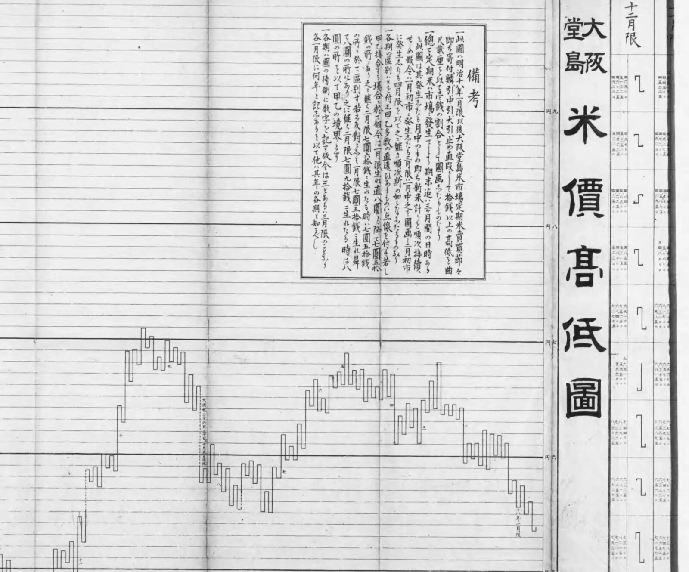
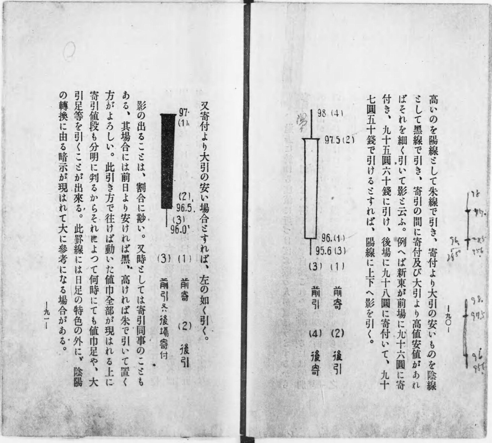
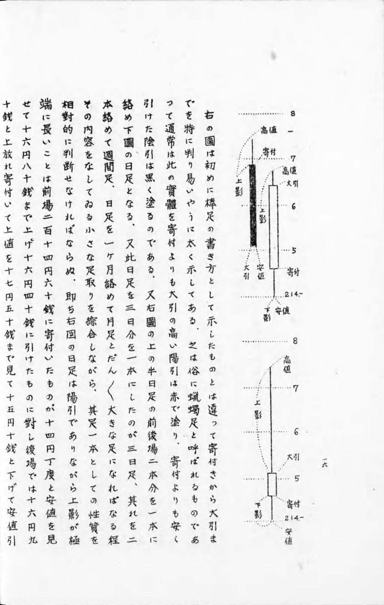
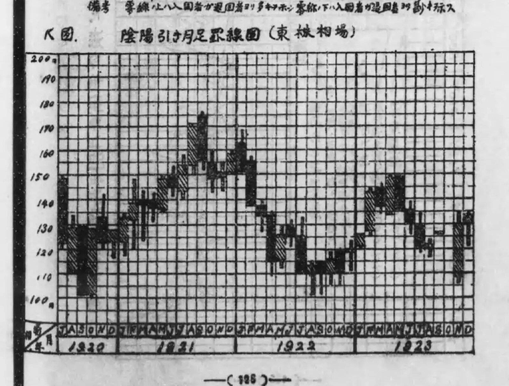
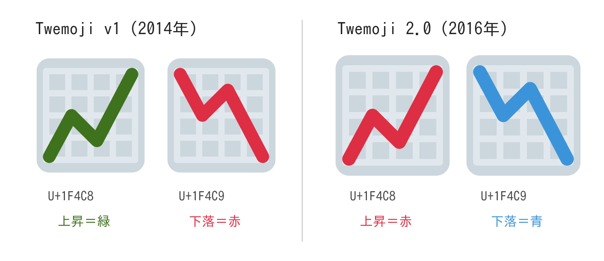

+++
author = "Yuichi Yazaki"
title = "Did the Red 📈 Come from Dojima in 1697? Checking Candlestick and Emoji Colors Against Primary Sources"
slug = "red-rising-chart-emoji"
date = "2026-11-05"
description = "The 📈 emoji is red because Japanese mobile carrier emoji entered Unicode in 2010. Charts that draw rises in red appear in Taisho to early Showa sources, but no source shows that Dojima merchants created candlesticks in 1697."
categories = [
    "principle"
]
tags = [
    "candlestick chart",
    "emoji",
    "color",
    "Dojima Rice Exchange"
]
image = "images/keizai-toukei-1925-inyobiki-monthly.jpg"
+++

The line in 📈 is red because Japanese mobile carrier emoji were incorporated into Unicode in 2010. Charts (keisen, price charts) that draw rises in red can be confirmed in sources from the Taisho to early Showa periods. On the other hand, no source has turned up showing that merchants at Dojima in 1697 created the candlestick chart.

The starting point is a post that Aakash Gupta wrote on X on April 6, 2026. It said that red means "up" in emoji because of the Dojima Rice Market in Osaka in 1697, where rice merchants created the candlestick chart (in-yō-ashi) to chart price movements. Below, I split this claim into year, origin, name, color, and emoji, and check each against the keisen books in the National Diet Library Digital Collections (NDL), materials from the Osaka Exchange, and Unicode specification documents.

<!--more-->

## Splitting the post's claim into five

The post begins as follows. The full text is a long-form post on X, and I could not read past "Rising price…".

> The reason red means "up" on these emojis dates back to 1697 Osaka, Japan. Rice merchants created the world's first futures exchange at the Dojima Rice Market. They needed to chart whether prices were rising or falling, so they built the candlestick chart, called 陰陽足 (yin-yang chart). Rising price…

In short: the red = up in emoji comes from Osaka in 1697, because the rice merchants of Dojima, the world's first futures exchange, created the candlestick chart (in-yō-ashi).

This post quotes the previous day's post by kuno (@kunoo), "Whoever made these emojis needs to be fired immediately." The community note on the quoted post says that the up emoji is red and the down emoji is blue because of a convention of the Tokyo Stock Exchange. From this, "these emojis" can be read as 📈 (U+1F4C8) and 📉 (U+1F4C9).

| Claim in the post | Verdict | What the sources confirm |
|---|---|---|
| It goes back to Osaka (Dojima) in 1697 | Partly supported | 1697 is the year the Yodoya rice market moved to Dojima. Futures trading (chōai-mai) was officially recognized in 1730 |
| Dojima was the world's first futures exchange | Supported as an assessment (not an established view) | The Osaka Exchange and Schaede (1989) use it with qualifications. Takatsuki Yasuo writes that it is mainly the assessment of commentators abroad |
| Rice merchants created the candlestick chart | Not supported | No candlestick form was found in Edo-period sources. The earliest description confirmed in text is from 1924 |
| It was called "in-yō-ashi" | Partly supported | The earliest use of "in-yō-ashi" is from 1931. No Edo-period use was found |
| The emoji's red = up is because of this | Not supported | Charts that draw rises in red are confirmed in 1924 to 1936. 📈 entered Unicode in 2010 from KDDI's emoji. No source linking the two was found |
| (Premise) On these emojis, red is up | Supported | The 📈 of Apple, Google, Samsung, and Twemoji has a red line |

## 1697 and 1730: what happened at Dojima

The Osaka Exchange page "Dojima Rice Exchange" writes in its chronology, "Genroku 10 (1697) or so: the Yodoya rice market moves here to Dojima." The next line says that in Kyōhō 15 (1730), Tokugawa Yoshimune officially recognized the Dojima rice market. 1697 is the year the market moved to Dojima.

According to the Japan Exchange Group's history, at this time both the spot market in rice tickets (shōmai-akinai) and the futures market traded on paper (chōai-mai-akinai) were officially recognized, and the public market "Dojima Kome-kaisho" came into being. *Ōsaka Dojima beishō enkaku* (History of the Osaka Dojima Rice Trade), published in Meiji 36 (1903), prints the notice, dated the 13th day of the 8th month of Kyōhō 15.

On "world's first," the English page of the Osaka Exchange has the heading "World's First Futures Exchange," while the Japanese page says it is "widely known as a pioneer of organized futures exchanges in the world." In research, Ulrike Schaede wrote in a 1989 paper that the first organized futures exchange to meet all the criteria of modern financial research goes back to eighteenth-century Japan.

Takatsuki Yasuo notes that this assessment is common among commentators abroad, citing Leo Melamed, Chairman Emeritus of CME Group. In the sources I checked, the starting point is the official recognition of 1730. The post's 1697 can be read as overlapping the year of the market's move with the year of the futures exchange.

## The candlestick form appears in sources in the Taisho period

I could not confirm any actual Edo-period chart. What I searched was NDL Search, the NDL Lab full-text search (searching classical books for "keisen," "ashidori," and "hoshi-ashi"), CiNii, and web search. The Edo-period price records I found were ledger-format market diaries (the oldest surviving one is from Hōreki 5 = 1755, Takatsuki 2011) and numerical tables.

The Nippon Technical Analysts Association (NTAA) explains that until around 1900, in both Japan and the US, charts were line graphs connecting closing prices (hoshi-ashi) or lines joining vertical and horizontal strokes in a hook shape. Hiraiwa Machi's *Beika zukan* (Illustrated Rice Prices) of Meiji 27 (1894) is also not in candlestick form.

Part of "Ōsaka Dojima beika kōtei-zu" from Hiraiwa Machi, *Beika zukan* (Illustrated Rice Prices) (1894) / Source: National Diet Library Digital Collections (public domain)

The explanatory text on the same sheet also says that it charts four values for each month: "umare-ne (opening)," "saikō-ne (high)," "saitei-ne (low)," and "saishū-ne (closing)."

NTAA sees the beginning in the method introduced by Inoue Yōzaburō in 1910, which drew the body as a thick arrow and the shadow as a dotted line. In 1914 Hayasaka Toyozō improved it into "yoritome-byō-ashi," and in 1920 Inoue Sanmai introduced it as "rōsoku-biki." NTAA's estimate is that it was most likely established in the 1910s, in the Taisho period. These three books are in NDL's arbitration-based public release, and I have not read the originals.

The earliest description I could confirm by reading the text is Muzen Rōjin's *Kabushiki keisen kōshūroku* (Lectures on Stock Charting) of Taisho 13 (1924). Chapter 5, "In-yō-biki hi-ashi" (daily in-yō-biki charts), says the following.

> 寄付より大引の高いのを陽線として朱線で引き、寄付より大引の安いものを陰線として黑線で引き、寄引の間に寄付及び大引より高値安値があればそれを細く引いて影と云ふ。
>
> (Where the close [ōbike] is higher than the open [yoritsuki], it is drawn as a yang line in a vermilion line; where the close is lower than the open, it is drawn as a yin line in a black line; and if there are highs or lows beyond the open and close during the session, they are drawn thin and called shadows [kage].)

Muzen Rōjin, *Kabushiki keisen kōshūroku* (Lectures on Stock Charting) (Rizai Kenkyūkai, 1924), frame 51 / Source: National Diet Library Digital Collections (public domain)

The example is a day that opened at 96 yen in the morning session and closed at 97.50 yen in the afternoon session. In the figure, the body runs from 96 yen to 97.50 yen, and the shadows reach 98 yen and 95.60 yen. The text says yang lines are drawn in vermilion, but in the printed figure the yang line is hollow and the yin line is filled in black.

**This book's way of drawing can be read as nearly coinciding with today's candlestick correspondence.** The basics of the form and how to read it are summarized in the article [Candlestick chart](/en/candlestick-chart/).

| Value | Part of the candlestick | 1924 term |
|---|---|---|
| Open | One end of the body | Yoritsuki |
| Close | The other end of the body | Ōbike |
| High | Upper wick | Kage (shadow) |
| Low | Lower wick | Kage (shadow) |
| Close higher than open | Color (yang line) | Vermilion line (hollow in the figure) |
| Close lower than open | Color (yin line) | Black line |
| Open and close the same | — | Black if lower than the previous day, vermilion if higher |

The popular theory that credits the Sakata rice merchant Honma Munehisa (1724 [by one account 1717]–1803) as the inventor has no support in contemporary sources. NTAA writes that there is no mention of charts in what is said to be Munehisa's last teachings. All the old books bearing the name "Munehisa" in NDL were published in the Meiji period. Steve Nison, who spread candlesticks to the West, also wrote in his 1994 book that it is hard to imagine Honma used candlesticks and that they were most likely developed in the early Meiji period (as quoted in the English Wikipedia; I have not checked the original). The dating differs from NTAA's, but neither treats it as an Edo-period invention.

## "In-yō-ashi" was the name of a chart drawn in vermilion and black

The usage of "in-yō-ashi" I could confirm is in Tokuda Kōhei's *Kabushiki baibai monogatari* (The Story of Stock Trading) of Showa 6 (1931). As ways of recording charts, it lists hoshi-ashi, in-yō-ashi, and nehaba-ashi.

> 陰陽足（一日の動き値幅を、相場昂騰したる時は赤、下落したる時は黑にて示す方）
>
> (In-yō-ashi: the method of showing a day's range of movement in red when the market has risen and in black when it has fallen.)

In the Taisho to early Showa periods, the name "in-yō-biki" turns up more often. NTAA explains that in-yō-ashi (in-yō-biki) is a higher-level name that includes candlesticks and does not mean the same thing as candlesticks.

I could not confirm any Edo-period usage. Searching "in-yō-ashi" in the NDL Lab full-text search, the only hits in the market sense were the 1931 and 1934 editions of *Kabushiki baibai monogatari*. However, most Meiji and Taisho keisen books are in arbitration-based release and are not covered by the search.

"Rōsoku-ashi" (candle chart) can be read as originally the name of a specific shape. In 1924 Muzen Rōjin called the shapes that appear at bottoms and tops "rōsoku-gata" (candle shapes), and *Shinshū keizai goji-ten* (New Edition Dictionary of Economic Terms) (1933) and *Keizai goji-ten* (Dictionary of Economic Terms) (1938) define it as a chart shaped like a candlestick. In Showa 11 (1936), Kobayashi Gien calls the chart that draws a thick body itself "zoku ni rōsoku-ashi" (popularly, the candle chart).

Kobayashi Gien, *Kabushiki sōba hitsuri no hiō* (The Secrets of Profit in Stock Trading) (Unmei Daigakuin, 1936), frame 14 / Source: National Diet Library Digital Collections (public domain)

According to the Chinese Wikipedia, candlesticks are called "陰陽燭" in Hong Kong. The post's name can also be read as a blend of the Japanese "in-yō-ashi" and the Hong Kong "陰陽燭."

Descriptions of color are consistent across sources of the 1920s and 1930s. Muzen Rōjin in 1924, Maya Sanjin's *Kabushiki riyoku no myōtai* (The Essence of Profit from Stocks) and Kobayashi Arata in 1925, Tokuda Kōhei in 1931, and Kobayashi Gien in 1936 all give yang lines as red (vermilion) and yin lines as black.

Kobayashi Arata's book is a statistics textbook, and in "K-zu" (Figure K) it shows monthly charts of the Tokyo Stock Exchange from July Taisho 9 to the end of Taisho 12. The text says yang lines are drawn in vermilion, and adds, "此圖では便宜上陰影線を用いて居る" (in this figure, for convenience, hatching is used).

Kobayashi Arata, *Keizai tōkeigaku no genri to ōyō* (Principles and Applications of Economic Statistics), vol. 1 (Diamond-sha, 1925), frame 76, "K-zu: In-yō-biki tsuki-ashi keisen-zu (Tōkabu sōba)" (Figure K: monthly in-yō-biki charts, Tokyo Stock Exchange) / Source: National Diet Library Digital Collections (public domain)

This can be read as an example in which what was distinguished by vermilion was replaced by a diagonal-line pattern for printing reasons. I could not confirm any Edo-period source that drew in red, since no actual chart survives.

## The red in 📈 entered Unicode in 2010

📈 and 📉 were added in Unicode 6.0, published on October 11, 2010. UTS #51 describes the emoji of this version as "the emoji characters deriving from Japanese carrier sets." That means they come from the emoji of Japanese mobile carriers.

In the background document for the proposal (L2/09-027R2, September 17, 2009), 📈 corresponds to KDDI's "Graph 1 (line graph)" and 📉 to KDDI's "Graph 2." In the mapping table EmojiSources.txt, too, the only correspondences for 📈 and 📉 are KDDI's emoji.

Unicode's official charts show the KDDI images from before incorporation. Judged by pixel color, 📈 was a red line rising to the right and 📉 was a blue line falling to the right (this is not a visual check). Emojipedia also writes that in the original KDDI 📈 and SoftBank's 💹, the rising line was red.

The colors of the glyphs vary by vendor. These are the results of judging the images in Unicode's official charts (v14.0 from 2021, v15.0 from 2022) by pixel color in the same way.

| Vendor | 📈 Up | 📉 Down |
|---|---|---|
| Apple | Red | Blue |
| Google | Red | Green (v14.0) → Blue (v15.0) |
| Microsoft (Windows) | Red (Fluent SVG: blue) | Blue (same: red) |
| Twitter (Twemoji) | Red | Blue |
| Samsung | Red | Blue |
| Facebook | Green | Orange |
| JoyPixels | Green | Red |

Reading the SVGs in public repositories lets us confirm this by color values. In Twemoji v1 of 2014, 📈 was green (#3e721d) and 📉 was red (#dd2e44). In 2.0 of 2016, they were swapped: 📈 became red (#DD2E44) and 📉 blue (#3B94D9). I found no source stating the reason for the change.

Source: Twitter, Inc. and other contributors / GitHub "twitter/twemoji." The SVGs of commit 5c0297d from 2014 and v2.0.0 converted to PNG and placed side by side (CC BY 4.0)

In the Fluent Emoji SVGs published by Microsoft, 📈 is blue and 📉 is red. The red in the chart can be read as the glyph of the Windows 10 generation; I have not checked the current Windows 11 screens.

Conventions for displaying stock prices also differ by region.

- The Japan Exchange Group's *Tōshō zukan* (Illustrated Guide to the TSE) says that in the ticker, "red means the stock price is higher than the previous day, and green means lower."
- Daiwa Securities' glossary says that a yin line is drawn in blue if in color (the yang line in red), and in black if in black and white (the yang line in white).
- A 2005 W3C mailing list post records an observation that Japan's Yahoo! Finance showed rises in black and falls in red.
- Jiang et al. (2014) write that in mainland China rises are red and falls are green, while in other regions including Hong Kong it is the reverse.

I found no source linking the convention of drawing rises in red to Dojima or Honma Munehisa. What I searched were Emojipedia's blog, the community note, *Tōshō zukan*, the English Wikipedia, NDL searches, and web searches in Japanese, English, and Chinese. The post can be read as joining the story of the candlestick's origin with the story of the 2010 emoji colors.

## Takeaways

The convention of showing up and down by color has flipped by era, region, and company. Keisen books of the 1920s drew rises in vermilion, and there is an example where printing replaced this with diagonal hatching. Today's Japanese exchanges show rises in red, and Hong Kong shows them in green.

From this, a use can be read: do not leave up and down to color alone. The hollow and filled-in black of 1924, the hatching of 1925, and the △ and ▼ in newspaper stock listings are marks whose direction can be read without color. In a chart whose readers come from mixed regions, it can be read as safer to show direction by shape or symbol as well.

The other is a procedure for investigating the origin of a chart. In this post, the market's year, the chart's form, its name, its color, and the emoji were made into one story. Matching them separately against sources yields separate years: the form in the Taisho period, the name in the Taisho to early Showa periods, and the emoji in 2010. In the history of charts, it can be read as best to check form, name, and color separately.

## References

**Primary sources**

- Aakash Gupta's post on X (2026-04-06): https://x.com/aakashgupta/status/2041019578520846747 (oEmbed: https://publish.twitter.com/oembed?url=https://x.com/aakashgupta/status/2041019578520846747 )
- kuno (@kunoo)'s post on X (2026-04-05) and its attached community note: https://x.com/kunoo/status/2040863289236975754 / https://twitter.com/i/birdwatch/n/2041213836351480189
- Osaka Exchange, "Dojima Rice Exchange": https://www.jpx.co.jp/dojima/ja/index.html / English version "Dojima Rice Exchange": https://www.jpx.co.jp/dojima/en/index.html
- Japan Exchange Group, "History": https://www.jpx.co.jp/corporate/about-jpx/history/02-03.html
- *Ōsaka Dojima beishō enkaku* (History of the Osaka Dojima Rice Trade), Osaka Dojima Rice Exchange, 1903: https://dl.ndl.go.jp/pid/803796
- Ulrike Schaede, "Forwards and futures in Tokugawa-period Japan," *Journal of Banking and Finance* 13 (1989) 487–513: https://sfu.ca/~poitras/JBF_Tokugawa-Japan_89.pdf
- Hiraiwa Machi, *Beika zukan* (Illustrated Rice Prices), 1894: https://dl.ndl.go.jp/pid/1088811
- Inoue Yōzaburō, *Teiki sōba kōtei keisen suiri-hō* (Reasoning Method for Futures Market High-Low Charts), 1910 (arbitration-based release, body text unread): https://dl.ndl.go.jp/pid/803919
- Hayasaka Toyozō, *Sōba dai-keisen-gaku: Kibei kabushiki* (Great Study of Market Charts: Futures Rice and Stocks), 1914 (arbitration-based release, body text unread): https://dl.ndl.go.jp/pid/953774
- Inoue Sanmai, *Ashidori no genri* (Principles of Ashidori Charting), 1920 (arbitration-based release, body text unread): https://dl.ndl.go.jp/pid/964570
- Hayasaka Toyozō (ed.), *Shōnai Honma Munehisa-ō isho* (Posthumous Writings of Honma Munehisa of Shonai), 1894: https://dl.ndl.go.jp/pid/804017 / *Beikai daiō Nihon chōja gokke no ichi Shōnai Sakata-kō Honma-ke hizō hōsho* (Treasured Book Kept by the Honma Family of Sakata Port, Shonai, One of the Five Rich Families of Japan, Great King of the Rice World): https://dl.ndl.go.jp/pid/803997 / *Munehisa-ō sōba zenshū* (Complete Market Writings of Munehisa), 1910: https://dl.ndl.go.jp/pid/804042
- Muzen Rōjin, *Kabushiki keisen kōshūroku* (Lectures on Stock Charting), Rizai Kenkyūkai, 1924 (frames 24, 51, 56): https://dl.ndl.go.jp/pid/982221
- Maya Sanjin, *Kabushiki riyoku no myōtai: Sōba senken* (The Essence of Profit from Stocks: Foresight in the Market), Kōtenkaku, 1925 (frame 31): https://dl.ndl.go.jp/pid/916889
- Kobayashi Arata, *Keizai tōkeigaku no genri to ōyō* (Principles and Applications of Economic Statistics), vol. 1, Diamond-sha, 1925 (frames 75–76): https://dl.ndl.go.jp/pid/971545
- Tokuda Kōhei, *Kabushiki baibai monogatari* (The Story of Stock Trading), Chiyoda Shoten, 1931 (frame 122): https://dl.ndl.go.jp/pid/1053408 / 1934 edition: https://dl.ndl.go.jp/pid/1031792
- Keizai Chishiki Fukyūkai (ed.), *Shijō keizai kōza dai-3: Keisen ni yoru kabushiki sōba kansoku* (Lectures on Market Economics, no. 3: Observing Stock Prices through Charts), 1933: https://dl.ndl.go.jp/pid/1264833
- Ōsaka Mainichi Shinbun Keizai-bu (ed.), *Shinshū keizai goji-ten* (New Edition Dictionary of Economic Terms), 1933: https://dl.ndl.go.jp/pid/1447691 / Ōsaka Mainichi Shinbunsha Keizai-bu (ed.), *Keizai goji-ten* (Dictionary of Economic Terms), Ichigensha, 1938: https://dl.ndl.go.jp/pid/1440733
- Kobayashi Gien, *Kabushiki sōba hitsuri no hiō* (The Secrets of Profit in Stock Trading), Unmei Daigakuin, 1936 (frame 14): https://dl.ndl.go.jp/pid/1102207
- Unicode 6.0.0 (2010-10-11): https://www.unicode.org/versions/Unicode6.0.0/
- Unicode Technical Standard #51, Unicode Emoji: https://www.unicode.org/reports/tr51/
- Unicode emoji-test.txt: https://www.unicode.org/Public/emoji/latest/emoji-test.txt
- Unicode EmojiSources.txt: https://www.unicode.org/Public/UCD/latest/ucd/EmojiSources.txt
- Markus Scherer, "Background data for Proposal for Encoding Emoji Symbols," L2/09-027R2 (WG2 N3681), 2009-09-17: https://www.unicode.org/L2/L2009/09027r2-emoji-backgrnd.pdf
- Unicode Full Emoji List (latest, v14.0, v15.0): https://www.unicode.org/emoji/charts/full-emoji-list.html / https://www.unicode.org/emoji/charts-14.0/full-emoji-list.html / https://www.unicode.org/emoji/charts-15.0/full-emoji-list.html
- Google emoji4unicode (KDDI emoji data): https://raw.githubusercontent.com/google/emoji4unicode/master/data/kddi/carrier_data.xml
- Twemoji (twitter/twemoji, graphics under CC BY 4.0): https://github.com/twitter/twemoji / current maintained version https://github.com/jdecked/twemoji
- Noto Emoji: https://github.com/googlefonts/noto-emoji
- Microsoft Fluent Emoji: https://github.com/microsoft/fluentui-emoji
- Japan Exchange Group, *Tōshō zukan* (Illustrated Guide to the TSE): https://www.jpx.co.jp/corporate/learning/resources/tvdivq0000003toh-att/zukan_tosyo.pdf
- Daiwa Securities glossary, "In-sen" (Yin line): https://www.daiwa.jp/glossary/YST0092.html
- W3C www-international mailing list posts (2005-09-30): https://lists.w3.org/Archives/Public/www-international/2005JulSep/0188.html / https://lists.w3.org/Archives/Public/www-international/2005JulSep/0191.html

**Research and secondary sources**

- Takatsuki Yasuo, "Edo jidai ni wa okome ga 'shōkenka' sarete ita koto o gozonji desu ka" (Did you know that rice was "securitized" in the Edo period?) (excerpt from *Ōzaka Dojima kome ichiba* (The Osaka Dojima Rice Market), Kodansha Gendai Shinsho, 2018): https://gendai.media/articles/-/56562
- Takatsuki Yasuo, "Kinsei Nihon ni okeru sōba jōhō no dentatsu" (The Transmission of Market Information in Early Modern Japan), *Yūsei Shiryōkan kenkyū kiyō* 2, 2011: https://www.postalmuseum.jp/publication/research/docs/research_02_06.pdf
- Yasuo Takatsuki & Takashi Kamihigashi, *Microstructure of the First Organized Futures Market: The Dojima Security Exchange from 1730 to 1869*, Springer (bibliographic record): https://link.springer.com/book/9789812878199
- Nippon Technical Analysts Association, "Types of charts": https://www.ntaa.or.jp/learn/charts
- Nippon Technical Analysts Association, "History of technical analysis": https://www.ntaa.or.jp/learn/history
- Thom Hartle, "Steve Nison On Candlestick Charting," *Stocks & Commodities* V.9:3, 1991: https://store.traders.com/-v09-c03-steveni-pdf.html
- Keith Broni, "Why does the 📈 Chart Increasing emoji show in red?," Emojipedia Blog, 2021-05-26: https://blog.emojipedia.org/why-does-the-chart-increasing-emoji-show-in-red/
- Emojipedia, "Chart Decreasing": https://emojipedia.org/chart-decreasing
- Kobe Shimbun NEXT, "How to read the stock listings," 2016-04-27: https://www.kobe-np.co.jp/rentoku/monoshiri/201604/sp/0009029258.shtml?pg=amp
- Jiang, F., Lu, S., Yao, X., Yue, X., & Au, W. (2014). Up or Down? How Culture and Color Affect Judgments. *Journal of Behavioral Decision Making*, 27(3), 226–234: https://doi.org/10.1002/bdm.1800
- Wikipedia "Candlestick chart" (includes a quotation of Nison 1994): https://en.wikipedia.org/wiki/Candlestick_chart
- Wikipedia (Chinese) "K線": https://zh.wikipedia.org/wiki/K線
