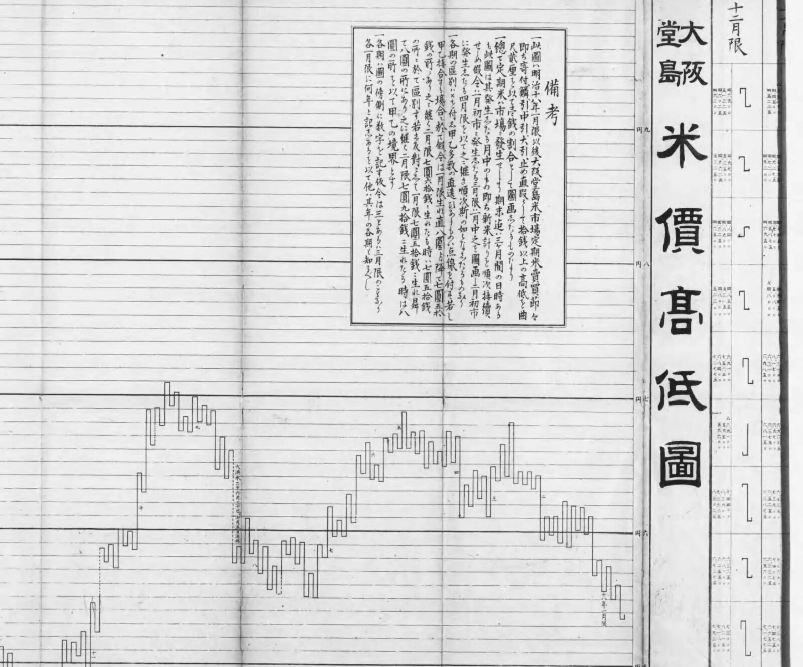
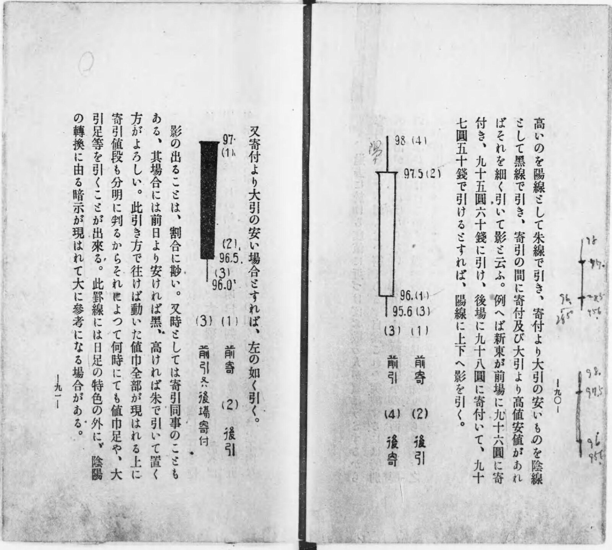
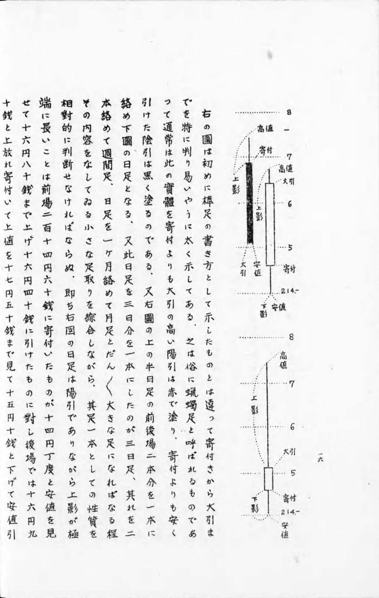
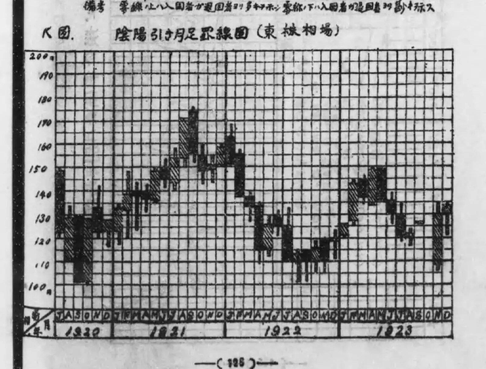
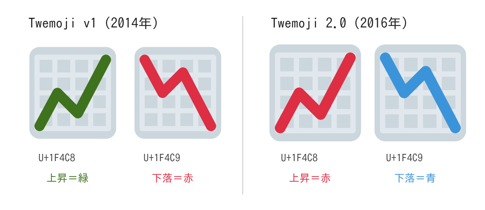

+++
author = "矢崎裕一"
title = "赤い 📈 は1697年の堂島から来たのか──ローソク足と絵文字の色を、一次資料で確かめる"
slug = "red-rising-chart-emoji"
date = "2026-11-05"
description = "📈 が赤いのは、日本の携帯電話会社の絵文字が2010年に Unicode へ入ったためです。上昇を赤く描く罫線は大正期の資料にありますが、1697年の堂島でローソク足を作った資料は見つかっていません。"
categories = [
    "principle"
]
tags = [
    "ローソク足",
    "絵文字",
    "色",
    "堂島米市場"
]
image = "images/keizai-toukei-1925-inyobiki-monthly.jpg"
+++

📈 の線が赤いのは、日本の携帯電話会社の絵文字が2010年に Unicode へ取り込まれたためです。上昇を赤で描く罫線（相場の図）は、大正〜昭和初期の資料で確かめられます。一方、1697年の堂島の商人がローソク足を作ったことを示す資料は、見つかっていません。

発端は、Aakash Gupta が2026年4月6日に X に書いた投稿です。絵文字で赤が上昇を表すのは1697年の大坂・堂島米市場にさかのぼり、米商人が値動きを図にするためにローソク足（陰陽足）を作ったからだ、という内容でした。以下では、この主張を年・起源・呼び名・色・絵文字に分け、国立国会図書館デジタルコレクション（NDL）の罫線書、大阪取引所の資料、Unicode の規格文書で確かめます。

<!--more-->

## 投稿の主張を、五つに分ける

投稿の冒頭は次のとおりです。全文は X の長文投稿になっていて、「Rising price…」より先は読めませんでした。

> The reason red means "up" on these emojis dates back to 1697 Osaka, Japan. Rice merchants created the world's first futures exchange at the Dojima Rice Market. They needed to chart whether prices were rising or falling, so they built the candlestick chart, called 陰陽足 (yin-yang chart). Rising price…

要旨は、絵文字の赤＝上昇は1697年の大坂に由来し、世界初の先物取引所だった堂島の米商人がローソク足（陰陽足）を作ったから、というものです。

この投稿は、kuno（@kunoo）の前日の投稿「Whoever made these emojis needs to be fired immediately.」を引用しています。引用元のコミュニティノートは、上昇の絵文字が赤、下降が青なのは東京証券取引所の慣習による、と書いています。ここから、「these emojis」は 📈（U+1F4C8）と 📉（U+1F4C9）だと読めます。

主張ごとの判定を先に示します。

| 投稿の主張 | 判定 | 資料で確かめられたこと |
|---|---|---|
| 1697年の大坂（堂島）にさかのぼる | 一部は裏づけられる | 1697年は淀屋の米市が堂島へ移った年。先物取引（帳合米）が公認されたのは1730年 |
| 堂島米市場は世界初の先物取引所 | 評価としては使われている | 大阪取引所と Schaede（1989）が条件付きで使う。高槻泰郎は、主に海外の論者の評価だと書く |
| 米商人がローソク足を作った | 裏づけられない | 江戸期の資料に、ローソク足の形は見つからなかった。文章で確かめた最も古い記述は1924年 |
| それは「陰陽足」と呼ばれた | 一部は裏づけられる | 「陰陽足」の用例は1931年。江戸期の用例は見つからなかった |
| 絵文字の赤が上昇なのはこのため | 裏づけられない | 赤で上昇を描く罫線は1924〜1936年に確かめられる。📈 は2010年に KDDI の絵文字から Unicode に入った。両者を結ぶ資料は見つからなかった |
| （前提）これらの絵文字では赤が上昇 | 裏づけられる | Apple・Google・Samsung・Twemoji の 📈 は赤い線 |

## 1697年と1730年、堂島で起きたこと

大阪取引所の「堂島米市場」のページは、年表に「元禄10年(1697)頃　淀屋米市、ここ堂島に移転」と書いています。次の行は、享保15年（1730）に徳川吉宗が堂島米市場を公認した、という記述です。1697年は、市場が堂島へ移った年です。

日本取引所グループの沿革によれば、このとき米切手の現物市場（正米商い）と、帳面の上で売買する先物市場（帳合米商い）が公認され、公的な市場「堂島米会所」ができました。明治36年（1903）の『大阪堂島米商沿革』は、その触書を享保15年8月13日付で載せています。

「世界初」については、大阪取引所の英語ページが見出しに「World's First Futures Exchange」と書き、日本語ページは「世界における組織的な先物取引所の先駆けとして広く知られている」と書きます。研究では、Ulrike Schaede（ウルリケ・シェーデ）が1989年の論文で、現代の金融研究の条件をすべて満たす最初の組織的な先物取引所は18世紀の日本にさかのぼる、と書いています。

高槻泰郎は、この評価は海外の論者に多く、CME グループ名誉会長のレオ・メラメドがよく知られている、と書いています。先物取引所としての起点は、どの資料でも1730年の公認です。投稿の1697年は、移転の年を先物取引所の年と重ねたものと読めます。

## ローソク足の形が資料に現れるのは、大正期

江戸期の罫線の現物は、確かめられませんでした。当たったのは、NDLサーチ、NDLラボの全文検索（古典籍を「罫線」「足取」「星足」で検索）、CiNii、Web 検索です。見つかった江戸期の値段の記録は、帳面形式の相場日記（現存最古は宝暦5年＝1755、高槻 2011）と数値の表でした。

日本テクニカルアナリスト協会（NTAA）は、1900年ごろまでは日米とも、終値を結ぶ折れ線（星足）や、縦線と横線をカギ形につなぐ描き方だったと説明しています。明治27年（1894）の平岩街『米価図鑑』も、ローソク足の形ではありません。

平岩街『米価図鑑』（1894）「大阪堂島米價高低圖」の部分／国立国会図書館デジタルコレクションより引用（パブリックドメイン）

同じ1枚の説明文は、月ごとの「生れ直（始値）」「最高直」「最低直」「最終直」の4つを図にした、とも書いています。

NTAA は、発端を1910年に井上揚三郎が紹介した、実体を太い矢印、影を点線で描く方法と見ています。1914年に早坂豊三が「寄止錨足」に改良し、1920年に井上三昧が「蝋燭引」として紹介しました。成立は1910年代、大正時代の可能性が高い、というのが NTAA の推定です。この3冊は NDL の裁定公開の資料で、原文は読めていません。

本文を読んで確かめられた最も古い記述は、大正13年（1924）の無髯老人『株式罫線講習録』です。第五章「陰陽引日足」に、こう書いてあります。

> 寄付より大引の高いのを陽線として朱線で引き、寄付より大引の安いものを陰線として黑線で引き、寄引の間に寄付及び大引より高値安値があればそれを細く引いて影と云ふ。

無髯老人『株式罫線講習録』（理財研究会、1924）コマ51／国立国会図書館デジタルコレクションより引用（パブリックドメイン）

例は、前場に96円で寄り付き、後場に97円50銭で引けた日です。図では96円から97円50銭までが実体、98円と95円60銭までが影です。本文は陽線を朱で引くとしますが、刷られた図では陽線は白抜き、陰線は黒塗りです。

**この本の書き方は、いまのローソク足の対応とそのまま重なります。** 形と読み方の基本は、[ローソク足チャート](/candlestick-chart/)の記事にまとめています。

| 値 | ローソク足の部分 | 1924年の言い方 |
|---|---|---|
| 始値 | 実体の一端 | 寄付 |
| 終値 | 実体のもう一端 | 大引 |
| 高値 | 上のヒゲ | 影 |
| 安値 | 下のヒゲ | 影 |
| 終値が始値より高い | 色（陽線） | 朱線（図では白抜き） |
| 終値が始値より安い | 色（陰線） | 黒線 |
| 始値と終値が同じ | 前日と比べて決める | 前日より安ければ黒、高ければ朱 |

考案者を酒田の米商人・本間宗久（1724〈一説1717〉–1803）とする通説には、同時代の資料の裏づけがありません。NTAA は、宗久の遺訓とされるものに罫線の記載がないと書きます。NDL にある「宗久」の名を冠した古い書物は、どれも明治の刊行です。西洋にローソク足を広めた Steve Nison（スティーブ・ニソン）も、1994年の著書で、本間がローソク足を使ったとは考えにくく、明治初期にできた可能性が高いと書いています（英語版 Wikipedia の引用による。原本は未確認）。NTAA とは年代が違いますが、どちらも江戸期の発明とはしていません。

## 「陰陽足」は、朱と黒で描く足の名前だった

「陰陽足」の用例として確かめられたのは、昭和6年（1931）の徳田昂平『株式売買物語』です。罫線の記録方法として、星足・陰陽足・値幅足を挙げています。

> 陰陽足（一日の動き値幅を、相場昂騰したる時は赤、下落したる時は黑にて示す方）

大正〜昭和初期には「陰陽引」という呼び名のほうが多く見つかります。NTAA は、陰陽足（陰陽引）はローソク足を含む上位の呼び名で、ローソク足と同じ意味ではない、と説明しています。

江戸期の用例は確かめられませんでした。NDLラボの全文検索で「陰陽足」を引くと、相場の意味では1931年と1934年の『株式売買物語』だけでした。ただし、明治〜大正の罫線書の多くは裁定公開で、検索の対象に入っていません。

「蝋燭足」は、はじめ特定の形の名前だったと読めます。1924年の無髯老人は底に出る形を「ロウソク形」と呼び、1933年と1938年の『経済語辞典』は燭台のような形の罫線としています。昭和11年（1936）の小林宜園は、実体を太く描く足そのものを「俗に蝋燭足」と呼んでいます。

小林宜園『株式相場必利の秘奥』（運命大学院、1936）コマ14／国立国会図書館デジタルコレクションより引用（パブリックドメイン）

中国語版 Wikipedia によれば、ローソク足は香港で「陰陽燭」と呼ばれます。投稿の呼び名は、日本語の「陰陽足」と香港の「陰陽燭」が重なったものとも読めます。

色の記述は、1920〜30年代の資料でそろっています。1924年の無髯老人、1925年の摩耶山人『株式利殖の妙諦』と小林新、1931年の徳田昂平、1936年の小林宜園は、どれも陽線を赤（朱）、陰線を黒としています。

小林新の本は統計学の教科書で、「K圖」に大正9年7月から12年末までの東株相場の月足を載せています。本文は陽線を朱線で引くとしたうえで、「此圖では便宜上陰影線を用いて居る」と断っています。

小林新『経済統計学の原理と応用』上（ダイヤモンド社、1925）コマ76「K圖 陰陽引き月足罫線圖（東株相場）」／国立国会図書館デジタルコレクションより引用（パブリックドメイン）

朱で区別していたものを、印刷の都合で斜線の模様に置き換えた例と読めます。1924年の図の白抜きも、同じ置き換えと読めます。江戸期に赤で描いた資料は、罫線の現物がないため確かめられませんでした。

## 📈 の赤は、2010年に Unicode へ入った

📈 と 📉 は、2010年10月11日公開の Unicode 6.0 で入りました。UTS #51 は、この版の絵文字を「the emoji characters deriving from Japanese carrier sets」と説明しています。日本の携帯電話会社の絵文字から来たもの、という意味です。

提案の背景資料（L2/09-027R2、2009年9月17日）では、📈 は KDDI の「グラフ１（折れ線グラフ）」、📉 は KDDI の「グラフ２」に当たります。対応表 EmojiSources.txt でも、📈 と 📉 が対応するのは KDDI の絵文字だけです。

Unicode の公式チャートには、取り込む前の KDDI の画像が載っています。画素の色で判定すると、📈 は赤い右上がりの線、📉 は青い右下がりの線でした（目視の確認ではありません）。Emojipedia も、元の KDDI と SoftBank の絵文字は上昇の線が赤だった、と書いています。

各社の字形の色は一様ではありません。Unicode の公式チャート（v14.0 は2021年、v15.0 は2022年）の画像を、同じく画素の色で判定した結果です。

| 各社 | 📈 上昇 | 📉 下落 |
|---|---|---|
| Apple | 赤 | 青 |
| Google | 赤 | 緑（v14.0）→ 青（v15.0） |
| Microsoft（Windows） | 赤 | 青 |
| Twitter（Twemoji） | 赤 | 青 |
| Samsung | 赤 | 青 |
| Facebook | 緑 | オレンジ |
| JoyPixels | 緑 | 赤 |

公開リポジトリの SVG を読むと、色の値で確かめられます。Twemoji は2014年の v1 で 📈 が緑（#3e721d）、📉 が赤（#dd2e44）でした。2016年の 2.0 で 📈 が赤（#DD2E44）、📉 が青（#3B94D9）に入れ替わっています。変更の理由を書いた資料は見つかりませんでした。

Twitter, Inc. and other contributors／GitHub「twitter/twemoji」より引用。2014年のコミット 5c0297d と v2.0.0 の SVG を PNG にして並べた（CC BY 4.0）

Google の Noto Emoji の 📉 も、青から緑を経て、2021年9月に青へ戻りました。

株価の表示の慣習も、地域ごとに違います。

- 日本取引所グループの『東証図鑑』は、チッカーで「前日よりも株価が上がっていると赤、下がっていると緑」と書いています。
- 大和証券の用語解説は、陰線をカラーなら青（陽線は赤）、白黒なら黒（陽線は白）で描く、と書いています。
- 2005年の W3C のメーリングリストには、日本の Yahoo!ファイナンスが上昇を黒、下落を赤で示していたという観察が残っています。
- Jiang ら（2014）は、中国本土では上昇が赤、下落が緑で、香港を含むほかの地域では逆だと書いています。

赤で上昇を描く慣習と、堂島や本間宗久を結びつける資料は見つかりませんでした。当たったのは、Emojipedia のブログ、コミュニティノート、『東証図鑑』、英語版 Wikipedia、NDL の検索、日英中の Web 検索です。投稿は、ローソク足の起源の話と、2010年の絵文字の色の話を、資料なしにつないだものと読めます。

## 使い道

色で上下を表す約束は、時代・地域・会社で入れ替わってきました。1920年代の罫線書は上昇を朱で描き、印刷では白抜きや斜線に置き換えました。いまの日本の取引所は上昇を赤、香港や欧米の多くは緑で示します。Twemoji は2016年に配色を逆にしました。

ここから、上昇と下落を色だけに任せない、という使い道が読めます。1924年の白抜きと黒塗り、1925年の斜線、新聞の株式欄の △ と ▼ は、色がなくても向きが読める符号です。読者の地域が混ざる図では、形か記号でも向きを示すのが安全だと読めます。

もう一つは、図の起源を調べる手順です。今回の投稿では、市場の年、図の形、呼び名、色、絵文字が一つの話になっていました。分けて資料に当てると、形は大正期、呼び名は昭和初期、絵文字は2010年と、別々の年が出てきます。チャートの歴史は、形・名前・色を分けて確かめるのがよいと読めます。

## 参考・出典

**一次資料**

- Aakash Gupta の X の投稿（2026-04-06）：https://x.com/aakashgupta/status/2041019578520846747 （oEmbed：https://publish.twitter.com/oembed?url=https://x.com/aakashgupta/status/2041019578520846747 ）
- kuno（@kunoo）の X の投稿（2026-04-05）と、付いたコミュニティノート：https://x.com/kunoo/status/2040863289236975754 ／https://twitter.com/i/birdwatch/n/2041213836351480189
- 大阪取引所「堂島米市場」：https://www.jpx.co.jp/dojima/ja/index.html ／英語版 "Dojima Rice Exchange"：https://www.jpx.co.jp/dojima/en/index.html
- 日本取引所グループ「沿革」：https://www.jpx.co.jp/corporate/about-jpx/history/02-03.html
- 『大阪堂島米商沿革』大阪堂島米穀取引所、1903：https://dl.ndl.go.jp/pid/803796
- Ulrike Schaede, "Forwards and futures in Tokugawa-period Japan," *Journal of Banking and Finance* 13 (1989) 487–513：https://sfu.ca/~poitras/JBF_Tokugawa-Japan_89.pdf
- 平岩街『米価図鑑』1894：https://dl.ndl.go.jp/pid/1088811
- 井上陽三郎『定期相場高低罫線推理法』1910（裁定公開、本文は未読）：https://dl.ndl.go.jp/pid/803919
- 早坂豊蔵『相場大罫線学：期米株式』1914（裁定公開、本文は未読）：https://dl.ndl.go.jp/pid/953774
- 井上三昧『足取の原理』1920（裁定公開、本文は未読）：https://dl.ndl.go.jp/pid/964570
- 早坂豊蔵編『荘内本間宗久翁遺書』1894：https://dl.ndl.go.jp/pid/804017 ／『米界大王日本長者五家之一庄内酒田港本間家秘蔵宝書』：https://dl.ndl.go.jp/pid/803997 ／『宗久翁相場全集』1910：https://dl.ndl.go.jp/pid/804042
- 無髯老人『株式罫線講習録』理財研究会、1924（コマ24、51、56）：https://dl.ndl.go.jp/pid/982221
- 摩耶山人『株式利殖の妙諦：相場先見』高天閣、1925（コマ31）：https://dl.ndl.go.jp/pid/916889
- 小林新『経済統計学の原理と応用』上、ダイヤモンド社、1925（コマ75〜76）：https://dl.ndl.go.jp/pid/971545
- 徳田昂平『株式売買物語』千代田書店、1931（コマ122）：https://dl.ndl.go.jp/pid/1053408 ／1934年版：https://dl.ndl.go.jp/pid/1031792
- 経済知識普及会編『市場経済講座 第3 罫線による株式相場観測』1933：https://dl.ndl.go.jp/pid/1264833
- 大阪毎日新聞経済部編『新修経済語辞典』1933：https://dl.ndl.go.jp/pid/1447691 ／大阪毎日新聞社経済部編『経済語辞典』一元社、1938：https://dl.ndl.go.jp/pid/1440733
- 小林宜園『株式相場必利の秘奥』運命大学院、1936（コマ14）：https://dl.ndl.go.jp/pid/1102207
- Unicode 6.0.0（2010-10-11）：https://www.unicode.org/versions/Unicode6.0.0/
- Unicode Technical Standard #51, Unicode Emoji：https://www.unicode.org/reports/tr51/
- Unicode emoji-test.txt：https://www.unicode.org/Public/emoji/latest/emoji-test.txt
- Unicode EmojiSources.txt：https://www.unicode.org/Public/UCD/latest/ucd/EmojiSources.txt
- Markus Scherer, "Background data for Proposal for Encoding Emoji Symbols," L2/09-027R2（WG2 N3681）, 2009-09-17：https://www.unicode.org/L2/L2009/09027r2-emoji-backgrnd.pdf
- Unicode Full Emoji List（最新・v14.0・v15.0）：https://www.unicode.org/emoji/charts/full-emoji-list.html ／https://www.unicode.org/emoji/charts-14.0/full-emoji-list.html ／https://www.unicode.org/emoji/charts-15.0/full-emoji-list.html
- Google emoji4unicode（KDDI の絵文字データ）：https://raw.githubusercontent.com/google/emoji4unicode/master/data/kddi/carrier_data.xml
- Twemoji（twitter/twemoji、グラフィックは CC BY 4.0）：https://github.com/twitter/twemoji ／現在の保守版 https://github.com/jdecked/twemoji
- Noto Emoji：https://github.com/googlefonts/noto-emoji
- Microsoft Fluent Emoji：https://github.com/microsoft/fluentui-emoji
- 日本取引所グループ『東証図鑑』：https://www.jpx.co.jp/corporate/learning/resources/tvdivq0000003toh-att/zukan_tosyo.pdf
- 大和証券 用語解説「陰線」：https://www.daiwa.jp/glossary/YST0092.html
- W3C www-international メーリングリストの投稿（2005-09-30）：https://lists.w3.org/Archives/Public/www-international/2005JulSep/0188.html ／https://lists.w3.org/Archives/Public/www-international/2005JulSep/0191.html

**研究・二次資料**

- 高槻泰郎「江戸時代にはお米が『証券化』されていたことをご存知ですか」（『大坂堂島米市場』講談社現代新書、2018 の抜粋）：https://gendai.media/articles/-/56562
- 高槻泰郎「近世日本における相場情報の伝達」郵政資料館研究紀要 2、2011：https://www.postalmuseum.jp/publication/research/docs/research_02_06.pdf
- Yasuo Takatsuki & Takashi Kamihigashi, *Microstructure of the First Organized Futures Market: The Dojima Security Exchange from 1730 to 1869*, Springer（書誌）：https://link.springer.com/book/9789812878199
- 日本テクニカルアナリスト協会「チャートの種類」：https://www.ntaa.or.jp/learn/charts
- 日本テクニカルアナリスト協会「テクニカル分析の歴史」：https://www.ntaa.or.jp/learn/history
- Thom Hartle, "Steve Nison On Candlestick Charting," *Stocks & Commodities* V.9:3, 1991：https://store.traders.com/-v09-c03-steveni-pdf.html
- Keith Broni, "Why does the 📈 Chart Increasing emoji show in red?," Emojipedia Blog, 2021-05-26：https://blog.emojipedia.org/why-does-the-chart-increasing-emoji-show-in-red/
- Emojipedia「Chart Decreasing」：https://emojipedia.org/chart-decreasing
- 神戸新聞 NEXT「株式欄の読み方」2016-04-27：https://www.kobe-np.co.jp/rentoku/monoshiri/201604/sp/0009029258.shtml?pg=amp
- Jiang, F., Lu, S., Yao, X., Yue, X., & Au, W. (2014). Up or Down? How Culture and Color Affect Judgments. *Journal of Behavioral Decision Making*, 27(3), 226–234：https://doi.org/10.1002/bdm.1800
- Wikipedia "Candlestick chart"（Nison 1994 の引用を含む）：https://en.wikipedia.org/wiki/Candlestick_chart
- Wikipedia（中国語）「K線」：https://zh.wikipedia.org/wiki/K線
