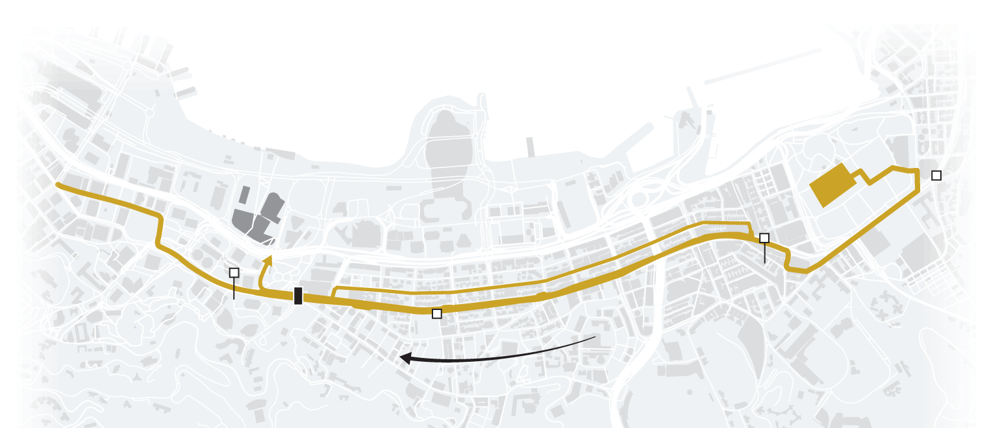
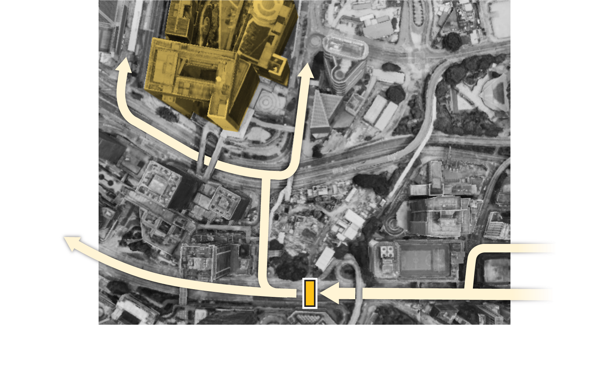
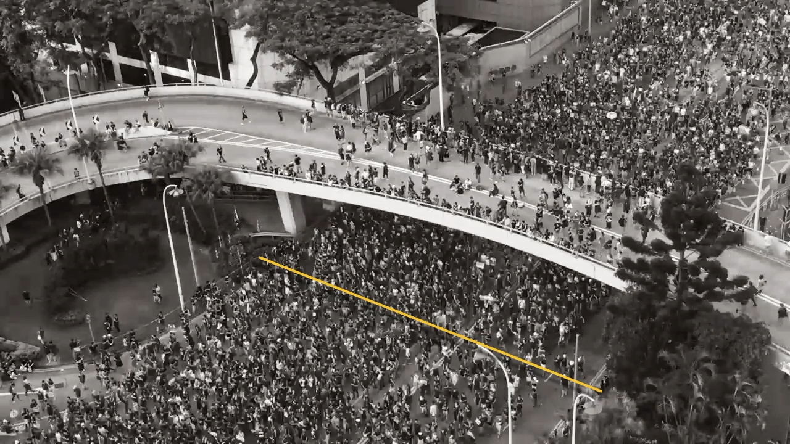
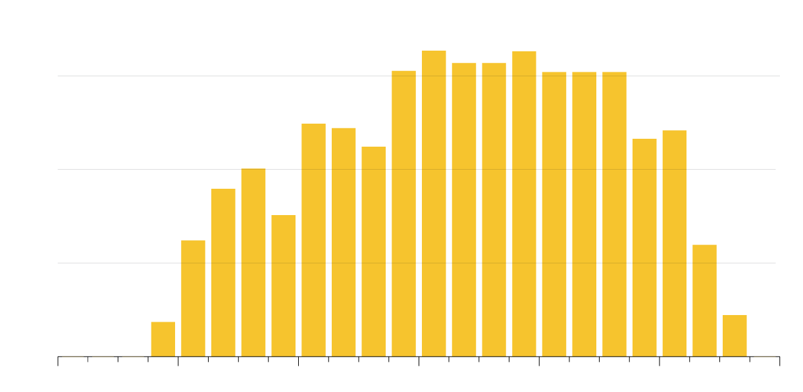

+++
author = "Yuichi Yazaki"
title = "Showing How 227,000 Was Counted, Split into Maps of Place, Time and Numbers: Reuters' Hong Kong Protest Count"
slug = "reuters-hong-kong-crowd-count"
date = "2026-11-04"
description = "Reuters estimated that 227,000 people marched in the July 1, 2019 Hong Kong protest. It shows where it counted with a map and photos, when with a timetable of dots, and the result with a bar chart of 15-minute estimates."
categories = [
    "consume"
]
tags = [
    "data journalism",
    "Sigma Awards",
    "crowd counting",
    "Reuters"
]
image = "images/share-card.png"
+++

For the July 1, 2019 protest in Hong Kong, Reuters estimated that 227,000 people marched. It shows where it counted with a map and photos, when it counted with a timetable of dots, and the result of the count with a bar chart of 15-minute estimates, each as a separate graphic.

The piece is Reuters Graphics' "Hong Kong protests: How many protesters took to the streets on July 1?", published on July 4, 2019. It is signed by three people: Simon Scarr, Manas Sharma and Marco Hernandez. It was also an entry for the Sigma Awards 2020. Below, I read it graphic by graphic, following the piece's text and figures, the Backstory in which Reuters described how it was made, and the Sigma entry form.

<!--more-->

## July 1, 2019: four numbers side by side

July 1 is the anniversary of Hong Kong's handover, and the day on which pro-democracy groups march every year. The march started at Victoria Park. The planned end point was the Government Headquarters, but clashes at the morning ceremony moved it to Chater Road, about 400 m away.

At the top, the piece lines up four estimates in prose.

| Who estimated | Number | How the piece describes it |
|---|---|---|
| Organizers | 550,000 | People who took to the streets |
| Police | 190,000 | People in the march "at its peak" |
| Hong Kong Public Opinion Research Institute (HKPORI) | 260,000 | People who took part in the protest |
| Reuters | 227,000 | People who marched past in the Admiralty district |

A note at the end says the HKPORI figure was wrongly given as 265,000 when the piece was first published and was later corrected. The piece has no graphic that puts the four numbers side by side.

The piece says that in Hong Kong, protest turnout is treated as a gauge of public opinion and is also a political fight between the organizers and the government. The police told Reuters that their figure was "only a rough figure solely for the purpose of effective manpower deployment." The organizers did not respond.

In its Sigma entry form, Reuters gives its motive as follows.

> For Reuters, this was an opportunity to calculate our own estimate and provide an unbiased statistic.

In a June 20 wire story, Scarr and Tong had relayed scholars' view that for a march it is better to count the people passing a section of the route in a short time and multiply by the length of the march. The July piece uses this method.

## Showing where it counted, with a map and photos

Scarr chose the counting location on a scouting trip. According to the Backstory, Scarr studied the roughly 3 km route on Google Earth and looked for a place the crowd had to pass. From photos posted on TripAdvisor, he also confirmed that a room in a certain hotel overlooked that spot. The hotel was the main observation point, and there were two more on a pedestrian bridge.

The first graphic the piece shows is a map of the march route.

Source: Scarr, Sharma, Hernandez (Reuters) / Reuters Graphics, "How many protesters took to the streets on July 1?"

The graphic was exported with ai2html, and the place names are laid over the image as HTML text. That is why the image quoted here has no lettering. In the piece, "START Victoria Park" appears at the right edge, "END Chater Road" at the left edge, "Counting location" below the black rectangle, and "Flow of people" next to the arrows.

According to the piece, part of the march headed for the Government Headquarters along the way. The counting location is before that fork, and there is no shortcut nearby. So the people heading for the Government Headquarters were counted too, the piece explains.

Source: Scarr, Sharma, Hernandez (Reuters) / Reuters Graphics, "How many protesters took to the streets on July 1?"

The second graphic is an enlargement of the area around the fork, with the branching arrows and a "Counting area" rectangle drawn over the photo. The video that follows looks down on Hennessy Road from the observation point, with a note that the full width of the road was in frame.

Source: Scarr, Sharma, Hernandez (Reuters) / Reuters Graphics, "How many protesters took to the streets on July 1?"

The image above is the piece's share image. It can be read as showing the line that the text refers to when it says people "passing a line in the road" were counted.

After showing the place, the piece states the limits of the number.

> That means Reuters’ calculations are not an estimate of the total number taking part in the protest - only the march.

People who left before the counting location, and people who went straight to Tamar Park without marching, are not counted. So **227,000 is the number of marchers, not the total number of protest participants**, the piece says.

## Showing when it counted, with dots

Next, the piece makes a graphic of when it counted.

> The team recorded 30 seconds of video at least every 15 minutes and counted the number of people passing a line in the road during that time.

That is, the team filmed 30 seconds of video at least every 15 minutes and counted the people who crossed a line in the road in that time.

Source: Scarr, Sharma, Hernandez (Reuters) / Reuters Graphics, "How many protesters took to the streets on July 1?"

The horizontal axis runs from 3 p.m. to 9 p.m. The legend reads "Each dot shows when Reuters analysed crowd flow," so one dot is one measurement. Arrows are labeled "Front of march arrives" and "Tail passes and main march is over," and the wide-screen version adds "Closer bursts of counting as crowd density fluctuated." Counting the dots in the image myself, I got about 30.

The method for turning a 30-second count into a total is as follows.

> Reuters extrapolated the number of people measured in 30 seconds over the period until the next reading - for instance, if there was a five-minute gap, the 30-second measurement would be multiplied by 10.

The count for 30 seconds is stretched over the time until the next measurement; if the gap is five minutes, it is multiplied by 10. As a formula, the total is the sum, over all measurements, of the count times (seconds until the next measurement ÷ 30).

In other words, the spacing of the dots is itself the extrapolation multiplier. It can be read as meaning that the sparser the dots, the more a single 30-second sample is stretched. Professor Keith Still, a crowd scientist, says in the piece that if you count the people passing through an area of known width over a short time, you should be able to get an accurate figure for the number who passed that spot.

The counting was done by hand. According to the Backstory, filming the march took more than four hours, and the team watched and counted 18 hours of video.

## Adding up the 15-minute bars gives 227,000

Below the dot graphic, the piece places a bar chart of the estimated number of people for each 15 minutes.

Source: Scarr, Sharma, Hernandez (Reuters) / Reuters Graphics, "How many protesters took to the streets on July 1?"

The vertical axis is labeled "Number of people," with ticks at 5,000, 10,000 and 15,000. The subtitle is "15 minute estimates," and the horizontal axis is the same as in the dot graphic. The piece concludes that adding these estimates gives the total number who passed the counting location, and that this is 227,000. When I read the heights of the 20 bars off the ticks and added them, I got about 227,000.

However, there is no graphic showing the result of the addition. Right after this paragraph there is an empty element called `cumulative`, but the script has no code to draw it, so nothing appears in the current version. I could not confirm whether a graphic existed when the piece was first published.

The correspondence between graphics and data is summarized below.

| Graphic | Data shown | Correspondence to appearance |
|---|---|---|
| Route map | Route, start and end points, Government Headquarters, counted location | Position on the map. The gold line is the route, the black rectangle is the location, the arrows are the direction of flow |
| Counting-area graphic | The fork and the counted area | Arrows and an area rectangle laid over an aerial photo |
| Observation-point video | Traffic on Hennessy Road | The road itself as seen from the observation point |
| Measurement-time graphic | Times of the 30-second measurements | Horizontal position is time, one dot is one measurement, spacing is the density of measurements |
| 15-minute bar chart | Extrapolated numbers of people, totaled for each 15 minutes | Bar length is the number of people, horizontal position is the time slot |

The dots and bars line up vertically on the same time axis. Comparing them, the reader can check which bars are values stretched from few measurements, it can be read. On the other hand, none of the graphics shows the extrapolation multipliers, the raw counts or the margin of error. The source is given as "Source: Reuters reporting," and as far as the piece and its links show, the data has not been published.

## How third parties saw this piece

On the Sigma Awards listing site, this piece is classified as a 2020 "entry" and is not on the shortlist. The results from other awards are as follows.

- Online Journalism Awards 2020: the series "Visualising the Hong Kong protests," which includes this piece, won Excellence in Visual Digital Storytelling, Large Newsroom.
- Same awards: an entry that paired it with the June piece "Measuring the masses" was a finalist for Explanatory Reporting, Large Newsroom.
- Kantar Information is Beautiful Awards 2019: longlisted in the Politics & Global category.

The description text on the award pages is Reuters' own entry text, so only the results can be used as an evaluation.

Researchers who counted the same day by a different method discuss it more concretely. In a 2023 paper, Chow, Yip and Wong combined capture-recapture with automated counting by a CNN and estimated 276,970 people (95% confidence interval 263,663 to 290,276). They mention Reuters as follows.

> However, their approach used a single check point late in the rally course and excluded those who left before it. Considering the estimated early departure of 72,981 based on the field sample, the Reuters count is also similar to the overall count reported in this study.

In other words, Reuters counted at a single point late in the route and did not include people who left before it. Taking into account the estimated early departure of 72,981, the Reuters count is also close to the authors' own estimate. The paper's references list the URL of this piece.

However, the paper and the piece disagree on the number and the location. The paper gives Reuters' number as "about 220,000" and the location as "near Arsenal Street." The piece gives 227,000 and Hennessy Road (Admiralty district). I could not confirm the reason for the discrepancy.

The paper further points out, without naming anyone, that methods which multiply time samples assume a constant flow, which is difficult for a crowd whose walking speed changes minute by minute. The piece stated in words that its number is "not the total." The paper can be read as putting a number, about 73,000 people, on that difference.

## What to take from it

What we can take away is a structure for showing how a single number was made by splitting the process into separate graphics.

The graphic of place fixes the scope of what was counted. That the counting location was chosen before the fork and with no shortcut can be checked with the map and photos. For the people outside that scope, the piece says so in words. The piece makes this division of roles clear.

The graphic of time shows how the sample was taken. Just by lining up dots, we can see when and how densely the counting was done. If the result bars are aligned with the time axis, we can compare which values were stretched from a thin sample, it can be read.

On the other hand, the extrapolation multipliers, the raw counts and the margin of error are not in a graphic. As in the 2023 paper, there is another path: attaching the range of the estimate as a number. A graphic that discloses the method and a graphic that shows the range are different things. This piece drew the former, split into place, time and number of people.

## References

**Primary sources**

- Simon Scarr, Manas Sharma, Marco Hernandez, “Hong Kong protests: How many protesters took to the streets on July 1?,” Reuters Graphics, 2019-07-04. [The piece](https://www.reuters.com/graphics/HONGKONG-EXTRADITION-CROWDSIZE/0100B05W0BE/) (original URL: [graphics.reuters.com](https://graphics.reuters.com/HONGKONG-EXTRADITION-CROWDSIZE/0100B05W0BE/index.html))
- Text and graphic labels of the same piece (script). [main.js](https://www.reuters.com/graphics/HONGKONG-EXTRADITION-CROWDSIZE/0100B05W0BE/scripts/main.js)
- Sigma Awards 2020, “How many protesters took to the streets on July 1?” (original entry form and Japanese translation). [Sigma Awards entries site](https://sigma-awards.data-visualization.jp/entries/2020-s-0088/)
- Reuters, “Backstory: How Reuters counted a quarter million people at Hong Kong's protests,” 2019-07-18 (Yahoo reprint). [Article](https://news.yahoo.com/backstory-reuters-counted-quarter-million-084715637.html)
- Reuters, “Mass movement: counting marchers in Hong Kong,” 2019-07-04 (The Star reprint, first version). [Article](https://www.thestar.com.my/news/world/2019/07/04/mass-movement-counting-marchers-in-hong-kong)
- Reuters, “CORRECTED-Mass movement: counting marchers in Hong Kong” (Devdiscourse reprint, corrected version). [Article](https://www.devdiscourse.com/article/international/586920-corrected-mass-movement-counting-marchers-in-hong-kong)
- Reuters, “In Hong Kong, science of crowd counting comes into focus,” 2019-06-20 (signed by Scarr and Tong, Yahoo reprint). [Article](https://news.yahoo.com/reuters-graphic-hong-kong-science-102212458.html)
- Online Journalism Awards entry pages (the description text is Reuters' entry text). [Visualising the Hong Kong protests](https://awards.journalists.org/entries/visualising-the-hong-kong-protests/) / [Hong Kong protests](https://awards.journalists.org/entries/hong-kong-protests/)

**Secondary sources**

- T. E. Chow, P. S. F. Yip, K.-P. Wong, “An integrated framework of mobile crowd estimation for the 2019, July 1st rally in Hong Kong,” *Multimedia Tools and Applications*, 2023. [doi:10.1007/s11042-023-15417-7](https://doi.org/10.1007/s11042-023-15417-7) / [PMC full text](https://pmc.ncbi.nlm.nih.gov/articles/PMC10152033/)
- Online Journalism Awards 2020, Excellence in Visual Digital Storytelling, Large Newsroom (winner). [Result](https://awards.journalists.org/entries/visualising-the-hong-kong-protests/)
- Online Journalism Awards 2020, Explanatory Reporting, Large Newsroom (finalist). [Result](https://awards.journalists.org/entries/hong-kong-protests/)
- Kantar Information is Beautiful Awards 2019, Politics & Global (longlist). [Showcase](https://informationisbeautifulawards.com/showcase/4108-hong-kong-protests-how-many-took-to-the-streets-on-july-1)
