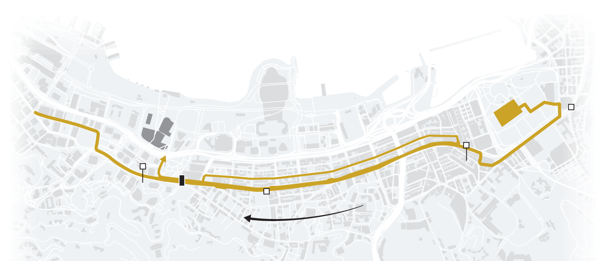
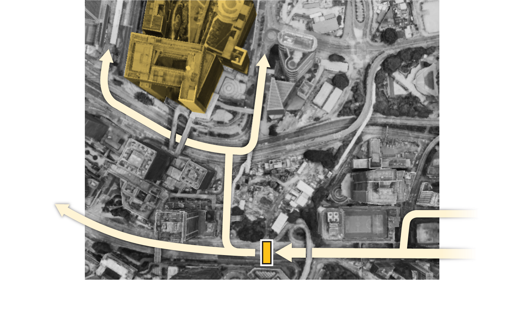
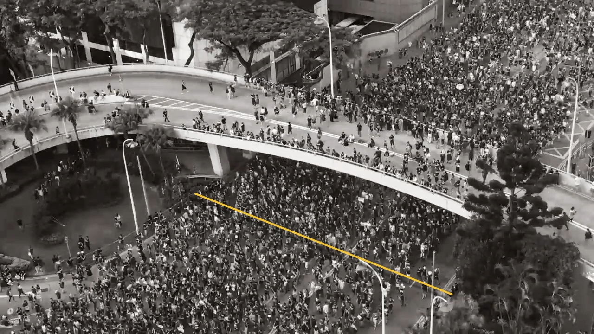
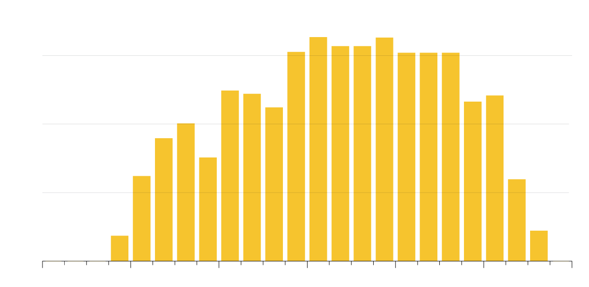

+++
author = "矢崎裕一"
title = "22.7万人の数え方を、場所・時刻・人数の図に分けて示す──Reuters の香港デモ計数"
slug = "reuters-hong-kong-crowd-count"
date = "2026-11-04"
description = "Reuters は2019年7月1日の香港デモの行進人数を22.7万人と推計しました。数えた場所は地図と写真、時刻は点の時刻表、結果は15分ごとの棒グラフで示しています。"
categories = [
    "consume"
]
tags = [
    "データジャーナリズム",
    "Sigma Awards",
    "群衆計数",
    "Reuters"
]
image = "images/share-card.png"
series = ["dataviz-journalism"]
series_weight = 1
seriesByline = "Simon Scarr・Manas Sharma・Marco Hernandez（Reuters）"
seriesTitle = "数え方を図に分けて示す──Reuters 香港デモの人数"
+++

Reuters（ロイター）は、2019年7月1日の香港デモについて、行進した人の数を22.7万人と推計しました。どこで数えたかは地図と写真で、いつ数えたかは点を並べた時刻表で、数えた結果は15分ごとの棒グラフで、それぞれ別の図にして示しています。

作品は Reuters Graphics の「Hong Kong protests: How many protesters took to the streets on July 1?」で、2019年7月4日に公開されました。署名は Simon Scarr（サイモン・スカー）、Manas Sharma（マナス・シャルマ）、Marco Hernandez（マルコ・ヘルナンデス）の3人です。Sigma Awards 2020 の応募作でもあります。以下は、作品の本文と図、Reuters が制作の裏側を書いた Backstory、Sigma への応募書類に沿って、図の順に読みます。

<!--more-->

## 2019年7月1日、四つの数が並ぶ

7月1日は香港の返還記念日で、民主派が毎年デモ行進をする日です。出発点はビクトリア公園でした。終点は政府本部の予定でしたが、朝の式典で衝突があり、約400m離れた Chater Road に変わりました。

作品は冒頭で、四つの推計を文章で並べます。

| 推計した人 | 人数 | 作品の書き方 |
|---|---|---|
| 主催者 | 550,000 | 街頭に出た人 |
| 警察 | 190,000 | 「ピーク時」に行進にいた人 |
| 香港民意研究所（HKPORI） | 260,000 | デモに参加した人 |
| Reuters | 227,000 | Admiralty 地区を行進して通った人 |

HKPORI の数は、公開当初は 265,000 と誤って書かれ、のちに直したと末尾に注記があります。四つの数を一枚に並べた図は、作品にはありません。

作品は、香港ではデモの人数が民意の指標として扱われ、主催者と政府の政治的な争いにもなる、と書きます。警察は取材に、自分たちの数は「only a rough figure solely for the purpose of effective manpower deployment」、つまり人員配置のための大まかな数だと答えました。主催者は回答していません。

Reuters は Sigma への応募書類で、動機をこう書いています。

> For Reuters, this was an opportunity to calculate our own estimate and provide an unbiased statistic.

自分たちで推計し、偏りのない統計を出す機会だった、という意味です。6月20日の配信記事で Scarr と Tong は、行進なら経路のある区間を短時間に通る人を数え、行進の長さを掛ける方がよい、という学者の見方を伝えていました。7月の作品は、この方法を使っています。

## 数える場所を、地図と写真で示す

数える場所は、Scarr が下見で決めました。Backstory によれば、Scarr は約3kmの経路を Google Earth で調べ、群衆が必ず通る場所を探しています。TripAdvisor の投稿写真から、あるホテルの部屋がその地点を見下ろせることも確かめました。主な観測点はそのホテルで、ほかに歩道橋の上にも2か所置いています。

作品が最初に見せる図は、行進の経路図です。

Scarr, Sharma, Hernandez（Reuters）／Reuters Graphics「How many protesters took to the streets on July 1?」より引用

図は ai2html で書き出したもので、地名は画像の上に HTML の文字で重ねてあります。ここに引いた画像に文字がないのはそのためです。作品では、右端に「START Victoria Park」、左端に「END Chater Road」、黒い長方形の下に「Counting location」、矢印に「Flow of people」と付きます。

作品によれば、行進の一部は途中で政府本部へ向かいました。数える地点はその分かれ道の手前で、近くに抜け道もありません。だから政府本部へ向かう人も数えられた、という説明です。

Scarr, Sharma, Hernandez（Reuters）／Reuters Graphics「How many protesters took to the streets on July 1?」より引用

二枚目は分かれ道のまわりの拡大図で、写真の上に分かれる矢印と「Counting area」の長方形を描いています。続く動画は観測点から Hennessy Road を見下ろしたもので、道路の幅いっぱいが画角に入っていた、と添えてあります。

Scarr, Sharma, Hernandez（Reuters）／Reuters Graphics「How many protesters took to the streets on July 1?」より引用

上は作品のシェア用画像です。本文の「道路の線を通る人を数えた」の、その線を見せた画像と読めます。

場所を示したあとで、作品は数の範囲を断ります。

> That means Reuters’ calculations are not an estimate of the total number taking part in the protest - only the march.

地点より前に抜けた人や、行進せずに直接 Tamar Park へ行った人は数えられない。だから **22.7万人は行進の人数で、デモ参加者の総数ではない**、という断りです。

## 数えた時刻を、点で示す

次に作品は、いつ数えたかを図にします。

> The team recorded 30 seconds of video at least every 15 minutes and counted the number of people passing a line in the road during that time.

少なくとも15分おきに30秒の動画を撮り、その間に道路の線を越えた人を数えた、という意味です。

Scarr, Sharma, Hernandez（Reuters）／Reuters Graphics「How many protesters took to the streets on July 1?」より引用

横軸は午後3時から午後9時です。凡例は「Each dot shows when Reuters analysed crowd flow」で、点1つが計測1回にあたります。矢印には「Front of march arrives」「Tail passes and main march is over」と付き、広い画面の版では「Closer bursts of counting as crowd density fluctuated」が加わります。筆者が画像で数えると、点はおよそ30個でした。

30秒の数を全体の数にする方法は、次のとおりです。

> Reuters extrapolated the number of people measured in 30 seconds over the period until the next reading - for instance, if there was a five-minute gap, the 30-second measurement would be multiplied by 10.

30秒の人数を、次の計測までの時間に引き伸ばす。間隔が5分なら10倍する、という説明です。式にすると、総数は「各回の人数 ×（次の計測までの秒数 ÷ 30）」の合計になります。

つまり点の間隔は、外挿の倍率そのものです。点がまばらな区間ほど、一回の30秒を大きく引き伸ばしている、と読めます。群衆科学の Keith Still（キース・スティル）教授は作品の中で、幅の分かった区域を短時間に通る人を数えれば、その地点を通った人数を正確につかめるはずだ、と述べています。

数えるのは手作業でした。Backstory によれば、行進を撮るのに4時間以上かかり、チームは18時間分の動画を見て数えています。

## 15分ごとの棒を足すと22.7万人になる

点の図の下に、作品は15分ごとの推計人数を棒グラフで置きます。

Scarr, Sharma, Hernandez（Reuters）／Reuters Graphics「How many protesters took to the streets on July 1?」より引用

縦軸は「Number of people」で、目盛りは 5,000、10,000、15,000。副題は「15 minute estimates」で、横軸は点の図と同じです。作品は、これらの推計を足すと数えた地点を通った総数になり、それが22.7万人だ、と結びます。筆者が目盛りから20本の棒の高さを読んで足すと、約22.7万人になりました。

ただし、足し合わせの結果を見せる図はありません。この段落の直後に `cumulative` という空の要素がありますが、スクリプトにそれを描く処理はなく、今の版には何も出ません。公開当初に図があったかは確かめられませんでした。

図とデータの対応をまとめます。

| 図 | 載せたデータ | 見た目への対応 |
|---|---|---|
| 経路図 | 経路、出発点と終点、政府本部、数えた地点 | 地図上の位置。金色の線が経路、黒い長方形が地点、矢印が流れの向き |
| 計数区域の図 | 分かれ道と数えた区域 | 航空写真に、矢印と区域の長方形を重ねる |
| 観測点の動画 | Hennessy Road の通行 | 観測点から見た道路そのもの |
| 計測時刻の図 | 30秒計測をした時刻 | 横軸の位置が時刻、点1つが計測1回、間隔が計測の密度 |
| 15分ごとの棒グラフ | 外挿した人数の15分ごとの合計 | 縦棒の長さが人数、横軸の位置が時間帯 |

点と棒は同じ時間軸で上下に並びます。見比べれば、どの棒が少ない計測から伸ばした値かを、読者が確かめられると読めます。一方で、外挿の倍率、数えた生の人数、誤差の幅は、どの図にもありません。出典は「Source: Reuters reporting」で、作品とリンク先から読める範囲では、データは公開されていません。

## 第三者はこの作品をどう見たか

Sigma Awards の一覧サイトでは、この作品は2020年の「応募」に分類され、ショートリストには入っていません。ほかの賞の結果は次のとおりです。

- Online Journalism Awards 2020：この作品を含む連作「Visualising the Hong Kong protests」が、Excellence in Visual Digital Storytelling, Large Newsroom を受賞。
- 同：6月の「Measuring the masses」と組んだ応募が、Explanatory Reporting, Large Newsroom のファイナリスト。
- Kantar Information is Beautiful Awards 2019：Politics & Global 部門のロングリスト。

賞のページの説明文は Reuters 側の応募文なので、評価として使えるのは結果だけです。

同じ日を別の方法で数えた研究者は、もっと具体的に論じています。Chow（チョウ）、Yip（イップ）、Wong（ウォン）は2023年の論文で、捕獲再捕獲法と CNN による自動計数を組み合わせ、276,970人（95%信頼区間 263,663〜290,276）と推計しました。Reuters には次のように触れています。

> However, their approach used a single check point late in the rally course and excluded those who left before it. Considering the estimated early departure of 72,981 based on the field sample, the Reuters count is also similar to the overall count reported in this study.

Reuters は終盤の一地点だけで数え、そこより前に抜けた人を含めていない。途中離脱の推計 72,981人を考えれば、Reuters の数も自分たちの推計に近い、という評価です。参考文献には、この作品の URL が挙がっています。

ただし、論文と作品では数と地点が食い違います。論文は Reuters の数を「about 220,000」、地点を「near Arsenal Street」と書きます。作品は227,000、地点は Hennessy Road（Admiralty 地区）です。食い違いの理由は確かめられませんでした。

論文はさらに、名指しはせずに、時間の標本を掛け合わせる方法は流れが一定だと仮定していて、歩く速さが分単位で変わる群衆には無理がある、と指摘します。作品は「総数ではない」と言葉で断りました。論文はその差を、約7.3万人という数にした、と読めます。

## 使い道

持ち帰れるのは、一つの数を出すときに、その作り方を図に分けて見せる組み立てです。

場所の図は、何を数えたかの範囲を決めます。分かれ道の手前で、抜け道のない地点を選んだことが、地図と写真で確かめられる。範囲の外の人については、文章で断る。この作品はその分担をはっきりさせています。

時刻の図は、標本の取り方を見せます。点を並べるだけで、いつ、どれだけの密度で数えたかが分かる。結果の棒と時間軸をそろえれば、どの値が薄い標本から伸ばしたものかを見比べられる、と読めます。

一方で、外挿の倍率、生の人数、誤差の幅は図にありません。2023年の論文のように、推計の幅を数で添える道もあります。方法を開示する図と、幅を示す図は別のものです。この作品は前者を、場所・時刻・人数の三つに分けて描きました。

## 参考・出典

**一次情報**

- Simon Scarr, Manas Sharma, Marco Hernandez, “Hong Kong protests: How many protesters took to the streets on July 1?,” Reuters Graphics, 2019-07-04. [作品](https://www.reuters.com/graphics/HONGKONG-EXTRADITION-CROWDSIZE/0100B05W0BE/)（元の URL: [graphics.reuters.com](https://graphics.reuters.com/HONGKONG-EXTRADITION-CROWDSIZE/0100B05W0BE/index.html)）
- 同作品の本文と図のラベル（スクリプト）. [main.js](https://www.reuters.com/graphics/HONGKONG-EXTRADITION-CROWDSIZE/0100B05W0BE/scripts/main.js)
- Sigma Awards 2020, “How many protesters took to the streets on July 1?”（応募書類の原文と日本語訳）. [Sigma Awards 一覧サイト](https://sigma-awards.data-visualization.jp/entries/2020-s-0088/)
- Reuters, “Backstory: How Reuters counted a quarter million people at Hong Kong's protests,” 2019-07-18（Yahoo 転載）. [記事](https://news.yahoo.com/backstory-reuters-counted-quarter-million-084715637.html)
- Reuters, “Mass movement: counting marchers in Hong Kong,” 2019-07-04（The Star 転載、初版）. [記事](https://www.thestar.com.my/news/world/2019/07/04/mass-movement-counting-marchers-in-hong-kong)
- Reuters, “CORRECTED-Mass movement: counting marchers in Hong Kong”（Devdiscourse 転載、訂正版）. [記事](https://www.devdiscourse.com/article/international/586920-corrected-mass-movement-counting-marchers-in-hong-kong)
- Reuters, “In Hong Kong, science of crowd counting comes into focus,” 2019-06-20（Scarr と Tong の署名、Yahoo 転載）. [記事](https://news.yahoo.com/reuters-graphic-hong-kong-science-102212458.html)
- Online Journalism Awards の応募ページ（説明文は Reuters の応募文）. [Visualising the Hong Kong protests](https://awards.journalists.org/entries/visualising-the-hong-kong-protests/) / [Hong Kong protests](https://awards.journalists.org/entries/hong-kong-protests/)

**第三者評価**

- T. E. Chow, P. S. F. Yip, K.-P. Wong, “An integrated framework of mobile crowd estimation for the 2019, July 1st rally in Hong Kong,” *Multimedia Tools and Applications*, 2023. [doi:10.1007/s11042-023-15417-7](https://doi.org/10.1007/s11042-023-15417-7) / [PMC 全文](https://pmc.ncbi.nlm.nih.gov/articles/PMC10152033/)
- Online Journalism Awards 2020, Excellence in Visual Digital Storytelling, Large Newsroom（受賞）. [結果](https://awards.journalists.org/entries/visualising-the-hong-kong-protests/)
- Online Journalism Awards 2020, Explanatory Reporting, Large Newsroom（ファイナリスト）. [結果](https://awards.journalists.org/entries/hong-kong-protests/)
- Kantar Information is Beautiful Awards 2019, Politics & Global（ロングリスト）. [ショーケース](https://informationisbeautifulawards.com/showcase/4108-hong-kong-protests-how-many-took-to-the-streets-on-july-1)
