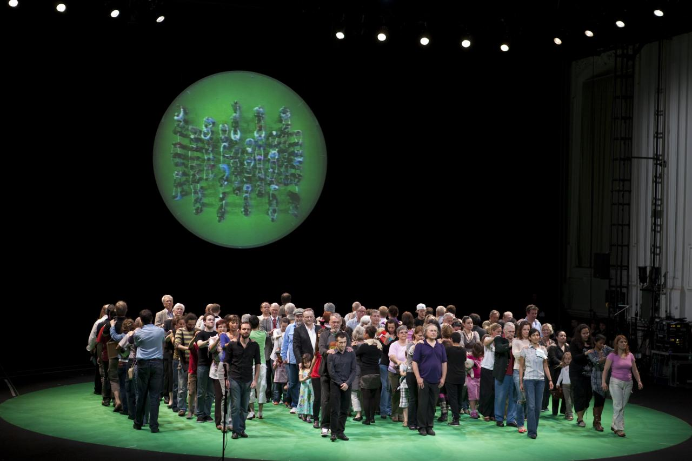
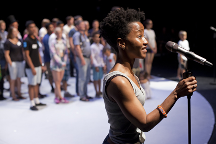
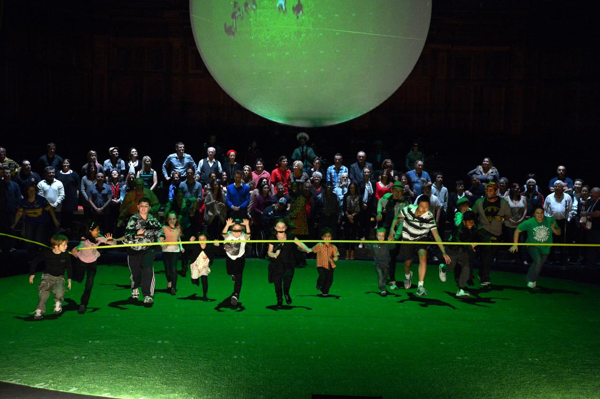
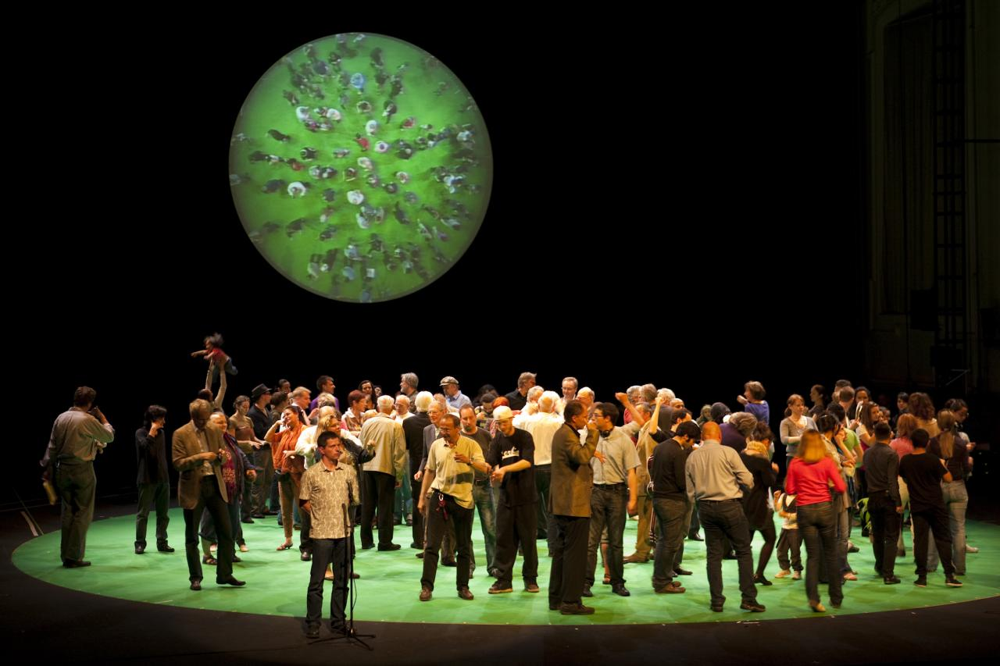

+++
author = "Yuichi Yazaki"
title = "100 Residents Become a Pie Chart on Stage: Rimini Protokoll's 100% City"
slug = "rimini-protokoll-100-percent-city"
date = "2026-11-05"
description = "Rimini Protokoll's 100% City is a theatre piece in which each resident stands for 1% of a city's population. Residents move around the stage according to their answers to questions, forming a pie chart out of human bodies."
categories = [
    "consume"
]
tags = [
    "data physicalization",
    "pie chart"
]
image = "images/cover.jpg"
+++

Rimini Protokoll's *100% City* is a theatre piece in which each resident stands for 1% of a city's population. One hundred residents, gathered to match the city's statistics, stand on stage. They move around the stage according to their answers to questions, and in front of the audience they form a pie chart out of human bodies.

The creators are three people: Helgard Haug, Stefan Kaegi and Daniel Wetzel. The piece premiered as *100% Berlin* at HAU 1 in Berlin on 1 February 2008. It was then remade for each city and staged in many places, and in Japan *100% Tokyo* (*100％トーキョー*) was performed in 2013. What follows draws on the official pages, interviews with the creators, the F/T day-of program, reviews and papers.

<!--more-->

## 2008: Starting as a Celebration of a Theatre's 100th Year

*100% Berlin* was created to celebrate the 100th anniversary of the Hebbel Theater. Its subtitle is "A Statistical Chain Reaction." It ran at HAU 1 on 1–3 February and 16–18 May 2008.

Haug recalled in a 2018 interview that touring had not been planned.

> In the beginning, the show was not intended to be a touring project. … finally, we realised the potential of "working locally but comparing globally"

In other words: at first it was not meant to tour, and in the end they realised the potential of working locally and comparing globally. The number of cities where the piece has been staged differs from source to source.

| When | Number given | Source |
|---|---|---|
| 2013 | "more than 10 places in Europe, Australia and North America" (Japanese: 「欧・豪・北米で10カ所以上」) | Katsura Mana, F/T13 day-of program (*F/T13 tōjitsu panfuretto*) |
| July 2013 | "nearly 20 cities" | Peter Crawley, *The Irish Times* |
| 2015 | "23 cities" | *Contemporary Theatre Review* |
| February 2018 | "34 different cities" | Haug, LitNet interview |
| 2020 | "over 40 cities" | HAU, "100% Berlin reloaded" |
| 2024 | "41 Städten" (41 cities) | Anja Quickert, paper |
| Accessed November 2026 | "more than 35 cities" | Rimini Protokoll official, "100% City" |
| November 2026, counted by the author | 40 cities (Berlin in 2008 to Oulu in 2026) | Performance list on the official "100% City" page |

The last row is the 42 entries on the official list minus Berlin reloaded (the 2020 revival) and Uni Marburg (a university version planned for 2027).

According to the tour materials, the running time is 110 minutes, and the piece needs a motorised revolving stage at least 10 m in diameter. A local team spends four to five months on casting, and the piece is normally performed three times.

Source: © Nurith Wagner-Strauss / Rimini Protokoll, "100% Vienna"

The creators' own writing also appears in the book *Making with Data* (edited by Huron, Nagel, Oehlberg and Willett; A K Peters/CRC Press, 2022). According to the book website's structure page, the second part, "Participation," includes a chapter "100% [City]" as the fourth piece after Cairn, SeeBoat and Let's Play with Data (chapter 2.4, pp. 147–162, doi:10.1201/9781003264903-9). I have not been able to read the chapter text, so its content is not covered here.

## One Person Is 1%, and a 24-Hour Chain Gathers the 100

One person on stage represents 1% of the city's population. How many people that is varies from city to city: about 34,000 in Berlin, about 16,935 in Vienna and about 41,000 in Melbourne.

There are rules for how the 100 are gathered. In the first Berlin production, the directors chose only the first person. Within 24 hours, that person introduced the next person from among their acquaintances, and so on until there were 100. In Stellenbosch, because of large gaps between regions, three chains were run in parallel. In some cities, the head of a statistics bureau or a statistics researcher was chosen as the first person.

The creators explain that they build the frame from five census criteria: age, gender, district, place of birth or origin, and household size or marital status. In the script for the first production, marital status was 46 single, 39 married, 6 widowed and 9 divorced.

Beyond those criteria, there are also hidden conditions. In Melbourne, eight conditions were added, including education, income, Indigenous status and sexual orientation. In a 2015 conversation, the creators also said they made sure that actors and theatre enthusiasts did not exceed the census proportion (1–2%).

The more the frame fills up, the harder the search becomes. The official Berlin page says that the closer they got to the end, the harder it was to find the next "link in the chain." In London, at the 37th person, they realised that there was not a single person of Pakistani heritage (*The Guardian*, 2012). When a chain breaks, they approach local organisations, schools and care homes for older people, and place advertisements in newspapers. The creators say they talk about this struggle on stage too.

> On stage we address the struggle to find people because it tells us something about the city, too.

That is, the struggle to find people also tells us something about the city.

Source: © Maja Nydal Eriksen / Rimini Protokoll, "100% Copenhagen"

At the start of the performance, the performers step up to the microphone one by one, in the order in which they were introduced, and introduce themselves. The order in which they line up on stage can be read as itself being the route along which the sample was gathered.

## Walking Beneath a Placard to Become a Pie Chart

The core of the performance is a yes-or-no question. Richard C. Windeyer recorded *100% Montréal* (2017) like this.

> In full view of the audience, each percentile stands beneath one of two placards—"Me/Not Me" and "Moi/Pas moi"— according to their answer for each question.

In short, for each question the performers stand beneath one of the two "Me/Not Me" placards in full view of the audience. For example, to the question "Who doesn't pay taxes?", four people stood on the "Me" side. The critic Katsura Mana wrote about *100% London* (2012) that the circle on the floor was divided into left and right along a diameter, and the performers walked to the right for Yes and to the left for No.

The number of people who gather becomes the proportion directly. The official page describes this scene as follows.

> A series of statistical groupings enacted onstage, like a giant pie chart brought to life.

In a 2015 conversation, the creators say that the answers to yes-or-no questions are turned into a "pie-chart" that becomes the starting point for political discussion.

Source: © Pigi Psimenou / Rimini Protokoll, "100% Melbourne"

Footage shot from directly overhead is also layered onto the stage. According to Windeyer's record of *100% Montréal*, a green platform on the floor was filmed by a camera directly above, and image processing replaced the green parts with radial charts, scatter plots and district maps, which were shown on a circular screen.

> Like in a Petri dish, you can look at how the individuals are moving and forming majorities and minorities.

Haug compares this footage to a Petri dish, saying you can see how individuals move and form majorities and minorities.

Source: © Nurith Wagner-Strauss / Rimini Protokoll, "100% Vienna"

For questions that are hard to answer in front of others, a different method is used. The lights are dimmed and each person raises a flashlight. The number of points of light is the number of people it applies to. When the same question, "Who doesn't pay taxes?", was asked in the dark in *100% Montréal*, more than ten lights came on. On the brightly lit stage, four people had stood on "Me." Windeyer calls this image a "luminous scatterplot of anonymized confession." In London, people earning £3,000 or more a month lit up their mobile phone screens.

The correspondences are summarised in a table.

| Data | How it appears on stage | Source |
|---|---|---|
| Population of the city | The 100 people on stage; one person is 1% of the population | Official pages |
| Population composition (five criteria) | Number of people cast; the number in each category is its proportion | Official pages, CTR 2015 |
| How the sample was gathered | Order of appearance; people introduce themselves in the order they were introduced | Haug 2018, Windeyer 2018 |
| Answers to yes-or-no questions | Standing position: the side of the "Me / Not Me" placards, or right and left of the circle | Windeyer 2018, Katsura 2013 |
| Proportion of answers | The number of people who gather; seen from directly above, a sector-shaped cluster | Official Melbourne page, CTR 2015 |
| Reading as a chart | Footage that replaces the green floor with a pie chart, scatter plot or district map | Windeyer 2018 |
| Answers that are hard to say in public | The number of flashlight or phone lights raised in the dark | Windeyer 2018, *The Guardian* 2012 |

**Laid out as a table, the correspondences fall into three stages.** At the casting stage, proportions are turned into numbers of people; during the performance, answers are turned into standing positions and clusters of people; and the footage lets the audience read those clusters as a chart. Because of that last stage, the same body can be seen as both a "person" and a "data point," or so it can be read.

## 2013: *100% Tokyo*

It was performed as part of Festival/Tokyo 13, from 29 November to 1 December 2013 at the Tokyo Metropolitan Theatre Playhouse. It was directed by Daniel Wetzel and performed in Japanese.

The F/T introduction describes the work as a "live opinion-survey theatre for 100 citizens gathered on the basis of Tokyo's population statistics" (Japanese: 「東京の人口統計に基づいて集められた100人の市民への、ライブ意識調査演劇」). The 100 people were said to "embody the 'standard' of the 9,055,257 people living in Tokyo's 23 wards" (Japanese: 「東京２３区に住む9055257人の『標準』を体現する」). One person corresponds to about 90,553 people. The official English page says:

> this cross-section of the society could tell the truth of modern Tokyo life in a way graphs or pie-charts never could.

That is, this cross-section of society could tell the truth of modern Tokyo life in a way that graphs or pie charts never could.

The statistical adviser was Nakamura Kazuyuki. In his interview in the program, Nakamura said he chose items by whether they "could be looked up." He left out smartphone penetration because "penetration" is hard to define, and left out educational background because there are many "no answer" responses. He also said that, from the standpoint of statistics, 100 people is not enough of a sample.

According to Katsura Mana's contribution, 3% of the residents of the 23 wards are foreign nationals, so 3 of the 100 people were foreigners. The breakdown was 1% each for "Koreans, Chinese and others." Katsura calls the Tokyo production "the Asian premiere of the series on the theme of cities" (Japanese: 「都市をテーマに置くシリーズのアジア初演」). The only Japanese city on the official list is Tokyo.

## How Third Parties Viewed the Work

Eddie Paterson discussed *100% Melbourne* in his 2016 paper "Bodies of Data." He reads the Petri dish footage as an expression of scale that moves between census figures, bodies on stage and a cell-like swarm. At the same time, he writes that the work traces the grid of the census.

> by staging official population data onstage, Rimini's performance visualises the grid-logic of the State.

That is, by staging official population data, the work makes visible the grid-logic of the State. Paterson notes that although there is a place near the venue where people sleeping rough gather, there were no rough sleepers on stage.

Windeyer questioned the veracity of the data. In *100% Montréal*, more than ten people raised their hands to the question "Who lied tonight?" The question is how the veracity of statistics can be guaranteed if the answers themselves cannot be trusted. He also records that Indigenous people make up less than 1% of the population, so they were not given a dedicated slot and were not visible on stage.

In his review in *The Irish Times*, Peter Crawley enjoyed the staging technique but criticised the sameness of the form. There is no message and no commentary, only questions. The form has been honed over five years and nearly 20 cities, and is hardly different in Dresden or in Tokyo, he says. He also writes that in Cork they were unable to get participants from wealthy districts or from the large Polish community.

Douglas Eacho, in the abstract of his 2018 paper, reads the work as nostalgia for nineteenth-century statistical reason and contrasts it with the algorithmic counting of big data. I have not read the main text.

## Takeaways

The first thing to take away is to attach one face to one mark. A sector on the stage is a cluster of people, and each of them introduced themselves at the start. The creators say that the audience follows a chain of a few people's answers rather than the whole city. A design that shows the aggregate and the individual on the same screen can be tried in visualizations of people too.

Next is to show how the sample was made. In *100% City*, the 24-hour chain and the people who could not be found are told as part of the performance. In a visualization too, you can put near the chart where the numbers were collected from and who is missing.

Third, the number changes when the way of answering changes. In Montréal, an answer given by four people on the lit stage became more than ten in the dark. From the two numbers, it can be read that the survey method is part of the result.

Finally, keep a count of what cannot be put in a chart. Nakamura Kazuyuki said he chose only the items that could be looked up, and that 100 people is not enough of a sample. Paterson and Windeyer pointed to the people who are not on stage. Noting what was counted and what was not can be read as a clue for reading a chart made with human bodies.

## References

**Primary sources**

- Rimini Protokoll, "100% City" (overview and performance list): https://www.rimini-protokoll.de/website/en/projects/100-stadt-7-1
- Rimini Protokoll, "100% CITY" tour portfolio PDF: https://www.rimini-protokoll.de/website/media/Touringportfolios/Portfolio_100%25.pdf
- Rimini Protokoll, "100% Berlin": https://www.rimini-protokoll.de/website/en/project/100-prozent-berlin
- Rimini Protokoll, "100% Berlin reloaded": https://www.rimini-protokoll.de/website/en/project/100-berlin-reloaded
- Rimini Protokoll, "100% Vienna": https://www.rimini-protokoll.de/website/en/project/100-prozent-wien
- Rimini Protokoll, "100% Melbourne": https://www.rimini-protokoll.de/website/en/project/100-percent-melbourne (making-of video: https://vimeo.com/53318534 )
- Rimini Protokoll, "100% Copenhagen": https://www.rimini-protokoll.de/website/en/project/100-kopenhagen
- Rimini Protokoll, "100% London": https://www.rimini-protokoll.de/website/en/project/100-london
- Rimini Protokoll, "100% Tokyo": https://www.rimini-protokoll.de/website/en/project/100-tokyo
- Rimini Protokoll, "100% Montréal": https://www.rimini-protokoll.de/website/en/project/100-montreal (documentation video: https://vimeo.com/224155970 )
- Interview with Helgard Haug, "100% Stellenbosch: A whole town on a stage," LitNet, 2018-02-23 (reprinted by RP): https://www.rimini-protokoll.de/website/en/text/100-stellenbosch-a-whole-town-on-a-stage
- Conversation between Rimini Protokoll and Daniel Koczy, "'…faces behind the numbers'," *Contemporary Theatre Review*, 2015: https://contemporarytheatrereview.org/2015/rimini-protokoll-100-percent-city/
- Interview with Haug and Kaegi, "Tableaux vivants," Goethe-Institut Canada, 2017 (reprinted by RP): https://www.rimini-protokoll.de/website/en/text/tableaux-vivants
- HAU Hebbel am Ufer, "100% Berlin reloaded": https://www.hebbel-am-ufer.de/en/programme/pdetail/rimini-protokoll-haug-kaegi-wetzel-100-berlin-reloaded/
- Festival/Tokyo 13, *100％トーキョー* (*100% Tokyo*) program page: https://www.festival-tokyo.jp/13/program/13/100percent_tokyo/
- Same, day-of program PDF (*Tōjitsu panfuretto*; includes the interview with Nakamura Kazuyuki and the contribution by Katsura Mana): https://www.festival-tokyo.jp/13/program/13/pdf/FT13_TP_100%25tokyo_web.pdf
- Rimini Protokoll, "100% [City]," in Huron, Nagel, Oehlberg, Willett (eds.), *Making with Data: Physical Design and Craft in a Data-Driven World*, A K Peters/CRC Press, 2022, ch. 2.4, pp. 147–162 (chapter text not checked): https://doi.org/10.1201/9781003264903-9
- Making with Data, "Structure" (the book's parts and chapters): https://makingwithdata.org/blog/structure
- dataphys.org, "2008 – 100% City": https://dataphys.org/list/100-city/

**Secondary sources**

- Eddie Paterson, "Bodies of Data: Informatics in Contemporary Performance," *Performance Paradigm* 12, 2016: https://performanceparadigm.net/index.php/journal/article/download/178/174
- Richard C. Windeyer, "Petri Dish Deceptions: The Search for 100% Veracity in Rimini Protokoll's Statistical Portrait of Montreal," *Canadian Theatre Review*, 2018 (reprinted by RP): https://www.rimini-protokoll.de/website/en/text/petri-dish-deceptions-the-search-for-100-veracity-in-rimini-protokoll-s-statistical-portrait-of-montreal
- Peter Crawley, "Cork's vital statistics," *The Irish Times*, 2013-07-02 (reprinted by RP): https://www.rimini-protokoll.de/website/en/text/cork-s-vital-statistics-1
- Sarfraz Manzoor, "100% London tells the capital's story through its inhabitants," *The Guardian*, 2012 (reprinted by RP): https://www.rimini-protokoll.de/website/en/text/100-london-tells-the-capital-s-story-through-its-inhabitants
- Douglas Eacho, "Serial Nostalgia: Rimini Protokoll's 100% City and the Numbers We No Longer Are," *Theatre Research International* 43(2), 2018, pp. 185–200 (abstract only checked). doi:10.1017/S0307883318000299 / https://www.cambridge.org/core/journals/theatre-research-international/article/abs/serial-nostalgia-rimini-protokolls-100-city-and-the-numbers-we-no-longer-are/DA0D36242D6CB84BE8C8789935EAB8D6
- Anja Quickert, "Theatrale Feldforschungen: Welt," in *Struktur und Ästhetik*, Narr Francke Attempto, 2024, pp. 149–176: https://www.rimini-protokoll.de/website/media/100prozent/strukturundaesthetik_Anja%20Quickert.pdf
