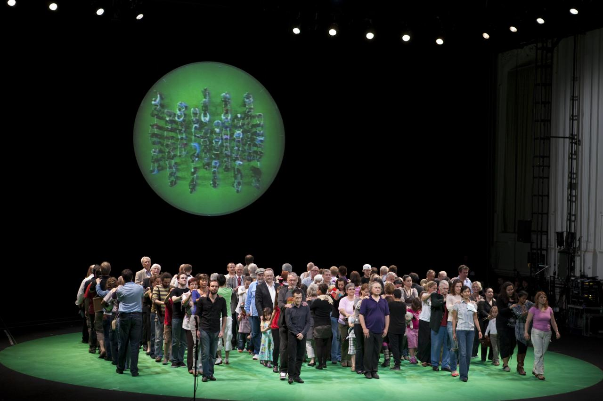
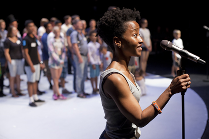
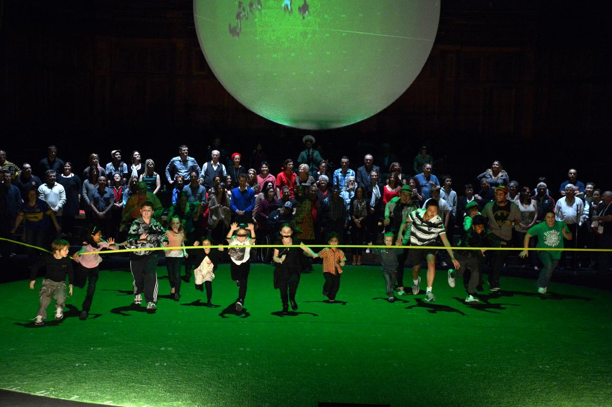
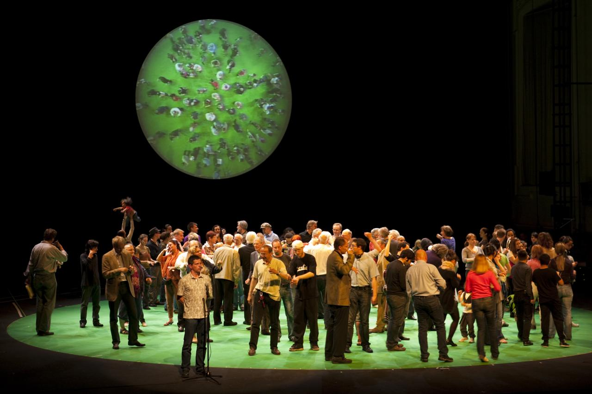

+++
author = "矢崎裕一"
title = "住民100人が、舞台の上で円グラフになる──Rimini Protokoll『100% City』"
slug = "rimini-protokoll-100-percent-city"
date = "2026-11-05"
description = "Rimini Protokoll の『100% City』は、都市の人口の1%を住民1人に置き換える演劇です。住民は問いへの答えに応じて舞台を移動し、人の体で円グラフをつくります。"
categories = [
    "consume"
]
tags = [
    "データ物質化",
    "円グラフ"
]
image = "images/cover.jpg"
series = ["data-physicalization"]
series_weight = 99
seriesByline = "Rimini Protokoll（Haug・Kaegi・Wetzel）"
seriesTitle = "人口の1%を1人に、住民100人で円グラフ──100% City"
+++

Rimini Protokoll（リミニ・プロトコル）の『100% City』は、都市の人口の1%を住民1人に置き換える演劇です。舞台には、その都市の統計に合わせて集めた住民100人が立ちます。住民は問いへの答えに応じて舞台上を移動し、観客の前で人の体による円グラフをつくります。

作者は Helgard Haug（ヘルガルト・ハウグ）、Stefan Kaegi（シュテファン・ケーギ）、Daniel Wetzel（ダニエル・ヴェッツェル）の3人です。初演は2008年2月1日、ベルリンの HAU 1 での『100% Berlin』でした。その後、都市ごとに作り直して各地で上演され、日本では2013年に『100％トーキョー』が上演されています。以下は、公式ページ、作者のインタビュー、F/T の当日パンフレット、劇評と論文に沿います。

<!--more-->

## 2008年、劇場の100年を祝う企画から始まる

『100% Berlin』は、ベルリンの Hebbel Theater の開館100年を祝う企画として作られました。副題は「A Statistical Chain Reaction（統計の連鎖反応）」です。上演は2008年2月1〜3日と5月16〜18日、HAU 1 でした。

巡回する予定はなかった、と Haug は2018年のインタビューで振り返っています。

> In the beginning, the show was not intended to be a touring project. … finally, we realised the potential of "working locally but comparing globally"

はじめは巡回公演のつもりはなかった。最後には「地元で作り、世界で比べる」ことの可能性に気づいた、という言葉です。上演した都市の数は、資料によって違います。

| 時点 | 書かれている数 | 出典 |
|---|---|---|
| 2013年 | 「欧・豪・北米で10カ所以上」 | 桂真菜、F/T13 当日パンフレット |
| 2013年7月 | 「nearly 20 cities」 | Peter Crawley、*The Irish Times* |
| 2015年 | 「23 cities」 | *Contemporary Theatre Review* |
| 2018年2月 | 「34 different cities」 | Haug、LitNet のインタビュー |
| 2020年 | 「over 40 cities」 | HAU「100% Berlin reloaded」 |
| 2024年 | 「41 Städten」 | Anja Quickert の論文 |
| 2026年11月閲覧 | 「more than 35 cities」 | Rimini Protokoll 公式「100% City」 |
| 2026年11月、筆者が数えた数 | 都市40（2008年 Berlin〜2026年 Oulu） | 公式「100% City」の上演一覧 |

最後の行は、公式一覧の「100% ○○」42件から、2020年の Berlin reloaded（再演）と、2027年予定の Uni Marburg（大学版）を除いた数です。

ツアー資料によれば、上演時間は110分で、直径10m以上の電動回転舞台が要ります。地元のチームが4〜5か月かけて配役し、通常3回上演します。

© Nurith Wagner-Strauss／Rimini Protokoll「100% Vienna」より引用

作者自身の文章は、書籍『Making with Data』（Samuel Huron、Till Nagel、Lora Oehlberg、Wesley Willett 編、A K Peters/CRC Press、2022）にも載っています。第2部「Participation」の章2.4「100% [City]」（pp. 147–162、doi:10.1201/9781003264903-9）で、著者は Rimini Protokoll です。章の本文は読めていないので、中身はここでは扱いません。

## 1人を1%にして、24時間の連鎖で100人を集める

舞台の1人は、その都市の人口の1%を表します。1人が何人ぶんかは都市で変わり、Berlin では約34,000人、Vienna では約16,935人、Melbourne では約41,000人でした。

100人の集め方には決まりがあります。演出側が選ぶのは1人目だけです。その人が24時間以内に、知り合いから次の1人を紹介し、これを100人まで続けます。1人目には、統計局の長や統計の研究者が選ばれた都市もあります。

作者側は、国勢調査の5つの基準で枠を作ると説明しています。年齢、性別、地区、出生地または出身、世帯規模または婚姻状態です。初演の台本では、婚姻状態は未婚46人、既婚39人、死別6人、離別9人でした。

基準のほかに、隠れた条件もあります。Melbourne では、学歴、所得、先住民、性的指向など8つの条件が加えられました。作者は2015年の対談で、俳優や演劇好きが国勢調査の比率（1〜2%）を超えないようにした、とも話しています。

枠が埋まるほど、人探しは難しくなります。公式の Berlin のページは、終わりに近づくほど次の「鎖の輪」を探すのが難しくなったと書いています。London では37人目の時点で、パキスタン系の人が一人もいないと分かりました（*The Guardian*、2012）。鎖が切れたときは、地域の団体や学校、高齢者施設をあたり、新聞に広告を出します。作者はこの苦労を舞台でも語ると言います。

> On stage we address the struggle to find people because it tells us something about the city, too.

人探しの苦労も、その都市について何かを語るからだ、という言葉です。

© Maja Nydal Eriksen／Rimini Protokoll「100% Copenhagen」より引用

上演の冒頭では、紹介された順に一人ずつマイクの前に出て、自己紹介をします。各自が大切な物を一つ持ってくる上演もありました。舞台に並ぶ順番そのものが、標本を集めた経路になっている、と読めます。

## 札の下へ歩き、円グラフになる

上演の中心は、二択の問いです。Richard C. Windeyer（リチャード・ウィンデヤー）は、2017年の『100% Montréal』をこう記録しています。

> In full view of the audience, each percentile stands beneath one of two placards—"Me/Not Me" and "Moi/Pas moi"— according to their answer for each question.

観客の目の前で、出演者は問いごとに「Me/Not Me」の札のどちらかの下に立つ、という記述です。たとえば「税金を払っていないのは誰か」という問いには、4人が「Me」の側に立ちました。評論家の桂真菜は、2012年の『100% London』で、床の円を直径で左右に分け、Yes なら右、No なら左に歩いたと書いています。

集まった人数が、そのまま割合になります。公式ページは、この場面を次のように書きます。

> A series of statistical groupings enacted onstage, like a giant pie chart brought to life.

統計の分類を次々と舞台で演じる、生きた巨大な円グラフのよう、という説明です。作者は2015年の対談で、二択の答えを「pie-chart」に変え、政治的な議論のきっかけにすると話しています。

© Pigi Psimenou／Rimini Protokoll「100% Melbourne」より引用

舞台には、真上から撮る映像も重なります。Windeyer によれば、緑の回転舞台を真上のカメラで撮り、映像処理で緑の部分を、放射状のグラフや散布図、地区の地図に置き換えて、円形のスクリーンに映します。

> Like in a Petri dish, you can look at how the individuals are moving and forming majorities and minorities.

Haug はこの映像をシャーレにたとえ、個人が動いて多数派と少数派をつくる様子が見える、と話しています。

© Nurith Wagner-Strauss／Rimini Protokoll「100% Vienna」より引用

人前では答えにくい問いには、別の方法を使います。照明を落とし、各自が懐中電灯を掲げます。光の点の数が、該当する人数です。『100% Montréal』で同じ「税金を払っていないのは誰か」を暗がりで問うと、十数本の灯りがともりました。明るい舞台で「Me」に立ったのは4人でした。Windeyer はこの映像を「luminous scatterplot of anonymized confession（匿名の告白の、光る散布図）」と書いています。London では、月収3,000ポンド以上の人が携帯電話の画面を光らせました。

対応を表にまとめます。

| データ | 舞台での表し方 | 出典 |
|---|---|---|
| 都市の人口 | 舞台に立つ100人。1人が人口の1% | 公式各ページ |
| 人口構成（5つの基準） | 配役の人数。各分類の人数がその割合 | 公式各ページ、CTR 2015 |
| 標本の集め方 | 登場の順番。紹介された順に自己紹介する | Haug 2018、Windeyer 2018 |
| 二択の問いへの答え | 立ち位置。「Me / Not Me」の札の側、または円の右と左 | Windeyer 2018、桂 2013 |
| 答えの割合 | 集まった人の数。真上から見ると扇形の固まり | 公式 Melbourne、CTR 2015 |
| 図表としての読み | 緑の床を、円グラフ、散布図、地区の地図に置き換えた映像 | Windeyer 2018 |
| 人前で言いにくい答え | 暗がりで掲げる懐中電灯や携帯電話の光の数 | Windeyer 2018、*The Guardian* 2012 |

**表にすると、対応は三つの段に分かれて見えます。** 配役の段で割合を人数に変え、上演中に答えを立ち位置と人の固まりに変え、映像でその固まりを図表として読ませる、という段です。最後の段があるので、同じ体が「人」と「データ点」の両方に見える、と読めます。

## 2013年、『100％トーキョー』

日本での上演は『100％トーキョー』です。フェスティバル/トーキョー13の演目として、2013年11月29日〜12月1日に東京芸術劇場プレイハウスで上演されました。演出はダニエル・ヴェッツェル、上演は日本語です。

F/T の紹介文は、作品を「東京の人口統計に基づいて集められた100人の市民への、ライブ意識調査演劇」と書いています。100人は「東京２３区に住む9055257人の『標準』を体現する」とされました。1人は約90,553人にあたります。公式の英語ページは、こう書きます。

> this cross-section of the society could tell the truth of modern Tokyo life in a way graphs or pie-charts never could.

社会のこの断面は、グラフや円グラフにはできない形で、現代の東京の暮らしの真実を語りうる、という一文です。

統計アドバイザーは中村和幸です。中村はパンフレットのインタビューで、項目を「調べられるかどうか」で選んだと話しています。スマートフォンの普及率は「普及」の定義が決めにくいので採らず、学歴は「無回答」が多いので採らなかった。基準の地区には、いちばん身近な区分として「23区」を採りました。そのうえで、統計学の観点からは100人ではサンプル数が足りない、とも述べています。

桂真菜の寄稿によれば、23区の住民の3%が外国人なので、100人のうち3人が外国人です。その内訳は「韓国人、中国人、その他」が1%ずつでした。桂は東京版を「都市をテーマに置くシリーズのアジア初演」と書いています。公式一覧に載る日本の都市は、Tokyo だけです。

## 第三者はこの作品をどう見たか

Eddie Paterson（エディ・パターソン）は、2016年の論文 "Bodies of Data" で『100% Melbourne』を論じました。シャーレの映像は、国勢調査の数字、舞台の体、細胞のような群れのあいだを行き来する、尺度の表現だと読んでいます。一方で、作品は国勢調査の格子をなぞっているとも書きます。

> by staging official population data onstage, Rimini's performance visualises the grid-logic of the State.

公式の人口データを舞台に載せることで、作品は国家の格子の論理を可視化している、という指摘です。会場の近くには路上生活者が集まる場所があるのに、舞台に路上生活者はいなかった、と Paterson は記しています。

Windeyer は、データの真実性を問いました。『100% Montréal』では「今夜うそをついたのは誰か」という問いに、十数人が手を挙げました。答えそのものが信用できないなら、統計の真実性はどう保証されるのか、という問いです。先住民は人口の1%に満たないため専用の枠がつかず、舞台に見えなかったとも記録しています。

*The Irish Times* の劇評で、Peter Crawley（ピーター・クローリー）は演出の技法を楽しみつつ、形式の変わらなさを批判しました。メッセージも論評もなく、問いがあるだけ。形式は5年と20近い都市で磨かれ、Dresden でも Tokyo でもほとんど変わらない、という評です。Cork では、裕福な地区や大きなポーランド系のコミュニティから参加者を得られなかった、とも書いています。

Douglas Eacho（ダグラス・イーコー）は2018年の論文の要旨で、作品を19世紀の統計的理性への郷愁と読み、ビッグデータによるアルゴリズム的な数え方と対比しています。本文は未読です。

## 使い道

持ち帰れることの一つ目は、1つのマークに1人の顔をつけることです。舞台の扇形は人の固まりで、その一人ひとりが冒頭で名乗っています。作者側は、観客が都市全体よりも、数人の答えの連なりを追うと話しています。集計と個人を同じ画面で見せる設計は、人を扱うデータの可視化でも試せると読めます。

次に、標本の作り方を見せることです。『100% City』では、24時間の連鎖も、見つからなかった人も、上演の一部として語られます。可視化でも、どこから集めた数か、誰が欠けているかを、図の近くに置けます。

三つ目は、答え方を変えると数が変わることです。Montréal では、明るい舞台で4人だった答えが、暗がりでは十数人になりました。調査の方法も結果の一部だと、2つの数が示しています。

最後に、図にできないものを数えておくことです。中村和幸は、調べられる項目だけを選び、100人ではサンプルが足りないと述べました。Paterson と Windeyer は、舞台にいない人を指摘しました。何を数え、何を数えなかったかを書き添えることが、人の体を使った図を読む手がかりになる、と読めます。

## 参考・出典

**一次情報**

- Rimini Protokoll「100% City」（概要と上演一覧）：https://www.rimini-protokoll.de/website/en/projects/100-stadt-7-1
- Rimini Protokoll「100% CITY」ツアー資料 PDF：https://www.rimini-protokoll.de/website/media/Touringportfolios/Portfolio_100%25.pdf
- Rimini Protokoll「100% Berlin」：https://www.rimini-protokoll.de/website/en/project/100-prozent-berlin
- Rimini Protokoll「100% Berlin reloaded」：https://www.rimini-protokoll.de/website/en/project/100-berlin-reloaded
- Rimini Protokoll「100% Vienna」：https://www.rimini-protokoll.de/website/en/project/100-prozent-wien
- Rimini Protokoll「100% Melbourne」：https://www.rimini-protokoll.de/website/en/project/100-percent-melbourne （メイキング映像：https://vimeo.com/53318534 ）
- Rimini Protokoll「100% Copenhagen」：https://www.rimini-protokoll.de/website/en/project/100-kopenhagen
- Rimini Protokoll「100% London」：https://www.rimini-protokoll.de/website/en/project/100-london
- Rimini Protokoll「100% Tokyo」：https://www.rimini-protokoll.de/website/en/project/100-tokyo
- Rimini Protokoll「100% Montréal」：https://www.rimini-protokoll.de/website/en/project/100-montreal （記録映像：https://vimeo.com/224155970 ）
- Helgard Haug のインタビュー「100% Stellenbosch: A whole town on a stage」LitNet、2018-02-23（RP 転載）：https://www.rimini-protokoll.de/website/en/text/100-stellenbosch-a-whole-town-on-a-stage
- Rimini Protokoll と Daniel Koczy の対談「'…faces behind the numbers'」*Contemporary Theatre Review*、2015：https://contemporarytheatrereview.org/2015/rimini-protokoll-100-percent-city/
- Haug・Kaegi のインタビュー「Tableaux vivants」Goethe-Institut Kanada、2017（RP 転載）：https://www.rimini-protokoll.de/website/en/text/tableaux-vivants
- HAU Hebbel am Ufer「100% Berlin reloaded」：https://www.hebbel-am-ufer.de/en/programme/pdetail/rimini-protokoll-haug-kaegi-wetzel-100-berlin-reloaded/
- フェスティバル/トーキョー13『100％トーキョー』プログラムページ：https://www.festival-tokyo.jp/13/program/13/100percent_tokyo/
- 同 当日パンフレット PDF（中村和幸のインタビュー、桂真菜の寄稿を含む）：https://www.festival-tokyo.jp/13/program/13/pdf/FT13_TP_100%25tokyo_web.pdf
- Rimini Protokoll, "100% [City]," in Huron, Nagel, Oehlberg, Willett (eds.), *Making with Data: Physical Design and Craft in a Data-Driven World*, A K Peters/CRC Press, 2022, ch. 2.4, pp. 147–162（章の本文は未確認）：https://doi.org/10.1201/9781003264903-9
- dataphys.org「2008 – 100% City」：https://dataphys.org/list/100-city/

**第三者評価**

- Eddie Paterson, "Bodies of Data: Informatics in Contemporary Performance," *Performance Paradigm* 12, 2016：https://performanceparadigm.net/index.php/journal/article/download/178/174
- Richard C. Windeyer, "Petri Dish Deceptions: The Search for 100% Veracity in Rimini Protokoll's Statistical Portrait of Montreal," *Canadian Theatre Review*, 2018（RP 転載）：https://www.rimini-protokoll.de/website/en/text/petri-dish-deceptions-the-search-for-100-veracity-in-rimini-protokoll-s-statistical-portrait-of-montreal
- Peter Crawley, "Cork's vital statistics," *The Irish Times*, 2013-07-02（RP 転載）：https://www.rimini-protokoll.de/website/en/text/cork-s-vital-statistics-1
- Sarfraz Manzoor, "100% London tells the capital's story through its inhabitants," *The Guardian*, 2012（RP 転載）：https://www.rimini-protokoll.de/website/en/text/100-london-tells-the-capital-s-story-through-its-inhabitants
- Douglas Eacho, "Serial Nostalgia: Rimini Protokoll's 100% City and the Numbers We No Longer Are," *Theatre Research International* 43(2), 2018, pp. 185–200（要旨のみ確認）. doi:10.1017/S0307883318000299 ／ https://www.cambridge.org/core/journals/theatre-research-international/article/abs/serial-nostalgia-rimini-protokolls-100-city-and-the-numbers-we-no-longer-are/DA0D36242D6CB84BE8C8789935EAB8D6
- Anja Quickert, "Theatrale Feldforschungen: Welt," in *Struktur und Ästhetik*, Narr Francke Attempto, 2024, pp. 149–176：https://www.rimini-protokoll.de/website/media/100prozent/strukturundaesthetik_Anja%20Quickert.pdf
