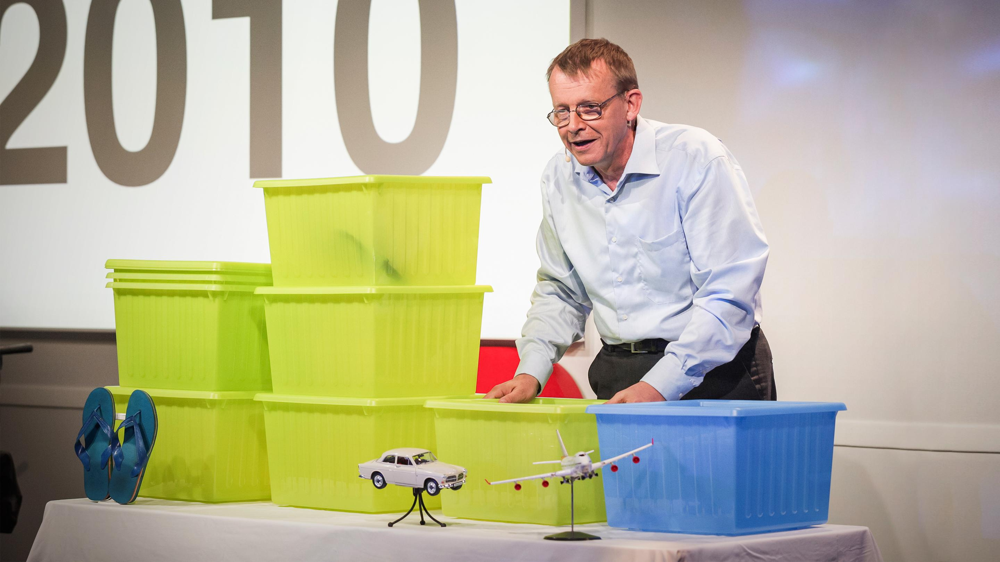
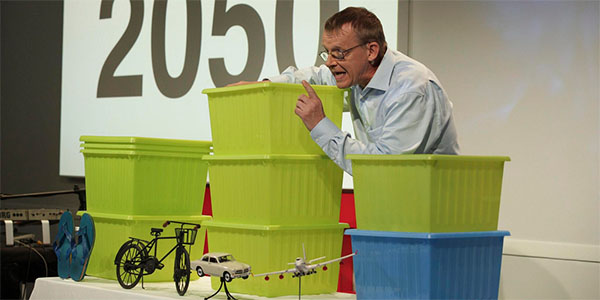
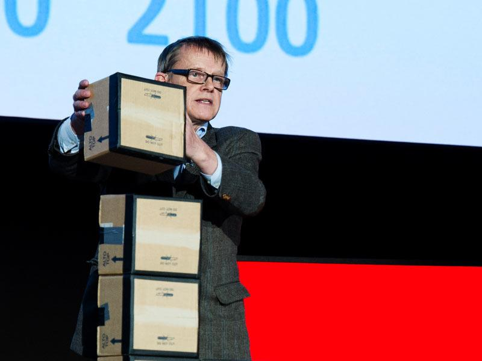
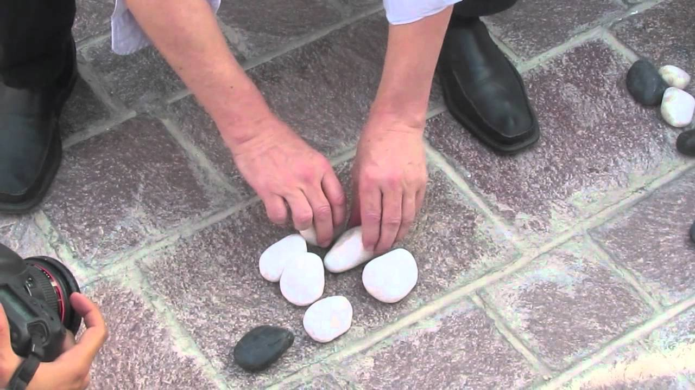

+++
author = "Yuichi Yazaki"
title = "One IKEA Box for a Billion People: Hans Rosling's Physical Visualizations"
slug = "rosling-physical-visualizations"
date = "2026-11-03"
description = "At TED@Cannes in 2010, Rosling treated one IKEA box as one billion people, lined the boxes up along income levels, and moved them by hand. In the second half of the talk he switched to an animated bubble chart."
categories = [
    "consume"
]
tags = [
    "data physicalization",
    "bubble chart"
]
image = "images/ted-cannes-2010-ikea-boxes.jpg"
series = ["data-physicalization"]
series_weight = 20
seriesByline = "Hans Rosling and Ola Rosling"
seriesTitle = "One Box as a Billion People, Rearranged: Rosling's Boxes"
+++

On June 21, 2010, at TED@Cannes in Cannes, Hans Rosling represented the world's population with boxes, using the rule "one IKEA box = one billion people." He lined the boxes up horizontally along levels of income and moved them by hand as the years advanced: 1960, 2010, 2050. In the second half of the same talk, from 6:08, he switched to an animated bubble chart on the screen.

The source is the transcript of the talk "Global population growth, box by box" (9 min 47 s), published by TED. dataphys.org, a catalog of physical visualizations collected by researchers, treats this talk as the starting point and gathers the later talks and videos in which Rosling used physical objects into a single entry. The entry was submitted by Pierre Dragicevic and Yvonne Jansen. Below, I follow the 2010 talk in chronological order and cover the later examples only to the extent they could be confirmed.

<!--more-->

## June 2010: IKEA boxes on the stage in Cannes

Rosling was a Swedish physician, a professor of international health at the Karolinska Institute, and a co-founder of Gapminder. According to dataphys, the technology and staging of the talk were handled by his son, Ola Rosling.

The 2010 talk begins with a joke.

> I'm going to talk now about how world population has changed from that year and into the future, but I will not use digital technology, as I've done during my first five TEDTalks. Instead, I have progressed, and I am, today, launching a brand new analog teaching technology that I picked up from IKEA: this box.

The preamble: he used digital technology in his first five TED talks, but today he will use a "new analog teaching technology" he found at IKEA, namely this box.

He then says, "This box contains one billion people," and recreates the world of 1960 as he heard about it from a schoolteacher. The developed countries hold one billion people and the developing countries two billion. Families in the developed countries save up to buy a Volvo; families in the developing countries save for the day's food and for a single pair of shoes. What a family wants to get becomes the marker for where a box is placed.

Source: TED, "Global population growth, box by box"

## Moving the boxes from 1960 to 2050

A box's horizontal position is a level of living. Small objects mark the levels: shoes, a bicycle, a car, an airplane. infosthetics (July 2010) describes these as "miniature icons of living conditions."

Advancing to 2010, there are seven boxes, because four billion people were added in 50 years. The West's one billion moves to the airplane position. The developing countries that have grown move to the car position. The biggest pile is the three billion at the bicycle position. And at the shoe position, two billion people remain, about as poor as they were 50 years earlier. Rosling says:

> But there is a continuous world from walking, biking, driving, flying -- there are people on all levels, and most people tend to be somewhere in the middle.

In short: the world is continuous from walking through biking and driving to flying, and most people are somewhere in the middle.

He moves the boxes for the 2050 outlook as well. China and others move to the airplane position. The poorest two billion grow to three or four billion. But if they escape poverty and children survive, population growth stops in 2050. The number and position of the boxes show this conditional outlook.

Source: TED (talk video) / dataphys.org, "Hans Rosling Adopts Physical Visualizations"

The colors of the boxes carry meaning too. At the end of the talk, Rosling calls the developed countries "this blue box." The CHI 2015 paper by Jansen et al. describes this scene as "rich countries = blue box, poor countries = green box."

## At 6:08, the bubble chart on the screen

In the second half of the talk, Rosling moves from the boxes to the screen.

> And let me show you why by converting back to the old-time digital technology. Here I have on the screen my country bubbles. Every bubble is a country. The size is population.

He says he will show why this happens using "old-time digital technology," turning the opening joke around. Each bubble on the screen is one country; its size is population and its color is continent. The vertical axis is the number of children per woman, and the horizontal axis is the share of children who survive to school age. Advancing the years from 1960, the motion shows child survival rising and family sizes shrinking.

At 7:47, Rosling ties the boxes to the bubbles.

> Can you see the poorest billion, those [two] boxes I had over here? They are still up here.

The point: the boxes of the poorest people, which he placed over there earlier, are still up here (at the position with many children). His conclusion was that raising child survival to 90% is the only way to stop population growth.

Putting the encodings of the first and second halves side by side gives the following.

| | First half: IKEA boxes | Second half: bubble chart |
|---|---|---|
| What one mark represents | One billion people | One country |
| Quantity | Number of boxes | Bubble size (population) |
| Horizontal position | Level of living (marked by small objects: shoes, bicycle, car, airplane) | Child survival rate |
| Vertical position | None (boxes at the same level are stacked) | Children per woman |
| Color | Blue = developed (rich) countries, green = poor countries (as described in the CHI 2015 paper) | Continent |
| Time | Boxes moved by hand (1960 → 2010 → 2050) | Animation (1960 → present) |

What the boxes in the first half show is the magnitude and composition: how many billions of people are at which level. The bubbles in the second half track 50 years of change country by country along two axes. Within a single talk, he can be read as **dividing the roles between the physical visualization and the animation**. The sentence at 7:47 can be read as a bridge that hands the "billion-person blocks" counted in the first half over to the cloud of country dots in the second.

## Later boxes, and other materials

dataphys's description begins with stacking IKEA boxes in 2010 and says that he later "switched" to pebbles, building toys, juice, snowballs, and toilet paper. He did not, however, give up boxes.

On April 16, 2012, at TEDxSummit in Doha, Qatar, Rosling gave "Religions and babies." This time the order is reversed. At 2:20 he shows the bubble chart first and changes the color to "the majority religion of each country." The boxes appear at 10:25.

> I will use these card boxes in which your notebooks came. They are quite useful for educational purposes. Each card box is one billion people.

He declares that he will use the cardboard boxes the notebooks handed out at the venue came in, with one box standing for one billion people. The boxes are stacked vertically by age group: 0 to 15 years, two billion; 15 to 30, two billion; 30 to 45, one billion; 45 to 60, almost one billion; 60 and over, one billion. Rosling notes, "These are rounded numbers." The roughly three billion people missing from the upper age groups will fill in over time. He calls this "the big fill-up" and says the world will reach 10 billion.

Source: TED, "Religions and babies"

Here is a summary of how each material was used, as far as could be confirmed.

| Material | Occasion | What one piece represents | Second variable |
|---|---|---|---|
| IKEA storage box | TED@Cannes, 2010 | One billion people | Horizontal position = level of living |
| Cardboard box | TEDxSummit (Doha), 2012 | One billion people | Vertical stacking = age group |
| Stones | Interview during TEDxSummit, 2012 | Not confirmed | Income levels compared by means of transport |
| LEGO (DUPLO) blocks and buttons | The Guardian video, 2013 | Not confirmed | Not confirmed |
| Toilet paper | No specific talk or program identified | One billion people (as described by an eyewitness) | Age group (as described by an eyewitness) |

The stone example was improvised in an interview setting during TEDxSummit, and Herbert Reininger posted a video of under a minute on YouTube.

Source: Herbert Reininger (YouTube video) / dataphys.org, "Hans Rosling Adopts Physical Visualizations"

In a The Guardian video of May 17, 2013, he uses LEGO blocks to explain population growth, child mortality, and CO2 emissions, according to the video's description. The correspondence between the blocks and the numbers has not been confirmed. dataphys also lists a LEGO video from the Brookings Institution as part of the same stream as Rosling's storytelling ([related article](/en/brookings-lego-data-stories/)).

For toilet paper, a blog post by Statistics Finland (2020) describes a scene in which one roll stood for one billion people, stacked by age group. But which talk or program the scene comes from has not been identified. Snowballs appear in the title of a January 2015 BBC Newsnight video, but what they represented has not been confirmed. Juice is said to have been used by dataphys and others, but the scene and what it represented have not been identified.

What the confirmed examples have in common can be read as this: count one piece as one billion people, and let position carry a second variable. They can be read as visualizations that convey magnitude and composition rather than exact values.

## How did third parties see these demonstrations?

For a researchers' placement of the work, there is the paper "Opportunities and Challenges for Data Physicalization" (CHI 2015) by Jansen, Dragicevic, Petra Isenberg, and others. In its Figure 2, the paper cites Rosling's boxes as an example of a physicalization "updated by hand." On the left of the same figure is [a quality board built from LEGO by a GM engineer](/en/gm-lego-quality-board/).

> His physicalizations are useful and effective in communicating information which individuals may find difficult to comprehend due to unfamiliar magnitudes and scales. It can also carry a shock value.

The assessment: they help convey unfamiliar magnitudes and can also carry a shock value. The paper goes on to say that the strength of Rosling's physicalizations lies in their "pedagogical and persuasive power," which conventional evaluation by time or error count cannot measure. This points to the need for a different yardstick than [the experiment that compared real bar charts on speed](/en/evaluating-physical-visualizations/).

The visualization researcher Robert Kosara wrote a tribute on eagereyes on February 7, 2017, after Rosling's death.

> Rosling demonstrated the importance of a human voice in visualization. He also used props: apples, rolls of toilet paper – he even swallowed a sword. This is how you make people watch, and this is how you leave an impression.

The assessment: props are a means of making people watch and leaving an impression. Kosara reads Rosling as someone who opened up visualization for explaining, teaching, and entertaining.

There are also assessments that include criticism. On an NPR program on February 11, 2017, the Stanford mathematician Keith Devlin acknowledged the power of animation to overturn how we see the world. He then pointed to the risk that it is taken to mean "don't worry," and to problems when the data are used for prediction. This is an assessment of animated charts, not of the boxes.

## Uses

Rosling told the dataphys editors:

> physical props reach the mind of a large part of the public because thats how you represent data in daily life at the kitchen table, at the cafe and in the bar.

In other words: physical props reach many people because that is how people ordinarily represent data, at the kitchen table, at the cafe, and in the bar.

Three things can be carried back into visualization work.

- Fix one unit and declare it. If you say at the start, "this box is one billion," the audience can follow the magnitude of the world's population just by counting boxes.
- Give the second variable to position, and only one. In 2010 the horizontal position carried income; in 2012 the vertical stacking carried age group. With small-object markers, the levels are clear without reading axis ticks.
- Divide the roles between objects and the screen. Show the overall magnitude and composition with boxes, and leave country-by-country change to the bubble chart. As at 7:47, pointing within the later chart to the objects from the first half connects the two representations.

Physical visualizations are not suited to reading fine values. Rosling can be read as having chosen the coarseness of billion-person units and handing the fine changes over to the screen.

## References

**Primary sources**

- dataphys.org, "2010 – Hans Rosling Adopts Physical Visualizations" (submitted by Pierre Dragicevic and Yvonne Jansen). https://dataphys.org/list/hans-rosling-adopts-physical-visualizations/ (tag list: https://dataphys.org/list/tags/ted/ )
- Hans Rosling, "Global population growth, box by box," TED@Cannes, recorded 2010-06-21. Transcript: https://www.ted.com/talks/hans_rosling_global_population_growth_box_by_box/transcript
- Hans Rosling, "Religions and babies," TEDxSummit (Doha), recorded 2012-04-16. Transcript: https://www.ted.com/talks/hans_rosling_religions_and_babies/transcript
- TED, list of talks by Hans Rosling. https://www.ted.com/speakers/hans_rosling
- Gapminder, "History of Gapminder." https://www.gapminder.org/about/about-gapminder/history/
- The Guardian, "Population growth and climate change explained by Hans Rosling," 2013-05-17. https://www.theguardian.com/global-development/video/2013/may/17/population-climate-change-hans-rosling-video
- Herbert Reininger, "Hans Rosling's shortest TED talk," YouTube. https://www.youtube.com/watch?v=UNs-ziziPyo
- BBC Newsnight, "Hans Rosling on global income disparity (and snowballs)," YouTube, 2015. https://www.youtube.com/watch?v=DoSTNRhoceY

**Secondary sources**

- Yvonne Jansen, Pierre Dragicevic, Petra Isenberg, et al., "Opportunities and Challenges for Data Physicalization," CHI 2015. https://eprints.lancs.ac.uk/id/eprint/72691/1/OA_2015_04_CHI_DataPhys.pdf
- Robert Kosara, "Hans Rosling: An Appreciation," eagereyes, 2017-02-07. https://eagereyes.org/blog/2017/hans-rosling-an-appreciation
- Keith Devlin, NPR Weekend Edition, 2017-02-11 (reprinted by WUSF). https://www.wusf.org/2017-02-11/remembering-the-edutainer-who-made-statistics-come-to-life
- infosthetics, "More Recent Talks from Hans Rosling (with Original Physical Props)," 2010-07-19. https://infosthetics.com/archives/2010/07/more_recent_talks_from_hans_rosling_with_original_physical_props.html
- Tilastokeskus (Statistics Finland), Tieto&trendit blog, 2020-03-18 (in Finnish). https://stat.fi/tietotrendit/blogit/2020/kayttoa-vessapaperille-kotiopetuksessa
- NPR Goats and Soda, 2017-02-08. https://www.npr.org/sections/goatsandsoda/2017/02/08/514074090/video-edutainer-hans-rosling-who-taught-us-about-the-world-has-died
