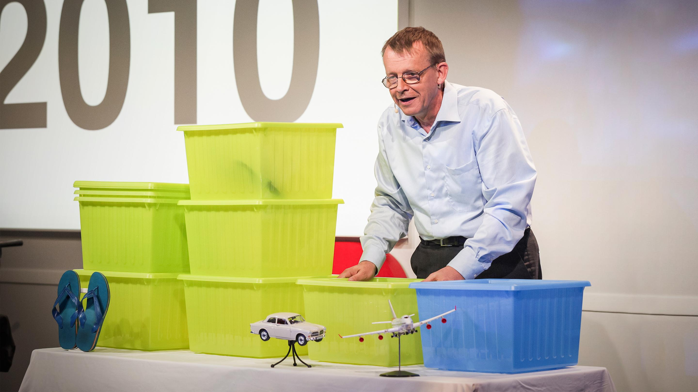
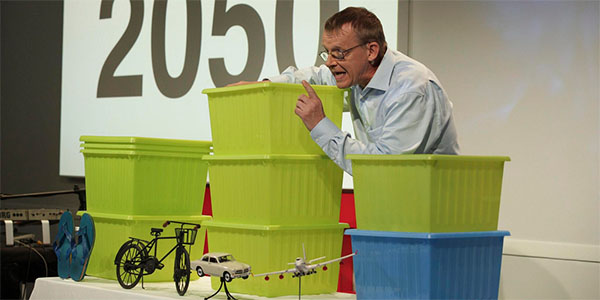
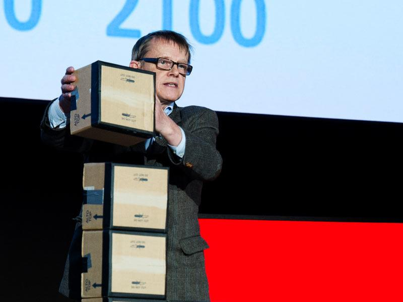
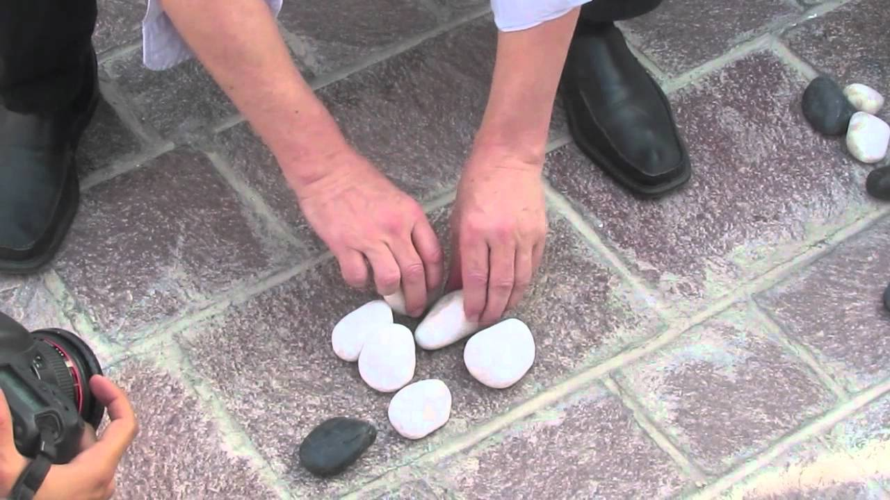

+++
author = "矢崎裕一"
title = "IKEAの箱1個を10億人にする──ハンス・ロスリングの物を使った可視化"
slug = "rosling-physical-visualizations"
date = "2026-11-03"
description = "2010年の TED@Cannes で、ロスリングはIKEAの箱1個を10億人とし、所得の段階に沿って並べて動かしました。講演の後半はバブルチャートのアニメーションに切り替えました。"
categories = [
    "consume"
]
tags = [
    "データ物質化",
    "バブル・チャート"
]
image = "images/ted-cannes-2010-ikea-boxes.jpg"
series = ["data-physicalization"]
series_weight = 18
seriesByline = "Hans Rosling・Ola Rosling"
seriesTitle = "1箱を10億人として並べ替える──ロスリングの箱"
+++

2010年6月21日、カンヌで開かれた TED@Cannes で、Hans Rosling（ハンス・ロスリング）は「IKEAの箱1個＝10億人」として世界人口を箱で表しました。箱は所得の段階に沿って横に並べ、1960年、2010年、2050年と年を進めるたびに手で動かしました。同じ講演の後半、6分8秒からは、画面に映したバブルチャートのアニメーションに切り替えました。

出典は TED が公開している講演「Global population growth, box by box」（9分47秒）のトランスクリプトです。研究者が集めた物理的な可視化の目録 dataphys.org は、この講演を起点に、その後の講演や動画で物を使った例をまとめて一つの項目にしています。登録者は Pierre Dragicevic（ピエール・ドラジチェヴィッチ）と Yvonne Jansen（イヴォンヌ・ヤンセン）です。以下は、2010年の講演を時間の順に追い、その後の例は確かめられた範囲で扱います。

<!--more-->

## 2010年6月、カンヌの舞台に IKEA の箱

ロスリングはスウェーデンの医師で、カロリンスカ研究所の国際保健学の教授で、Gapminder の共同創設者でした。dataphys によると、講演の技術と舞台演出は息子の Ola Rosling（オーラ・ロスリング）が担当していました。

2010年の講演は、冗談から始まります。

> I'm going to talk now about how world population has changed from that year and into the future, but I will not use digital technology, as I've done during my first five TEDTalks. Instead, I have progressed, and I am, today, launching a brand new analog teaching technology that I picked up from IKEA: this box.

最初の5回の TED講演ではデジタル技術を使ってきたが、今日は IKEA で見つけた「新しいアナログの教育技術」、つまりこの箱を使う、という前置きです。

続けて "This box contains one billion people."（この箱には10億人が入っている）と言い、学校の先生から聞いた1960年の世界を箱で再現します。先進国が10億人、途上国が20億人。先進国の家族はボルボを買うために貯金し、途上国の家族はその日の食べ物と、靴を一足買うために貯金していた、と語ります。この「何を手に入れたいか」が、箱を置く場所の目印になります。

TED／TED「Global population growth, box by box」より引用

## 箱を動かして、1960年から2050年へ

箱の横の位置は、暮らしの段階です。目印には、靴、自転車、車、飛行機の小物を置きます。infosthetics（2010年7月）はこれを "miniature icons of living conditions" と書いています。

2010年に進めると、箱は7個になります。50年で40億人が増えたからです。西側の10億人は飛行機の位置へ移ります。成長した途上国は車の位置へ進みます。いちばん大きな山は自転車の位置の30億人です。そして靴の位置には、20億人がほぼ50年前と同じ貧しさのまま残っています。ロスリングはこう言います。

> But there is a continuous world from walking, biking, driving, flying -- there are people on all levels, and most people tend to be somewhere in the middle.

歩く、自転車、車、飛行機まで、世界は切れ目なく続いていて、ほとんどの人は真ん中あたりにいる、という説明です。

2050年の見通しでも箱を動かします。中国などは飛行機の位置へ進む。いちばん貧しい20億人は30億、40億人へ増える。ただし貧困から抜け出し、子どもが生き延びられれば、人口の増加は2050年に止まる。箱の数と位置で、この条件つきの見通しを示しています。

TED（講演映像）／dataphys.org「Hans Rosling Adopts Physical Visualizations」より引用

箱の色にも意味があります。ロスリングは講演の最後で、先進国を "this blue box" と呼んでいます。Jansen らの CHI 2015 の論文は、この場面を「豊かな国＝青い箱、貧しい国＝緑の箱」と説明しています。

## 6分8秒、画面のバブルチャートへ

講演の後半で、ロスリングは箱から画面へ移ります。

> And let me show you why by converting back to the old-time digital technology. Here I have on the screen my country bubbles. Every bubble is a country. The size is population.

なぜそうなるのかを「昔ながらのデジタル技術」で見せる、と冒頭の冗談を裏返しています。画面のバブルは1つが1国で、大きさが人口、色が大陸です。縦軸は女性1人あたりの子どもの数、横軸は学齢まで生き延びる子どもの割合です。1960年から年を進めると、子どもの生存率が上がり、家族の人数が減っていく様子が動きで見えます。

7分47秒で、ロスリングは箱とバブルを結びつけます。

> Can you see the poorest billion, those [two] boxes I had over here? They are still up here.

さっき向こうに置いた、いちばん貧しい人たちの箱は、まだここ（子どもの数が多い位置）にいる、という指摘です。結論は「子どもの生存率を90%まで上げることが、人口の増加を止める唯一の道だ」というものでした。

前半と後半のエンコーディングを並べると、次のようになります。

| | 前半：IKEA の箱 | 後半：バブルチャート |
|---|---|---|
| 1つの印が表すもの | 10億人 | 1国 |
| 量 | 箱の個数 | バブルの大きさ（人口） |
| 横の位置 | 暮らしの段階（靴・自転車・車・飛行機の小物が目印） | 子どもの生存率 |
| 縦の位置 | なし（同じ段階の箱を積む） | 女性1人あたりの子どもの数 |
| 色 | 青＝先進国（豊かな国）、緑＝貧しい国（CHI 2015 論文の説明） | 大陸 |
| 時間 | 手で箱を動かす（1960→2010→2050） | アニメーション（1960→現在） |

前半の箱が見せるのは、何十億人がどの段階にいるか、という桁と構成です。後半のバブルは、国ごとに50年の変化を2つの軸で追います。一つの講演の中で、**物の可視化とアニメーションに役割を分けて使っていた**と読めます。7分47秒の一文は、前半で数えた「10億人の塊」を、後半の国の点の群れへ引き渡す橋になっている、と読めます。

## その後の箱と、ほかの素材

dataphys の説明は、2010年に IKEA の箱を積むことから始め、その後、小石、組み立て玩具、果汁、雪玉、トイレットペーパーへ "switched" した、と書いています。ただし、箱をやめたわけではありません。

2012年4月16日、カタール・ドーハの TEDxSummit で、ロスリングは「Religions and babies」を話しました。このときは順番が逆です。2分20秒で先にバブルチャートを見せ、色を「国の多数派の宗教」に変えています。箱が出てくるのは10分25秒です。

> I will use these card boxes in which your notebooks came. They are quite useful for educational purposes. Each card box is one billion people.

会場で配られたノートが入っていた段ボール箱を使い、1箱を10億人とする、という宣言です。箱は年齢層ごとに縦に積みます。0〜15歳が20億、15〜30歳が20億、30〜45歳が10億、45〜60歳がほぼ10億、60歳以上が10億。ロスリングは "These are rounded numbers." と断っています。上の年齢層に足りない約30億人が、これから埋まっていく。これを "the big fill-up" と呼び、世界は100億人になると話しました。

TED／TED「Religions and babies」より引用

確かめられた範囲で、素材ごとの使い方をまとめます。

| 素材 | 場 | 1個が表すもの | 二つ目の変数 |
|---|---|---|---|
| IKEA の収納箱 | TED@Cannes、2010年 | 10億人 | 横の位置＝暮らしの段階 |
| 段ボール箱 | TEDxSummit（ドーハ）、2012年 | 10億人 | 縦の積み重ね＝年齢層 |
| 石 | TEDxSummit の期間中のインタビュー、2012年 | 確かめられず | 乗り物で比べる所得の段階 |
| LEGO（DUPLO）のブロックとボタン | The Guardian の動画、2013年 | 確かめられず | 確かめられず |
| トイレットペーパー | 講演・番組は特定できず | 10億人（目撃した人の記述） | 年齢層（目撃した人の記述） |

石の例は、TEDxSummit の期間中にインタビューの場で即興に行ったもので、Herbert Reininger（ヘルベルト・ライニンガー）が1分足らずの動画を YouTube に投稿しています。

Herbert Reininger（YouTube 動画）／dataphys.org「Hans Rosling Adopts Physical Visualizations」より引用

2013年5月17日の The Guardian の動画では、LEGO のブロックを使い、動画の説明文によると、人口増加、子どもの死亡率、CO2 排出量を説明しています。ブロックと数値の対応は確かめられていません。dataphys は、Brookings 研究所のレゴ動画も、ロスリングの語りと同じ流れとして登録しています（[関連記事](/brookings-lego-data-stories/)）。

トイレットペーパーは、フィンランド統計局のブログ（2020年）が、1ロールを10億人として年齢層ごとに積んだ場面を記しています。ただし、どの講演・番組の場面かは特定できていません。雪玉は、2015年1月の BBC Newsnight の動画の題名に出てきますが、何を表したかは確かめられていません。果汁は、dataphys などが使ったと書いていますが、どの場面で何を表したかは特定できていません。

確かめられた例に共通するのは、1個を10億人として数え、位置で二つ目の変数を表すやり方だと読めます。正確な値ではなく、桁と構成比を伝える可視化だったと読めます。

## 第三者はこの演示をどう見たか

研究者による位置づけとして、Jansen、Dragicevic、Petra Isenberg らの論文「Opportunities and Challenges for Data Physicalization」（CHI 2015）があります。論文は図2で、ロスリングの箱を「手で更新する物理化」の例に挙げています。同じ図の左は、[GM の技術者がレゴで作った品質ボード](/gm-lego-quality-board/)です。

> His physicalizations are useful and effective in communicating information which individuals may find difficult to comprehend due to unfamiliar magnitudes and scales. It can also carry a shock value.

なじみのない桁の大きさを伝えるのに役立ち、衝撃を与える力もある、という評価です。論文はさらに、ロスリングの物理化の利点は "pedagogical and persuasive power" にあり、時間や誤りの数で測る従来の評価では測れない、と書いています。[実物の棒グラフを速さで比べた評価実験](/evaluating-physical-visualizations/)とは、別の物差しが要るという指摘です。

可視化の研究者 Robert Kosara（ロバート・コサラ）は、ロスリングの没後、2017年2月7日に eagereyes で追悼文を書いています。

> Rosling demonstrated the importance of a human voice in visualization. He also used props: apples, rolls of toilet paper – he even swallowed a sword. This is how you make people watch, and this is how you leave an impression.

小道具は、人に見させ、印象を残すための手段だという評価です。Kosara はロスリングを、説明し、教え、楽しませるための可視化を開いた人として読んでいます。

批判を含む評価もあります。スタンフォード大学の数学者 Keith Devlin（キース・デブリン）は、2017年2月11日の NPR の番組で、アニメーションが世界の見方を覆す力を認めました。そのうえで、「心配しなくていい」と受け取られる危険と、データを予測に使ったときの問題を指摘しています。これはアニメーションのチャートへの評価で、箱への評価ではありません。

## 使い道

ロスリングは dataphys の編集者に、こう語っています。

> physical props reach the mind of a large part of the public because thats how you represent data in daily life at the kitchen table, at the cafe and in the bar.

物の小道具が多くの人に届くのは、台所のテーブルや、カフェや、バーで、人がふだんそうやってデータを表しているからだ、という言葉です。

可視化の仕事に持ち帰れるのは、次の三つです。

- 単位を一つ決めて、宣言する。「この箱は10億人」と最初に言えば、聞き手は箱を数えるだけで世界人口の桁を追えます。
- 二つ目の変数は、位置に一つだけ持たせる。2010年は横の位置に所得、2012年は縦の積み重ねに年齢層を持たせました。小物の目印があれば、軸の目盛りを読まなくても段階が分かります。
- 物と画面に役割を分ける。箱で全体の桁と構成を見せ、国ごとの変化はバブルチャートに任せる。7分47秒のように、前半の物を後半の図の中で指し示せば、二つの表現がつながります。

物の可視化は、値を細かく読むのには向きません。ロスリングは10億人単位という粗さを選び、細かい変化は画面に渡していたと読めます。

## 参考・出典

**一次情報**

- dataphys.org「2010 – Hans Rosling Adopts Physical Visualizations」（登録：Pierre Dragicevic、Yvonne Jansen）. https://dataphys.org/list/hans-rosling-adopts-physical-visualizations/ （タグ一覧：https://dataphys.org/list/tags/ted/ ）
- Hans Rosling, “Global population growth, box by box,” TED@Cannes, 2010-06-21 収録. トランスクリプト：https://www.ted.com/talks/hans_rosling_global_population_growth_box_by_box/transcript
- Hans Rosling, “Religions and babies,” TEDxSummit（Doha）, 2012-04-16 収録. トランスクリプト：https://www.ted.com/talks/hans_rosling_religions_and_babies/transcript
- TED「Hans Rosling」講演一覧. https://www.ted.com/speakers/hans_rosling
- Gapminder「History of Gapminder」. https://www.gapminder.org/about/about-gapminder/history/
- The Guardian, “Population growth and climate change explained by Hans Rosling,” 2013-05-17. https://www.theguardian.com/global-development/video/2013/may/17/population-climate-change-hans-rosling-video
- Herbert Reininger, “Hans Rosling's shortest TED talk,” YouTube. https://www.youtube.com/watch?v=UNs-ziziPyo
- BBC Newsnight, “Hans Rosling on global income disparity (and snowballs),” YouTube, 2015. https://www.youtube.com/watch?v=DoSTNRhoceY

**第三者評価**

- Yvonne Jansen, Pierre Dragicevic, Petra Isenberg, et al., “Opportunities and Challenges for Data Physicalization,” CHI 2015. https://eprints.lancs.ac.uk/id/eprint/72691/1/OA_2015_04_CHI_DataPhys.pdf
- Robert Kosara, “Hans Rosling: An Appreciation,” eagereyes, 2017-02-07. https://eagereyes.org/blog/2017/hans-rosling-an-appreciation
- Keith Devlin, NPR Weekend Edition, 2017-02-11（WUSF 転載）. https://www.wusf.org/2017-02-11/remembering-the-edutainer-who-made-statistics-come-to-life
- infosthetics, “More Recent Talks from Hans Rosling (with Original Physical Props),” 2010-07-19. https://infosthetics.com/archives/2010/07/more_recent_talks_from_hans_rosling_with_original_physical_props.html
- Tilastokeskus（フィンランド統計局）Tieto&trendit ブログ, 2020-03-18（フィンランド語）. https://stat.fi/tietotrendit/blogit/2020/kayttoa-vessapaperille-kotiopetuksessa
- NPR Goats and Soda, 2017-02-08. https://www.npr.org/sections/goatsandsoda/2017/02/08/514074090/video-edutainer-hans-rosling-who-taught-us-about-the-world-has-died
