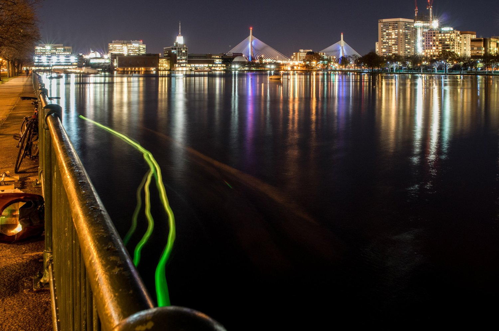
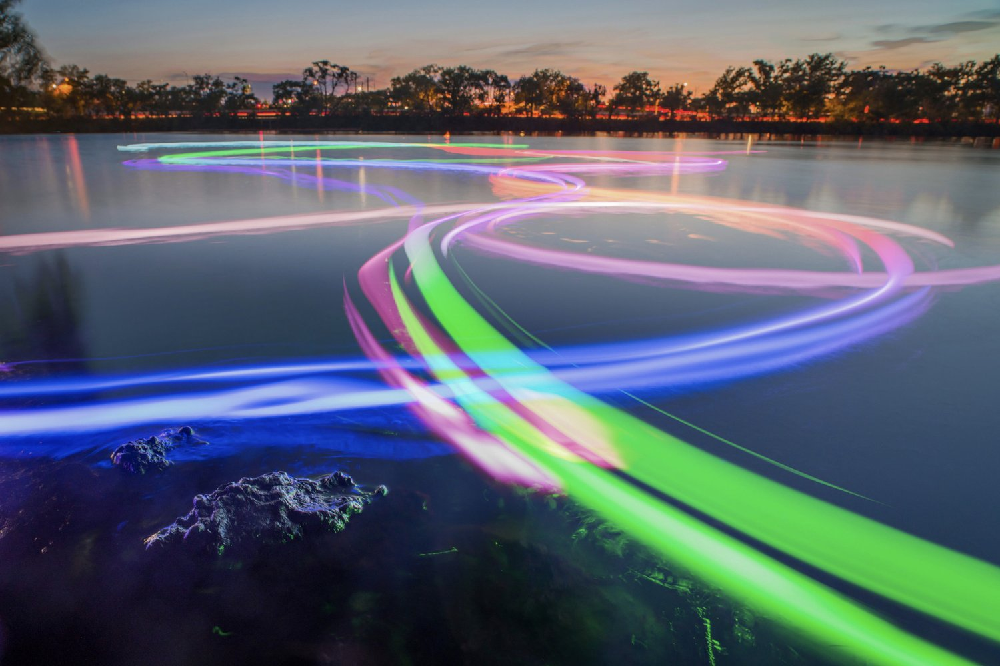

+++
author = "Yuichi Yazaki"
title = "Changing the Color of a Boat's Light on the Water It Measures: SeeBoat"
slug = "seeboat"
date = "2026-11-05"
description = "SeeBoat is a device that turns water-quality sensor readings into the LED color of a small boat running over the very water being measured, as it measures. In a long-exposure photograph, the boat's path remains as lines of color."
categories = [
    "consume"
]
tags = [
    "data physicalization",
    "color"
]
image = "images/seeboat-kendall-long-exposure.jpg"
+++

SeeBoat is a device that turns water-quality sensor readings into the LED color of a small boat running over the very water being measured, as it measures. Sensors for water temperature, conductivity, turbidity, and pH are mounted on a remote-controlled boat, and one chosen value is assigned to the hue of the hull's light. In a long-exposure photograph, the boat's path remains as lines of color.

The creator is Laura Perovich, and the work dates from her time as a doctoral student in the Object-Based Media group at the MIT Media Lab. Its predecessor is the float "Thermal Fishing Bob," born at Public Lab, and Perovich joined in improving it from 2015. What follows draws on the repository Perovich published on GitHub (README, Arduino code, parts list), her research notes that remain on Public Lab, and exhibition captions.

<!--more-->

## Throwing in floats to draw a river with light

The starting point is the Thermal Fishing Bob on the Public Lab wiki. A cheap thermistor and an LED are put in a waterproof container, thrown into a waterway, and photographed with a long exposure. The wiki describes the result like this.

> This will create a "light painting" where the colors describe the temperature of the water at that location.

In short, the result is a "light painting" in which the colors represent the water temperature at each location. It can be read as saying that the tool that measures and the tool that shows were, from the start, one and the same float.

In April 2014, Sara Wylie posted the result of drawing the edge of a pond with floats that students had built in a class. Her note says "the different groups had the Thermal Bobs set to different temperature ranges." The temperature range assigned to the colors differed from group to group.

From June to August 2015, Perovich posted a series of notes on improvements: adding more sensors and LEDs, making the temperature sensor faster, and putting the housing in a white sphere. On August 25 she also released a version whose color is not continuous.

> Thermal fishing bobs with this new code will light up red when they are above the set threshold value and will be off when the temperature is below the set threshold value.

In short, the float lights up red above the threshold and goes dark below it. The note gives, as a use for this version, searching for hot spots in a river that might exceed a regulatory limit. Only this threshold version ties red to "hot spots." It can be read as showing that the same author tried both a continuous hue scale and an on/off binary display.

## From floats to remote-controlled boats

On November 20, 2015, an early SeeBoat test was photographed near the Kendall Cogeneration Station on the Charles River.

Source: Laura Perovich & collaborators (photo: Jorge Valdez) / untold possibilities at the last minute, "ArtBoat and SeeBoat"

The exhibition caption says the following.

> The change in color from green to yellow is tied to the temperature sensor readings and indicates a potential thermal pollution source near the outflow pipe.

In short, the change from green to yellow corresponds to the temperature sensor readings and indicates a possible source of thermal pollution near the outflow pipe. The caption does not say whether green or yellow is the higher value.

The hull is a Horizon Hobby remote-controlled boat, the "Stealthwake 23" Brushed Deep-V RTR." The controller is an Adafruit Feather M0 with RFM95 LoRa Radio (900MHz), and the light source is a DotStar LED strip (white, 60 LEDs/m). The README opens by describing the work like this.

> SeeBoat is a fleet of remote controlled boats that measure and display water quality in real time. It allows communities to explore water quality in their local lakes, rivers, and streams by changing the color of the boat in response to changes to the water quality.

In short, it is a fleet of remote-controlled boats that measure and show water quality in real time, changing the boat's color as the water quality changes so that local people can explore their nearby rivers and lakes.

The Feather version of the code reads "Started June 2017." In autumn 2017, Rod Bayliss added turbidity, pH, and conductivity, and in 2019 Talia Spitz integrated everything and made it support multiple boats.

## Writing the color scale into each place

The values in the table are the defaults in the version published on GitHub (master, commit b61f5c3 of 2020-11-12). I have not checked the settings of other versions or other periods.

| Data | Appearance / material | How it is mapped | Source |
|---|---|---|---|
| Water-quality value (one of four) | Hue of all the hull's LEDs | Uses only the red-to-green hues (about 0–120°). Saturation and brightness are at maximum. All LEDs are the same color | `LED_updated.ino` |
| Water temperature (default) | Same as above | 62.0–72.0°F (about 16.7–22.2°C) sets the two ends of the color range | `seeBoatFeather.ino` |
| Conductivity | Same as above | 18,000–21,000 µS/cm | Same as above |
| pH | Same as above | 7.50–8.50 | Same as above |
| Turbidity | Same as above | 50–300 NTU | Same as above |
| Values outside the range | The color at the end | Converted linearly to 0–255, with anything beyond clipped | `normf()` in `LED_updated.ino` |
| Where it was measured | The water surface where the boat is | Position is not converted into a different appearance | README |
| Time and path | Lines of light in a long-exposure photograph | The photographer records them | README, caption |
| Exact numbers | Numbers sent by radio | Viewed in an Android app. A receiving-side Python script saves them to CSV | README, `readMe.txt` |
| Hull | A boat painted black | Blends into the night background | Parts list |
| Window of light | White milky acrylic | Light shows through holes cut in the hull | Parts list |

Only one value lights the LEDs per boat. It is chosen by writing one of "temperature", "conductivity", "turbidity", or "pH" into the variable `whichDataControlsLEDs`. In the same code, the turbidity sensor is disabled by default (`turbsensor = 0`).

**The values at the ends of the color range are not an absolute standard.** Just before the place where the range is set, Perovich writes the following.

> You want to choose values that are the bounds of what data you expect to see in a particular location so the color ranges well.

In short, if you choose the upper and lower limits of the values you expect to see in that location, the colors spread out well. The comment on conductivity also lists rough guides of about 700 µS/cm for fresh water, about 50,000 for brackish water, and about 53,000 for seawater. The configured 18,000–21,000 falls between the fresh-water figure of about 700 and the brackish figure of about 50,000.

The color can be read as meant for seeing "what is high or low within this river on this night." Values outside the range take the color of the end, so the colors of boats set to different ranges cannot be compared on the same scale. Note also that which of red and green a low value becomes is reversed between the latest published code (`LED_updated.ino`) and the older version (`archive/LED_functions.ino`). It has not been confirmed which direction the 2015 photograph used. For that reason, this article does not state the direction.

## Black hull, white window, numbers by radio

The parts list gives the use of the black spray paint as "to paint the boat so it blends into the background better at night." That is, the boat is painted so that it melts into the background at night. The light comes out through "1/8" satin ice white acrylic strips," a window of milky acrylic. The list also says this replaced the earlier method of attaching the LED strip to the outside of the boat with one in which the light shows through holes cut in the hull.

The numbers are sent separately from the light. The README says "Numeric sensor data is also transmitted via radio, visible through an Android app." The receiving-side Python script graphs the values and saves them to a CSV with timestamps.

The onboard GPS was, in the README's words, "in practice this doesn't seem to work (it never gets a fix)." As a workaround, the README describes a procedure in which a separate board records position to an SD card, which is later matched against the sensor CSV to make a map of the boat's path and the data.

From this, SeeBoat can be read as handling data through two routes. The light on the water can be read as a design that, without carrying coordinates, shows people on the spot how the values change. The exact numbers are sent by radio and saved to CSV on the receiving side. The map is described as built by matching the SD-card position record against the sensor CSV.

In the abstract of her 2020 doctoral thesis, Perovich places SeeBoat among "citizen science water quality tools for data collection and in situ display." In the book *Making With Data* (edited by Huron, Nagel, Oehlberg, and Willett; A K Peters/CRC Press), Part 2, "Participation," has a chapter by Perovich, 2.2 "SeeBoat" (pp. 123–132, DOI 10.1201/9781003264903-7). I have not been able to check the text of the chapter for this article.

## How third parties saw the work

I found no criticism or news coverage devoted to SeeBoat alone, within what I was able to trace this time. What follows is what third parties have written around the work.

The first is the 2019 Cambridge Arts exhibition "Untold Possibilities at the Last Minute: Artists Respond to Climate Change." "ArtBoat and SeeBoat" was shown there, and the overview says the following.

> SeeBoat invites us to experience our nearby rivers through the act of "drawing" with light attached to the boats.

In short, it lets us experience our nearby rivers through the act of "drawing" with the light attached to the boats. The overview also notes that water quality can change as water temperature rises, placing the work in the context of climate change.

Source: Laura Perovich (photo: Jorge Valdez) / untold possibilities at the last minute, "ArtBoat and SeeBoat"

The photograph above is of ArtBoat, the parent of SeeBoat. The exhibition site describes SeeBoat as ArtBoat combined with water-quality sensors. ArtBoat was an event at Magazine Beach in 2018 in which participants steered the boats' colors with a color-mixing board and drew pictures of light on the river. Below the work's page, an explanation of the city's stormwater and combined sewer overflows (CSO) is attached. It can be read as showing that the work was exhibited alongside an explanation of municipal water-quality policy.

The second is the record of a night test at the Mystic Generator Station in September 2015, using the predecessor floats. It was written by Erik Hanley of Northeastern, and Perovich was among the participants.

> It was difficult to see from the dock whether there was any color change from the floaties.

In short, it was hard to tell from the dock whether the floats' color had changed. It can be read that this problem may be related to SeeBoat's later painting of the hull black and lining LEDs up behind milky windows. I have not found any words from the author that show a causal link.

The third is Claudia Berger's review of *Making With Data* (*College & Research Libraries*). The review criticizes the book as a whole like this.

> These projects were designed by an overwhelmingly white audience of practitioners; only a few are led by practitioners who are Black, Indigenous, or people of color.

In short, most of the examples are by white practitioners, and only a few are led by Black, Indigenous, or people-of-color practitioners. The review also asks what about projects co-led by communities that tend to be shut out of data. A youth group from the environmental justice organization GreenRoots joined SeeBoat for testing, but the creator is a university researcher. This question can be read as an axis of tension for reading SeeBoat.

## Takeaways

What can be taken away from SeeBoat can be read as follows.

- Do not encode place. The place where the measurement was taken is the place of display, and this can be read as a design that shows people on the spot how the values change. The map is made separately by matching the position record against the sensor CSV.
- Set the color range on site. If the two ends are fitted to the expected span, the colors spread widely. Colors from boats with different range settings cannot be used for comparison.
- Continuous or threshold. Depending on what you want to find, you can choose between a hue scale and a binary display.
- Separate light and numbers. On site, show only the color of one variable, and send the exact numbers by radio.
- Erase the ground. Paint the hull black so that everything except the light you want to show blends into the background.

A long-exposure photograph combines these in a single image. The shape of the lines of light is where the boat went, and the color of the lines is the measured value.

## References

**Primary sources**

- Laura Perovich et al., SeeBoat (GitHub repository lperovich/seeboat. README, `software/main/seeBoatFeather/seeBoatFeather.ino`, `LED_updated.ino`, `software/main/archive/LED_functions/LED_functions.ino`, `software/main/readMe.txt`, `hardware/SeeBoat_fullPartsList.xlsx`, `tutorials/`, `app/fontsColors.pdf`). [GitHub](https://github.com/lperovich/seeboat)
- Exhibition site work page and caption "ArtBoat and SeeBoat," untold possibilities at the last minute (Cambridge Arts, 2019). [untoldpossibilities.org](https://www.untoldpossibilities.org/artboatandseeboat)
- Laura J. Perovich, "From data physicalization to data experiences: combining art, science, technology, and community to move towards collective action on environmental challenges," Ph.D. thesis, MIT Program in Media Arts and Sciences, 2020 (bibliographic record and abstract). [DSpace@MIT](https://dspace.mit.edu/handle/1721.1/129267)
- Laura Perovich, "SeeBoat," in Huron, Nagel, Oehlberg, Willett (eds.), *Making With Data: Physical Design and Craft in a Data-Driven World*, A K Peters/CRC Press, pp. 123–132 (chapter text not checked). [doi:10.1201/9781003264903-7](https://doi.org/10.1201/9781003264903-7) / [Routledge](https://www.routledge.com/Making-With-Data-Physical-Design-and-Craft-in-a-Data-Driven-World/Huron-Nagel-Oehlberg-Willett/p/book/9781032182223) / [Crossref](https://api.crossref.org/works/10.1201/9781003264903-7)
- Public Lab, "Thermal fishing bob" (wiki). [publiclab.org](https://publiclab.org/wiki/thermal-fishing-bob)
- Laura Perovich, Public Lab research notes (2015): [multiple inputs outputs](https://publiclab.org/notes/lperovich/06-10-2015/thermal-fishing-bob-multiple-inputs-outputs) / [faster waterproofed temperature sensors](https://publiclab.org/notes/lperovich/07-07-2015/thermal-fishing-bob-faster-waterproofed-temperature-sensors) / [in search of floating spheres](https://publiclab.org/notes/lperovich/08-17-2015/in-search-of-floating-spheres) / [threshold single thermal fishing bob](https://publiclab.org/notes/lperovich/08-25-2015/threshold-single-thermal-fishing-bob) (text checked in [publiclab-archive](https://github.com/publiclab/publiclab-archive))
- Sara Wylie, "Successful Thermal Fishing Bob Maps," Public Lab, 2014. [publiclab.org](https://publiclab.org/notes/Sara/04-23-2014/successful-thermal-fishing-bob-maps)
- Sara Wylie et al., "Successful thermal fishing bob test: mapping the Kendall power plant thermal plume," Public Lab, 2014. [publiclab.org](https://publiclab.org/notes/Sara/06-13-2014/successful-thermal-fishing-bob-test-mapping-the-kendall-power-plant-thermal-plume)
- MIT Media Lab, "SeeBoat (Thermal Fishing Bob): In-place environmental data visualization" (project page. Could not be reached, so its text has not been checked). [media.mit.edu](https://www.media.mit.edu/projects/thermal-fishing-bob-in-place-environmental-data-visualization/overview/)

**Secondary sources**

- Cambridge Arts, "Untold Possibilities at the Last Minute: Artists Respond to Climate Change" (exhibition overview, 2019). [untoldpossibilities.org](https://www.untoldpossibilities.org/)
- Erik Hanley et al., "Mystic Generator Station Thermal Fishing Bob Event with Mare Liberum," Public Lab, 2015. [publiclab.org](https://publiclab.org/wiki/mystic-generator-station-thermal-fishing-bob-event-with-mare-liberum)
- Claudia Berger, review of *Making With Data*, *College & Research Libraries*. [PDF](https://distantreader.org/stacks/journals/crl/crl-25984.pdf)
