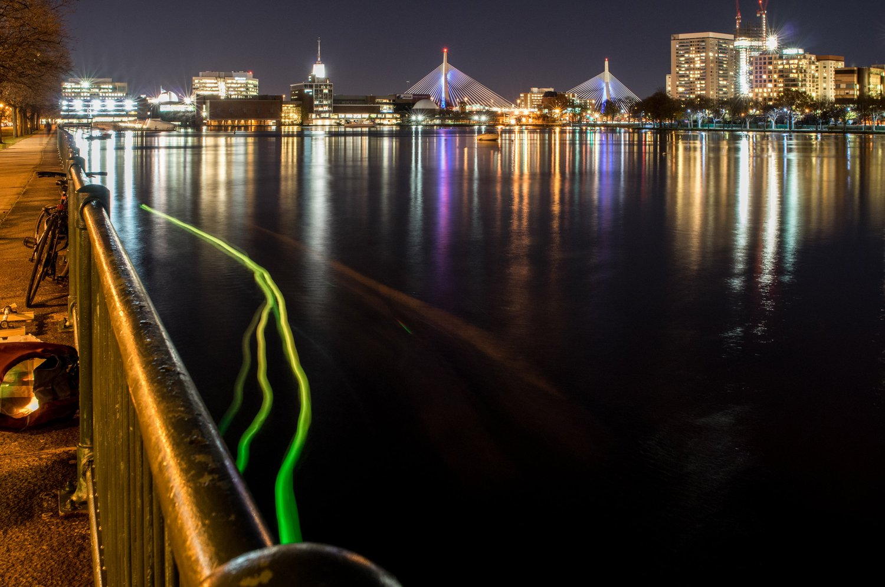
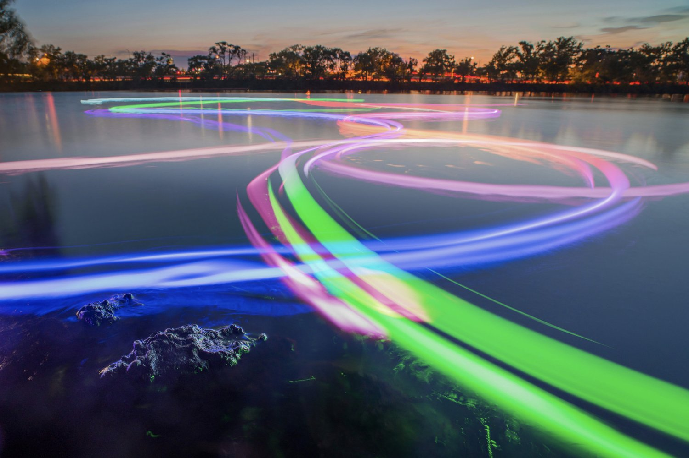

+++
author = "矢崎裕一"
title = "測ったその水面で、船の灯りの色を変える──SeeBoat"
slug = "seeboat"
date = "2026-11-05"
description = "SeeBoat は、水質センサーの値を、測った水面を走る小舟の LED の色にその場で変える装置です。長時間露光で撮ると、船の軌跡が色の線として残ります。"
categories = [
    "consume"
]
tags = [
    "データ物質化",
    "色"
]
image = "images/seeboat-kendall-long-exposure.jpg"
series = ["data-physicalization"]
series_weight = 99
seriesByline = "Laura Perovich ほか"
seriesTitle = "測った水面で船の灯りの色を変える──SeeBoat"
+++

SeeBoat（シーボート）は、水質センサーの値を、測った水面を走る小舟の LED の色にその場で変える装置です。ラジコンの船に水温・導電率・濁度・pH のセンサーを載せ、選んだ一つの値を、船体の灯りの色相に割り当てます。長時間露光で撮ると、船の軌跡が色の線として残ります。

作者は Laura Perovich（ローラ・ペロヴィッチ）で、MIT Media Lab の Object-Based Media グループの博士課程にいたころの作品です。前身は、Public Lab で生まれた浮き「Thermal Fishing Bob」で、Perovich は2015年からその改良に加わっています。以下は、Perovich が GitHub に公開したリポジトリ（README、Arduino のコード、部品表）と、Public Lab に残る研究ノート、展覧会のキャプションに沿います。

<!--more-->

## 浮きを投げ込み、光で川を描く

出発点は、Public Lab の wiki にある Thermal Fishing Bob（サーマル・フィッシング・ボブ）です。安価なサーミスタと LED を防水の容器に入れ、水路に投げ込んで、長時間露光で撮ります。wiki はその結果をこう書きます。

> This will create a "light painting" where the colors describe the temperature of the water at that location.

色がその場所の水温を表す「光の絵」ができる、という要旨です。測る道具と見せる道具が、最初から同じ一つの浮きだったと読めます。

2014年4月、Sara Wylie（サラ・ワイリー）は、授業で学生が作った浮きで池の縁を描いた結果を投稿しています。ノートには "the different groups had the Thermal Bobs set to different temperature ranges" とあります。色に割り当てる温度の範囲は、グループごとに違っていました。

Perovich は2015年の6〜8月、センサーと LED を増やす、温度センサーを速くする、筐体を白い球にする、といった改良のノートを続けて投稿します。8月25日には、色を連続させない版も出しました。

> Thermal fishing bobs with this new code will light up red when they are above the set threshold value and will be off when the temperature is below the set threshold value.

しきい値を超えると赤く光り、下回ると消える、という要旨です。ノートは、この版の用途として、規制値を超えるかもしれない川の熱い場所を探すことを挙げています。赤と「熱い場所」を結びつけているのは、このしきい値の版だけです。同じ作者が、連続した色相と、点くか消えるかの二値を、両方試していたと読めます。

## 浮きから、ラジコンの船へ

2015年11月20日、Charles River の Kendall Cogeneration Station の近くで、SeeBoat の初期のテストが撮られました。

Laura Perovich & collaborators（写真：Jorge Valdez）／untold possibilities at the last minute「ArtBoat and SeeBoat」より引用

展覧会のキャプションは、こう書きます。

> The change in color from green to yellow is tied to the temperature sensor readings and indicates a potential thermal pollution source near the outflow pipe.

緑から黄への変化は温度センサーの読みに対応し、排水口の近くに熱汚染源があるかもしれないことを示す、という要旨です。キャプションは、緑と黄のどちらが高い値かを書いていません。

船体は Horizon Hobby のラジコン「Stealthwake 23" Brushed Deep-V RTR」です。制御は Adafruit Feather M0 with RFM95 LoRa Radio（900MHz）、光源は DotStar の LED テープ（白、60 LED/m）です。README の冒頭は、作品をこう説明します。

> SeeBoat is a fleet of remote controlled boats that measure and display water quality in real time. It allows communities to explore water quality in their local lakes, rivers, and streams by changing the color of the boat in response to changes to the water quality.

水質をリアルタイムに測って見せるラジコンの船団で、水質の変化に応じて船の色を変え、地域の人が身近な川や湖の水質を探れるようにする、という要旨です。

Feather 版のコードは "Started June 2017" です。2017年秋に Rod Bayliss が濁度・pH・導電率を加え、2019年に Talia Spitz が全体を統合して複数の船に対応させました。

## 色のものさしを、場所ごとに書き込む

表の値は、GitHub 公開版（master、2020-11-12 のコミット b61f5c3）の既定値です。ほかの版や時期の設定は確かめていません。

| データ | 見た目・素材 | 対応のしかた | 出典 |
|---|---|---|---|
| 水質の値（4種類から1つ） | 船体の LED 全体の色相 | 赤〜緑の色相（約0〜120°）だけを使う。彩度と明度は最大。LED はすべて同じ色 | `LED_updated.ino` |
| 水温（既定） | 同上 | 62.0〜72.0°F（約16.7〜22.2°C）を色の両端にする | `seeBoatFeather.ino` |
| 導電率 | 同上 | 18,000〜21,000 µS/cm | 同上 |
| pH | 同上 | 7.50〜8.50 | 同上 |
| 濁度 | 同上 | 50〜300 NTU | 同上 |
| 範囲の外の値 | 端の色 | 0〜255 に線形に直し、はみ出した分は切る | `LED_updated.ino` の `normf()` |
| 測った場所 | 船がいる水面そのもの | 位置を別の見た目に変換しない | README |
| 時間と経路 | 長時間露光写真の光の線 | 撮影者が記録する | README、キャプション |
| 正確な数値 | 無線で送る数字 | Android アプリで見る。受信側の Python スクリプトが CSV に保存する | README、`readMe.txt` |
| 船体 | 黒く塗った船 | 夜の背景に溶けこませる | 部品表 |
| 光の窓 | 白い乳白アクリル | 船体に開けた穴から光を見せる | 部品表 |

光らせる値は、船1隻につき一つです。変数 `whichDataControlsLEDs` に "temperature"、"conductivity"、"turbidity"、"pH" のどれかを書いて選びます。同じコードでは、濁度センサーは既定で無効（`turbsensor = 0`）になっています。

**色の両端の値は、絶対的な基準ではありません。**範囲を設定する箇所の直前に、Perovich はこう書いています。

> You want to choose values that are the bounds of what data you expect to see in a particular location so the color ranges well.

その場所で見えると予想される値の上限と下限を選べば、色がよく散らばる、という要旨です。導電率のコメントには、淡水は約700、汽水は約50,000、海水は約53,000 µS/cm という目安も並びます。設定値の18,000〜21,000は、淡水の約700と汽水の約50,000の間に収まる値です。

色は「この川のこの夜の中で、どこが高いか低いか」を見るためのものだと読めます。範囲の外の値は端の色になるので、別の範囲を設定した船どうしの色は、同じ尺度では比べられません。なお、低い値が赤と緑のどちらになるかは、公開コードの最新版（`LED_updated.ino`）と旧版（`archive/LED_functions.ino`）で逆になっています。2015年の写真がどちらの向きだったかは、確かめられていません。そのため、この記事では向きを書きません。

## 黒い船体、白い窓、数字は無線で

部品表には、黒のスプレー塗料の用途が "to paint the boat so it blends into the background better at night" と書かれています。夜に背景へ溶けこむよう、船を塗るためです。光は "1/8" satin ice white acrylic strips"、乳白のアクリル板の窓から出します。それまで船の外側に付けていた LED テープを、船体に開けた穴から見せる方式に替えた、とも書かれています。

数字は光とは別に送ります。README は "Numeric sensor data is also transmitted via radio, visible through an Android app" と書きます。受信側の Python スクリプトは値をグラフにし、タイムスタンプ付きの CSV に保存します。

船上の GPS は "in practice this doesn't seem to work (it never gets a fix)" でした。回避策として、別の基板で位置を SD カードに記録し、あとでセンサーの CSV と突き合わせて、船の経路とデータの地図を作る手順が書かれています。

ここから、SeeBoat は二つの経路でデータを扱っていると読めます。水面の光は、座標を持たずに、その場の人に値の変化を見せる設計と読めます。正確な数値は無線で送られ、受信側で CSV に保存されます。地図は、SD カードの位置記録とセンサーの CSV を突き合わせて作る手順だと書かれています。

2020年の博士論文の要旨で、Perovich は SeeBoat を "citizen science water quality tools for data collection and in situ display"、データの収集と現地での表示のための市民科学の道具と位置づけています。書籍『Making With Data』（Huron・Nagel・Oehlberg・Willett 編、A K Peters/CRC Press）の第2部 "Participation" には、Perovich による章 2.2 "SeeBoat"（pp. 123–132、DOI 10.1201/9781003264903-7）があります。この記事では、章の本文は確認できていません。

## 第三者はこの作品をどう見たか

SeeBoat だけを論じた批評や報道は、今回たどれた範囲では見つかりませんでした。以下は、作品の周りで第三者が書いたものです。

一つめは、Cambridge Arts の2019年の展覧会「Untold Possibilities at the Last Minute: Artists Respond to Climate Change」です。"ArtBoat and SeeBoat" が出品され、総説はこう書きます。

> SeeBoat invites us to experience our nearby rivers through the act of "drawing" with light attached to the boats.

船に付けた光で「描く」ことを通して、身近な川を体験させる、という要旨です。総説は、水質が水温の上昇で変わりうることにも触れ、作品を気候変動の文脈に置いています。

Laura Perovich（写真：Jorge Valdez）／untold possibilities at the last minute「ArtBoat and SeeBoat」より引用

上は、SeeBoat の母体になった ArtBoat の写真です。展示サイトは、SeeBoat を ArtBoat に水質センサーを組み合わせたものと書いています。ArtBoat は、2018年に Magazine Beach で、参加者が色を混ぜるボードで船の色を操り、川面に光の絵を描いた催しです。作品ページの下には、市の雨水と合流式下水道越流（CSO）の説明が添えられています。作品が行政の水質政策の説明と並べて展示されたと読めます。

二つめは、2015年9月の Mystic Generator Station での、前身の浮きを使った夜のテストの記録です。Northeastern の Erik Hanley が書き、参加者に Perovich もいました。

> It was difficult to see from the dock whether there was any color change from the floaties.

船着き場からは、浮きの色が変わったかどうか見分けにくかった、という要旨です。のちに SeeBoat が船体を黒く塗り、乳白の窓に LED を並べたことと、この問題は関係しているかもしれないと読めます。因果を示す作者の言葉は確認できていません。

三つめは、『Making With Data』への Claudia Berger の書評（*College & Research Libraries*）です。書評は本全体をこう批判します。

> These projects were designed by an overwhelmingly white audience of practitioners; only a few are led by practitioners who are Black, Indigenous, or people of color.

作例の大半は白人の実践者によるもので、黒人・先住民・有色人種の実践者が率いるものはわずかだ、という要旨です。書評は、データから締め出されがちなコミュニティが共同で率いる企画はどうか、とも問います。SeeBoat には環境正義団体 GreenRoots の若者グループがテストで加わっていますが、作者は大学の研究者です。この問いは、SeeBoat を読むときの対立軸にもなると読めます。

## 使い道

SeeBoat から持ち帰れることは、次のように読めます。

- 場所を符号化しない。測った場所がそのまま表示の場所になり、その場の人に値の変化を見せる設計と読めます。地図は、位置記録とセンサーの CSV を突き合わせて別に作ります。
- 色の範囲は、その場で決める。予想される幅に両端を合わせると、色が幅広く散ります。範囲の設定が違う船どうしの色は、比較に使えません。
- 連続か、しきい値か。何を見つけたいかで、色相のスケールと二値の表示を選べます。
- 光と数字を分ける。その場では1変数の色だけを見せ、正確な数値は無線で送ります。
- 地を消す。船体を黒く塗り、見せたい光のほかは背景に溶けこませます。

長時間露光の写真は、これを1枚にまとめます。光の線の形が船の通った場所で、線の色が測った値です。

## 参考・出典

**一次情報**

- Laura Perovich ほか, SeeBoat（GitHub リポジトリ lperovich/seeboat。README、`software/main/seeBoatFeather/seeBoatFeather.ino`、`LED_updated.ino`、`software/main/archive/LED_functions/LED_functions.ino`、`software/main/readMe.txt`、`hardware/SeeBoat_fullPartsList.xlsx`、`tutorials/`、`app/fontsColors.pdf`）. [GitHub](https://github.com/lperovich/seeboat)
- 展覧会サイトの作品ページとキャプション「ArtBoat and SeeBoat」, untold possibilities at the last minute（Cambridge Arts, 2019）. [untoldpossibilities.org](https://www.untoldpossibilities.org/artboatandseeboat)
- Laura J. Perovich, "From data physicalization to data experiences: combining art, science, technology, and community to move towards collective action on environmental challenges," Ph.D. thesis, MIT Program in Media Arts and Sciences, 2020（書誌と要旨）. [DSpace@MIT](https://dspace.mit.edu/handle/1721.1/129267)
- Laura Perovich, "SeeBoat," in Huron, Nagel, Oehlberg, Willett (eds.), *Making With Data: Physical Design and Craft in a Data-Driven World*, A K Peters/CRC Press, pp. 123–132（章の本文は未確認）. [doi:10.1201/9781003264903-7](https://doi.org/10.1201/9781003264903-7) / [Routledge](https://www.routledge.com/Making-With-Data-Physical-Design-and-Craft-in-a-Data-Driven-World/Huron-Nagel-Oehlberg-Willett/p/book/9781032182223) / [Crossref](https://api.crossref.org/works/10.1201/9781003264903-7)
- Public Lab, "Thermal fishing bob"（wiki）. [publiclab.org](https://publiclab.org/wiki/thermal-fishing-bob)
- Laura Perovich, Public Lab の研究ノート（2015）: [multiple inputs outputs](https://publiclab.org/notes/lperovich/06-10-2015/thermal-fishing-bob-multiple-inputs-outputs) / [faster waterproofed temperature sensors](https://publiclab.org/notes/lperovich/07-07-2015/thermal-fishing-bob-faster-waterproofed-temperature-sensors) / [in search of floating spheres](https://publiclab.org/notes/lperovich/08-17-2015/in-search-of-floating-spheres) / [threshold single thermal fishing bob](https://publiclab.org/notes/lperovich/08-25-2015/threshold-single-thermal-fishing-bob)（本文は [publiclab-archive](https://github.com/publiclab/publiclab-archive) で確認）
- Sara Wylie, "Successful Thermal Fishing Bob Maps," Public Lab, 2014. [publiclab.org](https://publiclab.org/notes/Sara/04-23-2014/successful-thermal-fishing-bob-maps)
- Sara Wylie ほか, "Successful thermal fishing bob test: mapping the Kendall power plant thermal plume," Public Lab, 2014. [publiclab.org](https://publiclab.org/notes/Sara/06-13-2014/successful-thermal-fishing-bob-test-mapping-the-kendall-power-plant-thermal-plume)
- MIT Media Lab, "SeeBoat (Thermal Fishing Bob): In-place environmental data visualization"（プロジェクトページ。接続できず、本文は確認できていません）. [media.mit.edu](https://www.media.mit.edu/projects/thermal-fishing-bob-in-place-environmental-data-visualization/overview/)

**第三者評価**

- Cambridge Arts, "Untold Possibilities at the Last Minute: Artists Respond to Climate Change"（展覧会の総説, 2019）. [untoldpossibilities.org](https://www.untoldpossibilities.org/)
- Erik Hanley ほか, "Mystic Generator Station Thermal Fishing Bob Event with Mare Liberum," Public Lab, 2015. [publiclab.org](https://publiclab.org/wiki/mystic-generator-station-thermal-fishing-bob-event-with-mare-liberum)
- Claudia Berger, review of *Making With Data*, *College & Research Libraries*. [PDF](https://distantreader.org/stacks/journals/crl/crl-25984.pdf)
