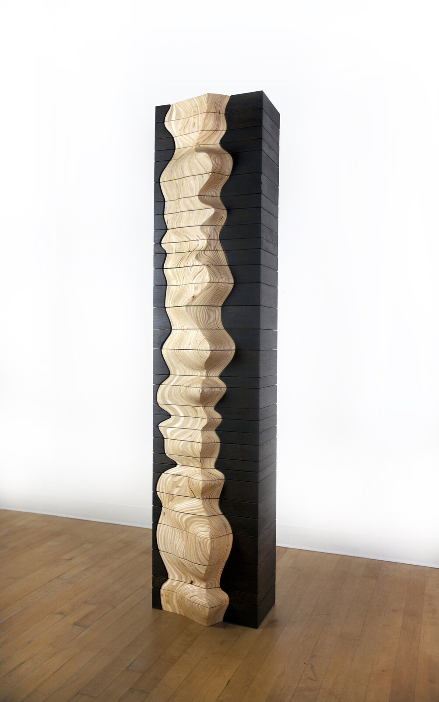
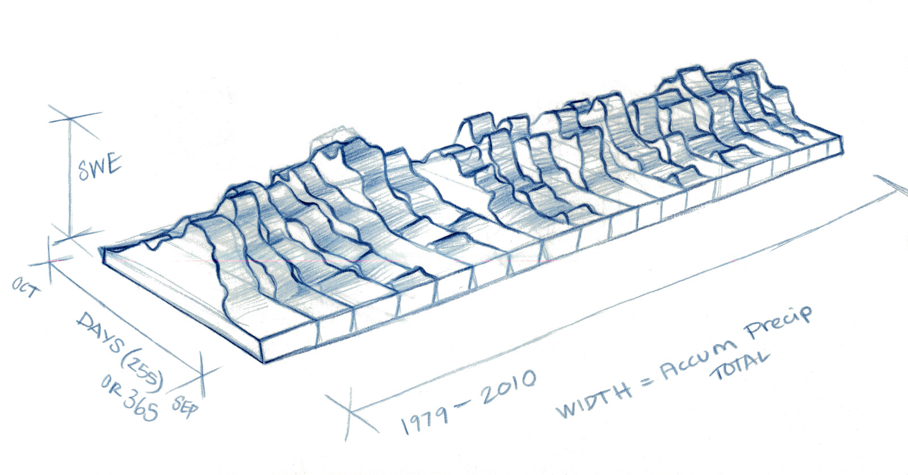
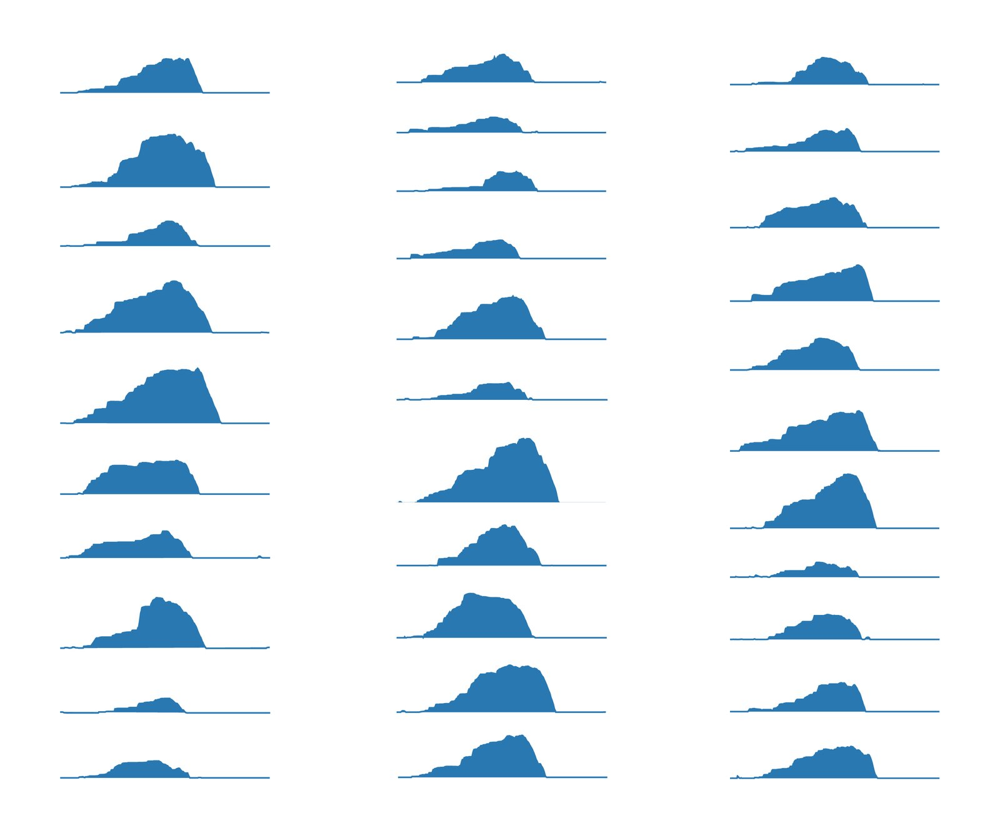
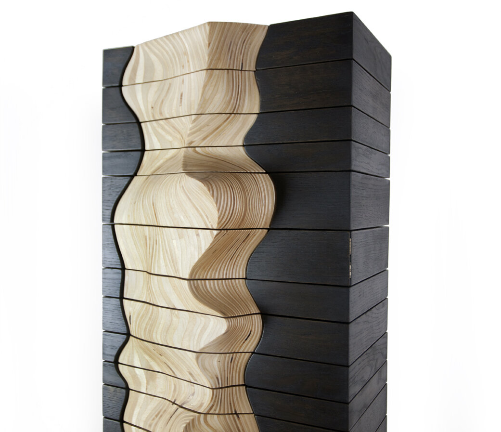
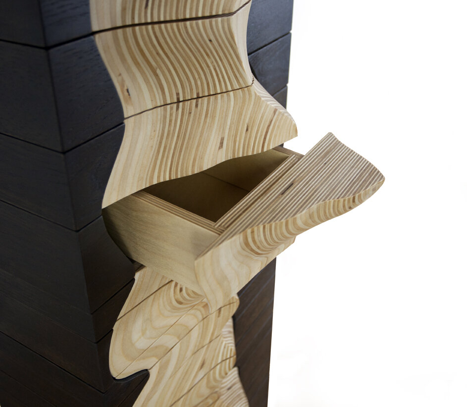

+++
author = "Yuichi Yazaki"
title = "31 Years of Snow in 31 Drawers: Adrien Segal's Snow Water Equivalent"
slug = "snow-water-equivalent"
date = "2026-11-05"
description = "A storage cabinet that turns 31 years (1980–2010) of snowpack data into 31 drawers. Each drawer's height shows that year's precipitation, and the carved relief of its front panel shows how snow water equivalent changed through the year."
categories = [
    "consume"
]
tags = [
    "data physicalization",
    "small multiples"
]
image = "images/cabinet-full-view.jpg"
+++

Adrien Segal's *Snow Water Equivalent* is a storage cabinet that turns 31 years (1980–2010) of snowpack data into 31 drawers. Each drawer is one year, with 1980 at the bottom and 2010 at the top. The height of a drawer shows that year's precipitation, and the relief carved into its plywood front panel shows how the snow water equivalent (SWE) changed through that year. The data were recorded by the NRCS (Natural Resources Conservation Service) at the Ebbetts Pass station in California's Sierra Nevada.

What follows is based on the work page on the artist's official website and on the artist's own making-of account on the official website of the book *Making with Data*. In the book, the first chapter of Part 1, "Handcraft" (1.1 "Snow Water Equivalent," pp. 37–50, doi:10.1201/9781003264903-1), is devoted to this work. I have not been able to read the chapter itself, so I use the making-of account, which is organized under the same headings as the chapter.

<!--more-->

## From childhood memories of Colorado snow to SNOTEL data

Segal is an artist based in Oakland, California, and teaches at the California College of the Arts (CCA). She studied furniture design at CCA and grew up in Colorado. According to the making-of account, the work grew out of her childhood memories of snow in the Colorado mountains. This is how Segal sees snow:

> Snow is the perfect seasonal water storage system, one that captures excess precipitation as frozen ice crystals during the winter months.

In other words, snow is a seasonal water-storage mechanism that holds the surplus precipitation of winter as ice crystals.

Looking for data, Segal came across SNOTEL, the NRCS monitoring network. It is an automated network in the western United States that publishes precipitation, snow depth, SWE and other measurements. Segal chose a station in the Sierra Nevada, where she now lives. SWE is the depth of water you would get if the whole snowpack were melted at once.

| Item | Details | Source |
|---|---|---|
| Station | SNOTEL Site: Ebbetts Pass, CA (Site Number 462) | The artist's work page |
| Location and elevation | 38°33′N, 119°48′W, elevation 8765 feet | The artist's work page (the NRCS's current site information gives 8660 ft, which does not match) |
| Period | 31 years (1980–2010) of water years | The artist's work page |
| Materials | Solid ash dyed black (frame), carved plywood (front panels) | Making-of account |
| Year made | 2011 | Heading on dataphys.org |
| Year made | 2012 | Caption in The Finch & Pea (2014) |
| Year made | The account says "1980 through 2010 when the sculpture was made," which could also be read as 2010 | Making-of account |

The sources disagree on the year the work was made, so this article does not settle on one. I could not confirm the dimensions from any primary source.

Source: Adrien Segal / "Snow Water Equivalent" on Adrien Segal's official website

## Stacking 31 years of graphs into a template

Segal first explores the form on paper. The "Paper mockups" section of the making-of account says:

> The annual charts of snow water equivalent were stacked to compare year to year snowpack levels.

That is, the yearly SWE charts were stacked to compare snowpack from one year to the next.

The sketch in the "Paper mockups" section of the making-of account (makingwithdata.org) has the axes labeled. Height is "SWE," depth is "DAYS (255) OR 365" with OCT and SEP at the ends, and the length direction is "1979–2010," with "WIDTH = Accum Precip TOTAL." At this stage the yearly layers were lined up side by side. The one-year offset from "1980–2010" can be read as the result of the water year starting in October of the previous year.

Source: Adrien Segal / "Snow Water Equivalent" on Making with Data

Once the proportions and scale were set, Segal fitted in the actual data points and, at this point, decided to orient the layers vertically. The making-of account says, "At this point I decided to orient the layers of data vertically." From here she switches to digital tools.

> I took each annual chart of snowpack into the computer program Adobe Illustrator and indexed them in relation to each other.

In short, she brought each year's snowpack chart into Illustrator and aligned them with one another. The work page includes a set of the yearly SWE charts.

Source: Adrien Segal / "Snow Water Equivalent" on Adrien Segal's official website

Using this figure as a template, she cuts the plywood with a band saw, laminates and glues the layers, and shapes them by hand with an angle grinder and other tools. The making-of account says, "I grind away the plywood until it becomes a single fluid form." After finishing with sandpaper, she cuts the form into its layers with a table saw and a dedicated jig. During the work she kept a spreadsheet of each layer's dimensions in view.

**The figure of overlaid small multiples becomes the blueprint for the three-dimensional object as it is**, or so it can be read. Aligning the graphs is the same job as making the template for cutting the wood.

## Drawer height and front-panel relief

The frame is solid ash, and its dimensions differ from year to year. Each drawer also has its own dimensions, and the making-of account says both were laborious. The cut plywood pieces are attached to the drawer fronts, and when the drawers are slid into the frame, the form of the original sculpture is restored. Finally, the drawers are assembled in chronological order, with 1980 at the bottom and 2010 at the top.

The table below sums up the correspondence between data and object as the artist describes it.

| Data | Property of the object | Artist's words (source) |
|---|---|---|
| Year (water year, 31 years) | One drawer. 1980 at the bottom, 2010 at the top | Making-of account |
| That year's total precipitation | Drawer height | Work page |
| Day-by-day SWE through that year | Shape of the front panel. A cross-section of the drawer seen from above is that year's SWE graph | Making-of account |
| Amount of water in that year's snowpack | Drawer size (how much it can hold) | Former work page (quoted on dataphys.org) |
| Whether it is data or not | Front panel is light plywood, frame is ash dyed black | Making-of account |
| Snow as natural water storage | Type of furniture (a storage cabinet) | Making-of account |

The former work page describes the front panels as a three-dimensional graph showing "the first snowfall, peak amount of water, and final snowmelt."

The artist's text does not say which direction on the front panel is the date and which is SWE. In the earlier sketch, SWE was height, days were depth, and precipitation was width. By orienting the layers vertically, precipitation, which had been the width, became the height of the drawer, and days and SWE moved onto the horizontal plane. That is how it can be read.

Source: Adrien Segal / "Snow Water Equivalent" on Adrien Segal's official website

To get a sense of the scale of the source data, during research I re-downloaded the daily data for SNOTEL 462 (SWE and accumulated precipitation) from the NRCS Report Generator and aggregated it by water year. The values below are **reference values, not the ones the artist used**. The NRCS notes that values may be revised, so they may differ from what the artist obtained at the time of making.

| Item (WY1980–2010, in inches) | Min | Max | Mean |
|---|---|---|---|
| Annual peak SWE | 17.2 (WY1987) | 76.8 (WY1995) | 39.9 |
| Water-year accumulated precipitation | 31.0 (WY1987) | 90.6 (WY1983) | 53.7 |

In these reference values, the correlation coefficient between annual peak SWE and annual precipitation is about 0.94. The artist distinguishes "height = precipitation" from "size = water in the snowpack," but as objects they are the same drawer dimension. Because the two quantities move together this closely, viewers probably take them in as nearly one quantity, or so it can be read.

If drawer height is assumed to be proportional to precipitation, the tallest drawer would be about 2.9 times the shortest. But the artist does not say whether it is proportional or whether a base height was added. The actual dimensions of the drawers have not been published either, so nothing about dimensions can be inferred from this. In the reference values, low-snow years run from 1987 to 1992, but I have not checked in the photographs how that appears as a pinch in the front panels.

## Snow's storage and human storage

This work matches the meaning of the data with the function of the object. In the Reflections section of the making-of account, Segal explains why she made it a cabinet:

> The Snow Water Equivalent sculpture ultimately took the form of a cabinet to make a connection between snow as a natural device for storing water and the devices humans use for storage.

That is, she made it a cabinet to connect snow, a natural device for storing water, with the tools people use for storage. The same section also says that in dry years the drawers hold less.

Source: Adrien Segal / "Snow Water Equivalent" on Adrien Segal's official website

The artist also writes about what she hopes viewers will do.

> They may ask themselves "what am I looking at and what is it telling me? Why is this drawer so small?"

In other words, viewers may ask what they are looking at and why this drawer is so small.

The smallness of a drawer is a quantity you notice when you try to put something in it, without reading any scale. The way the object is used is itself part of the encoding, or so it can be read. On the other hand, the station and the period do not appear in the work itself. The work page adds a table of station information and an explanatory text.

She explained her choice of plywood in 2017 on Data Stories #106. It can be cut into flat, complex shapes and the layers are easy to align. Solid wood expands and contracts and is prone to cracking and warping. The frame was dyed black for contrast with the front panels. It can be read as separating the surface that carries the data from the surface that supports it, by material and color.

The curved surfaces between years are not data points. They are joins made by sanding the stacked plywood by hand, so it can be read that the artist's hand is interpolating between the 31 graphs.

## How third parties saw the work

The first is a survey by researchers. "Data to Physicalization" by Djavaherpour et al. (EuroVis 2021 STAR) cites this work as an example of an approach distinctive to its maker. The section on environmental data includes this sentence:

> Segal transformed the amount of water stored as snow throughout a season into furniture, where the choice of forms and materials connected back to the origins of the data

In short, she turned the amount of water stored as snow into furniture, and tied form and materials to where the data came from. In the section on the fabrication process, on the other hand, the survey says that the method of cutting and stacking layers, which includes Segal's work, is time-consuming.

The second is a science-art blog. Michele Banks, in The Finch & Pea (2014), picked up the contrast of cold data rendered in a warm material.

> Data are hard. Snow is cold. And yet artist Adrien Segal chose wood, a warm, yielding material, to visualize snowpack data, to stunning effect.

That is, data are hard and snow is cold, yet Segal chose warm, yielding wood. Banks introduces SNOTEL as data for forecasting the water supply under a changing climate.

The third is a local newspaper. Michael Armstrong of the Homer News (2014) opens with the observation that the XY graph dominates how information is shown, and stresses that this work is a real cabinet in which things can actually be stored. The article states that the volume of the drawers represents the amount of water to scale, but this cannot be confirmed from the artist's own text. In this interview Segal says, "Can I touch that? Can I feel that? That's the response I want."

As a side note, on Data Stories #106 Moritz Stefaner says to Segal, "the shape is the data, which is so abstract and non tangible." But he touched on this work itself only briefly.

## Takeaways

There are three things from this work that you can take back to visualization work.

The first is to match the meaning of the data with the function of the object. Snow stores water, so she made the data into furniture that stores things. The artist writes, "The concept behind the data drives every decision." Even for charts on a screen, you can ask whether the form and interactions behave the way the thing the data represents behaves.

The second is that aligning small multiples can become the design of a three-dimensional object. Because the 31 yearly graphs were laid out on the same baseline, they could be cut, stacked and made into a single form. How you align baselines also decides how easy comparison is on a flat page.

The third is to separate the parts that carry data from the parts that do not. Segal separated the front panels and the frame by material and color. It is also worth keeping in mind the difference between surfaces interpolated by hand and forms that come from data points. Context that cannot be carried by the object, such as the station and the period, needs to be supplied separately.

## References

**Primary sources**

- Adrien Segal, "Snow Water Equivalent," the artist's official website: https://www.adriensegal.com/snow-water-equivalent
- Adrien Segal, "About": https://www.adriensegal.com/about
- Adrien Segal, "Press": https://www.adriensegal.com/press
- Adrien Segal, "Snow Water Equivalent," *Making with Data* project page (the artist's making-of account): https://makingwithdata.org/project/cabinet
- Adrien Segal, "Snow Water Equivalent," in S. Huron, T. Nagel, L. Oehlberg, W. Willett (eds.), *Making with Data: Physical Design and Craft in a Data-Driven World*, A K Peters/CRC Press, Part 1 "Handcraft", Chapter 1.1, pp. 37–50. (The publisher's page gives Copyright 2023; the Crossref registration date is 2022-11-16.) doi:10.1201/9781003264903-1 / Book page: https://www.routledge.com/Making-With-Data-Physical-Design-and-Craft-in-a-Data-Driven-World/Huron-Nagel-Oehlberg-Willett/p/book/9781032182223
- Data Stories #106 "Data Sculptures with Adrien Segal" (Enrico Bertini, Moritz Stefaner, 2017): https://archive.datastori.es/episode/106
- NRCS Report Generator: daily SWE and precipitation for SNOTEL 462 Ebbetts Pass (used for the reference-value aggregation): https://wcc.sc.egov.usda.gov/reportGenerator/view_csv/customSingleStationReport/daily/462:CA:SNTL%7Cid=%22%22%7Cname/1979-10-01,2010-09-30/WTEQ::value,PREC::value
- dataphys.org, "2011 – Adrien Segal's Data Furniture" (added by Yvonne Jansen; quotes the former work page): https://dataphys.org/list/data-furniture/

**Secondary sources**

- H. Djavaherpour, F. Samavati, A. Mahdavi-Amiri, F. Yazdanbakhsh, S. Huron, R. Levy, Y. Jansen, L. Oehlberg, "Data to Physicalization: A Survey of the Physical Rendering Process," EuroVis 2021 STAR, *Computer Graphics Forum* 40(3): https://arxiv.org/abs/2102.11175
- Michele Banks, "The Art of Science: Cold, Hard Data in Warm, Soft Wood," *The Finch & Pea*, 2014-05-14: https://thefinchandpea.com/2014/05/14/the-art-of-science-cold-hard-data-in-warm-soft-wood/
- Michael Armstrong, "From Science to Sculpture," *Homer News*, 2014-05-07: https://www.homernews.com/2014/05/07/from-science-to-sculpture/
- Wikipedia, "Adrien Segal": https://en.wikipedia.org/wiki/Adrien_Segal
