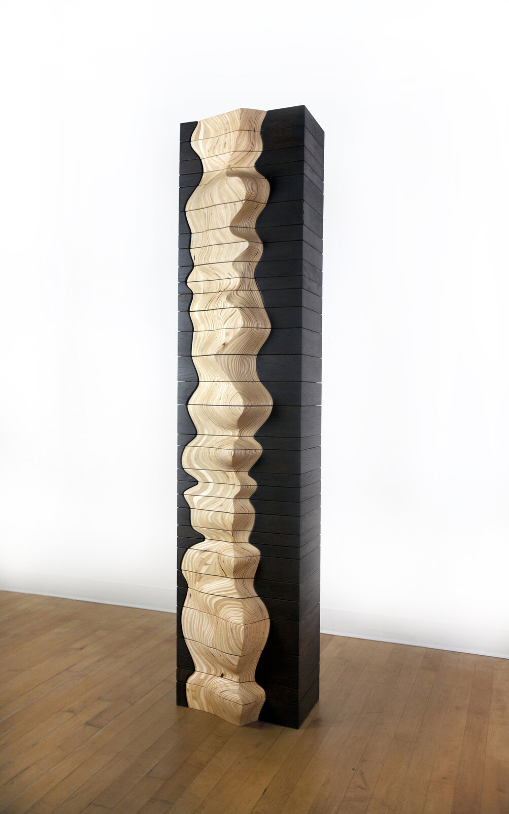
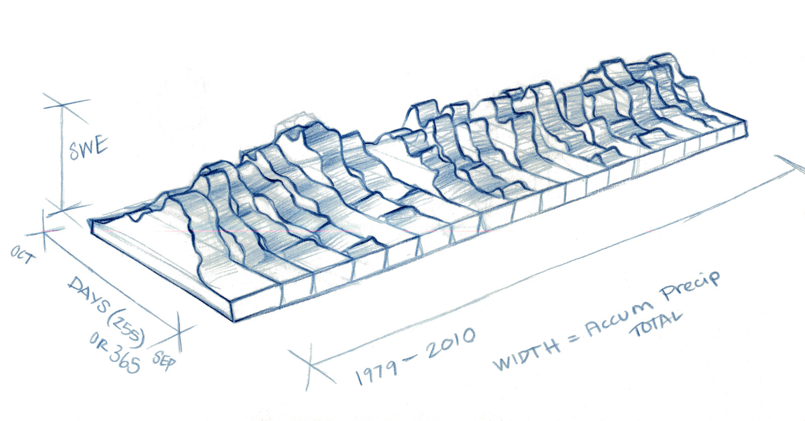
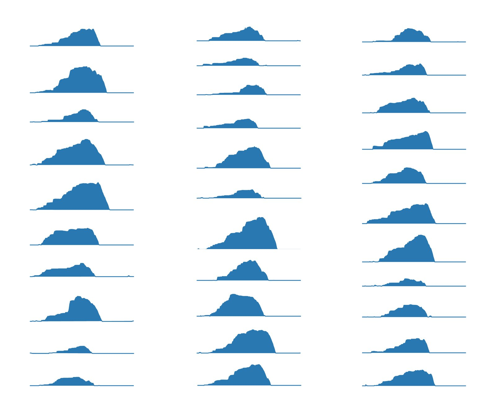
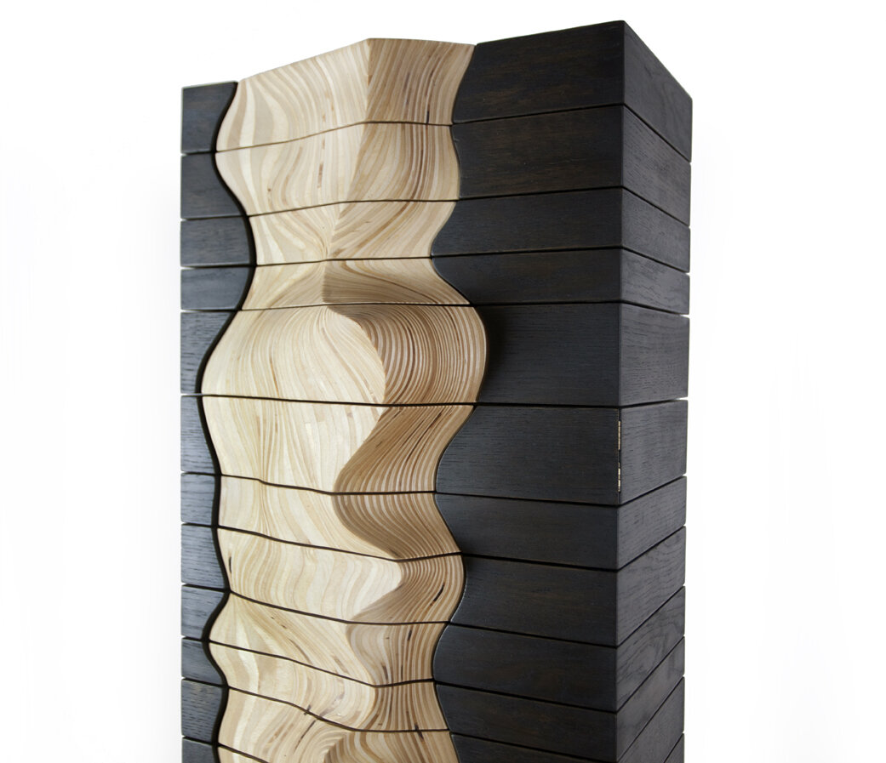
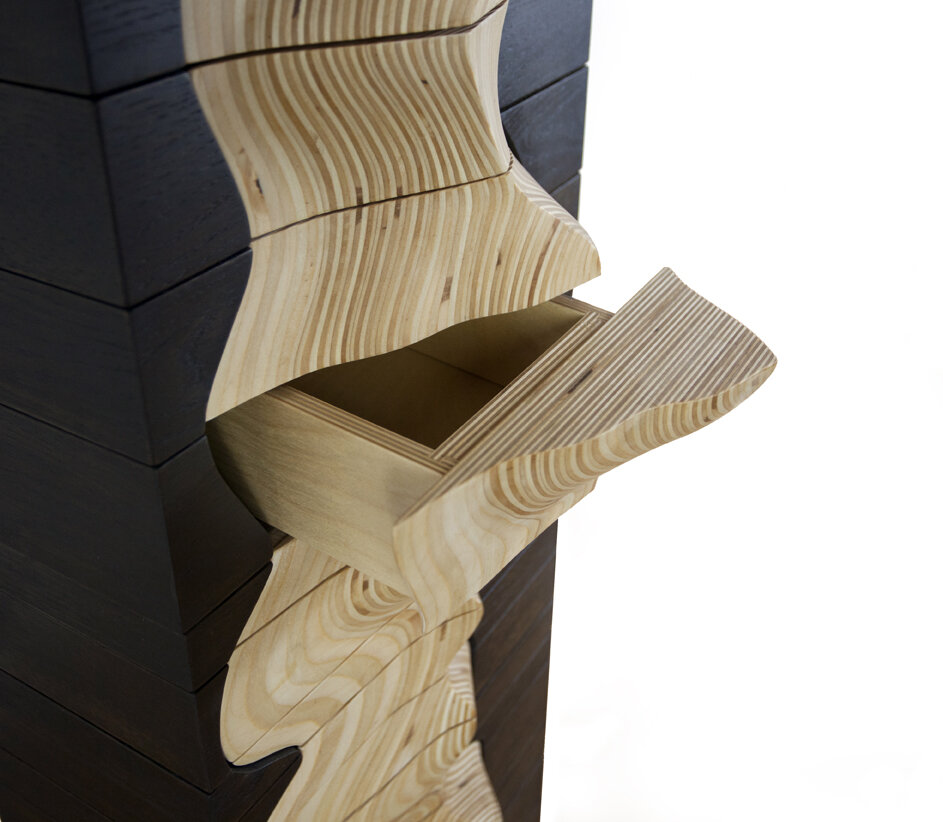

+++
author = "矢崎裕一"
title = "31年分の雪を、31段の引き出しにする──Adrien Segal『Snow Water Equivalent』"
slug = "snow-water-equivalent"
date = "2026-11-05"
description = "1980〜2010年の31年分の積雪データを、31段の引き出しにした収納家具です。引き出しの高さが年降水量を、彫った前板の起伏が積雪水量の推移を表します。"
categories = [
    "consume"
]
tags = [
    "データ物質化",
    "スモールマルチプル"
]
image = "images/cabinet-full-view.jpg"
series = ["data-physicalization"]
series_weight = 19
seriesByline = "Adrien Segal"
seriesTitle = "31年の雪を31段の引き出しに──Snow Water Equivalent"
+++

Adrien Segal（エイドリアン・シーガル）の『Snow Water Equivalent』は、31年分（1980〜2010年）の積雪データを31段の引き出しにした収納家具です。1段が1年で、下が1980年、上が2010年です。引き出しの高さがその年の降水量を、彫った合板の前板の起伏がその年の積雪水量（SWE）の推移を表します。データは、カリフォルニア州シエラネバダの観測点 Ebbetts Pass で、NRCS（Natural Resources Conservation Service）が記録したものです。

以下は、作者の公式サイトの作品ページと、書籍『Making with Data』の公式サイトにある作者自身の制作記に沿います。書籍では、第1部「Handcraft」の最初の章（1.1「Snow Water Equivalent」、pp. 37–50、doi:10.1201/9781003264903-1）がこの作品に当てられています。章そのものは読めていないため、章と同じ見出しの構成で書かれた制作記を使います。

<!--more-->

## コロラドの雪の記憶から、SNOTEL のデータへ

Segal はカリフォルニア州オークランドを拠点にする作家で、California College of the Arts（CCA）で教えています。CCA で家具デザインを学び、コロラド州で育ちました。制作記によれば、この作品はコロラドの山で育った子ども時代の雪の記憶から生まれました。雪を、Segal はこう見立てます。

> Snow is the perfect seasonal water storage system, one that captures excess precipitation as frozen ice crystals during the winter months.

雪は、冬の余った降水を氷の結晶として蓄える、季節ごとの貯水の仕組みだ、という意味です。

データを探して、Segal は NRCS の観測網 SNOTEL に行き着きます。米国西部の自動観測網で、降水量や積雪深、SWE などを公開しています。Segal は、いま住んでいるシエラネバダの観測点を選びました。SWE は、積雪をすべて一瞬で融かしたときにできる水の深さです。

| 項目 | 内容 | 出典 |
|---|---|---|
| 観測点 | SNOTEL Site: Ebbetts Pass, CA（Site Number 462） | 作者の作品ページ |
| 位置・標高 | 北緯38度33分、西経119度48分、標高 8765 feet | 作者の作品ページ（NRCS の現行のサイト情報は 8660 ft で、食い違う） |
| 期間 | 31年（1980〜2010年）の水文年 | 作者の作品ページ |
| 素材 | 黒く染めた無垢のアッシュ（枠）、彫刻した合板（前板） | 制作記 |
| 制作年 | 2011年 | dataphys.org の見出し |
| 制作年 | 2012年 | The Finch & Pea（2014）のキャプション |
| 制作年 | 「1980 through 2010 when the sculpture was made」とあり、2010年とも読める | 制作記 |

制作年は資料によって食い違うので、この記事では一つに決めていません。寸法は一次資料で確かめられませんでした。

Adrien Segal／Adrien Segal 公式サイト「Snow Water Equivalent」より引用

## 31年分のグラフを重ねて、型紙にする

Segal は、まず紙の上で形を探ります。制作記の「Paper mockups」の節には、こうあります。

> The annual charts of snow water equivalent were stacked to compare year to year snowpack levels.

年ごとの SWE のグラフを積み重ねて、年と年の積雪を比べた、という意味です。

制作記（makingwithdata.org）の「Paper mockups」の節に載っているスケッチには、軸の名前が書き込まれています。高さが「SWE」、奥行きが「DAYS（255）OR 365」で、端に OCT と SEP。長さの方向が「1979–2010」で、「WIDTH = Accum Precip TOTAL」とあります。この段階では、年の層は横に並んでいました。「1980〜2010年」と1年ずれるのは、水文年が前年10月に始まるためと読めます。

Adrien Segal／Making with Data「Snow Water Equivalent」より引用

比率とスケールが決まったところで、Segal は実際のデータ点を当てはめ、ここで層を縦に積む向きに決めます。制作記には「At this point I decided to orient the layers of data vertically」とあります。ここからはデジタルの道具に切り替えます。

> I took each annual chart of snowpack into the computer program Adobe Illustrator and indexed them in relation to each other.

年ごとの積雪のグラフを Illustrator に取り込み、互いの位置をそろえた、という要旨です。作品ページには、年ごとの SWE のグラフの一覧が載っています。

Adrien Segal／Adrien Segal 公式サイト「Snow Water Equivalent」より引用

この図を型紙に合板をバンドソーで切り、積層して接着し、アングルグラインダーなどで手で削ります。制作記には「I grind away the plywood until it becomes a single fluid form」とあります。紙やすりで仕上げたあと、テーブルソーと専用の治具で層ごとに切り分けます。作業中は各層の寸法を書いた表計算を見ていました。

**スモールマルチプルを重ねた図が、そのまま立体の設計図になっている**と読めます。グラフの位置をそろえる作業が、木を切る型紙を作る作業と同じだからです。

## 引き出しの高さと、前板の起伏

枠は無垢のアッシュで、年ごとに寸法が違います。引き出しも1段ずつ寸法が違い、制作記はどちらも手間がかかったと書いています。切り分けた合板は引き出しの前に付けられ、引き出しを枠に収めると、元の彫刻の形に戻ります。最後に、1980年を下、2010年を上にして年順に組み立てます。

作者が書いているデータと物の対応を、表にまとめます。

| データ | 物の性質 | 作者の言葉（出典） |
|---|---|---|
| 年（水文年、31年分） | 引き出し1段。下が1980年、上が2010年 | 制作記 |
| その年の総降水量 | 引き出しの高さ | 作品ページ |
| その年の日々の SWE の推移 | 前板の形。引き出しを上から見た断面が、その年の SWE のグラフ | 制作記 |
| その年の積雪の水の量 | 引き出しの大きさ（しまえる量） | 旧作品ページ（dataphys.org に引用） |
| データかどうか | 前板は明るい合板、枠は黒く染めたアッシュ | 制作記 |
| 雪＝自然の貯水 | 家具の種類（収納のキャビネット） | 制作記 |

旧作品ページは、前板を「the first snowfall, peak amount of water, and final snowmelt」、つまり初雪・水量のピーク・消雪を示す立体のグラフだと書いています。

前板のどの向きが日付で、どの向きが SWE かは、作者の文には書かれていません。先のスケッチでは、SWE が高さ、日数が奥行き、降水量が幅でした。層を縦にしたことで、幅だった降水量が引き出しの高さになり、日数と SWE は水平面に移った、と読めます。

Adrien Segal／Adrien Segal 公式サイト「Snow Water Equivalent」より引用

元データの規模を見るために、調査の段階で NRCS の Report Generator から SNOTEL 462 の日次データ（SWE と積算降水量）を取り直し、水文年ごとに集計しました。下の値は**作者が使った値ではなく、参考値**です。NRCS は値が改訂されうると注記していて、作者が制作時に取得した値と違う可能性があります。

| 項目（WY1980〜2010、単位はインチ） | 最小 | 最大 | 平均 |
|---|---|---|---|
| 年最大 SWE | 17.2（WY1987） | 76.8（WY1995） | 39.9 |
| 水文年の積算降水量 | 31.0（WY1987） | 90.6（WY1983） | 53.7 |

この参考値では、年最大 SWE と年降水量の相関係数は約0.94です。作者は「高さ＝降水量」と「大きさ＝積雪の水」を言い分けていますが、物としては同じ引き出しの寸法です。二つの量がこれだけ連動するので、見る人にはほぼ一つの量として伝わる、と読めます。

高さが降水量に比例すると仮定すれば、いちばん高い段はいちばん低い段の約2.9倍になります。ただ、比例なのか基準の高さを足したのかは、作者が書いていません。引き出しの実寸も公表されていないので、ここから寸法は推定できません。参考値では1987〜1992年に少雪の年が続きますが、それが前板のくびれとしてどう見えるかは、写真では確かめていません。

## 雪の貯水と、人の収納

この作品は、データの意味と物の機能を合わせています。制作記の振り返り（Reflections）で、Segal はキャビネットにした理由をこう書きます。

> The Snow Water Equivalent sculpture ultimately took the form of a cabinet to make a connection between snow as a natural device for storing water and the devices humans use for storage.

雪という自然の貯水装置と、人が使う収納の道具を結びつけるために、キャビネットの形にした、という要旨です。同じ節には、乾いた年は引き出しにしまえる量が少ない、とも書かれています。

Adrien Segal／Adrien Segal 公式サイト「Snow Water Equivalent」より引用

見る人に期待することも、作者は書いています。

> They may ask themselves "what am I looking at and what is it telling me? Why is this drawer so small?"

「何を見ているのか」「なぜこの引き出しはこんなに小さいのか」と問うかもしれない、という意味です。

引き出しの小ささは、目盛りを読まなくても、しまおうとして気づける量です。物の使われ方そのものがエンコーディングの一部になっている、と読めます。一方で、地点や期間は作品には表れません。作品ページは、地点の情報の表と説明文を添えています。

合板を選んだ理由は、2017年の Data Stories #106 で話しています。平らで複雑な形に切れ、層を位置合わせしやすい。無垢材は伸び縮みして割れや反りが出やすい、という説明です。枠は前板との対比のために黒く染めました。データを担う面と支える面を、素材と色で分けていると読めます。

年と年のあいだの曲面は、データ点ではありません。積んだ合板を手で削ったつなぎで、31本のグラフのあいだを作家の手が補間していると読めます。

## 第三者はこの作品をどう見たか

一つ目は、研究者のサーベイです。Djavaherpour らの「Data to Physicalization」（EuroVis 2021 STAR）は、この作品を作り手独自のアプローチの例に挙げています。環境データの節には、次の一文があります。

> Segal transformed the amount of water stored as snow throughout a season into furniture, where the choice of forms and materials connected back to the origins of the data

雪としてたまる水の量を家具に変え、形と素材をデータの出どころに結びつけた、という要旨です。一方で制作工程の節では、Segal の作品を含む、層を切って積む方法は時間がかかる、と述べています。

二つ目は、科学アートのブログです。Michele Banks は The Finch & Pea（2014）で、冷たいデータを温かい素材で表した対比を取り上げました。

> Data are hard. Snow is cold. And yet artist Adrien Segal chose wood, a warm, yielding material, to visualize snowpack data, to stunning effect.

データは硬く、雪は冷たい。それでも Segal は温かく柔らかい木を選んだ、という要旨です。Banks は SNOTEL を、変化する気候のもとで水の供給を予測するデータとして紹介しています。

三つ目は、地方紙です。Homer News の Michael Armstrong（2014）は、XY グラフが情報の見せ方を支配している、という話から書き始め、この作品が実際に物をしまえるキャビネットである点を強調しました。記事は引き出しの容積が水の量を縮尺どおりに表すと書いていますが、作者の文では確かめられません。Segal はこの取材で「Can I touch that? Can I feel that? That's the response I want」と話しています。

補足として、Data Stories #106 で Moritz Stefaner（モーリッツ・ステファナー）は、Segal に向けて「the shape is the data, which is so abstract and non tangible」と話しています。ただ、この作品そのものには短く触れただけでした。

## 使い道

この作品から、可視化の仕事に持ち帰れることは三つあります。

一つ目は、データの意味と物の機能を合わせることです。積雪は水をためるので、データを、ものをためる家具にしました。作者は「The concept behind the data drives every decision」と書いています。画面の図でも、形や操作がデータの表すものと同じふるまいをするかを考えられます。

二つ目は、スモールマルチプルの位置をそろえる作業が、立体の設計になることです。31本の年次グラフを同じ基準で並べたから、切って積んで一つの形にできました。基準線のそろえ方は、平面でも比べやすさを決めます。

三つ目は、データを担う部分と担わない部分を分けることです。Segal は前板と枠を素材と色で分けました。手で補間した面とデータ点から来た形の違いも、意識しておけます。地点や期間のように物に載らない文脈は、別に添える必要があります。

## 参考・出典

**一次情報**

- Adrien Segal「Snow Water Equivalent」作者の公式サイト：https://www.adriensegal.com/snow-water-equivalent
- Adrien Segal「About」：https://www.adriensegal.com/about
- Adrien Segal「Press」：https://www.adriensegal.com/press
- Adrien Segal「Snow Water Equivalent」*Making with Data* プロジェクトページ（作者の制作記）：https://makingwithdata.org/project/cabinet
- Adrien Segal, "Snow Water Equivalent," in S. Huron, T. Nagel, L. Oehlberg, W. Willett (eds.), *Making with Data: Physical Design and Craft in a Data-Driven World*, A K Peters/CRC Press, Part 1 "Handcraft", Chapter 1.1, pp. 37–50.（出版社ページの表記は Copyright 2023、Crossref の登録日は2022-11-16）doi:10.1201/9781003264903-1 / 書籍ページ：https://www.routledge.com/Making-With-Data-Physical-Design-and-Craft-in-a-Data-Driven-World/Huron-Nagel-Oehlberg-Willett/p/book/9781032182223
- Data Stories #106「Data Sculptures with Adrien Segal」（Enrico Bertini、Moritz Stefaner、2017）：https://archive.datastori.es/episode/106
- NRCS Report Generator：SNOTEL 462 Ebbetts Pass の日次 SWE と降水量（参考値の集計に使用）：https://wcc.sc.egov.usda.gov/reportGenerator/view_csv/customSingleStationReport/daily/462:CA:SNTL%7Cid=%22%22%7Cname/1979-10-01,2010-09-30/WTEQ::value,PREC::value
- dataphys.org「2011 – Adrien Segal's Data Furniture」（Yvonne Jansen 追加。旧作品ページの文を引用）：https://dataphys.org/list/data-furniture/

**第三者評価**

- H. Djavaherpour, F. Samavati, A. Mahdavi-Amiri, F. Yazdanbakhsh, S. Huron, R. Levy, Y. Jansen, L. Oehlberg, "Data to Physicalization: A Survey of the Physical Rendering Process," EuroVis 2021 STAR, *Computer Graphics Forum* 40(3)：https://arxiv.org/abs/2102.11175
- Michele Banks, "The Art of Science: Cold, Hard Data in Warm, Soft Wood," *The Finch & Pea*, 2014-05-14：https://thefinchandpea.com/2014/05/14/the-art-of-science-cold-hard-data-in-warm-soft-wood/
- Michael Armstrong, "From Science to Sculpture," *Homer News*, 2014-05-07：https://www.homernews.com/2014/05/07/from-science-to-sculpture/
- Wikipedia「Adrien Segal」：https://en.wikipedia.org/wiki/Adrien_Segal
