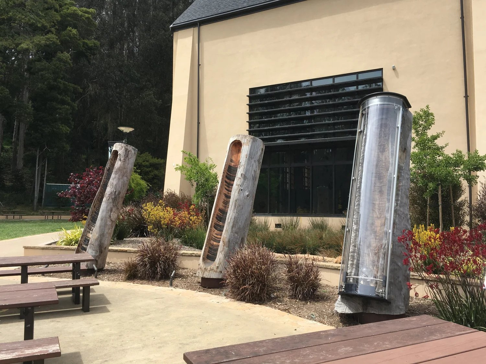
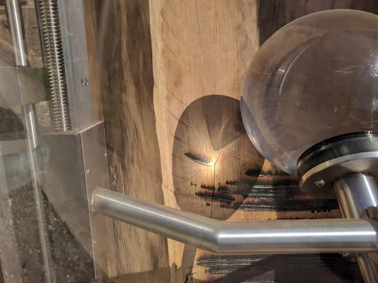
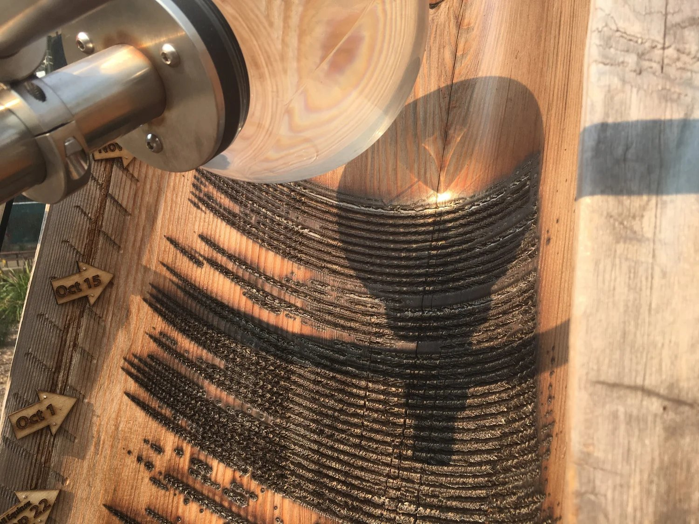
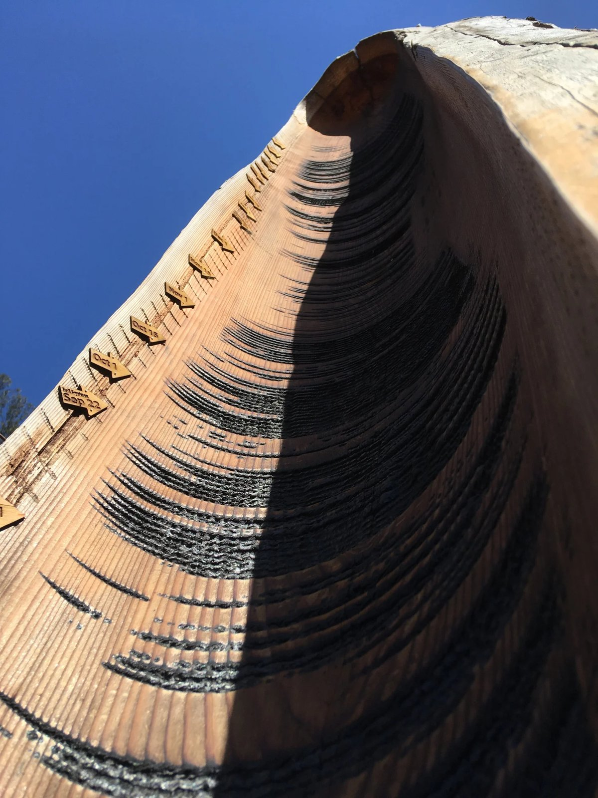
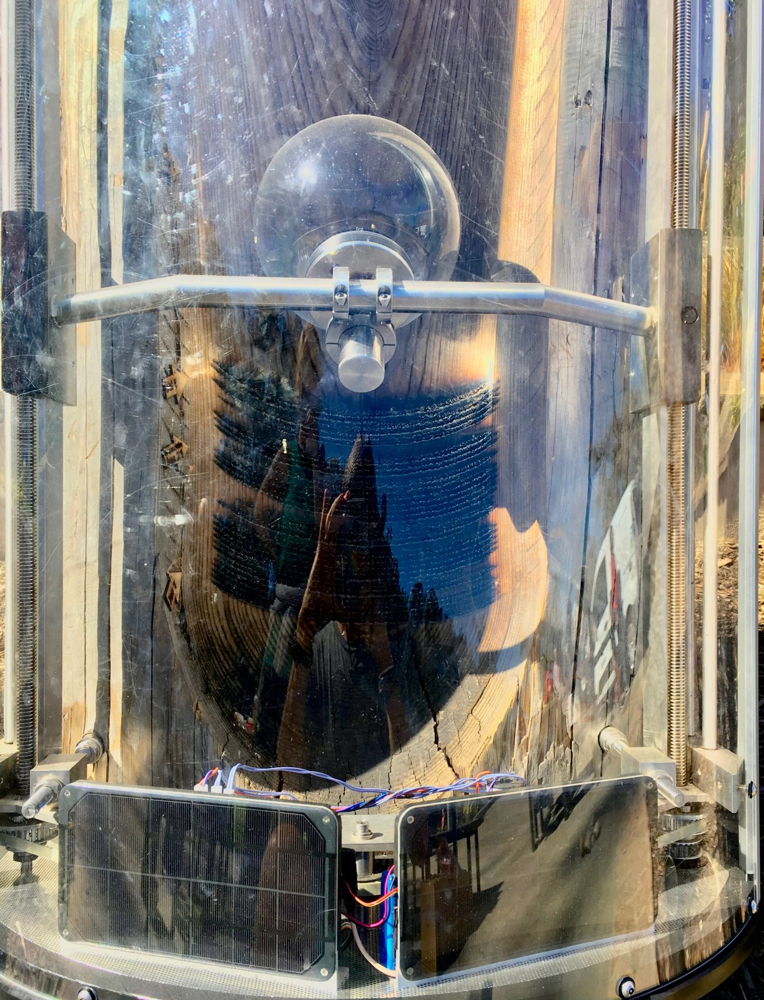

+++
author = "Yuichi Yazaki"
title = "Burning Logs with a Glass Ball to Record Sunshine: Charles Sowers's Solar Totems"
slug = "solar-totems"
date = "2026-11-05"
description = "Solar Totems is a public sculpture in which a glass ball focuses sunlight to burn a record of sunshine into logs. Each day adds one burned line, and three logs hold one year each."
categories = [
    "consume"
]
tags = [
    "data physicalization"
]
image = "images/cover.jpg"
series = ["data-physicalization"]
series_weight = 39
seriesByline = "Charles Sowers"
seriesTitle = "Burning Logs with a Glass Ball to Record Sunshine: Solar Totems"
+++

Charles Sowers's Solar Totems is a public sculpture in which a glass ball focuses sunlight to burn logs and record sunshine. As the sun moves across the sky, the burn becomes a single line, and when fog or clouds appear, the line breaks. The lens is advanced a little each day, so each day makes one line. Three logs take one year each.

The work was commissioned by the San Francisco Arts Commission and placed on the plaza in front of the Glen Park Canyon Recreation Center. The city's announcement is dated June 5, 2017, and the artist's page gives the dates as "2017-2020." Below, I follow the artist's official page and the city's announcement, and then read the assessments by a researcher and by visitors.

<!--more-->

## 2017: Three logs stand on the recreation center plaza

On June 5, 2017, the city's arts commission announced that a new work by Sowers had joined the renovated Glen Park Canyon Recreation Center. The announcement introduces Sowers as a local artist who weaves his love of science into his work.

According to the announcement, the material is three reclaimed redwood logs. Each is 30 inches (about 76 cm) in diameter and 12 feet (about 3.7 m) tall, and they were set upright on a south-facing open plaza in front of the building. One of them carries a solar-powered mechanism and a spherical lens.

From Charles Sowers / Charles Sowers, "Solar Totems"

The work was not delivered in finished form. Once installed, its record builds up over three years. The photo in the city's announcement shows Tom DeCaigny (director of cultural affairs), Sowers, Mayor Edwin M. Lee, and Phil Ginsburg (general manager of the Recreation and Park Department). DeCaigny said the work speaks to the natural wonders of this urban park.

The work also has a book chapter. In *Making with Data: Physical Design and Craft in a Data-Driven World* (edited by Samuel Huron, Till Nagel, Lora Oehlberg, and Wesley Willett; A K Peters/CRC Press, 2022), Part 5, Environment, includes chapter 5.3, "Solar Totems." Its author is Sowers himself, at pp. 345–358, DOI 10.1201/9781003264903-23. The same part also has a chapter on [Perpetual Plastic](/en/perpetual-plastic/), and the part's introduction was written by the researcher Dietmar Offenhuber. I have not been able to check the text of the chapter for this article.

## Putting a 19th-century sunshine recorder onto wood

The city's announcement describes where the idea came from.

> Inspired by 19th-century meteorological instruments that used a spherical glass lens to burn a sunshine record on a substrate of wood or paper, Solar Totems is a sculptural data-logger that creates an archive of the interaction of sun, weather and site.

In short, the work was inspired by 19th-century meteorological instruments that focused sunlight with a glass sphere and burned a record of sunshine into wood or paper. The city calls the work a "sculptural data-logger" and says it archives the interaction of sun, weather, and site.

The instrument behind it is known as the Campbell–Stokes recorder. According to Wikipedia, John Francis Campbell devised it in 1853, and George Gabriel Stokes improved it in 1879. Campbell's first device fitted a large spherical lens to a wooden bowl and let the sun scorch the bowl.

In Stokes's improved version, the recording medium is a card. Since Solar Totems has the sun write directly on wood, it can also be read as going back to a form that predates the card.

From Charles Sowers / Charles Sowers, "Solar Totems"

The artist's page describes the mechanism as follows.

> Over the course of 3 years, three reclaimed redwood logs receive the "writing" of the sun as its rays are focused by a spherical lens to lightly burn into the wood. As the sun moves across the sky, the burn becomes a line, preserving a record of sunshine periodically broken by fog or cloudy skies.

Over three years, three reclaimed redwood logs receive the "writing" of the sun. Light focused by a spherical lens lightly burns the wood, and as the sun moves across the sky, the burn becomes a line. The line is broken from time to time by fog or cloudy skies, and that break is itself the record of sunshine.

## One line is one day, one log is one year

The artist's page goes on to say how days and years are marked.

> The lens is advanced a small distance each day to create a distinct daily line. After one year the heliograph mechanism is transferred to the next log. In this way, the work is completed on-site and becomes a sculptural archive of the specific atmospheric conditions of the site.

The lens is advanced a little each day, which makes a distinct line for each day. After one year, the heliograph mechanism is moved to the next log. In this way the work is completed on site and becomes a sculptural archive of the atmospheric conditions specific to that place.

The artist's text does not say in which direction the lens is advanced. The two articles read in a later section both say the lens is advanced "upward." In the artist's photo, horizontally running burn lines are stacked in many tiers, one above another.

From Charles Sowers / Charles Sowers, "Solar Totems"

In this photo, arrow-shaped tags reading "Oct 1" and "Oct 15" are visible along the edge of the log. They are a scale for reading the order of the lines as dates. The correspondence between the data and the appearance is as follows.

| Data | Physical appearance / material | Source |
|---|---|---|
| Presence or absence of sunshine | Whether there is a mark burned into the wood where the lens's focal point fell (a burn line) | Artist's page |
| Time of day (the sun's movement) | The length of the line formed as burn marks connect | Artist's page (that the lines run horizontally is from the photos) |
| Breaks in sunshine caused by fog or cloud | Gaps in the line | Artist's page |
| Date | One line per day, made by the lens advanced a little each day. The position in the vertical stack | Artist's page (that the lines are stacked vertically is from the photos; that the direction is upward is from third-party articles) |
| Year | One log. After one year the mechanism moves to the next log (three logs for three years) | Artist's page, city announcement |
| Place | The work is fixed on the plaza. The record can only be taken at that place | Artist's page, city announcement |

There is no dataset received from outside. Sunlight that reaches the plaza is burned into the wood on the spot.

From how the photos look, the face of a log can be read as a grid of "horizontal = time of day, vertical = date," with the presence or absence of burn showing the value. This way of reading is close to that of a [calendar heat map](/en/calendar-heat-map/). However, the value is not a continuous quantity; it is almost a binary of "burned or not burned."

Regarding the Campbell–Stokes recorder, Wikipedia says it measures only sufficiently strong sunlight (bright sunshine), not all visible sunlight. The lines of Solar Totems, which uses the same mechanism, can be read as recording only sunshine above a certain intensity. I have not found any source that says this about the work itself.

From Charles Sowers / Charles Sowers, "Solar Totems"

The city's announcement also touches on year-to-year comparison. When a year's record is finished, the sunshine recorder moves to the next log, and park users can compare differences in weather from year to year. **Placing the three logs side by side can be read as forming a [small multiples](/en/small-multiples/) display that compares the same season across years.**

The artist himself says the following in the city's announcement.

> Taken together, the three transformed logs turn the plaza into a kind of civic solar and atmospheric observatory, artistically expanding our understanding of place and connecting us to our environment through that understanding.

Taken together, the three logs make the plaza a kind of civic observatory of sun and atmosphere. He adds that the work expands our understanding of place and, through that understanding, connects people to their environment.

## How did third parties see the work?

In his 2020 paper "What We Talk About When We Talk About Data Physicality," the researcher Offenhuber divided data physicalization along two axes: epistemological versus ontological, and representational versus relational. Solar Totems appears in Figure 9b as an example of the "ontological and relational" quadrant.

> Examples in this last quadrant operate without traditional data sets and don't use visual languages based on symbolic mappings and representation.

Examples in this quadrant work without traditional datasets and do not use visual languages based on symbolic mapping or representation. In the same paragraph, Offenhuber writes that works in this quadrant sometimes take the form of instruments that reproduce the process of collecting data. He describes Solar Totems as a work that records daily hours of sunshine as burn marks left by a spherical lens, and cites it as belonging to the lineage of Campbell's sunshine recorder.

Joan Sullivan is a photographer in Quebec, Canada, who photographs renewable energy. On October 16, 2017, she wrote "Solar Totems and Wave Walls" for Artists & Climate Change. She reads one line as a day's weather pattern, such as sunny, partly cloudy, or cloudy, and writes that a year adds up to "365 solar etchings." The 365 is Sullivan's count; the artist does not state a number of lines. Her words of appraisal are these.

> This is what climate change artists do best: using metaphor to build awareness, a sense of connection and familiarity to overcome anxiety, fear and resistance.

Using metaphor to build awareness, and creating connection and familiarity to overcome anxiety, fear, and resistance: that, she says, is what artists who work on climate change do best. This article was written before her visit.

On July 14, 2018, Steve Jurvetson posted "Solar Totems in Noe Valley" on his blog. The title names the neighboring district, but what is pictured is the work in Glen Park.

> The ball lens slowly advances upward over time… focusing the sunlight to burn daily stripes in a 12′ tall log. Each line records the level of sunlight or shade for the day.

The ball lens advances slowly upward over time, burning daily stripes into a 12-foot log, and each line records that day's sunlight and shade. In the comments, one reader wrote "brilliantly elegant design."

From Steve Jurvetson / steve.blog, "Solar Totems in Noe Valley"

## Takeaways

The burn lines of Solar Totems are not a chart that someone made after collecting sunshine data. An instrument leaves the record on the spot. I read three things that can be taken back into visualization work.

The first is showing the process of recording. The way burn lines increase by one a day shows how data comes into being, as it is. The instruments that Offenhuber describes as reproducing the process of collecting data can be read as pointing to works like this. In the About page, too, the artist writes that he sometimes makes instrumentation for seeing through phenomena that are normally invisible.

The second is the pattern of the grid and the arrangement. A grid that can be read as horizontal = time of day, vertical = date demands the same reading as a calendar heat map. Dividing the logs by year and placing three side by side allows year-to-year comparison. Even though the material is wood, the pattern in use can be read as the same as that of a chart on paper.

The third is taking on the limits of the instrument as well. A line that borrows the mechanism of the sunshine recorder is thought not to record weak sunlight. When a physical record is used for visualization, one also has to check what is not recorded.

The same artist's Tidal Memory is permanently installed at the Exploratorium and receives measured tide data. Its water levels in 24 glass columns show the hourly tide levels for one day. Whereas Tidal Memory receives external data and plays it back, Solar Totems records the phenomenon directly, on the spot. It can be read that even within one artist's work there are two types with different relationships to data.

## References

**Primary sources**

- Charles Sowers, "Solar Totems," artist's official page: https://www.charlessowers.com/solartotems
- Charles Sowers CV: https://www.charlessowers.com/pagecv
- Charles Sowers, About Me (approach to his work): https://www.charlessowers.com/about-me
- San Francisco Arts Commission, "New Public Art in Glen Park," 2017-06-05: https://www.sf.gov/news-new-public-art-in-glen-park
- Charles Sowers, "Solar Totems," in Samuel Huron, Till Nagel, Lora Oehlberg, Wesley Willett (eds.), *Making with Data: Physical Design and Craft in a Data-Driven World*, A K Peters/CRC Press, 2022, Part 5 Environment, 5.3, pp.345–358. doi:10.1201/9781003264903-23
- Routledge, *Making with Data* table of contents: https://www.routledge.com/Making-With-Data-Physical-Design-and-Craft-in-a-Data-Driven-World/Huron-Nagel-Oehlberg-Willett/p/book/9781032182223
- makingwithdata.org table of contents: https://makingwithdata.org/blog/structure
- dataphys.org, "Tidal Memory" (a different work by the same artist; there is no entry for Solar Totems): https://dataphys.org/list/tidal-memory/

**Secondary sources**

- Dietmar Offenhuber, "What We Talk About When We Talk About Data Physicality," *IEEE Computer Graphics and Applications* 40(6): 25–37, 2020. doi:10.1109/MCG.2020.3024146 / arXiv: https://arxiv.org/abs/2006.04631 (PDF: https://arxiv.org/pdf/2006.04631 )
- Joan Sullivan, "Solar Totems and Wave Walls," Artists & Climate Change, 2017-10-16: https://artistsandclimatechange.com/2017/10/16/solar-totems-and-wave-walls/
- Steve Jurvetson, "Solar Totems in Noe Valley," 2018-07-14: https://steve.blog/2018/07/14/solar-totems-in-noe-valley/
- Wikipedia, "Campbell–Stokes recorder" (background on the original instrument): https://en.wikipedia.org/wiki/Campbell%E2%80%93Stokes_recorder
