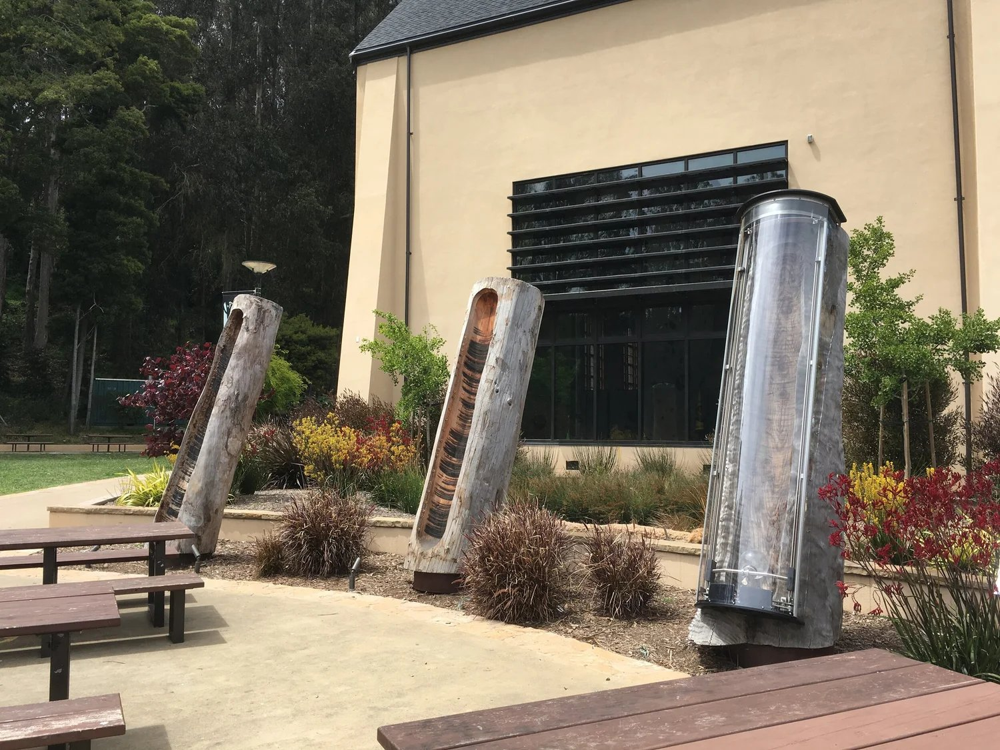
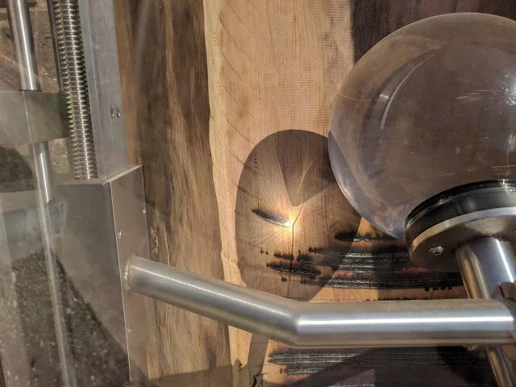
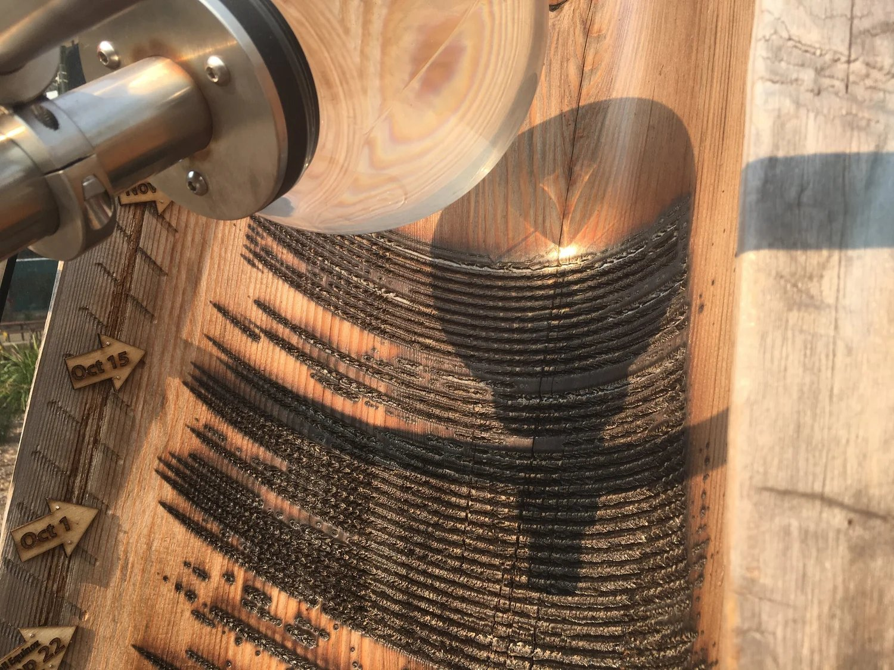
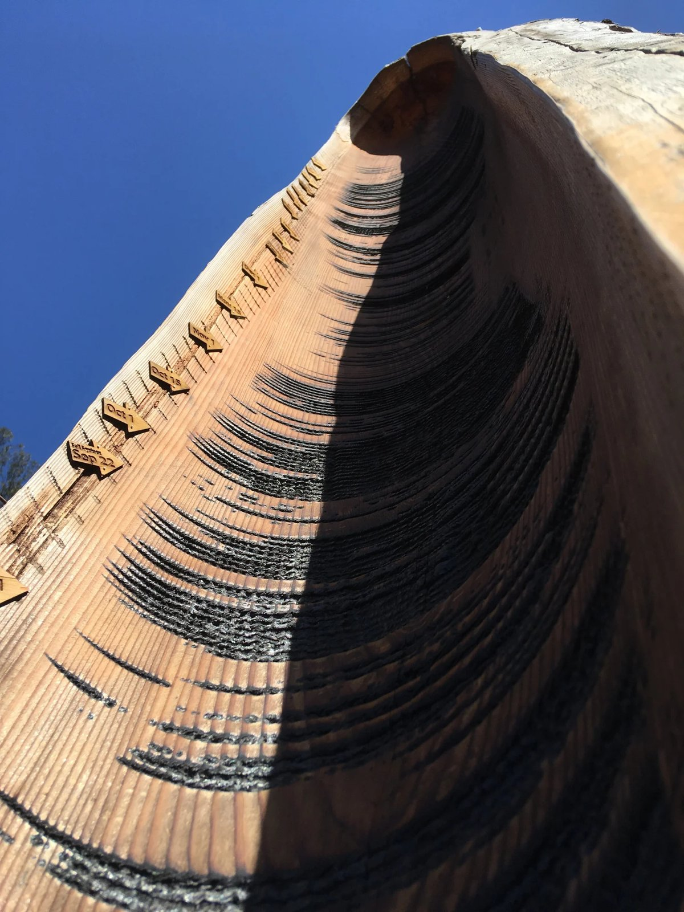
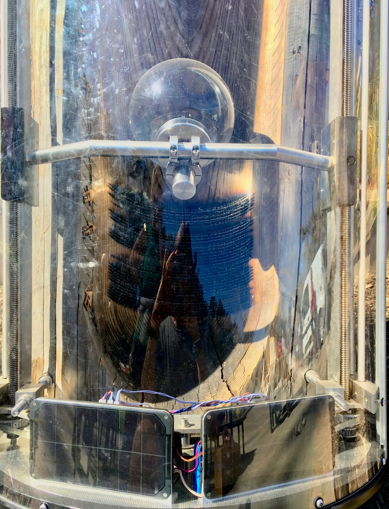

+++
author = "矢崎裕一"
title = "ガラス球で丸太を焦がし、日照を記録する──Charles Sowers の Solar Totems"
slug = "solar-totems"
date = "2026-11-05"
description = "Solar Totems は、ガラス球で日光を集めて丸太を焦がし、日照を記録させた公共彫刻です。焦げ跡は太陽が動くあいだに線になり、1日1本ずつ増え、3本の丸太が1年ずつを受け持ちます。"
categories = [
    "consume"
]
tags = [
    "データ物質化"
]
image = "images/cover.jpg"
series = ["data-physicalization"]
series_weight = 99
seriesByline = "Charles Sowers"
seriesTitle = "ガラス球で丸太を焦がし、日照を記録する──Solar Totems"
+++

Charles Sowers（チャールズ・ソワーズ）の Solar Totems は、ガラス球で日光を集めて丸太を焦がし、日照を記録させた公共彫刻です。太陽が空を動くあいだに焦げ跡が1本の線になり、霧や雲が出るとその線が途切れます。レンズが毎日少しずつ送られて、1日1本の線ができます。3本の丸太が1年ずつを受け持ちます。

作品は San Francisco Arts Commission（サンフランシスコ市芸術委員会）の委託で、Glen Park Canyon Recreation Center の前の広場に置かれました。市の発表は2017年6月5日、作者のページの表記は「2017-2020」です。以下は、作者の公式ページと市の発表に沿い、そのあとで研究者と来訪者の評価を読みます。

<!--more-->

## 2017年、レクリエーション・センターの広場に3本の丸太が立つ

2017年6月5日、市の芸術委員会は、改修を終えた Glen Park Canyon Recreation Center に Sowers の新作が入ったと発表しました。発表は Sowers を、科学への愛着を作品に溶け込ませる地元の作家と紹介しています。

発表によれば、素材は再生レッドウッドの丸太3本です。どれも直径30インチ（約76 cm）、高さ12フィート（約3.7 m）で、建物の前の南向きに開けた広場に、立てて据えられました。そのうちの1本に、太陽電池で動く機構と球形のレンズが取り付けられています。

Charles Sowers／Charles Sowers「Solar Totems」より引用

作品は完成した姿で運び込まれたのではなく、置かれてから3年かけて記録が積み上がっていきます。市の発表の写真には、文化局長の Tom DeCaigny、Sowers、Edwin M. Lee 市長、公園局の総支配人 Phil Ginsburg が並んでいます。DeCaigny は、この都市公園の自然の驚きに語りかける作品だと述べました。

この作品には、書籍の章もあります。『Making with Data: Physical Design and Craft in a Data-Driven World』（Samuel Huron、Till Nagel、Lora Oehlberg、Wesley Willett 編、A K Peters/CRC Press、2022）の第5部 Environment に、5.3「Solar Totems」の章があります。筆者は Sowers 本人で、pp.345–358、DOI は 10.1201/9781003264903-23 です。同じ部には [Perpetual Plastic](/perpetual-plastic/) の章もあり、部の序文は研究者の Dietmar Offenhuber（ディートマー・オッフェンフーバー）が書いています。章の本文は、この記事では確かめられていません。

## 19世紀の日照計を、木の上に置き直す

市の発表は、着想の出どころをこう書いています。

> Inspired by 19th-century meteorological instruments that used a spherical glass lens to burn a sunshine record on a substrate of wood or paper, Solar Totems is a sculptural data-logger that creates an archive of the interaction of sun, weather and site.

ガラスの球で日光を集め、木や紙に日照の記録を焼き付けた19世紀の気象計器に着想を得た、という要旨です。市はこの作品を「彫刻のデータロガー」と呼び、太陽と天気と場所のかかわりを記録に残すと説明しています。

元になった計測器は、Campbell–Stokes 日照計（キャンベル・ストークス日照計）として知られています。Wikipedia によれば、John Francis Campbell が1853年に考案し、1879年に George Gabriel Stokes が改良しました。Campbell の最初の装置は、木の器に大きな球レンズをはめ、太陽にその器を焦がさせるものでした。

Stokes の改良版では、記録の受け手がカードになります。木に直接書かせる Solar Totems は、カードより前の形に戻っているとも読めます。

Charles Sowers／Charles Sowers「Solar Totems」より引用

作者のページは、仕組みを次のように書いています。

> Over the course of 3 years, three reclaimed redwood logs receive the "writing" of the sun as its rays are focused by a spherical lens to lightly burn into the wood. As the sun moves across the sky, the burn becomes a line, preserving a record of sunshine periodically broken by fog or cloudy skies.

3年をかけて、3本の再生レッドウッドの丸太が太陽の「筆跡」を受け取る、という書き出しです。球形のレンズで集めた光が木を軽く焦がし、太陽が空を動くにつれて焦げ跡が線になります。線は霧や曇り空でときどき途切れ、それがそのまま日照の記録になります。

## 1本の線が1日、1本の丸太が1年

作者のページは続けて、日付と年の刻み方を書いています。

> The lens is advanced a small distance each day to create a distinct daily line. After one year the heliograph mechanism is transferred to the next log. In this way, the work is completed on-site and becomes a sculptural archive of the specific atmospheric conditions of the site.

レンズは毎日少しずつ送られ、1日ごとに区別できる線ができます。1年たつと、日照計の機構は次の丸太へ移されます。こうして作品はその場で完成し、その場所に固有の大気の状態を記録した彫刻になる、という要旨です。

作者の文章は、レンズを送る向きを書いていません。後の節で読む2つの記事は、どちらもレンズを「上へ」送ると書いています。作者の写真では、横に延びる焦げ線が上下に何段も重なっています。

Charles Sowers／Charles Sowers「Solar Totems」より引用

この写真では、丸太の縁に「Oct 1」「Oct 15」と書いた矢印形の札が見えます。線の並びを日付として読むための目盛りです。データと見た目の対応は次のとおりです。

| データ | 物理的な見た目・素材 | 出典 |
|---|---|---|
| 日照の有無 | レンズの焦点が木を焦がした跡（焦げ線）があるか | 作者のページ |
| 一日のうちの時刻（太陽の移動） | 焦げ跡がつながってできる線の長さ | 作者のページ（線が横向きであることは写真から） |
| 霧・雲による日照の途切れ | 線の切れ目 | 作者のページ |
| 日付 | 毎日少しずつ送られるレンズがつくる、1日1本の線。上下に並んだ位置 | 作者のページ（上下に並ぶことは写真から。上へという向きは第三者の記事） |
| 年 | 丸太1本。1年たつと機構を次の丸太へ移す（3本で3年） | 作者のページ、市の発表 |
| 場所 | 作品が広場に固定されていること。記録はその場所でしか取れない | 作者のページ、市の発表 |

外から受け取るデータセットはありません。広場に届いた日光が、その場で木に焼き付けられます。

写真の見た目からは、1つの面に「横＝時刻、縦＝日付」の格子ができ、焦げの有無で値を示していると読めます。その読み方は、[カレンダー・ヒートマップ](/calendar-heat-map/)に近いものです。ただし値は連続量ではなく、ほぼ「焦げたか、焦げなかったか」の二値です。

Wikipedia は Campbell–Stokes 日照計について、目に見える日光ではなく、十分に強い日光（bright sunshine）しか測れないと書いています。同じ仕組みを使う Solar Totems の線も、ある強さを超えた日照だけを記録していると読めます。作品についてそう書いた資料は、見つかっていません。

Charles Sowers／Charles Sowers「Solar Totems」より引用

市の発表は、年ごとの比較にも触れています。1年分の記録が終わると日照計は次の丸太へ移り、公園の利用者は年ごとの天気の違いを比べられる、と書いています。**3本の丸太を並べると、同じ時期を年ごとに見比べる[スモール・マルチプル](/small-multiples/)になる、と読めます。**

作者自身も、市の発表の中でこう述べています。

> Taken together, the three transformed logs turn the plaza into a kind of civic solar and atmospheric observatory, artistically expanding our understanding of place and connecting us to our environment through that understanding.

3本の丸太がそろうと、広場は市民のための太陽と大気の観測所のようになる、という要旨です。その場所への理解を広げ、理解を通じて人を環境に結びつける、とも述べています。

## 第三者はこの作品をどう見たか

研究者の Offenhuber は、2020年の論文 "What We Talk About When We Talk About Data Physicality" で、データ物理化を2つの軸で分けました。1つは認識論的か存在論的か、もう1つは表象的か関係的か、という軸です。Solar Totems は「存在論的・関係的」の象限の例として、図9b に載っています。

> Examples in this last quadrant operate without traditional data sets and don't use visual languages based on symbolic mappings and representation.

この象限の例は、従来のデータセットなしに働き、記号の対応づけや表象に基づく視覚言語を使わない、という定義です。Offenhuber は同じ段落で、この象限の作品が、データを集める過程を再現する計測器の形をとることもあると書いています。Solar Totems については、球形のレンズが焼き付けた焦げ跡として毎日の日照時間を記録する作品と説明し、Campbell の日照計に連なるものとして挙げました。

Joan Sullivan（ジョーン・サリバン）は、再生可能エネルギーを撮るカナダ・ケベックの写真家です。2017年10月16日、Artists & Climate Change に「Solar Totems and Wave Walls」を書きました。線1本を、晴れ、ところにより曇り、曇りといった1日の天気の型として読み、1年で「365 solar etchings」になると書いています。365は Sullivan の数え方で、作者は線の数を書いていません。評価の言葉は次のとおりです。

> This is what climate change artists do best: using metaphor to build awareness, a sense of connection and familiarity to overcome anxiety, fear and resistance.

比喩を使って気づきを促し、つながりと親しみをつくって、不安や恐れや抵抗を乗り越えさせる。それが気候変動を扱うアーティストのいちばん得意なことだ、という要旨です。この記事は訪問前に書かれたものです。

Steve Jurvetson（スティーブ・ジャーベットソン）は、2018年7月14日、自分のブログに「Solar Totems in Noe Valley」を載せました。題は隣の地区の名前ですが、写っているのは Glen Park の作品です。

> The ball lens slowly advances upward over time… focusing the sunlight to burn daily stripes in a 12′ tall log. Each line records the level of sunlight or shade for the day.

球レンズは時間をかけて上へ進み、高さ12フィートの丸太に毎日の縞を焼き付ける。1本の線が、その日の日照と日陰を記録する、という要旨です。コメント欄では、読者の一人が「brilliantly elegant design（見事に簡潔な設計）」と書いています。

Steve Jurvetson／steve.blog「Solar Totems in Noe Valley」より引用

## 使い道

Solar Totems の焦げ線は、誰かが日照のデータを集めて図にしたものではありません。計測器が、その場で記録を残していきます。可視化の仕事に持ち帰れることは、3つあると読めます。

1つ目は、記録の過程を見せることです。焦げ線が1日1本ずつ増えていく様子は、データがどう生まれるかを、そのまま見せています。Offenhuber の言う、データを集める過程を再現する計測器は、こうした作品を指していると読めます。作者も About のページで、ふだん見えない現象を見通すための計測器（instrumentation）を作ることがある、と書いています。

2つ目は、格子と並べ方の型です。横＝時刻、縦＝日付と読める格子は、カレンダー・ヒートマップと同じ読み方を求めます。丸太を1年ごとに分け、3本並べると、年ごとの比較ができます。素材が木でも、使われている型は紙の上のチャートと同じだと読めます。

3つ目は、計測器の限界も一緒に引き受けることです。日照計の仕組みを借りた線は、弱い日光を記録しないと考えられます。物理的な記録を可視化に使うときは、何が記録されないかも確かめる必要があります。

同じ作者の Tidal Memory は、Exploratorium に常設され、潮位の実測データを受け取ります。24本のガラス柱の水位で、1日分の1時間ごとの潮位を示します。外のデータを受け取って再生する Tidal Memory に対し、Solar Totems は現象をその場で直接記録します。同じ作者の中にも、データとの関係が違う2つの型がある、と読めます。

## 参考・出典

**一次情報**

- Charles Sowers「Solar Totems」作者公式ページ：https://www.charlessowers.com/solartotems
- Charles Sowers CV：https://www.charlessowers.com/pagecv
- Charles Sowers About Me（制作姿勢）：https://www.charlessowers.com/about-me
- San Francisco Arts Commission「New Public Art in Glen Park」2017-06-05：https://www.sf.gov/news-new-public-art-in-glen-park
- Charles Sowers, "Solar Totems," in Samuel Huron, Till Nagel, Lora Oehlberg, Wesley Willett (eds.), *Making with Data: Physical Design and Craft in a Data-Driven World*, A K Peters/CRC Press, 2022, Part 5 Environment, 5.3, pp.345–358. doi:10.1201/9781003264903-23
- Routledge『Making with Data』目次：https://www.routledge.com/Making-With-Data-Physical-Design-and-Craft-in-a-Data-Driven-World/Huron-Nagel-Oehlberg-Willett/p/book/9781032182223
- makingwithdata.org 目次：https://makingwithdata.org/blog/structure
- dataphys.org「Tidal Memory」（同じ作者の別作品。Solar Totems の項目はない）：https://dataphys.org/list/tidal-memory/

**第三者評価**

- Dietmar Offenhuber, "What We Talk About When We Talk About Data Physicality," *IEEE Computer Graphics and Applications* 40(6): 25–37, 2020. doi:10.1109/MCG.2020.3024146 ／ arXiv：https://arxiv.org/abs/2006.04631 （PDF：https://arxiv.org/pdf/2006.04631 ）
- Joan Sullivan「Solar Totems and Wave Walls」Artists & Climate Change, 2017-10-16：https://artistsandclimatechange.com/2017/10/16/solar-totems-and-wave-walls/
- Steve Jurvetson「Solar Totems in Noe Valley」2018-07-14：https://steve.blog/2018/07/14/solar-totems-in-noe-valley/
- Wikipedia「Campbell–Stokes recorder」（元になった計測器の背景）：https://en.wikipedia.org/wiki/Campbell%E2%80%93Stokes_recorder
