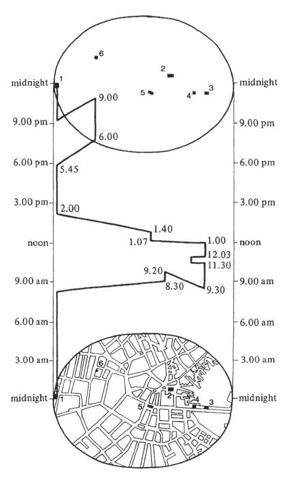
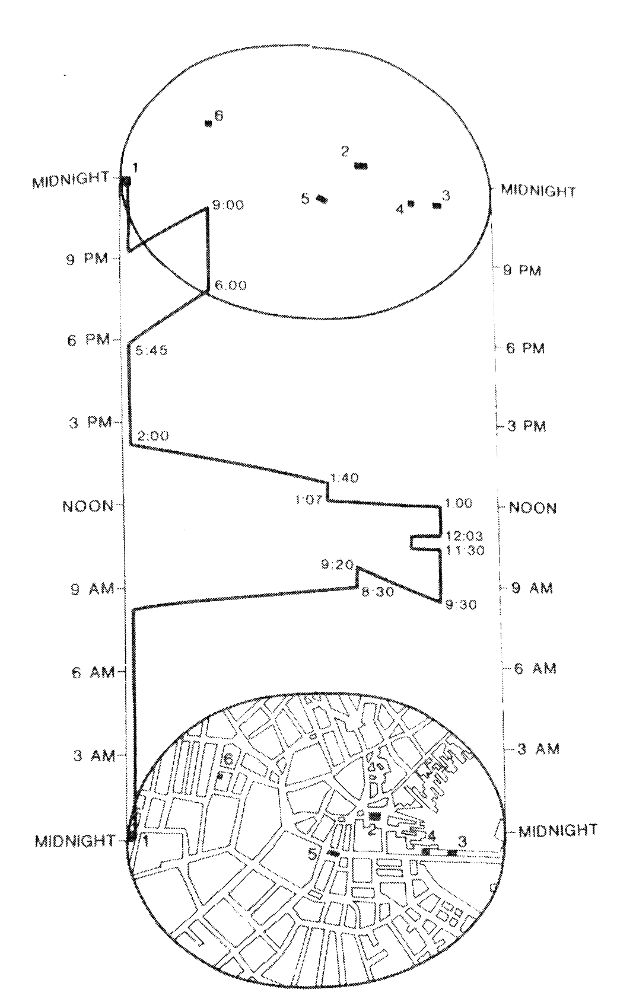
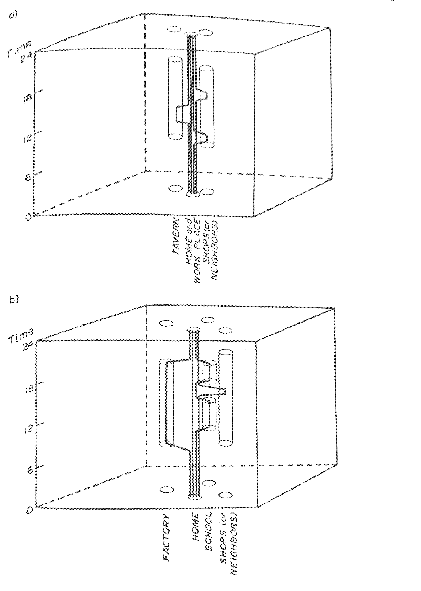

+++
author = "Yuichi Yazaki"
title = "Drawing a Boston Merchant's Day as a Single Line: Allan Pred's Space-Time Path (1984)"
slug = "space–time-path-diagram"
date = "2025-10-11"
description = "In 1984, Allan Pred used Hägerstrand's space-time path to draw the day of a 'typical' Boston merchant between 1783 and 1812 as a single line, with clock time on the vertical axis and a street map as the base."
categories = [
    "consume"
]
tags = [
    "Allan Pred",
    "Torsten Hägerstrand",
    "time geography",
    "space-time path",
    "space-time cube",
    "maps"
]
image = "images/thumb_ph_vizjp.png"
+++

In 1984, the geographer Allan Pred used Torsten Hägerstrand's space-time path notation to draw a single diagram. The vertical axis is the time of day, and the base is a street map of Boston. It shows the day of a "typical" Boston merchant between 1783 and 1812, from midnight to midnight, as one line.

The diagram appeared in the paper "Structuration, Biography Formation, and Knowledge: Observations on Port Growth during the Late Mercantile Period" (*Environment and Planning D: Society and Space*, vol. 2, no. 3). The paper was reprinted in the 1990 collection *Making Histories and Constructing Human Geographies*. I have not been able to read the body of the 1984 paper. What follows rests on the paper's bibliographic record, abstract and reference list, and on the figure in the reprinted version. I checked the reprinted figure against a photograph of the book's page posted by Jeremy Norman on HistoryofInformation.com.

<!--more-->

## One Diagram in a Paper on Port Growth

Pred (1936–2007) was a professor of geography at UC Berkeley and served as department chair from 1979 to 1988. The paper appeared in *Environment and Planning D: Society and Space*, vol. 2, no. 3, pp. 251–275.

According to the abstract, the paper discusses the growth of ports in the late mercantile period from three sides: a reassessment of Braudel's account of commercial capitalism, Pred's own theory that sees place as a "historically contingent process," and the case of Boston.

> Finally, the interplay of biography formation, knowledge acquisition, and the growth of Boston, Massachusetts, between 1783 and 1812 is considered.

In other words, the paper's last topic is how biography formation, knowledge acquisition and the growth of the city interacted in Boston between 1783 and 1812. These years fall after independence, not in the colonial period. The "Structuration" in the title refers to Anthony Giddens's structuration theory, and the reference list includes several works by Giddens.

The title of the figure is "Daily path of a 'typical' Boston merchant capitalist." It does not record the day of one real merchant. It is **a day assembled as a type**. The quotation marks around "typical" can be read as a signal that the figure is a constructed image.

## Time Upward, a Street Map at the Base

Source: a figure in Allan Pred, *Making Histories and Constructing Human Geographies* (Westview Press, 1990), first published in the 1984 paper. Taken from a photograph of the book's page on HistoryofInformation.com (Jeremy Norman); the figure has been cropped and the show-through from the reverse side of the paper has been lightened.

The diagram has the form of a cylinder seen obliquely. The posts on the left and right are the time scale, with midnight at the bottom and at the top. The ellipse at the base is a street map of central Boston, and the ellipse at the top carries only the location markers.

| Visual element | Data or meaning it stands for | Concrete example in this figure |
|---|---|---|
| Vertical scales at the left and right edges | Time of day (from midnight at the bottom to midnight at the top) | Evenly spaced, every 3 hours |
| Ellipse at the base | A street map of central Boston, seen obliquely | Markers and numbers for locations 1 to 6 |
| Ellipse at the top | The same plane, placed at midnight at the end of the day | Markers 1 to 6 sit at the same left-right positions as on the base |
| Black markers and numbers | Places the merchant visits | (1) home, (2) Faneuil Hall, (3) counting-house, (4) coffee house, (5) 'Change on State Street, (6) club-meeting site |
| Thick line | The space-time path of one merchant | Just one |
| Vertical sections of the line | Staying in the same place | Home from 2:00 to 5:45, for example |
| Slanted or nearly horizontal sections | Moving from place to place | 5:45 to 6:00, for example; roughly 7 to 20 minutes |
| Numbers at the bends | Times of arrival and departure | 8:30, 9:20, 11:30, 12:03, 1:07 and others, 12 in all |
| Color, changes in line width | Not used | Monochrome |

The correspondence between numbers and places comes from the legend printed below the figure in the reprinted version. The ellipse at the top does not stand for "distance," which is separate from time. It is a lid: the plane of the map, lifted by one day's worth of height.

Following the line from the bottom, the merchant's day can be read as follows.

| Time of day | Location |
|---|---|
| Midnight to morning | (1) Home |
| 8:30 to 9:20 | (2) Faneuil Hall |
| 9:30 to 11:30 | (3) Counting-house |
| Between leaving the counting-house at 11:30 and returning at 12:03 | (4) A stop at a coffee house |
| 12:03 to 1:00 | (3) Counting-house |
| 1:07 to 1:40 | (5) The 'Change (exchange) on State Street |
| 2:00 to 5:45 | (1) Home |
| 6:00 to 9:00 | (6) Club meeting site |
| Just after 9:00 to midnight | (1) Home |

The morning goes back and forth between workplaces, early afternoon brings a stop at the exchange, the afternoon is at home, and the evening is at the club. This timetable was read off the line in the figure. It has not been checked against records of daily life at the time.

## Height Alone Does Not Give the Time

This diagram has a point where readers can lose their way. Because the map is seen obliquely, the height on the page mixes two things: the time and the depth of the map.

Location 6 lies farther back on the map than home (location 1). The "6:00" where the line reaches location 6 sits, on the left-hand scale, above 6 PM, at about the height of 8 PM. It is lifted on the page by the amount of the depth.

Pred addresses this in the explanatory note for the reprinted figure.

> Thus, the time-scales at the two outermost edges hold only for the corresponding perimeter points that they connect, and one must imagine a separate time-scale line connecting each of the six locations visited.

That is, the time scales at the two outer edges apply only to the perimeter points they connect, and the reader has to imagine a separate time-scale line for each of the six locations visited. The same note also says that 0.44 inch along a vertical line corresponds to 3 hours, and that corresponding points on the base and the top are 3.5 inches apart. I have not confirmed whether the figure in the 1984 paper carried the same note.

Writing a time at each bend of the line can be read as a response to this difficulty. It lets the reader take the numbers directly instead of measuring time from height. The division of labor is this: **the scale shows the approximate time of day, and the labels carry the exact times.**

## The Notation Comes from Hägerstrand

Pred did not invent the way this diagram is drawn. It is the notation of time geography, set out by the Swedish geographer Hägerstrand.

Hägerstrand presented it in 1969 at the European congress of the Regional Science Association in Copenhagen, and published it in 1970 as the paper "What about people in regional science?" Wikipedia quotes the following line from it (pp. 10–11 of the original).

> In time-space the individual describes a *path*

In time-space, in other words, an individual traces a "path." The notation includes the aquarium, which takes the map as its base and time as its height; the prism, which shows the area that can be reached; and the bundle, in which several paths gather. Drawings are made in axonometric projection. Pred's diagram consists only of the aquarium and a single path.

The link between Pred and Hägerstrand can be traced through the bibliography.

| Year | Pred's work |
|---|---|
| 1967 | Translated Hägerstrand's doctoral thesis (1953) into English: *Innovation Diffusion as a Spatial Process* (with Greta Haag) |
| 1977 | "The Choreography of Existence," a commentary on time geography (*Economic Geography*, vol. 53, no. 2) |
| 1981 | Edited the festschrift *Space and Time in Geography: Essays Dedicated to Torsten Hägerstrand* |
| 1981 | Published a diagram of the daily paths of a family of four in *Journal of Historical Geography*, vol. 7 |
| 1984 | The Boston merchant diagram. The reference list includes Hägerstrand 1970 and 1974, Lenntorp 1976 and others |

Source: a figure from Allan Pred, *Journal of Historical Geography* 7 (1981), as reprinted in *Making Histories and Constructing Human Geographies* (1990). Taken from a photograph of the book's page on HistoryofInformation.com (Jeremy Norman); cropped in the same way, with the show-through lightened.

The title of the 1981 figure is "Daily paths of a hypothetical family of four under (a) the artisan mode of production and (b) the factory and large-scale shop mode of production." It compares the days of a hypothetical family of four under an artisan mode of production and under a factory and large-scale shop mode of production. According to Norman, the four black lines running vertically are the movements of each family member.

So the 1984 diagram is not an "early example" of time geography. It applies a notation that Pred himself had already used three years earlier to the history of a port town. The base of the 1981 figure has only place names such as TAVERN and HOME, and no streets. The 1984 figure lays a street map of a real city on the base and writes times to the minute at the bends. It can be read as moving, with the same notation, from a schematic diagram to specific times in a specific city.

## How Others Have Seen This Diagram

The first view comes from the side of information history: Jeremy Norman of HistoryofInformation.com.

> What interested me was not so much the well-analyzed data discussed in the paper, but the way that Pred mapped the movement of the "merchant" within the 24 hour period.

He says that he was drawn less to the data in the paper than to how Pred mapped the merchant's movement within 24 hours. Comparing it with the 1981 family diagram, Norman writes that the merchant diagram is "perhaps easier to understand."

The second comes from the side of geovisualization: Menno-Jan Kraak's 2003 paper. It revisits the space-time cube as a visualization and explains how to read it, with vertical lines as stays and nearly horizontal lines as movements, and then names the limits of the hand-drawn era.

> when the concept was introduced the options to create the graphics were limited to manual methods and the user could only experience the single view created by the draftsperson. An alternative view on the cube would mean to go through a laborious drawing exercise.

With hand drawing, the reader could see only the one viewpoint the draftsperson had chosen, and another angle meant redrawing. The problem of "height alone does not give the time" in Pred's diagram can also be read as coming from this single viewpoint.

The third is criticism of the notation itself. According to the Wikipedia article "Time geography," Bo Lenntorp (1999) wrote the following.

> The notation system is a very useful tool, but it is a rather poor reflection of a rich world-view.

The notation is useful, he says, but a poor reflection of a rich world-view. In *Feminism and Geography* (1993), Gillian Rose criticized time geography: it overlaps with feminism in looking at the paths of everyday life, but it is also a form of masculinism in social science. Since then, Mei-Po Kwan (2002) and others have reexamined time geography.

What Pred's 1984 diagram draws is one day of a male "merchant capitalist." There are no paths for family, servants or women. Given that in 1981 he had drawn a family of four, reducing the figure to one line can be read as the result of choosing whose day to show. If Rose's criticism is applied to this diagram, that is where the issue lies.

## Uses

There are four things from this diagram that can be carried over into visualization work.

- **When time is assigned to one axis, staying and moving separate in the shape of the line.** Vertical sections are stays and slanted sections are moves, and the length of a stay can be compared by the length of the line. This way of reading also works for activity logs and for delivery and patrol records.
- In an oblique view, height gets mixed with depth. Pred writes the time at each bend and shows how to read the figure in the note for the reprinted version. Today, other options are a cube that can be rotated, or placing the map and a band of time side by side.
- When drawing a "typical" case, show that it is a constructed image. Pred puts quotation marks around typical in the title.
- Choosing whose line to draw is also choosing whose line not to draw. A single path is easy to read, but it leaves other people's days out of the diagram.

The 1984 diagram is not one that invented a new notation. It borrowed Hägerstrand's notation and made it concrete, with a map and clock times, for one day in one city.

## References

**Primary sources**

- Allan Pred, "Structuration, Biography Formation, and Knowledge: Observations on Port Growth during the Late Mercantile Period," *Environment and Planning D: Society and Space*, 2(3), 1984, pp. 251–275. [doi:10.1068/d020251](https://doi.org/10.1068/d020251) / [Crossref (bibliographic record, abstract, references)](https://api.crossref.org/works/10.1068/d020251)
- Allan Pred, *Making Histories and Constructing Human Geographies: The Local Transformation of Practice, Power Relations, and Consciousness*, Westview Press, 1990. [Bibliographic record at archive.org](https://archive.org/details/makinghistoriesc0000pred)
- Allan Pred, "Biography Formation, Knowledge Acquisition, and the Growth and Transformation of Cities During the Late Mercantile Period: The Case of Boston, 1783-1812" (chapter 2 of the same book in its 2019 Routledge reissue, pp. 41–75). [Crossref](https://api.crossref.org/works/10.4324/9780429044649-3)
- Allan Pred, "The Choreography of Existence: Comments on Hägerstrand's Time-Geography and Its Usefulness," *Economic Geography*, 53(2), 1977, pp. 207–221. [doi:10.2307/142726](https://doi.org/10.2307/142726)
- Allan Pred, "Production, Family and Free-time Projects: A Time-Geographic Perspective on the Individual and Societal Change in Nineteenth-Century U.S. Cities," *Journal of Historical Geography*, 7, 1981, pp. 3–36. [doi:10.1016/0305-7488(81)90082-7](https://doi.org/10.1016/0305-7488(81)90082-7)
- Torsten Hägerstrand, "What about people in regional science?," *Papers of the Regional Science Association*, 24(1), 1970, pp. 7–21. [doi:10.1111/j.1435-5597.1970.tb01464.x](https://doi.org/10.1111/j.1435-5597.1970.tb01464.x)

**Secondary sources**

- Jeremy Norman, "With 'Time Geography' Allan Pred Maps the Activity of Individuals and a Family During the Course of a Single Day," HistoryofInformation.com. [Article](https://www.historyofinformation.com/detail.php?id=5346)
- Menno-Jan Kraak, "The Space-Time Cube Revisited from a Geovisualization Perspective," *Proceedings of the 21st International Cartographic Conference*, 2003. [PDF](https://icaci.org/files/documents/ICC_proceedings/ICC2003/Papers/255.pdf)
- Wikipedia, "Time geography" (source of the citations of Hägerstrand 1970, Lenntorp 1999 and Rose 1993). [Article](https://en.wikipedia.org/wiki/Time_geography)
- Wikipedia, "Torsten Hägerstrand" (Pred's English translation, the 1981 festschrift). [Article](https://en.wikipedia.org/wiki/Torsten_H%C3%A4gerstrand)
- Wikipedia, "Allan Pred" (biography). [Article](https://en.wikipedia.org/wiki/Allan_Pred)
