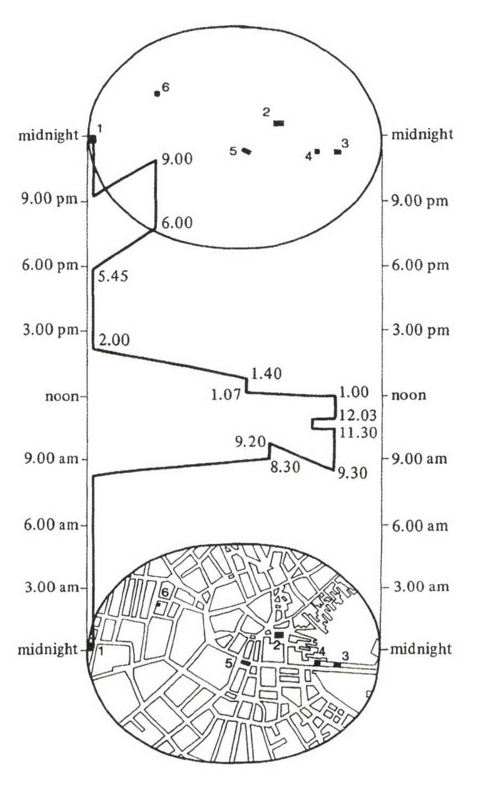
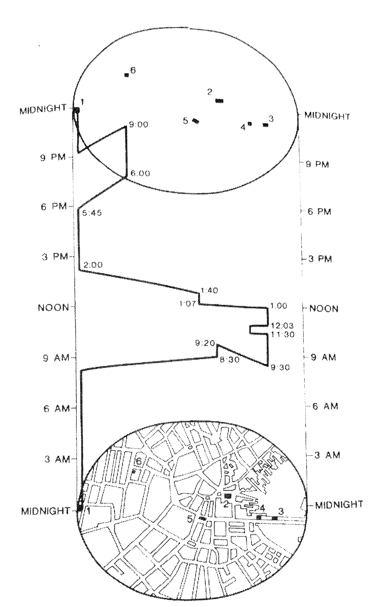
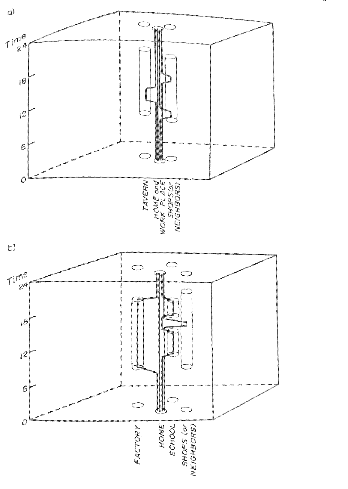

+++
author = "矢崎裕一"
title = "ボストン商人の一日を一本の線で描く──Allan Pred の時空間パス（1984）"
slug = "space–time-path-diagram"
date = "2025-10-11"
description = "1984年、Pred は Hägerstrand の時空間パスで、1783〜1812年のボストンの「典型的な」商人の一日を、時刻を縦軸、街路図を底面にとり一本の線で描きました。"
categories = [
    "consume"
]
tags = [
    "Allan Pred",
    "Torsten Hägerstrand",
    "時間地理学",
    "時空間パス",
    "時空間キューブ",
    "地図"
]
image = "images/thumb_ph_vizjp.png"
series = ["dataviz-classics"]
series_weight = 10
seriesByline = "Allan Pred"
seriesTitle = "商人の一日を一本の線で──Pred のボストン時空間パス"
+++

1984年、地理学者の Allan Pred（アラン・プレッド）は、Torsten Hägerstrand（トルステン・ヘーゲルストランド）の時空間パス（space-time path）の表記を使って、一枚の図を描きました。縦軸は一日の時刻、底面はボストンの街路図です。1783〜1812年のボストンの「典型的な」商人の一日を、真夜中から真夜中まで、一本の線で描いています。

図が載ったのは、論文 "Structuration, Biography Formation, and Knowledge: Observations on Port Growth during the Late Mercantile Period"（*Environment and Planning D: Society and Space* 2巻3号）です。この論文は、1990年の論文集 *Making Histories and Constructing Human Geographies* に収録されました。1984年の論文本文は読めていません。以下は、論文の書誌・要旨・参考文献と、再録版の図に沿います。再録版の図は、Jeremy Norman が HistoryofInformation.com に載せた書籍ページの写真で確かめました。

<!--more-->

## 港の成長を問う論文の、一枚の図

Pred（1936–2007）は UC Berkeley の地理学教授で、1979〜88年には学科長を務めました。論文の掲載は *Environment and Planning D: Society and Space* の2巻3号、251–275ページです。

要旨によれば、論文は後期重商主義の時代の港の成長を、3つの面から論じます。Braudel の商業資本主義論の再評価、場所を「歴史的に偶有的な過程」とみる Pred 自身の理論、そしてボストンの事例です。

> Finally, the interplay of biography formation, knowledge acquisition, and the growth of Boston, Massachusetts, between 1783 and 1812 is considered.

最後に、1783〜1812年のボストンで、伝記の形成・知識の獲得・都市の成長がどう作用し合ったかを考える、という内容です。この年代は独立後で、植民地時代ではありません。題の Structuration は Anthony Giddens の構造化理論を指し、参考文献には Giddens の著作が複数入っています。

図の題は "Daily path of a 'typical' Boston merchant capitalist" です。描かれているのは、一人の実在の商人の記録ではありません。**典型として組み立てた一日**です。typical に付いた引用符は、組み立てた像であることを知らせる印だと読めます。

## 縦に時刻、底に街路図

Allan Pred, *Making Histories and Constructing Human Geographies*（Westview Press, 1990）所収の図（初出は1984年の論文）／HistoryofInformation.com（Jeremy Norman）掲載の書籍ページの写真より引用（図の部分を切り出し、紙の裏写りを薄くしています）

図は、円柱を斜めから見た形をしています。左右の柱が時刻の目盛りで、下端と上端が真夜中です。底面の楕円はボストン市街の街路図で、上面の楕円には地点の印だけがあります。

| 見た目の要素 | 対応するデータ・意味 | この図での具体例 |
|---|---|---|
| 左右両端の縦の目盛り | 一日の時刻（下の真夜中から上の真夜中まで） | 3時間ごとに等間隔 |
| 底面の楕円 | ボストン市街の街路図を、斜めから見たもの | 地点1〜6の印と番号 |
| 上面の楕円 | 同じ平面を、一日の終わりの真夜中に置いたもの | 印1〜6が底面と同じ左右位置に並ぶ |
| 黒い印と番号 | 商人が立ち寄る場所 | (1) home、(2) Faneuil Hall、(3) counting-house、(4) coffee house、(5) 'Change on State Street、(6) club-meeting site |
| 太い線 | 一人の商人の時空間パス | 1本だけ |
| 線の垂直な部分 | 同じ場所にとどまること | 2:00〜5:45 の自宅など |
| 線の斜め・水平に近い部分 | 場所から場所への移動 | 5:45→6:00 など。7〜20分ほど |
| 折れ目の数字 | 到着・出発の時刻 | 8:30、9:20、11:30、12:03、1:07 など12か所 |
| 色、線の太さの変化 | 使っていない | モノクロ |

番号と場所の対応は、再録版の図の下に印刷された凡例によります。上面の楕円は、時間とは別の「距離」を表すものではありません。地図の平面を、一日分の高さだけ持ち上げたふたです。

線を下からたどると、商人の一日は次のように読めます。

| 時間帯 | 地点 |
|---|---|
| 真夜中〜朝 | (1) 自宅 |
| 8:30〜9:20 | (2) Faneuil Hall |
| 9:30〜11:30 | (3) counting-house（帳場） |
| 11:30 に counting-house を出て 12:03 に戻るあいだ | (4) coffee house に立ち寄る |
| 12:03〜1:00 | (3) counting-house |
| 1:07〜1:40 | (5) State Street の 'Change（取引所） |
| 2:00〜5:45 | (1) 自宅 |
| 6:00〜9:00 | (6) クラブの会合場所 |
| 9:00すぎ〜真夜中 | (1) 自宅 |

午前は仕事場を行き来し、昼すぎに取引所へ寄り、午後は自宅、夜はクラブです。この時間割は図の線から読み取ったもので、当時の生活記録と照らし合わせたものではありません。

## 高さだけでは時刻を読めない

この図には、読むときに迷う点があります。地図を斜めから見ているので、紙の上の高さには、時刻と地図の奥行きの両方が入ります。

地点6は、地図の上で自宅（地点1）より奥にあります。線が地点6に着く「6:00」の数字は、左端の目盛りでは 6 PM より上、8 PM 近くの高さにあります。奥行きの分だけ、紙の上で持ち上がっているのです。

Pred はこの点を、再録版の図の説明に書いています。

> Thus, the time-scales at the two outermost edges hold only for the corresponding perimeter points that they connect, and one must imagine a separate time-scale line connecting each of the six locations visited.

両端の時刻目盛りが当てはまるのは、目盛りがつなぐ縁の点だけである。訪れた6か所それぞれに、別の時刻の目盛り線を思い描く必要がある、という説明です。同じ説明は、縦の線に沿って0.44インチが3時間に当たり、底面と上面の対応する点が3.5インチ離れている、とも述べます。1984年の論文の図に同じ説明が付いていたかは、確かめられていません。

線の折れ目ごとに時刻を書き込んだのは、この読みにくさへの対処だと読めます。高さから時刻を測らせず、数字を直接読ませているからです。**目盛りはおおよその時間帯を示し、正確な時刻はラベルが受け持つ**、という分担です。

## 表記は Hägerstrand から来ている

この図の描き方は、Pred が考え出したものではありません。スウェーデンの地理学者 Hägerstrand が示した、時間地理学（time geography）の表記です。

Hägerstrand は1969年、コペンハーゲンの Regional Science Association 欧州大会で発表し、1970年に論文 "What about people in regional science?" として出しました。Wikipedia は、その中の言葉をこう引いています（原典の10–11ページ）。

> In time-space the individual describes a *path*

時空間の中で、個人は一本の「パス」を描く、という意味です。表記には、地図を底面、時間を高さにとる水槽（aquarium）、到達できる範囲を示すプリズム、複数のパスが集まる束（bundle）があり、軸測投影（axonometric）で描きます。Pred の図は、このうち水槽とパス1本だけでできています。

Pred と Hägerstrand のつながりは、書誌でたどれます。

| 年 | Pred の仕事 |
|---|---|
| 1967 | Hägerstrand の博士論文（1953）を英訳。*Innovation Diffusion as a Spatial Process*（Greta Haag と共訳） |
| 1977 | 時間地理学の論評 "The Choreography of Existence"（*Economic Geography* 53巻2号） |
| 1981 | 記念論集 *Space and Time in Geography: Essays Dedicated to Torsten Hägerstrand* を編集 |
| 1981 | *Journal of Historical Geography* 7巻に、家族4人の一日のパスの図を発表 |
| 1984 | ボストン商人の図。参考文献に Hägerstrand 1970・1974、Lenntorp 1976 など |

Allan Pred, *Journal of Historical Geography* 7（1981）の図の、*Making Histories and Constructing Human Geographies*（1990）での再録／HistoryofInformation.com（Jeremy Norman）掲載の書籍ページの写真より引用（同様に切り出し、裏写りを薄くしています）

1981年の図の題は "Daily paths of a hypothetical family of four under (a) the artisan mode of production and (b) the factory and large-scale shop mode of production" です。職人の生産様式と、工場・大規模店の生産様式のもとで、仮想の家族4人の一日を比べています。Norman によれば、縦に走る4本の黒い線が、それぞれ家族一人の動きです。

ですから、1984年の図は時間地理学の「初期の実例」ではありません。Pred 自身も3年前に使った既存の表記を、港町の歴史に当てはめた例です。1981年の図の底面には TAVERN や HOME といった場所の名前があるだけで、街路はありません。1984年の図は、底面に実在の街路図を敷き、折れ目に分単位の時刻を書いています。同じ表記で、模式図から特定の都市の特定の時刻へ寄せた図だと読めます。

## 第三者はこの図をどう見たか

一つ目は情報史の側から、HistoryofInformation.com の Jeremy Norman です。

> What interested me was not so much the well-analyzed data discussed in the paper, but the way that Pred mapped the movement of the "merchant" within the 24 hour period.

論文のデータそのものより、24時間の中の「商人」の動きを Pred がどう地図にしたかに興味を引かれた、という内容です。Norman は1981年の家族の図と比べて、商人の図を "perhaps easier to understand" と書いています。

二つ目はジオビジュアライゼーションの側から、Menno-Jan Kraak の2003年の論文です。時空間キューブを可視化として見直し、垂直な線は滞在、水平に近い線は移動、という読み方を説明したうえで、手描きの時代の限界を挙げています。

> when the concept was introduced the options to create the graphics were limited to manual methods and the user could only experience the single view created by the draftsperson. An alternative view on the cube would mean to go through a laborious drawing exercise.

手描きでは、読者は製図者の描いた一つの視点しか見られず、別の角度には描き直しが要った、という指摘です。Pred の図の「高さだけでは時刻を読めない」問題も、この一つの視点から来ていると読めます。

三つ目は、表記法そのものへの批判です。Wikipedia の "Time geography" によれば、Bo Lenntorp（1999）は次のように書きました。

> The notation system is a very useful tool, but it is a rather poor reflection of a rich world-view.

表記は役に立つが、豊かな世界観の貧しい反映だ、という評です。Gillian Rose は1993年の *Feminism and Geography* で、時間地理学は日々の経路に目を向ける点でフェミニズムと重なるが、社会科学の男性性の一形態でもある、と批判しました。その後、Mei-Po Kwan（2002）らが時間地理学を見直しています。

Pred の1984年の図に描かれているのは、男性の「商業資本家」一人の一日です。家族や使用人、女性のパスはありません。1981年には家族4人を描いていたことを考えると、線を1本にしたのは、誰の一日を見せるかを選んだ結果だと読めます。Rose の批判をこの図に当てはめるなら、論点はそこにあります。

## 使い道

この図から、可視化の仕事に持ち帰れることは4つあります。

- **時間を一つの軸に割り当てると、滞在と移動が線の形で分かれる。** 垂直な部分が滞在、傾いた部分が移動で、滞在の長さは線の長さで比べられます。行動ログや配送・巡回の記録にも使える見方です。
- 斜めから見せる図では、高さに奥行きが混ざる。Pred は折れ目に時刻を書き、再録版の図の説明で読み方を示しています。いまなら、回転できるキューブにする、地図と時刻の帯を並べる、という手もあります。
- 「典型」を描くときは、組み立てた像だと示す。Pred は題の typical に引用符を付けています。
- 誰の線を描くかは、誰の線を描かないかでもある。1本のパスは読みやすい反面、ほかの人の一日を図から外します。

1984年の図は、新しい表記を発明した図ではありません。Hägerstrand の表記を借り、一つの都市の一日に、地図と時刻で具体化した図です。

## 参考・出典

**一次情報**

- Allan Pred, "Structuration, Biography Formation, and Knowledge: Observations on Port Growth during the Late Mercantile Period," *Environment and Planning D: Society and Space*, 2(3), 1984, pp. 251–275. [doi:10.1068/d020251](https://doi.org/10.1068/d020251) / [Crossref（書誌・要旨・参考文献）](https://api.crossref.org/works/10.1068/d020251)
- Allan Pred, *Making Histories and Constructing Human Geographies: The Local Transformation of Practice, Power Relations, and Consciousness*, Westview Press, 1990. [archive.org の書誌](https://archive.org/details/makinghistoriesc0000pred)
- Allan Pred, "Biography Formation, Knowledge Acquisition, and the Growth and Transformation of Cities During the Late Mercantile Period: The Case of Boston, 1783-1812"（同書 Routledge 2019年再刊の第2章、pp. 41–75）. [Crossref](https://api.crossref.org/works/10.4324/9780429044649-3)
- Allan Pred, "The Choreography of Existence: Comments on Hägerstrand's Time-Geography and Its Usefulness," *Economic Geography*, 53(2), 1977, pp. 207–221. [doi:10.2307/142726](https://doi.org/10.2307/142726)
- Allan Pred, "Production, Family and Free-time Projects: A Time-Geographic Perspective on the Individual and Societal Change in Nineteenth-Century U.S. Cities," *Journal of Historical Geography*, 7, 1981, pp. 3–36. [doi:10.1016/0305-7488(81)90082-7](https://doi.org/10.1016/0305-7488(81)90082-7)
- Torsten Hägerstrand, "What about people in regional science?," *Papers of the Regional Science Association*, 24(1), 1970, pp. 7–21. [doi:10.1111/j.1435-5597.1970.tb01464.x](https://doi.org/10.1111/j.1435-5597.1970.tb01464.x)

**第三者評価**

- Jeremy Norman, "With 'Time Geography' Allan Pred Maps the Activity of Individuals and a Family During the Course of a Single Day," HistoryofInformation.com. [記事](https://www.historyofinformation.com/detail.php?id=5346)
- Menno-Jan Kraak, "The Space-Time Cube Revisited from a Geovisualization Perspective," *Proceedings of the 21st International Cartographic Conference*, 2003. [PDF](https://icaci.org/files/documents/ICC_proceedings/ICC2003/Papers/255.pdf)
- Wikipedia, "Time geography"（Hägerstrand 1970、Lenntorp 1999、Rose 1993 の引用元）. [記事](https://en.wikipedia.org/wiki/Time_geography)
- Wikipedia, "Torsten Hägerstrand"（Pred による英訳、1981年の記念論集）. [記事](https://en.wikipedia.org/wiki/Torsten_H%C3%A4gerstrand)
- Wikipedia, "Allan Pred"（経歴）. [記事](https://en.wikipedia.org/wiki/Allan_Pred)
