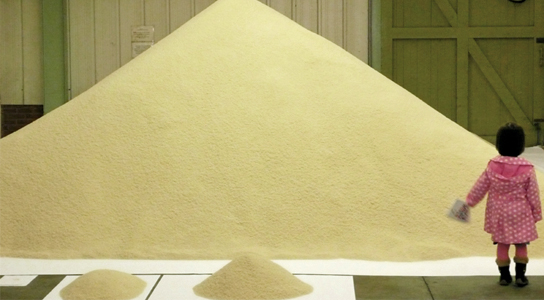
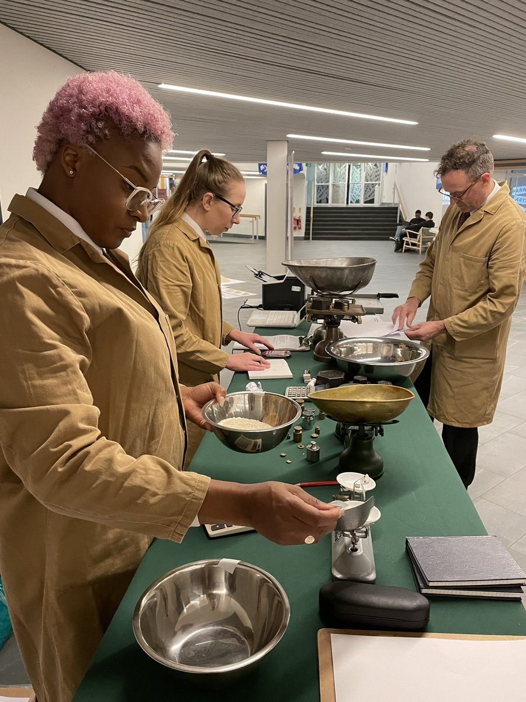
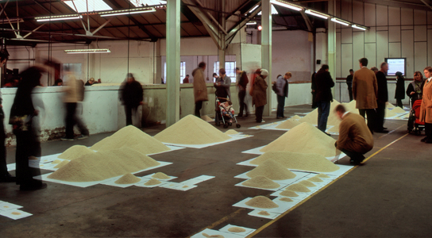

+++
author = "Yuichi Yazaki"
title = "One Grain of Rice Is One Person, and Every Pile Uses the Same Conversion: Stan's Cafe, \"Of All The People In All The World\""
slug = "stans-cafe-of-all-the-people"
date = "2026-11-06"
description = "Stan's Cafe's piece treats one grain of rice as one person and weighs every statistic at about 60 grains per gram. As a result, the size ratio between labelled piles is exactly the ratio between the numbers of people."
categories = [
    "consume"
]
tags = [
    "data physicalization",
    "population"
]
image = "images/birmingham-2008-large-pile.jpg"
series = ["data-physicalization"]
series_weight = 14
seriesByline = "Stan's Cafe (James Yarker)"
seriesTitle = "One Grain of Rice per Person, Weighed Out: Of All The People"
+++

Of All The People In All The World is a piece that Stan's Cafe, a theatre company from Birmingham, England, has been performing since 2003. One grain of rice stands for one person, and every statistic is weighed out into a pile at about 60 grains per gram, so the size ratio between labelled piles is exactly the ratio between the numbers of people. The paper under each pile carries only the name of the statistic, never a number.

What follows draws on the company's official pages (the overview, the FAQ, and the page for each performance) and on two essays, from 2005 and 2018, by James Yarker, the originator and director. As third-party records, it uses articles from VOA and the Christian Science Monitor, and dataphys.org, a catalogue of physical visualizations. It differs from [Hans Rosling's demonstration](/en/rosling-physical-visualizations/), in which one IKEA box stood for one billion people, in the size of its unit and in how it treats numbers.

<!--more-->

## Gathering a number like 6.2 billion out of things you can hold

The idea came during a tour in 2002. In the 2005 essay, Yarker writes that every European city was full of people who would not have missed the company if it had not been there. He wanted to understand how many people there are on Earth. In the 2018 script of his TEDx Bonn talk, he looks back:

> 6.2 billion, what does that mean? Even written out in full the number was ungraspable.

Even written out, 6.2 billion was a number he could not grasp. He also writes that if you gather 6.2 billion things you can hold, you can pick one up as yourself and look back at everyone else.

The material was sand at first. According to the 2005 essay, a student at Manchester Metropolitan University told him that "sand grains vary in size, and there is even dust." Yarker went around builders' merchants and a spice shop on Ladypool Road in Birmingham, and settled on rice. He counted out 100 grams on a kitchen scale and did the arithmetic, which showed that the world's population would need "100 odd tons."

The official FAQ lists the conditions for choosing rice in order. The grains had to be "regular size grains," so that numbers could be calculated from grains per gram. They had to be small, cheap, durable and unable to roll. Beyond that, rice is a staple food across much of the world, and up close it looks slightly like a person. **The first condition is that numbers can be weighed out.**

## One conversion of 60 grains per gram, for every statistic

According to the official page, the piece began in May 2003 in the foyer of Warwick Arts Centre in Coventry. It was the "UK" version, in which Britain's population of 60 million at the time was represented by 1,000 kg of rice.

According to the FAQ, the company put many grains on a scale and took the average per gram. Numbers up to 200 are counted by hand, and anything larger is weighed. The next sentence is the idea behind the piece:

> Although this is inevitably an approximation so are most of the statistics themselves. Ultimately the show is about proportions, this beside that, using the same formula for all statistics keeps these proportions accurate.

It is an approximation, but so are the statistics themselves. The piece is about proportions, this pile beside that one, and using the same formula for every statistic keeps those proportions accurate.

Put together from the sources, the correspondence between data and rice looks like this.

| Data | How it is shown | Specific value or example | Source |
|---|---|---|---|
| One person | One grain of rice | "Each grain of rice = one person" | Official overview |
| Number of people (201 or more) | Weight of rice, shown as pile size | Long-grain rice, 60 grains per gram | FAQ, Tokyo performance page |
| Number of people (up to 200) | Grains counted by hand | "count numbers up to 200 by hand" | FAQ |
| Name of the statistic | Label on a white sheet of paper under the pile | No number is written | 2018 script |
| Relations between statistics | Piles placed side by side | One grain for Michael Jackson next to the 12 people who walked on the Moon | 2018 script |
| Regions | Places within the venue | In 2008: the Americas, then Europe, Africa and Asia, in that order | 2008 performance page |
| World population over time | Three piles and lighting in one room | AD 1, 1500 and 1900 | 2008 performance page |
| Population density | Number of grains per country | Canada has 3 people per km², so 3 grains | VOA |
| The visitor themselves | One grain handed to them | A child is given a grain at the entrance | CS Monitor |

The scale changes from one edition to the next.

| Edition and venue | Year | People represented | Amount of rice | Source |
|---|---|---|---|---|
| UK (Warwick Arts Centre) | 2003 | Britain, 60 million | 1,000 kg | Official overview |
| World edition (Stuttgart) | 2005 | World, 6.2 billion | 104 tonnes | Official overview |
| World edition (Birmingham) | 2008 | World, 6.7 billion | 112 tonnes / 120 tonnes | Overview / performance page |
| If the same edition were staged in 2022 | 2022 | n/a | 133 tonnes | Official overview |

Dividing 6.2 billion by 104 tonnes gives about 59.6 grains per gram (my calculation). That matches the conversion closely.

Source: Stan's Cafe, [Stan's Cafe "Birmingham 2"](https://stans.cafe/project/project-of-all-the-people/project-of-all-the-people-birmingham2/)

The conversion changes with the kind of rice. According to the page for the September 2010 Tokyo performance (Setagaya Public Theatre), Japanese rice runs to 52 grains per gram, fewer than the 60 of the usual long-grain rice. The same number of people weighs more, so the company hurried to buy more rice.

The sources disagree on some numbers.

- Amount of rice in 2008: the overview page says 112 tonnes, while the performance page says "120 tons." The performance page also mentions an "extra 8 tonnes," and 104 + 8 = 112. A photo of the announcement sign on the performance page also reads "112 TONNES." The 120 can be read as a typo.
- Population of Britain: the overview and the 2018 script say 60 million, while the 2005 essay says "59 million."
- CS Monitor writes "50 million" for the pile for England, which is a different subject from the figure for Britain as a whole.
- Scale in CS Monitor: it says the MASS MoCA performance used more than 15 tonnes, about 250 million grains, and that one 100-pound bag holds about 1 million grains. That works out to roughly 17 to 22 grains per gram (my calculation), which does not match 60 grains. I could not confirm the reason.

## No numbers: let viewers read piles beside their labels

In the 2018 script, Yarker writes the rule of the piece like this:

> We never show the numbers because the numbers get in the way; in standing in for the people numbers erase the people.

Numbers are never shown. The reason is that numbers get in the way, and by standing in for the people they erase the people.

What is put down instead is the name of the statistic and what sits next to it. The script gives examples such as placing the world's refugees next to the world's dollar billionaires, and a joke about placing one grain for Michael Jackson next to the 12 grains for the people who walked on the Moon.

Photo: Graeme Rose. Source: [Stan's Cafe "Tokyo"](https://stans.cafe/project/project-of-all-the-people/project-of-all-the-people-tokyo/)

The labels in Tokyo were bilingual, in Japanese and English, with no numbers. On the largest piles, Yarker writes:

> even in vast piles the granularity of the rice remains clear, every pile is demonstrably a collection of individuals

Even in the biggest piles the grains stay visible, so each pile is plainly a collection of individuals. Asked about the contradiction of one person appearing in two piles, the FAQ answers that the grains are "actors," and that two grains may play the same person at the same time. This can be read as saying that the piles are independent for each statistic and are not meant to be added together.

Compared with [Rosling's IKEA boxes](/en/rosling-physical-visualizations/), the differences are as follows.

| | Rosling's boxes (TED@Cannes, 2010) | Of All The People In All The World |
|---|---|---|
| One unit | One box = 1 billion people | One grain = one person |
| Numbers | The speaker says them aloud | Not written on labels |
| How things are compared | Lined up along income levels, and moved by advancing the years | Labelled piles placed side by side |
| Time | A 9 minute 47 second talk | A run of several days to several weeks |

You cannot see people inside a box, so Rosling can be read as making up for it with spoken numbers. With rice, one grain is one person, so individuals are visible even inside a pile. **Bringing the unit down to one person can be read as the precondition for getting by without writing numbers.** Yarker called Stuttgart in 2005 "a map as big as the territory."

## Weighing, placing and swapping during the run

The company calls the piece a "performance installation." According to the official overview, the performers spend several days weighing out rice and laying down labelled piles. The piles become an "ever changing landscape."

Source: Stan's Cafe, [Stan's Cafe "Of All The People In All The World: UK"](https://stans.cafe/project/project-of-all-the-people/of-all-the-people-in-all-the-world-uk/)

This was the 2022 performance, back at Warwick Arts Centre, where the piece first played. According to the performance page, statistics were taken up and swapped out throughout the run.

According to the FAQ, statistics are collected from newspapers, academic journals, television, the web and other places. Official and unofficial figures are sometimes placed side by side. Where to put what is decided by the performers in discussion with their colleagues, and visitors' suggestions are taken as well.

Source: Stan's Cafe, [Stan's Cafe "Birmingham 2"](https://stans.cafe/project/project-of-all-the-people/project-of-all-the-people-birmingham2/)

In Birmingham in 2008, the route through the factory rooms followed roughly the order of geography. The three piles for AD 1, 1500 and 1900 were lit with slow crossfades.

The official list of performances includes "Adelaide 2026," so the piece is still being performed.

## How third parties saw the piece

The first record is a reaction to the no-numbers rule. VOA spoke to visitors at the performance at the Skirball Cultural Center in Los Angeles. The date in the URL is 2007-12-21, and the publication date shown on the page is 2009-11-01. Rick Brous says:

> We would love to get quantity on these things as we walk around and see big piles, we would like to know if that is hundreds of thousands or millions.

He would like to know whether a big pile is hundreds of thousands or millions. In the same article, Hillary Schmitt says the opposite:

> I like the fact that the numbers aren't listed on here and it's just a visual comparison.

She likes that there are no numbers and it is only a visual comparison. It is a record of responses split over the author's rule.

The second is about what is being compared. The Christian Science Monitor reported on the MASS MoCA performance in April 2007. The pile for the US population stood about 6 feet high. It also writes that the piles for residents of US gated communities and for prison inmates were nearly the same size.

The third is a researcher's classification. dataphys.org, run by Pierre Dragicevic and Yvonne Jansen, classifies the piece as a "Passive physical visualization."

> Rice is weighted manually in small quantities and manually poured over piles. This labor-intensive process is part of the show.

The view is that the labour of weighing small quantities by hand and pouring them is part of the work. The date given is "Since around 2004," but according to the official pages the premiere was in May 2003.

## Takeaways

There are four judgements to take back to visualization work.

The first is that a smaller unit makes quantity and the individual visible at once. With one box = 1 billion people, you cannot see individuals. With one grain = one person, you can see the grains even in a big pile. It can be read as an option when you want to show both quantity and the individual.

The second is a way of thinking that puts a consistent conversion ahead of the precision of individual values. The FAQ admits the approximation, then says that using the same formula for everything keeps the proportions. For a chart meant to make people compare, it can be read as saying that applying the same scale to every series is a precondition.

The third is the cost of removing the numbers. As with the VOA visitor, people who want to know the order of magnitude are left dissatisfied. Whether to favour ease of comparison or readable information is decided by the purpose of the chart.

The fourth is to re-weigh the conversion constant for each material and state it. Just as Japanese rice changed it to 52 grains, a different material means a different constant. The reason for the discrepancy has not been confirmed, but there is also the CS Monitor figure that does not match 60 grains, and it can be read as safer to state the conversion explicitly.

## References

**Primary sources**

- Stan's Cafe, "Of All The People In All The World" (overview, FAQ, list of performances). [Official page](https://stans.cafe/project/project-of-all-the-people/)
- Stan's Cafe, "Of All The People In All The World: UK" (Warwick Arts Centre, 4-9 October 2022). [Performance page](https://stans.cafe/project/project-of-all-the-people/of-all-the-people-in-all-the-world-uk/)
- Stan's Cafe, "Stuttgart" (Wagenhalle, 20 June to 10 July 2005). [Performance page](https://stans.cafe/project/project-of-all-the-people/project-of-all-the-people-stuttgart/)
- Stan's Cafe, "Birmingham 2" (A.E. Harris Factory, 13 September to 5 October 2008). [Performance page](https://stans.cafe/project/project-of-all-the-people/project-of-all-the-people-birmingham2/)
- Stan's Cafe, "Tokyo" (Setagaya Public Theatre, 14-22 September 2010, photo: Graeme Rose). [Performance page](https://stans.cafe/project/project-of-all-the-people/project-of-all-the-people-tokyo/)
- James Yarker, "Making Of All The People In All The World," 2005. [Essay](https://stans.cafe/essay/essays-making-oatp/)
- James Yarker, "Human Empathy In A Granular World," script of a talk at TEDx Bonn, 2018-11-17. [Essay](https://stans.cafe/essay/essays-human-empathy/)

**Secondary sources**

- Mike O'Sullivan, "Performance Artists Make Statistics Real Through Grains of Rice" (Skirball Cultural Center, Los Angeles), *VOA*, date in the URL 2007-12-21, publication date shown on the page 2009-11-01. [Article](https://www.voanews.com/a/a-13-2007-12-21-voa65/336801.html)
- "Sizing up the world with rice" (North Adams, MASS MoCA), *The Christian Science Monitor*, 2007-04-03. [Article](https://www.csmonitor.com/2007/0403/p19s01-hfks.html)
- "2004 – Of All the People in All the World: Stats with Rice," *List of Physical Visualizations* (dataphys.org, run by Pierre Dragicevic and Yvonne Jansen). [Item list (rice tag)](https://dataphys.org/list/tags/rice/) / [Item page](https://dataphys.org/list/of-all-the-people-in-all-the-world-stats-with-rice/)
