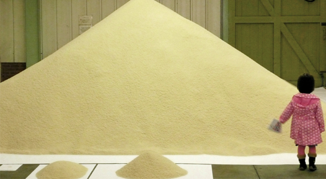
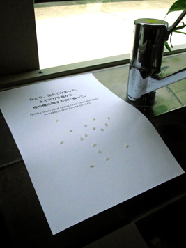
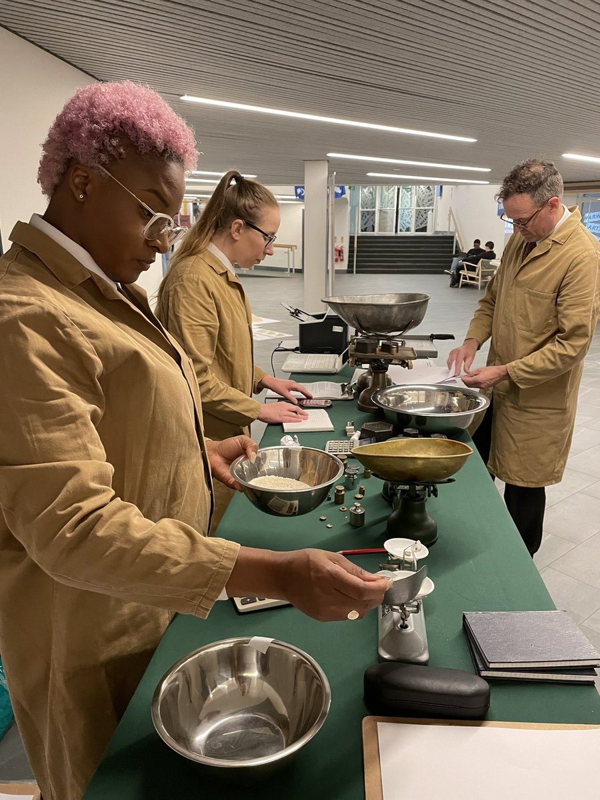
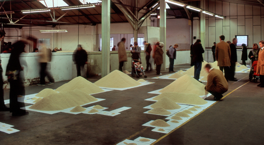

+++
author = "矢崎裕一"
title = "米1粒を1人とし、同じ換算で山を比べる──Stan's Cafe「Of All The People In All The World」"
slug = "stans-cafe-of-all-the-people"
date = "2026-11-06"
description = "Stan's Cafe の作品は、米1粒を1人とし、どの統計も1グラム約60粒で量って山にします。そのため、ラベルを付けた山どうしの大きさの比が、そのまま人数の比になります。"
categories = [
    "consume"
]
tags = [
    "データ物質化",
    "人口"
]
image = "images/birmingham-2008-large-pile.jpg"
series = ["data-physicalization"]
series_weight = 14
seriesByline = "Stan's Cafe（James Yarker）"
seriesTitle = "米1粒を1人として量る──Of All The People"
+++

Of All The People In All The World（オブ・オール・ザ・ピープル・イン・オール・ザ・ワールド）は、英国バーミンガムの劇団 Stan's Cafe（スタンズ・カフェ）が2003年から上演している作品です。米1粒を1人とし、どの統計も1グラム約60粒で量って山にするので、ラベルを付けた山どうしの大きさの比が、そのまま人数の比になります。山の下の紙には統計の名前だけを書き、数値は書きません。

以下は、劇団の公式ページ（概要と FAQ、公演ごとのページ）と、原案・演出の James Yarker（ジェームズ・ヤーカー）の2005年と2018年のエッセイに沿います。第三者の記録には、VOA と Christian Science Monitor の記事、物理的な可視化の目録 dataphys.org を使います。IKEA の箱1個を10億人にした[ハンス・ロスリングの演示](/rosling-physical-visualizations/)とは、単位の大きさと数値の扱いが違います。

<!--more-->

## 62億という数を、つかめる物で集める

着想は2002年のツアーでした。2005年のエッセイで Yarker は、欧州のどの都市にも、自分たちがいなくても困らない人々があふれていた、と書いています。地球に何人いるのかを理解したい。2018年、TEDx Bonn の講演原稿では、こう振り返ります。

> 6.2 billion, what does that mean? Even written out in full the number was ungraspable.

62億と書き出しても、つかめない数だった、という話です。つかめる物を62億個集めれば、1個を自分として手に取り、残りの全員を見返せる、とも書いています。

素材は、初めは砂でした。2005年のエッセイによると、マンチェスター・メトロポリタン大学の学生が「砂は粒の大きさがそろわず、粉まである」と返してきました。Yarker は建材店やバーミンガムの Ladypool Road のスパイス店を回り、米に決めます。台所のはかりで100グラムを数えて計算すると、世界の人口には「100 odd tons」が要ると分かりました。

公式の FAQ は、米を選んだ条件を順に挙げています。1グラムあたりの粒数で計算できるよう「regular size grains」であること。小さく、安く、丈夫で、転がらないこと。そのうえで、世界の多くで主食であり、近くで見ると人の形に少し似ていること。**最初の条件が、重さで数を量れることです。**

## 1グラム60粒を、すべての統計に使う

公式ページによると、作品は2003年5月、Warwick Arts Centre（コヴェントリー）のロビーで始まりました。当時の英国の人口6,000万人を、米1,000kg で表す「UK」版です。

FAQ によると、劇団はたくさんの粒をはかりに載せ、1グラムあたりの平均を取りました。200人までは手で数え、それより多いものは重さで量ります。続く一文が、作品の考え方です。

> Although this is inevitably an approximation so are most of the statistics themselves. Ultimately the show is about proportions, this beside that, using the same formula for all statistics keeps these proportions accurate.

近似にはなるが、統計そのものも近似だ。作品は「これの隣にあれ」という割合についてのもので、すべての統計に同じ式を使うから割合が保たれる、という説明です。

データと米の対応は、資料からまとめると次のとおりです。

| データ | 表し方 | 具体的な値・例 | 出典 |
|---|---|---|---|
| 1人 | 米1粒 | 「Each grain of rice = one person」 | 公式の概要 |
| 人数（201人以上） | 米の重さ → 山の大きさ | 長粒米で60粒／g | FAQ、東京公演のページ |
| 人数（200人まで） | 手で数えた粒 | 「count numbers up to 200 by hand」 | FAQ |
| 統計の名前 | 山の下の白い紙のラベル | 数値は書かない | 2018年の原稿 |
| 統計どうしの関係 | 山を隣り合わせに置く | 月面を歩いた12人の隣に、マイケル・ジャクソンの1粒 | 2018年の原稿 |
| 地域 | 会場内の場所 | 2008年は南北アメリカ→欧州→アフリカ→アジアの順 | 2008年の公演ページ |
| 時代ごとの世界人口 | 1室の3つの山と照明 | 西暦1年・1500年・1900年 | 2008年の公演ページ |
| 人口密度 | 国ごとの粒の数 | カナダは1km²あたり3人なので3粒 | VOA |
| 来場者本人 | 手渡される1粒 | 入口で子どもに1粒を渡す | CS Monitor |

規模は版で変わります。

| 版・会場 | 年 | 表した人数 | 米の量 | 出典 |
|---|---|---|---|---|
| UK（Warwick Arts Centre） | 2003 | 英国 6,000万人 | 1,000kg | 公式の概要 |
| 世界版（シュトゥットガルト） | 2005 | 世界 62億人 | 104トン | 公式の概要 |
| 世界版（バーミンガム） | 2008 | 世界 67億人 | 112トン／120トン | 概要／公演ページ |
| 同じ版を2022年に上演するなら | 2022 | ― | 133トン | 公式の概要 |

62億を104トンで割ると、1グラム約59.6粒です（計算）。換算とほぼ合います。

Stan's Cafe／[Stan's Cafe「Birmingham 2」](https://stans.cafe/project/project-of-all-the-people/project-of-all-the-people-birmingham2/)より引用

換算は米の種類で変わります。2010年9月の東京公演（世田谷パブリックシアター）のページによると、日本の米は1グラム52粒で、いつもの長粒米の60粒より少ない。同じ人数でも重くなるので、劇団は米を急いで買い足しました。

資料どうしで、数字が食い違うところがあります。

- 2008年の米の量：概要ページは112トン、公演ページは「120 tons」です。公演ページは「extra 8 tonnes」とも書き、104＋8＝112 になります。公演ページの告知看板の写真も「112 TONNES」です。120は誤記と読めます。
- 英国の人口：概要と2018年の原稿は6,000万人、2005年のエッセイは「59 million」です。
- CS Monitor はイングランドの山を「50 million」と書いていて、英国全体の数とは対象が違います。
- CS Monitor の規模：MASS MoCA の公演は15トン超で約2億5千万粒、100ポンドの袋1つが約100万粒とあります。1グラム17〜22粒ほどになり（計算）、60粒と合いません。理由は確かめられませんでした。

## 数値を書かず、ラベルと隣り合わせで読ませる

Yarker は2018年の原稿で、作品の決まりをこう書いています。

> We never show the numbers because the numbers get in the way; in standing in for the people numbers erase the people.

数値は見せない。数値は邪魔で、人の代わりに立つことで人を消してしまう、という理由です。

代わりに置くのは、統計の名前と、隣に何を置くかです。原稿には、世界のドル長者の隣に世界の難民を置く例や、月面を歩いた12粒の隣にマイケル・ジャクソンの1粒を置く冗談が出てきます。

Graeme Rose 撮影／[Stan's Cafe「Tokyo」](https://stans.cafe/project/project-of-all-the-people/project-of-all-the-people-tokyo/)より引用

東京公演のラベルは日本語と英語の2か国語で、数値はありません。大きな山について、Yarker はこう書きます。

> even in vast piles the granularity of the rice remains clear, every pile is demonstrably a collection of individuals

どれほど大きな山でも粒は見えたままで、一人ひとりの集まりだと分かる、という意味です。FAQ は、1人が二つの山に入る矛盾への問いに、米粒は「actors」で、同じ人を2粒が同時に演じてもよい、と答えています。山は統計ごとに独立し、足し合わせるものではないと読めます。

[ロスリングの IKEA の箱](/rosling-physical-visualizations/)と比べると、違いは次のとおりです。

| | ロスリングの箱（TED@Cannes、2010） | Of All The People In All The World |
|---|---|---|
| 1単位 | 箱1個＝10億人 | 米1粒＝1人 |
| 数値 | 講演者が言葉で言う | ラベルに書かない |
| 比べ方 | 所得の段階に沿って並べ、年を進めて動かす | ラベル付きの山を隣り合わせに置く |
| 時間 | 9分47秒の講演 | 数日から数週間の会期 |

箱1個の中に人は見えないので、ロスリングは数を言葉で補ったと読めます。米は1粒が1人なので、山の中にも個人が見えます。**単位を1人まで下げたことが、数値を書かずに済ませる前提になっている**と読めます。Yarker は2005年のシュトゥットガルトを「a map as big as the territory」と呼びました。

## 会期中に、量って、置いて、入れ替える

劇団は作品を「performance installation」と呼んでいます。公式の概要によると、上演者が数日かけて米を量り、ラベル付きの山を置いていきます。山は「ever changing landscape」になります。

Stan's Cafe／[Stan's Cafe「Of All The People In All The World: UK」](https://stans.cafe/project/project-of-all-the-people/of-all-the-people-in-all-the-world-uk/)より引用

2022年、初演地の Warwick Arts Centre に戻った公演です。公演ページによると、会期中に統計を取り上げては入れ替え続けました。

FAQ によると、統計は新聞、学術誌、テレビ、ウェブなどから集めます。公式と非公式の数字を並べて置くこともあります。どこに何を置くかは、上演者が仲間と相談し、来場者の提案も受けて決めます。

Stan's Cafe／[Stan's Cafe「Birmingham 2」](https://stans.cafe/project/project-of-all-the-people/project-of-all-the-people-birmingham2/)より引用

2008年のバーミンガムでは、工場の部屋を巡る順をおおよその地理の順にしました。西暦1年・1500年・1900年の3つの山には、照明をゆっくりクロスフェードさせています。

公式の公演一覧には「Adelaide 2026」があり、上演は今も続いています。

## 第三者はこの作品をどう見たか

一つ目の記録は、数値を書かない決まりへの反応です。VOA は、ロサンゼルスの Skirball Cultural Center の公演で来場者に話を聞きました。URL の日付は2007-12-21、ページの公開日の表示は2009-11-01です。Rick Brous（リック・ブラウス）は、こう言います。

> We would love to get quantity on these things as we walk around and see big piles, we would like to know if that is hundreds of thousands or millions.

大きな山が数十万なのか数百万なのか知りたい、という意見です。同じ記事で、Hillary Schmitt（ヒラリー・シュミット）は反対のことを言っています。

> I like the fact that the numbers aren't listed on here and it's just a visual comparison.

数値がなく、見た目の比較だけなのがよい、という意見です。作者の決まりに対して、受け止めが分かれた記録です。

二つ目は、比較の中身です。Christian Science Monitor は2007年4月、MASS MoCA の公演を伝えました。米国の人口の山は高さ約6フィートでした。米国のゲーテッド・コミュニティの住民と刑務所の収容者の山が、ほぼ同じ大きさだったとも書いています。

三つ目は、研究者の分類です。Pierre Dragicevic（ピエール・ドラジチェヴィッチ）と Yvonne Jansen（イヴォンヌ・ヤンセン）の dataphys.org は、この作品を「Passive physical visualization」に分類しています。

> Rice is weighted manually in small quantities and manually poured over piles. This labor-intensive process is part of the show.

手で少しずつ量って注ぐ手間も作品の一部だ、という見方です。年代は「Since around 2004」とされていますが、公式では初演は2003年5月です。

## 使い道

可視化の仕事に持ち帰れる判断は、四つあります。

一つ目は、単位を小さくすると、量と個が同時に見えることです。箱1個＝10億人では個人は見えません。1粒＝1人なら、大きな山でも粒が見えます。量と個を両方示したいときの選択肢と読めます。

二つ目は、個々の精度より、換算をそろえることを先に置く考え方です。FAQ は近似を認めたうえで、同じ式を全部に使うから割合が保たれると書きます。比べさせたい図では、すべての系列に同じ尺度を当てることが前提になると読めます。

三つ目は、数値を消すことの代償です。VOA の来場者のように、桁を知りたい人には不満が残ります。比べやすさと読み取れる情報のどちらを取るかは、図の目的で決めることになると読めます。

四つ目は、換算の定数を素材ごとに量り直し、明記することです。日本の米で52粒に変わったように、素材が替われば定数も替わります。食い違いの理由は確かめられていませんが、CS Monitor の数字が60粒と合わない例もあり、換算は明記しておくのが安全だと読めます。

## 参考・出典

**一次情報**

- Stan's Cafe, “Of All The People In All The World”（作品の概要、FAQ、公演一覧）. [公式ページ](https://stans.cafe/project/project-of-all-the-people/)
- Stan's Cafe, “Of All The People In All The World: UK”（Warwick Arts Centre、2022年10月4〜9日）. [公演ページ](https://stans.cafe/project/project-of-all-the-people/of-all-the-people-in-all-the-world-uk/)
- Stan's Cafe, “Stuttgart”（Wagenhalle、2005年6月20日〜7月10日）. [公演ページ](https://stans.cafe/project/project-of-all-the-people/project-of-all-the-people-stuttgart/)
- Stan's Cafe, “Birmingham 2”（A.E. Harris Factory、2008年9月13日〜10月5日）. [公演ページ](https://stans.cafe/project/project-of-all-the-people/project-of-all-the-people-birmingham2/)
- Stan's Cafe, “Tokyo”（世田谷パブリックシアター、2010年9月14〜22日、photo: Graeme Rose）. [公演ページ](https://stans.cafe/project/project-of-all-the-people/project-of-all-the-people-tokyo/)
- James Yarker, “Making Of All The People In All The World,” 2005. [エッセイ](https://stans.cafe/essay/essays-making-oatp/)
- James Yarker, “Human Empathy In A Granular World,” TEDx Bonn での講演原稿, 2018-11-17. [エッセイ](https://stans.cafe/essay/essays-human-empathy/)

**第三者評価**

- Mike O'Sullivan, “Performance Artists Make Statistics Real Through Grains of Rice”（ロサンゼルス、Skirball Cultural Center）, *VOA*, URL の日付は2007-12-21、ページの公開日の表示は2009-11-01. [記事](https://www.voanews.com/a/a-13-2007-12-21-voa65/336801.html)
- “Sizing up the world with rice”（ノースアダムズ、MASS MoCA）, *The Christian Science Monitor*, 2007-04-03. [記事](https://www.csmonitor.com/2007/0403/p19s01-hfks.html)
- “2004 – Of All the People in All the World: Stats with Rice,” *List of Physical Visualizations*（dataphys.org、Pierre Dragicevic・Yvonne Jansen 運営）. [項目一覧（rice タグ）](https://dataphys.org/list/tags/rice/) / [項目ページ](https://dataphys.org/list/of-all-the-people-in-all-the-world-stats-with-rice/)
