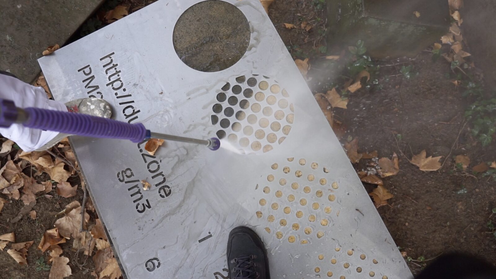
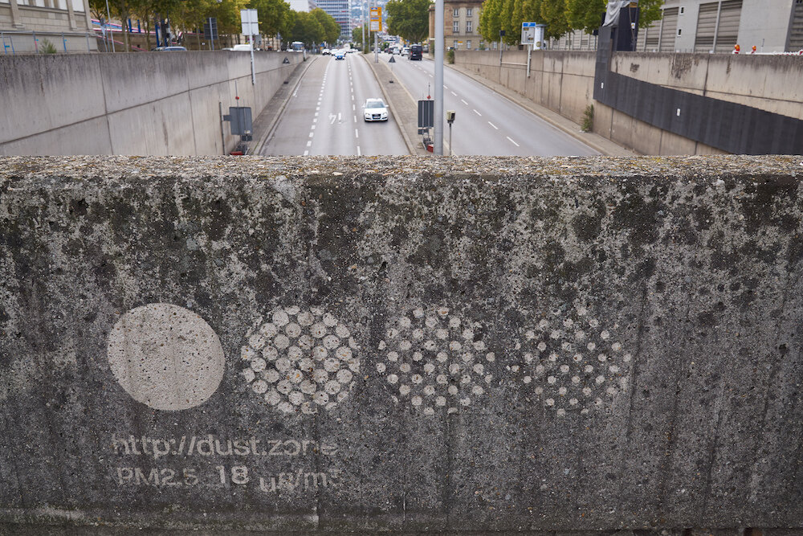
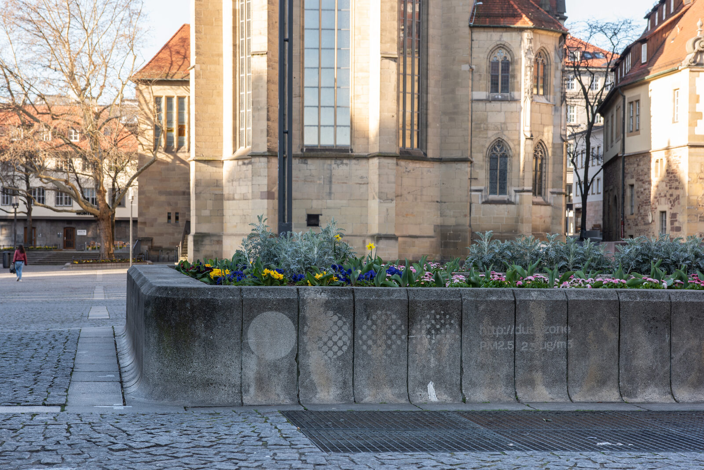
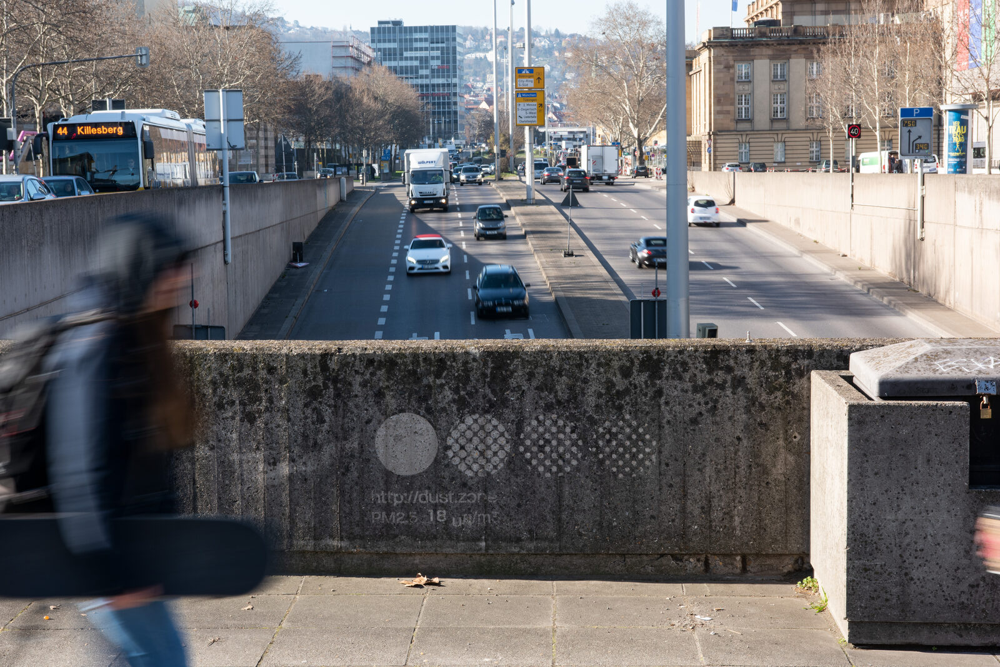

+++
author = "Yuichi Yazaki"
title = "Washing Dirt Off a Wall to Draw Circles, Then Letting Settling Dust Erase Them: Dietmar Offenhuber's Staubmarke"
slug = "staubmarke-dustmark"
date = "2026-11-05"
description = "Using stencils and a pressure washer, Staubmarke cleans dirt from walls and other surfaces to leave circles made of dots of different sizes, drawn as a scale. Each mark lets viewers roughly estimate how thick the accumulated layer is."
categories = [
    "consume"
]
tags = [
    "data physicalization"
]
image = "images/dustmark-bridge-wall.jpg"
+++

Dietmar Offenhuber's Staubmarke (pronounced "SHTOWP-mar-keh"; the English title is Dustmark) is a work in which stencils and a pressure washer are used to clean dirt from walls and other surfaces, leaving rows of circles made of dots of different sizes, drawn as a scale. By reading the scale on each mark, viewers can roughly estimate how thick the accumulated layer of dirt is. As dust settles again, the pattern disappears, starting with the smallest circles.

The work was made in October 2018 for Drehmoment, an arts festival held in Stuttgart, Germany. What follows is a reading based on the brochure from the organizer KulturRegion Stuttgart, Offenhuber's paper "Data by Proxy" (2019), and a press article from Northeastern University. The artist's official page and the project site dust.zone could not be opened this time.

<!--more-->

## Washing a Wall in Stuttgart, 2018

Drehmoment was an industrial arts festival organized by KulturRegion Stuttgart, held from October 4 to 28, 2018. Staubmarke was presented together with Michael Saup's VR work "STAUB" in a single brochure, and the listed partners include the High-Performance Computing Center Stuttgart (HLRS). "STAUB" was shown inside St. Mary's Church (Marienkirche), while the Staubmarke marks were placed at several locations in the city.

The brochure states the premise shared by both works as follows.

> Elektronische Sensoren liefern zwar genaue Messdaten, die Zahlen und Maßeinheiten bleiben für uns jedoch abstrakt.

In other words: electronic sensors do deliver precise measurements, but the numbers and units remain abstract for us.

Offenhuber's technique is reverse graffiti. Rather than adding paint to a dirty surface, he washes away only part of the dirt to bring out a design. According to a Northeastern University press article (December 2018), he used a pressure washer and stencils to wash patterns into city walls and pavements.

Source: Dietmar Offenhuber / Information is Beautiful Awards, "Dustmarks And Ozone Tattoos: Autographic Displays Of Air Pollution"

The organizer describes the artist's aim like this.

> Dabei geht es ihm darum, einen physischen Referenzpunkt zu den digitalen Messwerten herzustellen.

That is, the aim is to create a physical reference point for the digital measurements.

## Circles of Different Dot Sizes Become a Scale

According to the brochure, each mark contains a scale (Skala) uncovered from the layer of dirt.

> Jede Staubmarke zeigt eine aus der Staubschicht freigelegte Skala. Anhand dieser können Betrachterinnen und Betrachter ungefähr die Stärke der abgelagerten Patina einschätzen.

In other words: viewers can use this scale to roughly estimate the thickness of the accumulated layer of dirt.

In the photographs, a mark takes the form of a filled circle at the far left, followed by circles made of small dots. The dots get smaller toward the right.

Source: Work by Dietmar Offenhuber (photographer not credited) / Boston Hassle, "WENT THERE: World Memory, The Art of Data Visualization @ Boston CyberArts Gallery"

Over time, the pattern disappears. The paper "Data by Proxy" says that the finest details go first.

> With ongoing pollution, the markers will fade over time, starting with the most delicate textures in the pattern.

The press article likewise explains that as new dust settles on the washed areas, the smallest circles vanish first. This can be read as meaning that the finest step of the scale is the first to disappear, while the coarser steps remain longer.

The correspondence between data and appearance, as far as the sources I examined show, is summarized in the table below.

| Data / phenomenon | Appearance / material | What it does | Source |
|---|---|---|---|
| Particulate matter accumulated on city surfaces | Difference in brightness between washed and still-dirty areas | No paint is added; dirt is selectively removed | Paper, §7.3 |
| Thickness of the accumulated layer | A scale uncovered from the layer of dirt | Viewers roughly estimate the thickness of the layer | Brochure |
| Continued accumulation afterward | The order in which the pattern disappears | Fine elements, the smallest circles, disappear first | Paper, §7.3; press article |
| Dirt that varies by place | Where the marks are placed | The same type of mark at several locations in the city | Brochure; press article |
| Measurements from a citizen sensor network | Mark locations overlap with measurement sites | Measured values can be compared with the appearance of the marks | Brochure; paper, §7.3 |
| Substrate | Concrete or stone walls and pedestals | The paper's figure says "washed into concrete" | Paper, Fig. 9 |

**This can be read as: the more dirt there is, the more clearly the washed circles show, and the more dirt resettles, the more the circles fade.** Because the image fades as the quantity grows, it can be read as the reverse of an ordinary chart, which adds ink. The scale can be read as working like a legend for reading the layer's thickness at a given moment. At the same time, the number of steps that have vanished can be read as a clock that records how much has been deposited since the mark was washed.

## Four Locations or Five: Where the Marks Are and What Was Measured

The number of locations where marks were placed differs between sources. The brochure lists five, RG1 to RG5.

| No. | Location (as given in the brochure) |
|---|---|
| RG1 | Under the Paulinen Bridge (Tübinger Straße) |
| RG2 | St. Mary's Church (Tübinger Straße 36) |
| RG3 | Pedestal of a flowerbed on Schillerplatz (in front of the entrance to the Old Palace) |
| RG4 | Wall near the Wagenburg Tunnel (Konrad-Adenauer-Straße) |
| RG5 | Staatsgalerie Stuttgart (Konrad-Adenauer-Straße 30–32) |

The press article, on the other hand, writes "His website features four locations." That is a statement that the project site showed four locations. The brochure says the latest locations are listed on dust.zone, but because I could not open that site, I was not able to confirm which number is final.

Source: Dietmar Offenhuber / Information is Beautiful Awards, "Dustmarks And Ozone Tattoos: Autographic Displays Of Air Pollution"

The choice of locations is related to the measurements. The brochure says that references to regional measurements from the citizen measurement network luftdaten.info were added. The paper explains this in a little more detail.

> The markers were applied at locations also surveyed by the sensors installed by a citizen sensing initiative, allowing the comparison between data values and physical appearance of the markers.

In other words: the marks were also placed at sites measured by sensors installed by a citizen sensing initiative, so the data values can be compared with the physical appearance of the marks. According to the press article, the project site had links from each location to the citizen group's data.

As for numerical values on individual marks, they cannot be confirmed from the artist's side. The exhibition review in Boston Hassle says that each mark also showed the average PM2.5 value for its location. A photograph the artist's side submitted to the Information is Beautiful Awards also has text under a circle that reads "PM2.5 18 µg/m³." However, the sources I could read do not say when or in which measurement that value was taken.

Source: Photo by Frank Kleinbach (according to the image file name), work by Dietmar Offenhuber / Information is Beautiful Awards, "Dustmarks And Ozone Tattoos: Autographic Displays Of Air Pollution"

## Its Place in "Data by Proxy"

In the paper "Data by Proxy — Material Traces as Autographic Visualizations," presented at IEEE VIS in 2019, Offenhuber cites this work as an example. An autographic visualization, in the paper's terms, is a visualization that starts from traces left on physical things rather than from data translated into symbols. Staubmarke appears in Section 7.3, "Sensory Accountability."

> As an example, the project Staubmarke (Fig. 9) visualizes air pollution by applying visual markers on urban surfaces to make accumulations of particulate matter legible.

That is, it is introduced as an example that places markers on urban surfaces so that accumulations of particulate matter can be read.

> We use the term sensory accountability to describe approaches that call attention to the complex material qualities of a phenomenon that is often reduced to a single quantitative dimension.

In other words: the paper calls approaches that draw attention to the complex material qualities of a phenomenon often reduced to a single quantity "sensory accountability." The paper goes on to say that it means asking what a sensor captures, what it ignores, and how the recorded values correspond to the phenomenon as sensed.

The caption of Fig. 9 in the paper classifies this work's design operations as "aggregating, encoding." In Table 2 of the same paper, Aggregating means gathering material so that it becomes visible, and Encoding means adding a scale that divides up the phenomenon. Since the work uses a layer of accumulated dirt and washes a scale into it, these two operations can be read as applying to it directly.

The work also has a chapter in the book *Making with Data* (edited by Huron, Nagel, Oehlberg, and Willett; CRC Press). It is 5.4, "Staubmarke (Dustmark)," in Part 5, "Environment," written by Offenhuber, pp. 359–369, DOI 10.1201/9781003264903-24. I could not read the chapter text this time. The same Part 5 also includes [Perpetual Plastic](/en/perpetual-plastic/) and [Solar Totems](/en/solar-totems/). Both are works in which a phenomenon leaves traces in the material at hand. They differ in the direction of the trace: in Solar Totems, burn lines accumulate and remain, whereas in Staubmarke the pattern fades away.

## How Third Parties Saw the Work

Gina Lindner wrote about this work in an exhibition review in Boston Hassle (May 2019). The exhibition was "World Memory: The Art of Data Visualization" at the Boston Cyberarts Gallery.

> The first and most memorable work I encountered was dust.zone

The review calls it the first work she met at the venue and the most memorable. Lindner writes that on the washed, clean surface a "utopia" of a pollution-free world peeks through. She then points out that it is a time-based work whose patterns disappear within a few months.

> dust.zone is also uniquely time-based: these crisp patterns will fade over the coming months as dust reaccumulates.

The same review also reports an incident in Boston. Offenhuber tried reverse graffiti on the gravel outside the gallery, but there was not enough dirt, and no pattern appeared. This is written as something she heard from a gallery staff member.

From the visualization community, an entry that paired it with Ozone Tattoo, "Dustmarks and Ozone Tattoos," made the Longlist in the Unusual category of the Kantar Information is Beautiful Awards 2019. It was not a winner.

The Northeastern University press article gives as background a conflict between citizen groups and city authorities over how to measure air pollution. Because it is a university press release, it is not an independent critique. I did not find any independent commentary by researchers in this survey.

## Takeaways

What we can take away from this work is a design in which disappearing is itself the scale.

In an ordinary chart, marks increase as values increase. In Staubmarke, the more dust settles, the more the image disappears. You draw a graded pattern once and let the phenomenon erase it; by looking at how far it has been erased, you can read how much has accumulated since it was drawn. That is how I read it.

The other is a reference point for checking numbers against the physical thing in the same place. The marks were also placed at the citizen sensors' measurement sites, so that the values could be compared with the appearance of the wall. It can be read as a way of returning a number on a screen to the place where that number was measured.

The author himself writes about the limits. The paper says that producing an autographic visualization is slow and bound by the materials available. According to Boston Hassle, on the gravel outside the gallery there was too little dirt for a pattern to appear. This method can be read as usable only when the phenomenon leaves enough of a trace on the spot.

## References

**Primary sources**

- KulturRegion Stuttgart, "Drehmoment Produktionskunst-Festival 4.–28.10.2018: Michael Saup | Dietmar Offenhuber »STAUB« | »Staubmarke« Mit: HLRS" brochure (PDF, 2018): https://kulturregion-stuttgart.de/fileadmin/user_upload/Projekte/2018_Drehmoment/Kommunen-Projekte/Einzelprogrammhefte/Drehmoment_Stuttgart_Saup_Offenhuber_WEB.pdf
- Dietmar Offenhuber, "Data by Proxy — Material Traces as Autographic Visualizations," arXiv:1907.05454, 2019 (IEEE VIS 2019; Section 7.3, Fig. 9, Table 2): https://arxiv.org/abs/1907.05454
- Information is Beautiful Awards, "Dustmarks And Ozone Tattoos: Autographic Displays Of Air Pollution" (entry text and photographs, 2019): https://www.informationisbeautifulawards.com/showcase/3977-dustmarks-and-ozone-tattoos-autographic-displays-of-air-pollution
- Dietmar Offenhuber, "Staubmarke (Dustmark)," in *Making with Data*, pp. 359–369 (Part 5, 5.4): https://doi.org/10.1201/9781003264903-24
- *Making with Data* book site, editors and structure of the parts: https://makingwithdata.org/blog/structure
- Table of contents of *Making with Data* (bookseller's page): https://preigu.de/buecher/making-with-data/122556908
- Pages that could not be opened this time: the artist's official page https://offenhuber.net/project/staubmarke-dustmark/ / project site http://dust.zone/

**Secondary sources**

- Gina Lindner, "WENT THERE: World Memory, The Art of Data Visualization @ Boston CyberArts Gallery," *Boston Hassle*, 2019-05-14: https://bostonhassle.com/went-there-world-memory-the-art-of-data-visualization/
- Khalida Sarwari, "He came up with a way to make data tangible and exciting," *Northeastern Global News*, 2018-12-18 (university press office): https://news.northeastern.edu/2018/12/18/heres-one-way-to-make-data-tangible-and-exciting
- Kantar Information is Beautiful Awards 2019, Longlist (Unusual category): https://www.informationisbeautifulawards.com/showcase/3977-dustmarks-and-ozone-tattoos-autographic-displays-of-air-pollution
