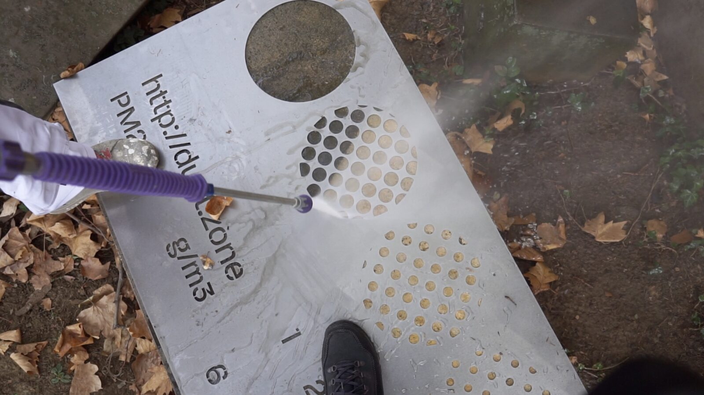
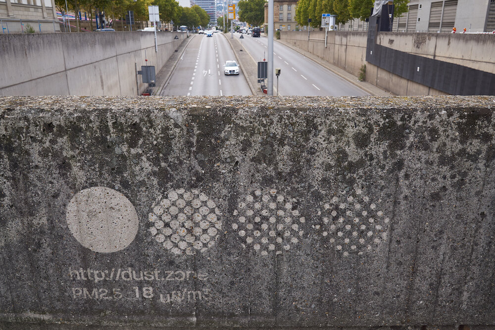
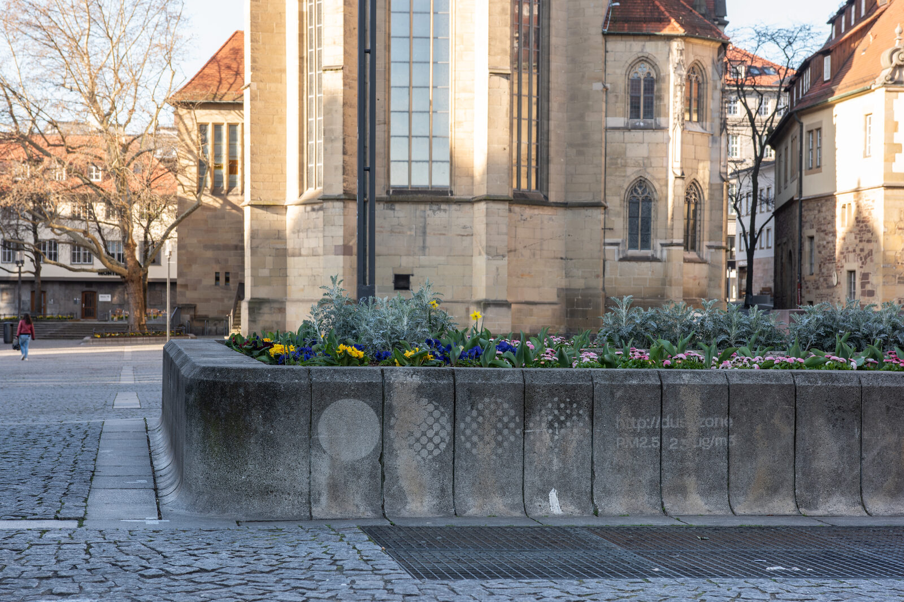
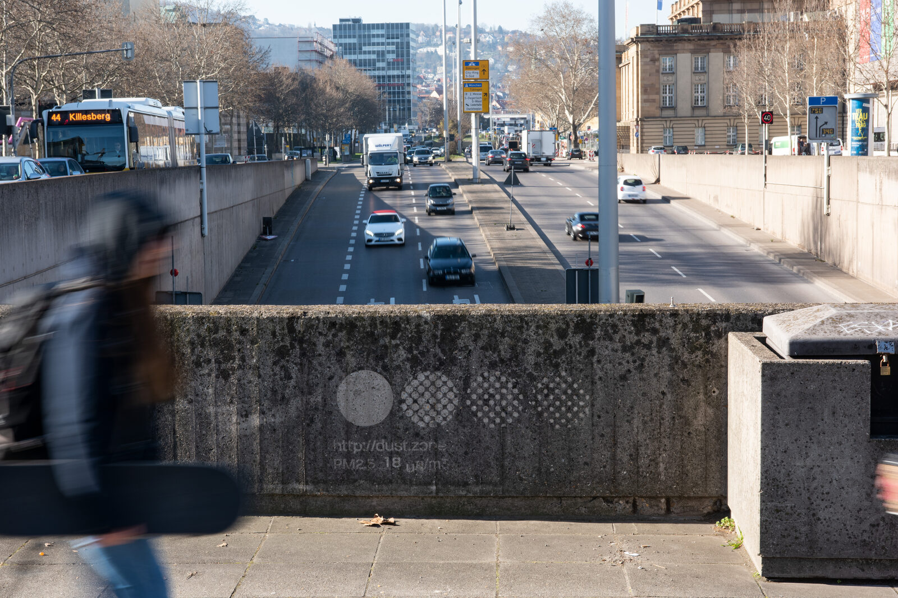

+++
author = "矢崎裕一"
title = "壁の汚れを洗って円を描き、積もる粉じんで消していく──Dietmar Offenhuber の Staubmarke"
slug = "staubmarke-dustmark"
date = "2026-11-05"
description = "ステンシルと高圧洗浄機で壁などの汚れを落とし、大きさの違う点でできた円を目盛りとして描いた作品です。各印の目盛りで、積もった層の厚さをおおよそ見積もれるようにしました。"
categories = [
    "consume"
]
tags = [
    "データ物質化"
]
image = "images/dustmark-bridge-wall.jpg"
series = ["data-physicalization"]
series_weight = 99
seriesByline = "Dietmar Offenhuber"
seriesTitle = "汚れを洗って描き、小さい円から消える──Staubmarke"
+++

Dietmar Offenhuber（ディートマー・オッフェンフーバー）の Staubmarke（シュタウプマルケ、英語表記は Dustmark）は、ステンシルと高圧洗浄機で壁などの汚れを落とし、大きさの違う点でできた円を並べて、目盛りとして描いた作品です。見る人が各印の目盛りで、積もった汚れの層の厚さをおおよそ見積もれるようにしました。粉じんが積もり直すと、模様は小さい円から見えなくなっていきます。

作品は2018年10月、ドイツのシュトゥットガルトで開かれた芸術祭「Drehmoment」のために作られました。以下は、主催者 KulturRegion Stuttgart のパンフレット、Offenhuber の論文「Data by Proxy」（2019）、Northeastern University の広報記事に沿って読みます。作者の公式ページと作品サイト dust.zone は、今回は開けませんでした。

<!--more-->

## 2018年、シュトゥットガルトの壁を洗う

Drehmoment は、KulturRegion Stuttgart が開いた産業芸術祭です。会期は2018年10月4日〜28日でした。Staubmarke は、Michael Saup の VR 作品「STAUB」と一冊のパンフレットにまとめられ、協力先にはシュトゥットガルト高性能計算センター（HLRS）が載っています。「STAUB」は聖マリア教会の中で見せ、Staubmarke の印は市内の複数の場所に置かれました。

パンフレットは、両作品に共通する前提をこう書きます。

> Elektronische Sensoren liefern zwar genaue Messdaten, die Zahlen und Maßeinheiten bleiben für uns jedoch abstrakt.

電子センサーは正確な測定値を出すが、数字や単位は私たちにとって抽象的なままだ、という説明です。

Offenhuber がとった技法は、リバース・グラフィティです。汚れた面に塗料を足すのではなく、一部だけを洗い落として図柄を出します。Northeastern University の広報記事（2018年12月）によると、高圧洗浄機とステンシルで、街の壁や舗道に模様を洗い出しました。

Dietmar Offenhuber／Information is Beautiful Awards「Dustmarks And Ozone Tattoos: Autographic Displays Of Air Pollution」より引用

主催者は、作者のねらいを次のように書いています。

> Dabei geht es ihm darum, einen physischen Referenzpunkt zu den digitalen Messwerten herzustellen.

デジタルの測定値に対して、物理的な参照点をつくることがねらいだ、という一文です。

## 点の大きさの違う円が、目盛りになる

パンフレットによると、一つ一つの印には、汚れの層から洗い出した目盛り（Skala）が入っています。

> Jede Staubmarke zeigt eine aus der Staubschicht freigelegte Skala. Anhand dieser können Betrachterinnen und Betrachter ungefähr die Stärke der abgelagerten Patina einschätzen.

見る人は、この目盛りで、積もった汚れの層の厚さをおおよそ見積もれる、という説明です。

写真で見ると、印は左端の塗りつぶした円と、小さな円の点を集めた円が並んだ形をしています。点は右へ行くほど小さくなります。

Dietmar Offenhuber の作品（撮影者の記載なし）／Boston Hassle「WENT THERE: World Memory, The Art of Data Visualization @ Boston CyberArts Gallery」より引用

時間がたつと、模様は消えていきます。論文「Data by Proxy」は、細かい部分から消えると書いています。

> With ongoing pollution, the markers will fade over time, starting with the most delicate textures in the pattern.

広報記事も、洗った部分に新しい粉じんが積もるにつれ、いちばん小さい円から消えていくと説明しています。目盛りのいちばん細かい段が最初に消え、粗い段が後まで残る、と読めます。

調べた資料から、データと見た目の対応をまとめると、次のようになります。

| データ・現象 | 見た目・素材 | 内容 | 出典 |
|---|---|---|---|
| 街の表面に積もった粒子状物質 | 洗った部分と汚れたままの部分の、明るさの差 | 塗料を足さず、汚れを選んで取り除く | 論文 7.3節 |
| 積もった層の厚さ | 汚れの層から洗い出した目盛り | 見る人が層の厚さをおおよそ見積もる | パンフレット |
| その後も続く堆積 | 図柄の消える順序 | 細かい要素、小さい円から先に消える | 論文 7.3節、広報記事 |
| 場所ごとの汚れ | 印を置く位置 | 市内の複数の場所に同じ方式の印 | パンフレット、広報記事 |
| 市民センサー網の測定値 | 印の場所と測定地点を重ねる | 測定値と印の見た目を比べられる | パンフレット、論文 7.3節 |
| 下地 | コンクリートや石の壁・台座 | 論文の図は「washed into concrete」 | 論文 Fig. 9 |

**汚れが多いほど洗った円がくっきり見え、汚れが積もり直すほど円は消えていく、と読めます。** 量が増えるほど図が薄れる向きで、インクを足していくふつうのチャートとは逆の設計だと読めます。目盛りは、その時点の層の厚さを読む凡例として働く、と読めます。同時に、消えた段の数が、印を洗ってからの堆積を刻む時計にもなっている、と読めます。

## 4か所か、5か所か──印の場所と測定値

印を置いた場所の数は、資料によって食い違います。パンフレットには、RG1〜RG5の5か所が載っています。

| 番号 | 場所（パンフレットの記載） |
|---|---|
| RG1 | パウリーネン橋の下（Tübinger Straße） |
| RG2 | 聖マリア教会（Tübinger Straße 36） |
| RG3 | シラー広場の花壇の台座（旧宮殿の入口前） |
| RG4 | ヴァーゲンブルク・トンネルの近くの壁（Konrad-Adenauer-Straße） |
| RG5 | シュトゥットガルト州立美術館（Konrad-Adenauer-Straße 30–32） |

一方、広報記事は「His website features four locations」と書いています。作品サイトでは4か所だった、という記述です。パンフレットは最新の場所を dust.zone で案内するとしていますが、そのサイトを開けなかったため、どちらが最終的な数かは確かめられませんでした。

Dietmar Offenhuber／Information is Beautiful Awards「Dustmarks And Ozone Tattoos: Autographic Displays Of Air Pollution」より引用

場所の選び方には、測定値との関係があります。パンフレットは、市民の測定網 luftdaten.info の地域の測定値への参照を付けた、と書きます。論文はもう少し詳しく説明しています。

> The markers were applied at locations also surveyed by the sensors installed by a citizen sensing initiative, allowing the comparison between data values and physical appearance of the markers.

印は、市民の測定活動が設置したセンサーの測定地点にも置かれた。そのため、データの値と印の見た目を比べられる、という説明です。広報記事によると、作品サイトには各場所から市民団体のデータへのリンクがありました。

印ごとの数値については、作者側の文章では確かめられません。Boston Hassle の展覧会評は、各印がその場所の PM2.5 の平均値も示していたと書いています。作者側が Information is Beautiful Awards に出した写真にも、円の下に「PM2.5 18 µg/m³」と読める文字があります。ただ、その数値がいつの、どの測定の値なのかは、読めた資料には書かれていません。

Frank Kleinbach 撮影（画像ファイル名の記載による）、作品 Dietmar Offenhuber／Information is Beautiful Awards「Dustmarks And Ozone Tattoos: Autographic Displays Of Air Pollution」より引用

## 「Data by Proxy」での位置づけ

Offenhuber は、2019年の IEEE VIS で発表した論文「Data by Proxy — Material Traces as Autographic Visualizations」で、この作品を例に挙げています。論文の言う autographic visualization は、記号に置き換えたデータではなく、物に残った痕跡から出発する可視化です。Staubmarke は 7.3節「Sensory Accountability」に出てきます。

> As an example, the project Staubmarke (Fig. 9) visualizes air pollution by applying visual markers on urban surfaces to make accumulations of particulate matter legible.

都市の表面に印を付けて、粒子状物質の堆積を読めるようにした例だ、という紹介です。

> We use the term sensory accountability to describe approaches that call attention to the complex material qualities of a phenomenon that is often reduced to a single quantitative dimension.

一つの数量に縮められがちな現象の、複雑な物質としての性質に目を向けさせる方法を、sensory accountability と呼ぶ、という定義です。論文はさらに、センサーが何をとらえ、何を無視し、記録された値が感覚でとらえる現象とどう対応するのかを問うことだ、と続けます。

論文の Fig. 9 のキャプションは、この作品のデザイン操作を「aggregating, encoding」と分類しています。同じ論文の Table 2 では、Aggregating は素材を集めて見えるようにすること、Encoding は現象を区切る目盛りを加えることです。汚れが集まった層を使い、そこに目盛りを洗い出した作品なので、二つの操作がそのまま当てはまる、と読めます。

この作品には、書籍『Making with Data』（Huron・Nagel・Oehlberg・Willett 編、CRC Press）にも章があります。第5部「Environment」の 5.4「Staubmarke (Dustmark)」で、執筆は Offenhuber、pp. 359–369、DOI は 10.1201/9781003264903-24 です。章の本文は今回読めていません。同じ第5部には [Perpetual Plastic](/perpetual-plastic/) と [Solar Totems](/solar-totems/) も入っています。どちらも、現象がその場の素材に痕跡を残す作品です。違いは痕跡の向きで、Solar Totems は焦げ線が増えて残り、Staubmarke は図柄が消えていきます。

## 第三者はこの作品をどう見たか

Gina Lindner は、Boston Hassle の展覧会評（2019年5月）で、この作品を取り上げました。展覧会は Boston Cyberarts Gallery の「World Memory: The Art of Data Visualization」です。

> The first and most memorable work I encountered was dust.zone

会場で最初に出会い、最も記憶に残った作品だ、という評です。Lindner は、洗ってきれいになった面に、汚染のない世界の「utopia」がのぞくと書きます。そして、模様が数か月で消えていく、時間に基づく作品である点を挙げます。

> dust.zone is also uniquely time-based: these crisp patterns will fade over the coming months as dust reaccumulates.

同じ評には、ボストンでの出来事も載っています。Offenhuber はギャラリーの外の砂利でもリバース・グラフィティを試したが、汚れが足りず、模様にならなかった。ギャラリーの担当者から聞いた話として書かれています。

可視化のコミュニティからは、Kantar Information is Beautiful Awards 2019 で、Ozone Tattoo と組みにした応募「Dustmarks and Ozone Tattoos」が Unusual 部門の Longlist に入りました。受賞ではありません。

Northeastern University の広報記事は、市民団体と市当局が大気汚染の測り方で対立していたことを背景として書いています。大学の広報なので、独立した批評ではありません。研究者による独立した論評は、今回の調査では見つかりませんでした。

## 使い道

この作品から持ち帰れるのは、消えていくこと自体を目盛りにする設計です。

ふつうのチャートでは、値が増えると印が増えます。Staubmarke では、粉じんが増えるほど図が消えます。段階のある模様を一度だけ描き、あとは現象に消させる。どこまで消えたかを見れば、描いてからの量が読める、と読めます。

もう一つは、数値と現物を同じ場所で照らし合わせる参照点です。印は市民センサーの測定地点にも置かれ、値と壁の見た目を比べられるようにしてありました。画面の数字を、その数字が測られた場所へ戻す方法として読めます。

限界も、作者自身が書いています。論文は、autographic visualization の制作は遅く、手に入る素材に縛られるとしています。Boston Hassle によれば、ギャラリーの外の砂利では、汚れが足りず模様が出ませんでした。この方式は、現象がその場に十分な痕跡を残しているときにだけ使える、と読めます。

## 参考・出典

**一次情報**

- KulturRegion Stuttgart「Drehmoment Produktionskunst-Festival 4.–28.10.2018：Michael Saup | Dietmar Offenhuber »STAUB« | »Staubmarke« Mit: HLRS」パンフレット（PDF、2018）：https://kulturregion-stuttgart.de/fileadmin/user_upload/Projekte/2018_Drehmoment/Kommunen-Projekte/Einzelprogrammhefte/Drehmoment_Stuttgart_Saup_Offenhuber_WEB.pdf
- Dietmar Offenhuber, "Data by Proxy — Material Traces as Autographic Visualizations," arXiv:1907.05454, 2019（IEEE VIS 2019。7.3節、Fig. 9、Table 2）：https://arxiv.org/abs/1907.05454
- Information is Beautiful Awards, "Dustmarks And Ozone Tattoos: Autographic Displays Of Air Pollution"（応募文と写真、2019）：https://www.informationisbeautifulawards.com/showcase/3977-dustmarks-and-ozone-tattoos-autographic-displays-of-air-pollution
- Dietmar Offenhuber, "Staubmarke (Dustmark)," in *Making with Data*, pp. 359–369（第5部 5.4）：https://doi.org/10.1201/9781003264903-24
- 『Making with Data』書籍サイト、編者と各部の構成：https://makingwithdata.org/blog/structure
- 『Making with Data』の目次（書店のページ）：https://preigu.de/buecher/making-with-data/122556908
- 今回は開けなかったページ：作者の公式ページ https://offenhuber.net/project/staubmarke-dustmark/ ／作品サイト http://dust.zone/

**第三者評価**

- Gina Lindner, "WENT THERE: World Memory, The Art of Data Visualization @ Boston CyberArts Gallery," *Boston Hassle*, 2019-05-14：https://bostonhassle.com/went-there-world-memory-the-art-of-data-visualization/
- Khalida Sarwari, "He came up with a way to make data tangible and exciting," *Northeastern Global News*, 2018-12-18（大学広報）：https://news.northeastern.edu/2018/12/18/heres-one-way-to-make-data-tangible-and-exciting
- Kantar Information is Beautiful Awards 2019, Longlist（Unusual 部門）：https://www.informationisbeautifulawards.com/showcase/3977-dustmarks-and-ozone-tattoos-autographic-displays-of-air-pollution
