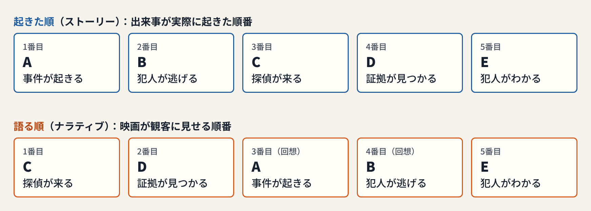
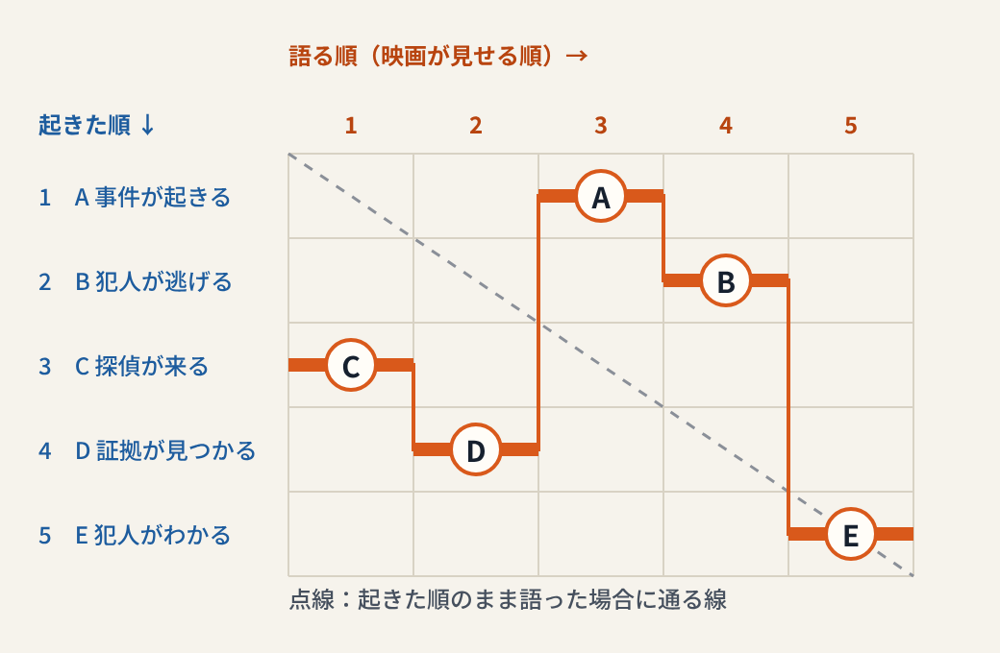
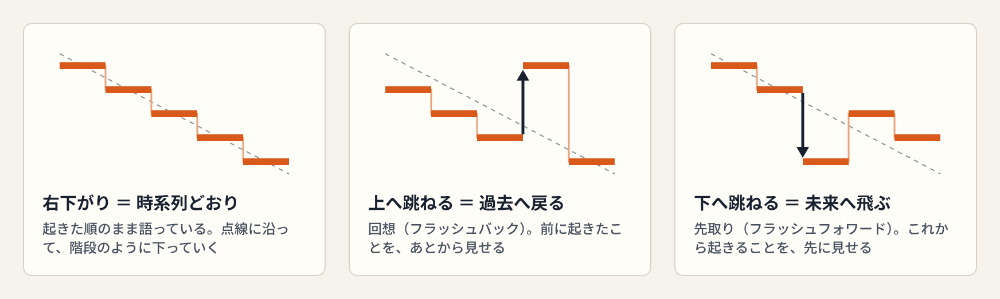
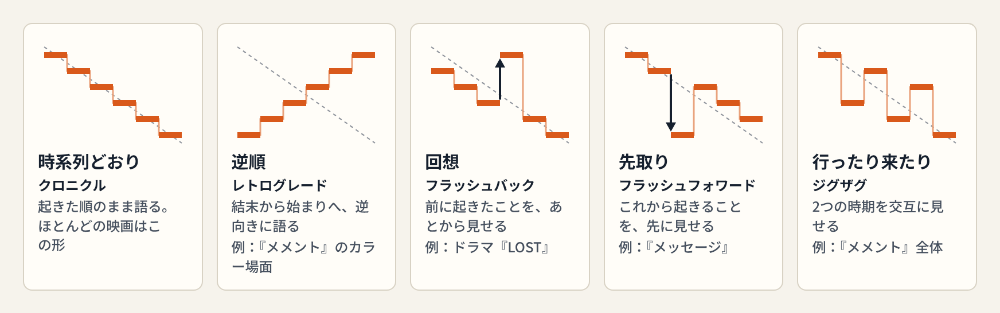
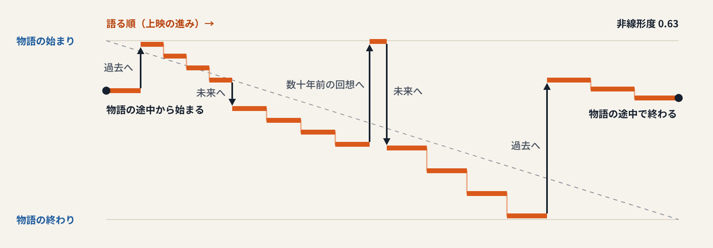
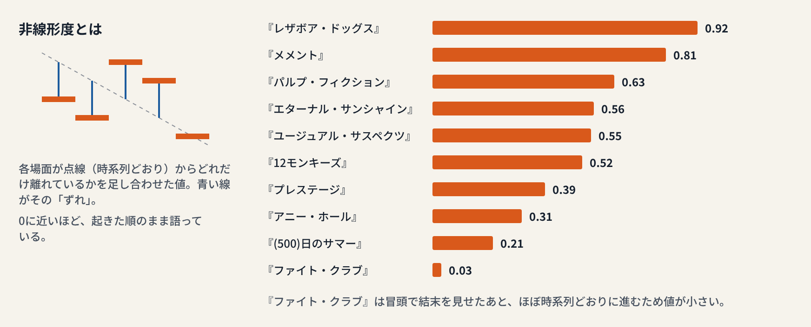
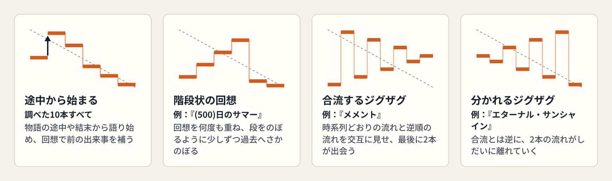
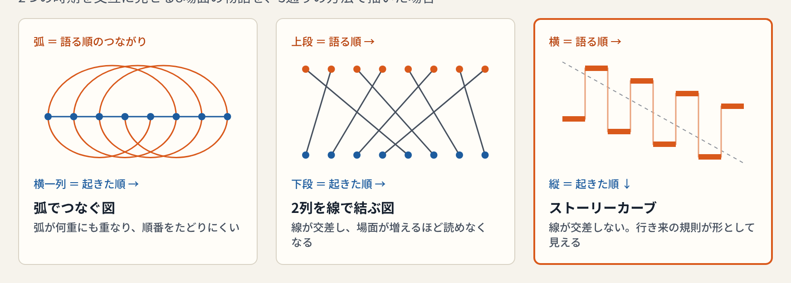

+++
author = "矢崎裕一"
title = "並べて比べると、分類にない形が見える──Story Curves が描いた10本の映画"
slug = "story-curves-nonlinear-narratives"
date = "2026-11-21"
description = "映画の時間の入れ替えを1本の曲線にすると、作品どうしを同じ図で比べられます。10本を並べた結果、文学理論の類型にない大きな形が見つかりました。"
categories = [
    "technology",
    "principle"
]
tags = [
    "Story Curves",
    "ナラティブ",
    "Nam Wook Kim",
    "Genette"
]
image = "images/cover.png"
+++

Story Curves の面白さは、映画の時間の入れ替えを図にしたことだけではありません。どの映画も同じ作り方の1本の曲線になるので、作品どうしを並べて比べられることです。Nam Wook Kim（ナム・ウク・キム）らは10本の映画を曲線にして並べ、文学理論の類型にはなかった、映画1本を特徴づける大きな形を見つけました。

出典は Kim ほか6人の論文 "Visualizing Nonlinear Narratives with Story Curves" です。IEEE VIS 2017（InfoVis）で発表され、*IEEE Transactions on Visualization and Computer Graphics* の2018年1月号に載りました。以下は、この論文と著者のプロジェクトサイトに沿います。図は、論文の図をもとに筆者が描き起こした模式図です。

<!--more-->

## 「起きた順」と「語る順」を縦横にとる

物語には順番が2つあります。出来事が実際に起きた順番と、作品がそれを見せる順番です。論文は前者を story order、後者を narrative order と呼びます。この記事では「起きた順」「語る順」と書きます。

筆者作成。並びは Kim ほか 2018 の Fig. 1 と同じ（C・D・A・B・E）。出来事の中身は筆者が当てはめた例

2つの順番がずれている語り方を、非線形ナラティブ（nonlinear narrative）と言います。論文によると、ねらいは多くの場合サスペンスを高めることです。小説、演劇、映画、漫画、ゲームで広く使われています。

調べにくさは2つあります。時間が何度も行き来するので、頭の中で整理しきれません。そして、本当の時系列を明示した記録がどこにもありません。脚本に書かれているのは、語る順だけです。

Story Curves の作り方は単純です。横軸に語る順を、左から右へとります。縦軸に起きた順を、上から下へとります。各場面をその交点に置き、語る順につないでいきます。

筆者作成。Kim ほか 2018 の Fig. 1 をもとに描き起こしたもの

起きた順のまま語る映画は、左上から右下への対角線になります。**読むのは、この対角線からの離れ方です。** 線が上へ跳ねれば過去へ戻り、下へ跳ねれば未来へ飛んでいます。

筆者作成

論文は、対角線からの距離を全場面について足し合わせ、非線形度（nonlinearity）という1つの数にしています。図の上に添えられる値です。

## Genette の類型を、同じ図で描き直す

時間の入れ替えには、先行する分類があります。フランスの文学理論家 Gérard Genette（ジェラール・ジュネット）の類型です。論文はこれを7つに整理して紹介しています。

| 類型 | 内容 | 論文が挙げる例 |
|---|---|---|
| Chronicle | 起きた順のまま語る | 災害映画、民話 |
| Retrograde | 結末から始まりへ、逆向きに語る | 『メメント』のカラー場面 |
| Zigzag | 2つの時期を交互に語る | 『メメント』全体 |
| Analepsis | 回想（フラッシュバック） | ドラマ『LOST』 |
| Prolepsis | 先取り（フラッシュフォワード） | 映画『メッセージ』 |
| Syllepsis | 時間以外のつながり（場所、主題）でまとめる | 挿話を重ねる古典的な小説 |
| Achrony | 順番に関係がなく、ばらばらに語る | ― |

Genette はこの分析を、文章の精読と記号で行いました。論文が例に引く表記は `A2 [B1] C2 [D1 (E2) F1 (G2) H1] I2` です。角括弧が回想、丸括弧が先取りを表します。小説の一節なら追えますが、映画1本ぶんを一望するには向きません。

Story Curves では、時間の順番にかかわる5つが、そのまま曲線の形になります。

筆者作成。Genette の類型のうち、曲線の形として現れる5つ

右下がりの階段は Chronicle、右上がりは Retrograde です。上への跳ね上がりが Analepsis、下への跳ね下がりが Prolepsis、上下の往復が Zigzag になります。記号では別々の書き方だったものが、1枚の図の上の向きと傾きにそろいます。

残る2つは、形だけでは見分けにくい類型です。Syllepsis は時間ではなく意味のまとまりだからです。そこで論文は、曲線に情報を重ねます。線の色が登場人物、線を囲む帯が場所、背景の縦帯が時間帯です。線の太さは、その場面の登場人数を表します。

## 『パルプ・フィクション』を1本の線で読む

論文の最初の図は、Quentin Tarantino 監督の『パルプ・フィクション』（1994）です。

筆者作成。Kim ほか 2018 の Fig. 1 をもとに単純化した模式図。場面の数と位置は概略

曲線は、縦軸の中ほどから始まります。最初の場面が、物語の途中に当たるからです。そこから上へ跳ねて過去に戻り、階段状に下ります。途中で数十年前の回想へ跳ね上がり、また下ります。最後に大きく上へ戻り、**始まりとほぼ同じ高さで終わります。**

論文はこれを、物語が同じ地点で始まり、同じ地点で終わる、と読んでいます。非線形度は 0.63 です。

色を重ねると、別のことが見えます。この映画には、互いにつながった3つの話があります。主役は Vincent、Butch、Jules です。論文の図では、Jules の場面が2つのかたまりに分かれ、その間に Vincent と Butch の話が挟まっています。Genette の言う Syllepsis が、色のかたまりとして現れた例です。

もう1本の例は Christopher Nolan 監督の『メメント』（2000）です。こちらは最後の出来事から始まり、何度も物語の冒頭へ戻ります。曲線は上下の往復になります。論文が面白がっているのは、その中身です。回想の場面は時系列どおりに進み、先取りの場面は逆順に進みます。2本の線は、映画の終わりで出会います。非線形度は 0.81 です。

## 10本を並べて見つかった形

著者たちは、公開されている脚本から10本の映画を選び、すべて曲線にしました。場面の時系列への並べ替えは手作業で、1本あたり平均30〜60分かかった、と書いています。

筆者作成。数値は Kim ほか 2018 の Fig. 1・3・10 に記載された Nonlinearity の値

| 映画 | 非線形度 |
|---|---|
| レザボア・ドッグス | 0.92 |
| メメント | 0.81 |
| パルプ・フィクション | 0.63 |
| エターナル・サンシャイン | 0.56 |
| ユージュアル・サスペクツ | 0.55 |
| 12モンキーズ | 0.52 |
| プレステージ | 0.39 |
| アニー・ホール | 0.31 |
| (500)日のサマー | 0.21 |
| ファイト・クラブ | 0.03 |

『ファイト・クラブ』の値が小さいのは、冒頭で結末を見せたあと、ほぼ時系列どおりに進むからです。時間を入れ替えた映画として知られていても、入れ替えの量は作品ごとに大きく違います。

数よりも大事なのは、形です。論文は、Genette の類型は数場面ぶんの局所的な形を記述するものが多い、と指摘します。それらが組み合わさると、映画1本を特徴づける大きな形になります。**曲線を並べて初めて見分けられたのが、この大きな形でした。**

筆者作成。Kim ほか 2018 の 7.2 節が挙げる形のうち4つ

論文が挙げる構造の形は5つです。

- 途中から始まる／終わる（in medias res）。 10本すべてに見られました。物語の途中か結末から語り始め、回想で前の出来事を補います。多くは物語の最後の出来事で終わりますが、『パルプ・フィクション』と『メメント』は例外です。
- 続きに戻る回想・先取り。 前の回想が終わった時点へ戻り、離れた場面のかたまりをつなぎます。『パルプ・フィクション』の Jules の話がこれです。
- 階段状の回想・先取り。 回想のあとに回想が続き、段をのぼるように語ります。『(500)日のサマー』が例です。
- 行き来するフラッシュ。 回想と先取りが絡み合い、3つ以上の時期を行き来します。『アニー・ホール』と『(500)日のサマー』で目立ちます。
- 合流・分岐するジグザグ。 2つの流れが近づくか、離れていきます。『メメント』は合流、『エターナル・サンシャイン』はその逆です。

色を重ねて見える形も2つあります。時間は飛んでも主人公を追い続ける形と、時期ごとに登場人物がまとまる形です。前者は『ファイト・クラブ』『アニー・ホール』『メメント』に見られます。

## 第三者はこの図をどう見たか

データ可視化のブログ FlowingData は、2017年10月9日にこの研究を紹介しました。記事は、この形式には見覚えがあるはずだ、と書きます。The New York Times が、映画の予告編の非線形さを見せるのに使った図です。論文自身も、関連研究でこの図に触れています。ただし予告編の図が比べているのは、本編の語る順と予告編の語る順です。起きた順は入っていません。Story Curves は、縦軸を起きた順に置き換えたものと読めます。

研究の側では、同じ枠組みが別の題材に移されています。Xingyu Lan らは CHI 2021 の論文で、時間を扱うデータストーリーの語る順を分析し、6つのパターンを取り出しました。参考文献には Story Curves が挙がっています。結論は、作り手は物語を生き生きさせるために、わざと曲がり角や跳躍を足す、というものです。

可視化の外でも使われています。Clare Grall らは2023年、『(500)日のサマー』を見ている人の脳を fMRI で調べました。この論文は、映画が場面を見せる順と、出来事が起きた順の関係を示す図に、Story Curves の考え方を使っています。脳は順番をばらして見せられても、時系列に並べ直して表現している、というのが論文の結果です。

評価という意味では、Information is Beautiful Awards 2017 の Arts, Entertainment & Culture 部門でロングリストに入っています。

論文の中にも、外からの目があります。著者たちは脚本家3人と文学研究者1人に話を聞きました。脚本家の一人は、こう言っています。

> The visuals look like musical notes.

図が音符のように見える、という感想です。文学作品にもリズムがある、と続きます。一方で脚本家たちは、書いている最中には使わない、とも言っています。役に立つのは、書き直しで場面を並べ替えるときや、既存の脚本を読むときです。教育と、撮影の段取りにも使える、という声がありました。

## 使い道

持ち帰れることは3つあります。

1つ目は、**2つの順番を比べるときは、順番どうしを縦横にとる、という型です。** 論文は別の描き方も検討しています。起きた順を横一列に並べ、語る順を弧でつなぐ図。上下2本の線を、対応する場面どうしで結ぶ図。どちらも線が交差し、複雑な物語では目の移動が長くなる、というのが著者たちの判断です。

筆者作成。Kim ほか 2018 の Fig. 5 の比較を、2つの時期を交互に見せる8場面の例に置き換えたもの

著者たちは、この型が物語に限らないとも書いています。同じ要素の2通りの並びなら、何でも載ります。挙げられているのは、スポーツの順位の入れ替わりと、染色体の並びの組み替えです。前年と今年の順位、計画の順と実行の順も、同じ図で見られるはずです。

2つ目は、新しい図法でも、読み方は学べるということです。論文は13人で実験をしています。可視化も物語論も専門ではない、18〜35歳の人たちです。説明を読み、あらすじから自分で曲線を描く練習をしました。学習は平均で約17分です。そのあと、曲線だけを見て20問に答えました。

| 項目 | 結果 |
|---|---|
| 参加者 | 13人 |
| 学習時間 | 平均 約17分 |
| 正答数 | 20問中 平均16問（最低9、最高20） |
| 回答時間 | 全体で平均 7.49分 |

つまずきも記録されています。原点が左上にあることに、はじめは戸惑う人がいました。回想と先取りを取り違える人もいました。そして、いちばん難しかったのは図を読むことではなく、出来事を時系列に並べ直す作業でした。見慣れない図を仕事で出すときは、短い練習と、向きを示す手がかりを一緒に出す。そう読めます。

3つ目は、限界の書き方です。Story Curves が扱うのは順番だけです。場面の長さの違いや、同じ出来事を何度も語ることは、十分に表せません。数十年前への回想も、1段ぶんの跳躍にしか見えません。時間のループや並行する時間軸も、いまの形では描けません。著者たちはこれを論文の中で認め、時系列の並べ替えを自動で手伝うことを今後の課題に挙げています。

1つの図法が何を捨てているかを、作り手自身が書いておく。並べて比べる図を作るときほど、その一覧が効いてきます。

## 参考・出典

**一次情報**

- Nam Wook Kim, Benjamin Bach, Hyejin Im, Sasha Schriber, Markus Gross, Hanspeter Pfister, "Visualizing Nonlinear Narratives with Story Curves," *IEEE Transactions on Visualization and Computer Graphics*, 24(1), pp. 595–604, 2018. DOI: [10.1109/TVCG.2017.2744118](https://doi.org/10.1109/TVCG.2017.2744118)
- 著者によるプロジェクトサイト: [Visualizing Nonlinear Narratives with Story Curves](https://namwkim.github.io/storycurve/)
- Story Explorer のデモ: [storycurve.namwkim.org](http://storycurve.namwkim.org/)
- Gérard Genette, *Narrative Discourse: An Essay in Method*, Cornell University Press, 1983.（論文が依拠する類型の原典。本記事は論文の紹介に沿っています）

**第三者評価**

- FlowingData, "Visualizing nonlinear stories," 2017年10月9日. [https://flowingdata.com/2017/10/09/visualizing-nonlinear-stories](https://flowingdata.com/2017/10/09/visualizing-nonlinear-stories)
- Xingyu Lan, Xinyue Xu, Nan Cao, "Understanding Narrative Linearity for Telling Expressive Time-Oriented Stories," *CHI 2021*. DOI: [10.1145/3411764.3445344](https://doi.org/10.1145/3411764.3445344)
- Clare Grall, Josefa Equita, Emily S. Finn, "Neural unscrambling of temporal information during a nonlinear narrative," *Cerebral Cortex*, 33(11), pp. 7001–7014, 2023. DOI: [10.1093/cercor/bhad015](https://doi.org/10.1093/cercor/bhad015)
- Kantar Information is Beautiful Awards 2017, Longlist（Arts, Entertainment & Culture）. [https://www.informationisbeautifulawards.com/showcase/2430](https://www.informationisbeautifulawards.com/showcase/2430)
