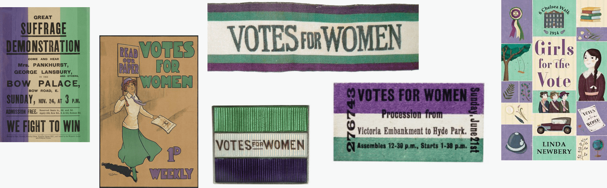
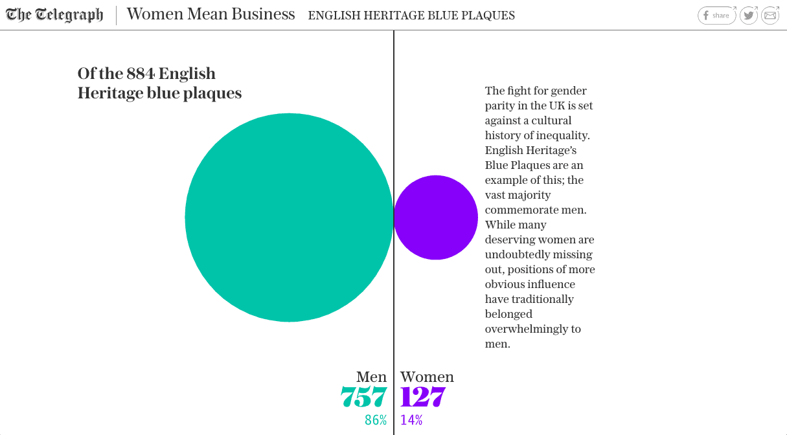
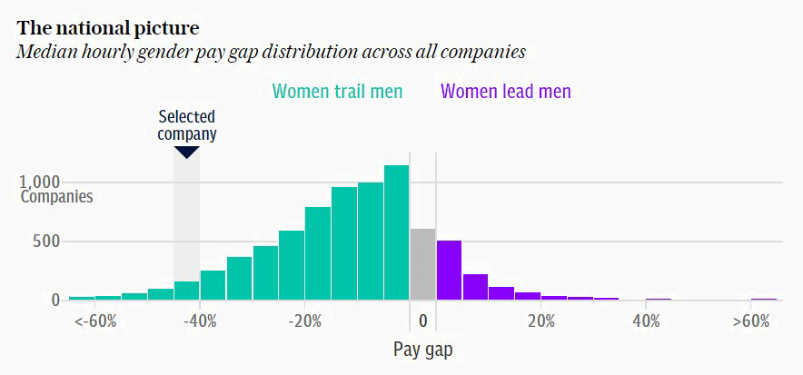
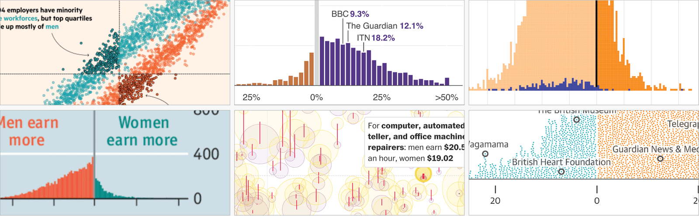

+++
author = "Yuichi Yazaki"
title = "Dropping Pink and Blue, Giving Women the Purple That Stands Out on White: The Telegraph's \"Born Equal. Treated Unequally.\""
slug = "telegraph-born-equal-gender-colors"
date = "2026-11-07"
description = "In its charts on gender inequality, The Telegraph dropped pink and blue for the suffrage movement's purple and green, and gave women the purple, which stands out against a white background. The piece ran on International Women's Day, 8 March 2018."
categories = [
    "consume"
]
tags = [
    "data journalism",
    "color",
    "gender",
    "The Telegraph",
    "Data Feminism"
]
image = "images/telegraph-chart-purple-green.png"
series = ["dataviz-journalism"]
series_weight = 99
seriesByline = "Fraser Lyness et al. (The Telegraph)"
seriesTitle = "Giving Women the Purple That Stands Out on White: The Telegraph's \"Born Equal\""
+++

For its charts on gender inequality, The Telegraph dropped pink and blue and used the purple and green of the suffrage movement. Which color went to which sex was decided by how they look against a white background: purple, which stands out more than green on white, went to women. The interactive piece with this palette, "Born Equal. Treated Unequally.," was published on 8 March 2018, International Women's Day.

The Telegraph piece itself is for subscribers only, and I have not been able to read it. What follows about the charts comes through two sources: Chapter 4 of *Data Feminism* (2020) by Catherine D'Ignazio and Lauren F. Klein, which shows the work as Figure 4.6, and a Datawrapper blog post (10 July 2018) in which Lisa Charlotte Muth put questions to Fraser Lyness, who chose the colors.

<!--more-->

## 8 March 2018: A Piece for International Women's Day

According to *Data Feminism*, in March 2018 reporters on The Telegraph's Lifestyle Desk were thinking about how to mark International Women's Day. What caught their eye was the gender gap in the UK across education, politics, business, and culture.

| Item | Detail | Source |
|---|---|---|
| Title | "Born Equal. Treated Unequally." (Datawrapper writes "Born equal. Treated unequally") | *Data Feminism* note 48, Datawrapper |
| Publication date | 8 March 2018 | *Data Feminism* note 48 |
| Text authors | Claire Cohen, Patrick Scott, Ellie Kempster | Same |
| Production credits | The three above, plus Richard Moynihan, Oliver Edgington, Dario Verrengia, Fraser Lyness, George Ioakeimidis, Jamie Johnson | *Data Feminism* Fig. 4.6 |
| Who chose the colors | Fraser Lyness (Director of Graphic Journalism) and his team | Datawrapper |

The article's URL contains "women-mean-business-interactive." In an October 2018 article, The Telegraph's Jamie Johnson writes that on International Women's Day the paper launched "Women Mean Business," a campaign to support women entrepreneurs. The same article also describes 2018 as the year of celebrating 100 years of women's suffrage. I have found no source, however, saying that this piece was timed to that centenary.

According to *Data Feminism*, the data from other institutions that the reporters used all came in a male/female binary. The categories could not be changed. What could be changed was the color.

## Borrowing the Suffrage Movement's Purple and Green

The quickest colors for separating men from women are pink and blue. In the Datawrapper post, Lisa Charlotte Muth cites a "Chart Doctor" column by Alan Smith of the FT (I have not read the original column; I checked it against the passage the Datawrapper post quotes). Smith wrote that he used pink and blue because the link between color and sex is so strong that no legend is needed, which keeps the chart clean. Muth writes that pink and blue reinforce gender stereotypes and are especially counterproductive in charts about inequality.

*Data Feminism* makes the same point.

> "Pink and blue is, after all, another hierarchy, and the goal of the Telegraph team members was to mitigate inequality, not reinforce it."

In short, pink and blue is itself a hierarchy, and the team's aim was to ease inequality, not to reinforce it.

The team chose purple and green. In Lyness's account, these were the colors of the "Votes for Women" campaign in early twentieth-century Britain.

> "At the heart of this movement were “Sylvia Pankhurst and Emmeline Pethick-Lawrence and essentially the colors were their choice (apparently symbolizing; purple for freedom and dignity, white for purity, green for hope).””

The colors were chosen by Sylvia Pankhurst and Emmeline Pethick-Lawrence, who stood at the center of the movement, and are said to stand for freedom and dignity (purple), purity (white), and hope (green). Of these, the team used purple and green for the sexes.

Source: Lisa Charlotte Muth, [Datawrapper Blog](https://www.datawrapper.de/blog/gendercolor)

Lyness says the reference to the suffrage movement "sealed the deal."

> "Having a reference to the suffrage movement helped seal the deal"

Nobody objected to the fact that, without pink and blue, the sex of a group is not obvious at a glance, he says. Rather, Lyness answers, everyone felt that pink and blue would undermine the message they wanted to convey.

## Purple, Which Stands Out on White, for the Smaller Group

The purple-and-green pair was chosen for what it means. Then which sex gets the purple? Lyness answers:

> "Against white, purple registers with far greater contrast and so should attract more attention when putting alongside the green, not by much but just enough to tip the scales. In a lot of the visualisations men largely outnumber women, so it was a fairly simple method of bringing them back into focus."

On a white background, purple has much stronger contrast and draws attention when placed next to green. The difference is not large, but it is enough to tip the scales. Because men far outnumber women in many of the charts, it was a simple way to bring women back into focus. Before this, Lyness also says, they had wanted to give priority to women.

The contrast is "far greater," but the pull on attention is "not by much." This can be read as the idea that **the effect of making something stand out can be modest; it is enough for the scales to tip a little**.

Datawrapper shows the following image as a chart where this effect is easy to see.

Source: The Telegraph / [Datawrapper Blog](https://www.datawrapper.de/blog/gendercolor)

The header reads "Women Mean Business" and "ENGLISH HERITAGE BLUE PLAQUES." Of 884 blue plaques, 757 are for men and 127 for women. Measuring the image, the ratio of the circles' areas can be read as close to the ratio of the counts (about 6 to 1). Datawrapper does not say which part of the piece this image comes from.

Figure 4.6 of *Data Feminism* lines up FTSE 100 CEOs as human-shaped icons filled in purple and green. The accompanying text reads "Just six of FTSE 100 CEOs are women."

There is one more purple-and-green chart, for which the source article is not named.

Source: The Telegraph / [Datawrapper Blog](https://www.datawrapper.de/blog/gendercolor)

It shows the gap between men's and women's median hourly pay across all companies, as a distribution of the number of companies. In the legend, "Women trail men" is green and "Women lead men" is purple. Here the colors stand for the direction of the gap, not for sex, but the idea of making the smaller side purple can be read as the same. Datawrapper writes that the same palette was also used in a pay-gap article (paywalled) of 22 March 2018.

| Data | Visual channel | Specifics | Source |
|---|---|---|---|
| Sex | Hue | Women = purple, men = green | Datawrapper, *Data Feminism* |
| Male/female CEOs | Human-shaped icons | Purple and green, legend "Men / Women" | *Data Feminism* Fig. 4.6 |
| Number of plaques | Circle size | Men 757 (green), women 127 (purple) | Datawrapper image |
| Direction of pay gap | Bar color | Below = green, above = purple | Datawrapper image |
| Color values | n/a | Not confirmed | n/a |

## What Colors Did Other Newsrooms Use?

The Datawrapper post says that Muth's piece grew out of a tweet by the FT's John Burn-Murdoch (I have not read the tweet). The tweet lined up the colors that outlets used in reporting UK pay-gap data.

| Category | Examples (according to the Datawrapper post) |
|---|---|
| Pink and blue (red and blue) | NYT (2015, 2017), Bloomberg (2016), WSJ (2016), Daily Mail (2018), ZEIT (2016, 2018), two of The Pudding's film pieces (2017) |
| Other colors | Economist, Guardian, FT, Telegraph, Bloomberg (all 2018), Morgenpost (2017), Washington Post (2017), BBC (2017, 2018), and others |
| Inconsistent within one outlet | Bloomberg's four pieces in 2018 each use different colors. Quartz swaps the pink-and-blue assignment from article to article |

For another work by The Pudding, see [the Women's Pockets article](/en/pudding-womens-pockets/) in the same series.

Source: charts by each outlet / Lisa Charlotte Muth ([Datawrapper Blog](https://www.datawrapper.de/blog/gendercolor))

Muth writes that the Economist, Guardian, Telegraph, Washington Post, and others gave women a cooler color than men, and remarks, "You can't go further away from the norm." On the other hand, she calls swapping the assignment, as Quartz does, risky: readers who see pink and blue do not check the legend, so women may be read as the better-off group.

## How Third Parties Saw This Palette

The first, Muth, praises the fact that the reasoning could be put into words. Lyness did not simply pick two pretty colors; he could explain why, she writes, and she titled the section "How to choose colors: The Telegraph case."

The second, *Data Feminism*, cites the piece as an example of a situation where the makers cannot choose how the data is collected and can only "hack" binary data from the inside.

> "Here, one hierarchy—the hierarchy in which colors are perceived by the eye—was employed to challenge another one: the hierarchy of gender."

The assessment is that a hierarchy of visible color was used to challenge a hierarchy of gender. The book adds, however, that the team could have gone one step further.

> "They had an opportunity to communicate to the public that gender is not a binary by spelling that out—in the text of the story or in a caption under the graphics or by showing visually that there was no data for nonbinary people."

The criticism is that they could have told the public that gender is not a binary, in the text, in a caption, or by showing in a graphic that there was no data on nonbinary people.

The contrast the book draws is The Guardian's "Does the New Congress Reflect You?" (2018). It has three categories: cis male, cis female, and trans + nonbinary. Choosing trans + nonbinary turns every district gray and displays "0 people in Congress are like you." The book writes that the absence of data becomes an important conclusion in itself. The same section then moves on to how to depict gender itself, taking up a figure by Amanda Montañez of Scientific American ([the Beyond XX and XY article](/en/beyond-xx-and-xy/)).

The third is the research side. In a 2024 paper analyzing gender visualizations from 2012 to 2022, Cabric et al. wrote that alternative palettes such as purple and green "remain uncommon." They do not name The Telegraph; the mention comes by way of Muth's post. They also list the option of dropping color and distinguishing by label or position.

## Takeaways

There are four judgments to take away.

The first is to separate the reason for choosing the colors from the reason for assigning them. The pair was chosen for its meaning and the assignment for how it looks. Because there were two reasons, it can be read as the team being able to push through, internally, the decision to give up pink and blue, which need no legend.

The second is to give the more eye-catching color to the smaller group. The luminance difference from the background can be compared with measures such as the WCAG ratio or APCA, covered in [the color contrast article](/en/color-contrast-wcag-apca/). These, however, are measures of text legibility, not of how easily something attracts attention. That the effect need only be "not by much" is Lyness's own phrasing.

The third is to keep the assignment fixed within a publication. If you swap it, as Quartz does, it will be read in the opposite sense.

The fourth is to remember that changing colors does not change the categories. If you have only binary data, you can state that limit in the body text or in a caption. There is also the route, as in The Guardian, of showing the absence of data in the graphic itself.

## References

**Primary sources**

- Claire Cohen, Patrick Scott, Ellie Kempster et al., "Born Equal. Treated Unequally.," *The Telegraph*, 2018-03-08 (subscribers only; not read by the author). [Article](https://www.telegraph.co.uk/women/business/women-mean-business-interactive/)
- Fraser Lyness's remarks (in Lisa Charlotte Muth's Datawrapper post). [Article](https://www.datawrapper.de/blog/gendercolor)
- Jamie Johnson, "Women Mean Business: How the Telegraph's campaign unfolded," *The Telegraph*, 2018-10-31 (Yahoo reprint). [Article](https://www.yahoo.com/lifestyle/women-mean-business-telegraph-apos-060000841.html)
- The Telegraph's pay-gap article using the same palette, 2018-03-22 (subscribers only; not read by the author). [Article](https://www.telegraph.co.uk/news/2018/03/22/large-companies-publishing-gender-pay-gap-figures-need-know/)

**Secondary sources**

- Lisa Charlotte Muth (then Rost), "An alternative to pink & blue: Colors for gender data," Datawrapper Blog, 2018-07-10. [Article](https://www.datawrapper.de/blog/gendercolor) (old URL: https://blog.datawrapper.de/gendercolor/)
- Alan Smith, FT "Chart Doctor" column (on the pink-and-blue baby names chart). Confirmed from the quotation in the Datawrapper post; original not read. [Datawrapper post](https://www.datawrapper.de/blog/gendercolor)
- John Burn-Murdoch's tweet (lining up the colors outlets used in UK pay-gap reporting). Confirmed from the mention in the Datawrapper post; original tweet not read. [Datawrapper post](https://www.datawrapper.de/blog/gendercolor)
- Catherine D'Ignazio & Lauren F. Klein, *Data Feminism*, MIT Press, 2020, ch.4 "What Gets Counted Counts," pp.111–113, fig.4.6–4.7, notes 48–50 (CC BY-NC-ND 4.0). [Open-access edition at the Internet Archive](https://archive.org/details/mit_press_book_9780262358521)
- Sam Morris, Juweek Adolphe, Erum Salam, "Does the New Congress Reflect You?," *The Guardian*, 2018 (comparison example in *Data Feminism*; not read by the author). [Article](https://www.theguardian.com/us-news/ng-interactive/2018/nov/15/new-congress-us-house-of-representatives-senate)
- Cabric, Bjarnadóttir, Ling, Rafnsdóttir, Isenberg, "Eleven Years of Gender Data Visualization: A Step Towards More Inclusive Gender Representation," *IEEE TVCG* 30(1):316–326, 2024. [doi:10.1109/TVCG.2023.3327369](https://doi.org/10.1109/TVCG.2023.3327369) / [arXiv](https://arxiv.org/pdf/2308.14415)
