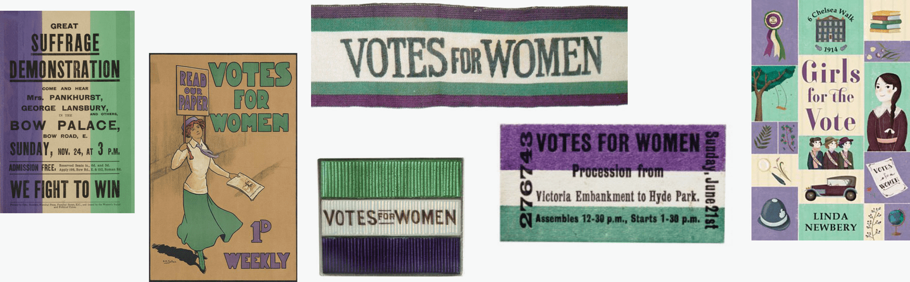
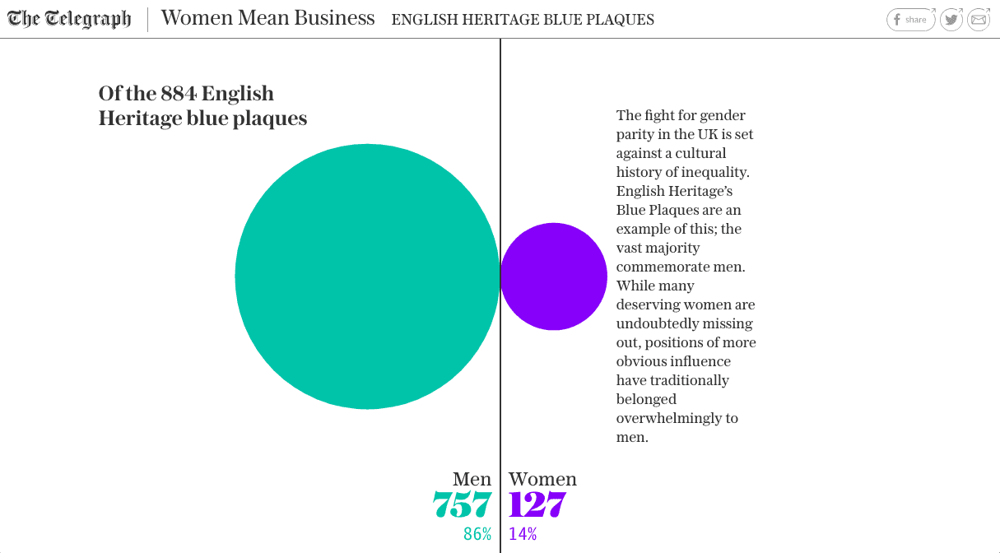
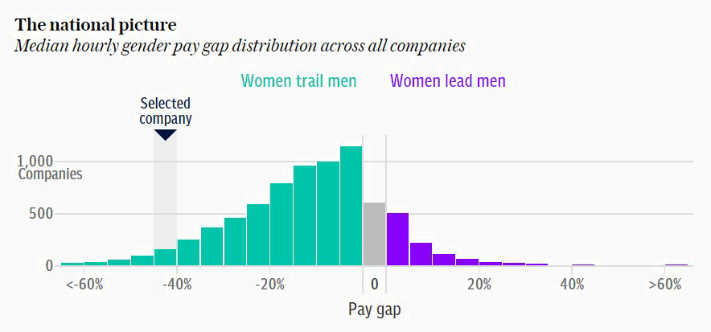
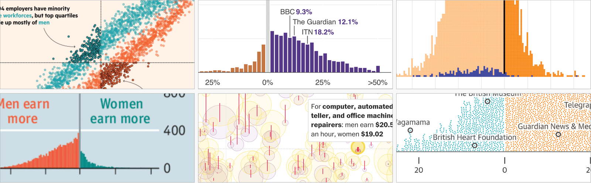

+++
author = "矢崎裕一"
title = "ピンクと青をやめ、白地で目立つ紫を女性に──The Telegraph「Born Equal. Treated Unequally.」"
slug = "telegraph-born-equal-gender-colors"
date = "2026-11-07"
description = "The Telegraph は男女の格差を示す図で、ピンクと青をやめて参政権運動の紫と緑を使い、白地で目立つ紫を女性に割り当てました。2018年3月8日、国際女性デーの記事です。"
categories = [
    "consume"
]
tags = [
    "データジャーナリズム",
    "色",
    "ジェンダー",
    "The Telegraph",
    "Data Feminism"
]
image = "images/telegraph-chart-purple-green.png"
series = ["dataviz-journalism"]
series_weight = 99
seriesByline = "Fraser Lyness ほか（The Telegraph）"
seriesTitle = "白地で目立つ紫を女性に──Telegraph「Born Equal」"
+++

The Telegraph（テレグラフ）は、男女の格差を示す図で、ピンクと青をやめて、参政権運動の紫と緑を使いました。どちらの性にどちらの色を当てるかは、白地での見え方で決めています。白地で緑より目立つ紫を、女性に割り当てました。この配色を使ったインタラクティブ記事「Born Equal. Treated Unequally.」は、2018年3月8日、国際女性デーに公開されています。

Telegraph の記事本体は購読者向けで、筆者は読めていません。以下で触れる図の中身は、すべて二つの資料を通したものです。一つは、本作を図4.6に載せた Catherine D'Ignazio（キャサリン・ディグナツィオ）と Lauren F. Klein（ローレン・F・クライン）の『Data Feminism』（MIT Press、2020）第4章。もう一つは、色を決めた Fraser Lyness（フレイザー・ライネス）に質問した、Datawrapper のブログ記事（2018年7月10日）です。

<!--more-->

## 2018年3月8日、国際女性デーの記事

『Data Feminism』によると、きっかけは国際女性デーでした。2018年3月、Telegraph の Lifestyle Desk の記者たちは、この日をどう記念するかを考えていました。そこで目に留まったのが、教育・政治・ビジネス・文化にわたる英国の男女格差だった、と同書は書いています。

基本の情報は、次のとおりです。

| 項目 | 内容 | 出典 |
|---|---|---|
| 題 | “Born Equal. Treated Unequally.” | 『Data Feminism』注48 |
| 題（別表記） | “Born equal. Treated unequally” | Datawrapper |
| 公開日 | 2018年3月8日 | 『Data Feminism』注48 |
| 形式 | interactive feature（同書の本文）、infographic（同書の図版クレジット）、scrollytelling article（Datawrapper） | 両資料 |
| 本文の筆者 | Claire Cohen、Patrick Scott、Ellie Kempster | 『Data Feminism』注48 |
| 制作クレジット | 上の3人と、Richard Moynihan、Oliver Edgington、Dario Verrengia、Fraser Lyness、George Ioakeimidis、Jamie Johnson の計9人 | 『Data Feminism』図4.6 |
| 色を決めた人 | Fraser Lyness（Director of Graphic Journalism）とそのチーム | Datawrapper |

記事の URL には “women-mean-business-interactive” とあります。Telegraph の Jamie Johnson は2018年10月の記事で、同社が国際女性デーに “Women Mean Business” を始めたと書いています。英国での女性の起業を後押しするキャンペーンです。

> “On International Women's Day this year, The Telegraph launched Women Mean Business - a campaign to boost female entrepreneurship in Britain.”

国際女性デーに、女性の起業を後押しするキャンペーンを始めた、という一文です。同じ記事は、2018年を参政権100年を祝う年だとも書いています。ただし、本作をその100年に合わせて作ったと書く資料は見つかっていません。

データについて、『Data Feminism』はこう書きます。

> “As journalists, they were working with multiple sources of data collected by other agencies, which all came in binary form.”

記者たちは、他の機関が集めた複数のデータを使い、それはすべて男女の二値で来ていた、という意味です。データの区分は、記者の手では変えられませんでした。変えられたのは、色でした。

## 参政権運動の紫と緑を借りる

男女を色で分けるとき、いちばん手早いのはピンクと青です。Datawrapper の記事で Lisa Charlotte Muth（リサ・シャルロッテ・ムート）は、その理由を Financial Times の Alan Smith（アラン・スミス）の言葉で示しています。Smith は赤ちゃんの名前の図をピンクと青で作ったときのことを、コラム「Chart Doctor」でこう書いています。

> “… I justified it because the strong cultural association of the colors meant I did not need to put a separate legend on the chart. This, in turn, meant my graphic would be ‘cleaner’, something to which all designers aspire.”

色と性の結びつきが強いので凡例が要らず、図がすっきりする、と正当化した、という話です。Muth は、ピンクと青を使うと性の固定観念を後押しすることになり、格差の図ではとくに逆効果だと書いています。

『Data Feminism』も同じ点を突きます。

> “Pink and blue is, after all, another hierarchy, and the goal of the Telegraph team members was to mitigate inequality, not reinforce it.”

ピンクと青もまた一つの階層で、チームの目的は不平等を強めることでなく和らげることだった、という意味です。

チームが代わりに選んだのが、紫と緑でした。Muth の記事は、Lyness の説明を地の文に引いています。

> “The colors are inspired by the “Votes for Women” campaign in the UK as part of the initial suffrage movement in the early 20th century. At the heart of this movement were “Sylvia Pankhurst and Emmeline Pethick-Lawrence and essentially the colors were their choice (apparently symbolizing; purple for freedom and dignity, white for purity, green for hope).””

20世紀初めの英国の “Votes for Women” キャンペーンの色で、中心にいた Sylvia Pankhurst と Emmeline Pethick-Lawrence が選んだ、という説明です。紫は自由と尊厳、白は純潔、緑は希望を表すとされます。三色のうち、図の性別に使ったのは紫と緑です。

Lisa Charlotte Muth／[Datawrapper Blog](https://www.datawrapper.de/blog/gendercolor) より引用

Lyness は、この由来を持っていたことが社内で効いたと話しています。

> “Having a reference to the suffrage movement helped seal the deal”

参政権運動という裏づけが、決め手になった、という意味です。凡例なしで読めるピンクと青を捨てることにも、反対は出なかったといいます。

> “Essentially no one objected to the idea that genders couldn't be easily identified by not using commonly referred to combinations like pink & blue. If anything they felt it would harm the message they were hoping to convey.”

ピンクと青を使わないと性別がすぐには分からない、という点に異論はなく、むしろピンクと青のほうが伝えたいことを損なうと皆が感じた、という話です。

## 白地で目立つ紫を、少ない側に

紫と緑の組は、意味で選んだものです。では、紫をどちらの性に当てるか。Lyness は Muth の質問に、こう答えています。

> “When deciding which gender aligned with which color, it was more a case of trying to prioritize women in the order of genders. Against white, purple registers with far greater contrast and so should attract more attention when putting alongside the green, not by much but just enough to tip the scales. In a lot of the visualisations men largely outnumber women, so it was a fairly simple method of bringing them back into focus.”

女性を優先する、という考えで決めた。白地では紫のほうがずっと強いコントラストになり、緑と並べると、より注意を引くはずだ。差は大きくないが、天秤を傾けるには足りる。多くの図で男性が女性を大きく上回るので、女性に焦点を戻す簡単な方法だった、という説明です。

Lyness は、コントラストの差を「far greater」と言いながら、注意を引く効果は「not by much」と言っています。**目立たせる効果は控えめでよく、少しだけ天秤を傾ければ足りる**、という考え方と読めます。

Datawrapper の記事は、この効果がよく見える図として、次の画像を載せています。

The Telegraph／[Datawrapper Blog](https://www.datawrapper.de/blog/gendercolor) より引用

ヘッダーには「Women Mean Business」「ENGLISH HERITAGE BLUE PLAQUES」とあります。English Heritage のブルー・プラーク884枚のうち、男性が757枚（86%）、女性が127枚（14%）です。画像を測ると、二つの円の面積の比は、枚数の比（約6倍）に近いと読めます。円は男性のほうがずっと大きく、紫の小さな円が、白地の上で緑に埋もれずに立っています。この画像が本作のどの部分かは、Datawrapper は書いていません。

『Data Feminism』の図4.6は、FTSE 100 の CEO の図です。人型のアイコンを並べて紫と緑で塗り分け、凡例は “Men / Women” です。図に添えた文は「Just six of FTSE 100 CEOs are women」で、100人のうち女性は6人です。

Datawrapper の記事には、もう1枚、紫と緑の図があります。Lyness の説明の直前に置かれていますが、出典の記事名は添えられていません。

The Telegraph／[Datawrapper Blog](https://www.datawrapper.de/blog/gendercolor) より引用

題は「The national picture」で、全企業の時給の中央値の男女差を、企業数の分布で示しています。凡例は「Women trail men」が緑、「Women lead men」が紫です。ここでは、色が性別そのものでなく、格差がどちらに傾いているかを表しています。それでも、女性が上回る側に紫を当てていて、少ない側を紫にする考えは同じだと読めます。Datawrapper は、同じ配色が2018年3月22日の賃金格差の記事（有料）でも使われたと書いています。

確かめられた範囲で、データと見た目の対応をまとめます。

| データ | 見た目 | 具体 | 出典 |
|---|---|---|---|
| 性別：女性 | 色相 | 紫 | Datawrapper、『Data Feminism』図4.6 |
| 性別：男性 | 色相 | 緑 | 同上 |
| （データなし） | 地の色 | 白。紫が緑よりコントラストが高くなる前提 | Lyness（Datawrapper） |
| FTSE 100 の CEO の男女 | 人型アイコンの並び | 紫と緑で塗り分け、凡例 “Men / Women” | 『Data Feminism』図4.6 |
| ブルー・プラークの男女の枚数 | 円の大きさ | 男性757（緑）、女性127（紫） | Datawrapper の画像 |
| 企業ごとの賃金格差の向き | 棒の色 | 女性が下回る＝緑、上回る＝紫、ゼロ付近＝灰 | Datawrapper の画像 |
| 色の値 | ― | 未確認 | ― |

## ほかの報道機関は何色を使ったか

Muth の記事は、FT の John Burn-Murdoch（ジョン・バーン＝マードック）のツイートを広げたものです。英国の男女の賃金格差データが出たとき、どの社が何色で報じたかを並べたツイートでした。Muth はそこから、各社の色を集めています。

| 区分 | 例（Datawrapper の記事による） |
|---|---|
| ピンクと青（赤と青）を使った | NYT（2015、2017）、Bloomberg（2016）、WSJ（2016）、Daily Mail（2018）、ZEIT（2016、2018）、The Pudding の映画のジェンダー2作（2017、赤と青） |
| ピンクと青をやめた | Economist（2018）、Morgenpost（2017）、Guardian（2018）、FT（2018）、Telegraph（2018）、Information is Beautiful（2014）、Washington Post（2017）、Bloomberg（2018）、BBC（2017、2018） |
| 同じ社の中で一貫しない | Bloomberg の2018年の4本は記事ごとに色が違う。Quartz は基本色がピンクと青だが、どちらの性に当てるかが記事で入れ替わる（2015〜2018年の10例） |

The Pudding の2017年の “Gender Representation of Comic Book Characters” は、男性が紺、女性が金色でした。The Pudding の別の作品は、同じ特集の [Women's Pockets の記事](/pudding-womens-pockets/)で読みます。

各社の図／Lisa Charlotte Muth（[Datawrapper Blog](https://www.datawrapper.de/blog/gendercolor)）より引用

Muth は、ピンクと青をやめた側について、こう書いています。

> “The Economist, Guardian, Telegraph, Washington Post, and others used a cooler color for women than for men. Respect! You can't go further away from the norm.”

Economist、Guardian、Telegraph、Washington Post などは、女性に男性より寒色を当てた。慣習からこれ以上は離れられない、という評価です。

一方で Muth は、Quartz のようにピンクと青の割り当てを入れ替える例には、危うさを指摘します。

> “Charts that flip the stereotypical colors can be hard to read”

固定観念の色を逆に当てた図は読みにくい、という意味です。読者はピンクと青を見ると凡例を確かめないので、格差の図で女性に青を当てると、女性のほうが恵まれているように読まれかねない、と Muth は書いています。

Muth の脚注は、Andy Kirk（アンディ・カーク）が2015年に可視化のデザイナー126人に聞いた調査に触れています。ピンクと青を使うと答えたのは、男性の41%、女性の14%でした。

## 第三者はこの配色をどう見たか

評価は、それぞれ別の点に向いています。一つ目は Muth 自身の評価で、配色そのものより、理由を言葉にできたことに向いています。

> “Doing research pays off. Fraser was not only able to decide on two beautiful colors but was also able to communicate a reason for this decision”

調べたことが報われた、Lyness は美しい2色を選んだだけでなく、その理由を説明できた、という意味です。Muth はこの節に「How to choose colors: The Telegraph case」と題を付け、色の選び方の手本として扱っています。

二つ目は『Data Feminism』です。同書は、作り手がデータの集め方を選べない場面の例として本作を挙げます。

> “Visualization designers, for example, do not typically have control over the collection practices of the data they are asked to visualize. They often inherit binary data that they then need to “hack” from within.”

可視化の作り手は、ふつうデータの集め方を決められず、受け取った二値のデータを内側から「ハック」するしかない、という意味です。そのうえで同書は、知覚の階層で性の階層に挑んだと評価します。

> “Here, one hierarchy—the hierarchy in which colors are perceived by the eye—was employed to challenge another one: the hierarchy of gender.”

目に見える色の階層を、性の階層に挑むために使った、という見方です。

ただし同書は、もう一歩進められたとも書きます。

> “But the Telegraph journalists could have gone one step further to rethink binaries. They had an opportunity to communicate to the public that gender is not a binary by spelling that out—in the text of the story or in a caption under the graphics or by showing visually that there was no data for nonbinary people.”

本文か、図の下の説明か、非二値の人のデータがないことを見せる図で、性は二値でないと伝えることもできた、という批判です。色を替えても、男と女の二つの区分は残っています。

対比として同書が挙げるのが、Guardian の “Does the New Congress Reflect You?”（2018）です。区分は cis male、cis female、trans + nonbinary の三つです。trans + nonbinary を選ぶと地図の全選挙区が灰色になり、「0 people in Congress are like you」と出ます。同書は「The absence of data becomes an important takeaway」と書いています。データがないこと自体が、データと同じくらい大事な結論になる、という意味です。同じ節の続きで、同書は性そのものをどう描くかという問いに進み、Scientific American の Amanda Montañez（アマンダ・モンタニェス）の図を取り上げます（[Beyond XX and XY の記事](/beyond-xx-and-xy/)）。

三つ目は、研究の側からの位置づけです。Cabric らは2024年、2012〜2022年のジェンダーの可視化を集めて分析した論文を IEEE TVCG に載せました。紫や緑のような代わりの配色について、こう書いています。

> “These colors started to appear in the visualization community … but remain uncommon”

こうした色は可視化の世界に出始めたが、まだ珍しい、という意味です。論文は Telegraph の名前を出さず、Muth の記事を通してこの配色に触れています。さらに、色で性を分けるのをやめ、ラベルや位置で区別する道も挙げています。

## 使い道

可視化の仕事に持ち帰れる判断は、四つあります。

一つ目は、色を選ぶ理由と、割り当てる理由を分けることです。Telegraph は、紫と緑の組を参政権運動という意味で選び、どちらに当てるかを白地での見え方で決めました。理由が二つあったから、凡例の要らないピンクと青を捨てる判断を、社内で通せたと読めます。

二つ目は、目立つ色を少ない側に当てることです。男性が大きく上回る図では、少ない側の点や円が埋もれがちです。Lyness は、その側に白地で強く出る色を置きました。地の色に対してどちらが強く出るかは、[色のコントラストの記事](/color-contrast-wcag-apca/)のような指標で確かめられます。効果は「not by much」で足りる、というのも Lyness の言葉です。

三つ目は、同じ媒体の中で割り当てを固定することです。Quartz のように記事ごとに入れ替えると、読者は凡例を見ずに逆の意味で読むおそれがあります。Telegraph は、賃金格差の別の記事でも同じ配色を使いました。

四つ目は、色を替えても区分は替わらない、と覚えておくことです。データが二値で来るなら、『Data Feminism』が言うように、本文や説明文で区分の限界を書くことができます。Guardian のように、データがないことを図で見せる道もあります。

## 参考・出典

**一次情報**

- Claire Cohen, Patrick Scott, Ellie Kempster ほか, “Born Equal. Treated Unequally.,” *The Telegraph*, 2018-03-08（購読者向け、筆者は未読）. [記事](https://www.telegraph.co.uk/women/business/women-mean-business-interactive/)
- Fraser Lyness の発言（Lisa Charlotte Muth の Datawrapper の記事内）. [記事](https://www.datawrapper.de/blog/gendercolor)
- Jamie Johnson, “Women Mean Business: How the Telegraph's campaign unfolded,” *The Telegraph*, 2018-10-31（Yahoo 転載）. [記事](https://www.yahoo.com/lifestyle/women-mean-business-telegraph-apos-060000841.html)
- 同じ配色を使った Telegraph の賃金格差の記事, 2018-03-22（購読者向け、筆者は未読）. [記事](https://www.telegraph.co.uk/news/2018/03/22/large-companies-publishing-gender-pay-gap-figures-need-know/)

**第三者評価**

- Lisa Charlotte Muth（当時は Rost）, “An alternative to pink & blue: Colors for gender data,” Datawrapper Blog, 2018-07-10. [記事](https://www.datawrapper.de/blog/gendercolor)（旧 URL：https://blog.datawrapper.de/gendercolor/）
- Catherine D'Ignazio & Lauren F. Klein, *Data Feminism*, MIT Press, 2020, ch.4 “What Gets Counted Counts,” pp.111–113, fig.4.6–4.7, notes 48–50（CC BY-NC-ND 4.0）. [Internet Archive の OA 版](https://archive.org/details/mit_press_book_9780262358521)
- Sam Morris, Juweek Adolphe, Erum Salam, “Does the New Congress Reflect You?,” *The Guardian*, 2018（『Data Feminism』の比較例、筆者は未読）. [記事](https://www.theguardian.com/us-news/ng-interactive/2018/nov/15/new-congress-us-house-of-representatives-senate)
- Cabric, Bjarnadóttir, Ling, Rafnsdóttir, Isenberg, “Eleven Years of Gender Data Visualization: A Step Towards More Inclusive Gender Representation,” *IEEE TVCG* 30(1):316–326, 2024. [doi:10.1109/TVCG.2023.3327369](https://doi.org/10.1109/TVCG.2023.3327369) / [arXiv](https://arxiv.org/pdf/2308.14415)
