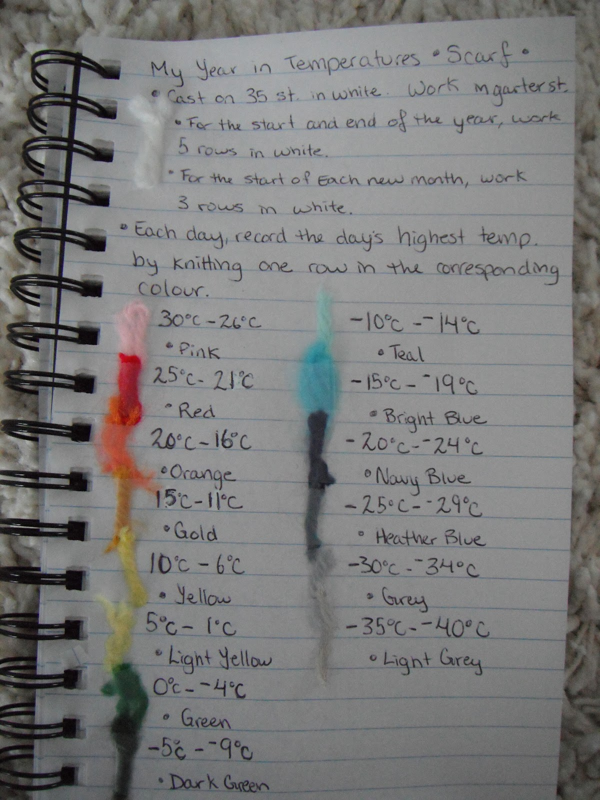
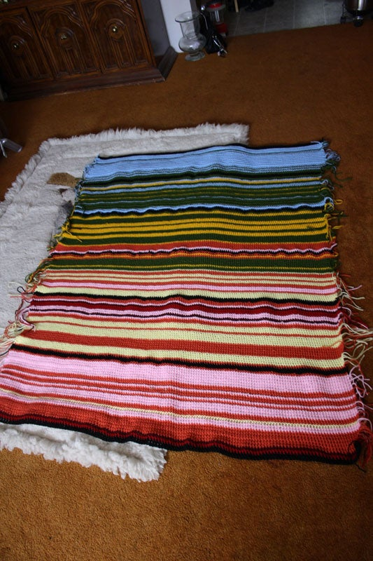
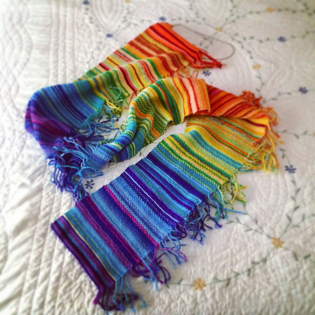
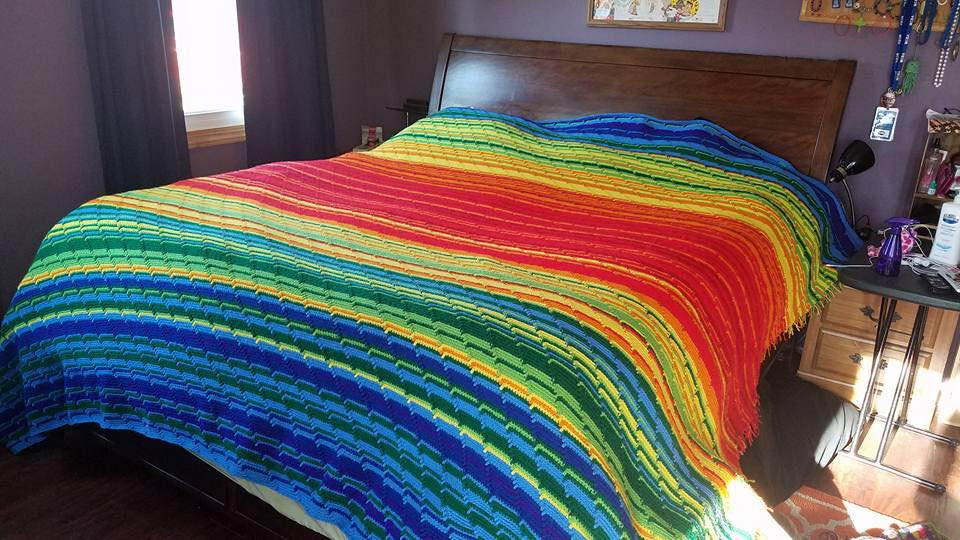

+++
author = "Yuichi Yazaki"
title = "One Row a Day, a New Yarn Every 5°C: The Temperature Scarf and Blanket"
slug = "temperature-scarf"
date = "2026-11-01"
description = "The temperature scarf is a year-long time series on a stepped color scale: one row per day gives the length, and the day's high temperature, binned in 5°C steps, gives the color."
categories = [
    "consume"
]
tags = [
    "data physicalization",
    "color"
]
image = "images/color-card.jpg"
series = ["data-physicalization"]
series_weight = 25
seriesByline = "Kristen Cooper et al."
seriesTitle = "One Row a Day, a New Color Every 5°C: Temperature Scarves"
+++

The Temperature Scarf is a year-long time series on a stepped color scale. "One day = one row" gives the length, and "the day's high temperature, binned in 5°C steps" gives the color. Knit one row a day, and by the end of the year you are left with 365 stripes. The order of the stripes is the date, and the color of each stripe is the temperature class. The color card that serves as the legend is made by each knitter to fit the temperature range of their own region.

The original is a knitting pattern that Kristen Cooper, who lives in northern British Columbia, Canada, published on her blog "Honey Nutbrown's" on January 2, 2013. dataphys.org lists it as "2013 – Temperature Scarves and Afghans". What follows draws on the text, images, and comments of Kristen's blog, and on a post by Arlene Cline, who made one of the earliest blanket (afghan) versions.

<!--more-->

## January 2, 2013: A "Conceptual Knitting Pattern"

Kristen's post, "My Year in Temperatures -Scarf-", begins by defining the pattern.

> "This is a conceptual knitting pattern that will look different for everyone who knits it. In this pattern, you record the day's highest temperature by knitting one row in the colour designated for each temperature. At the end of the year, you will have a visual colourful graph of the temperatures of your area for a whole year."

She calls it a "conceptual knitting pattern" that looks different for every knitter. You record the day's high temperature by knitting one row in an assigned color. After a year, you have a colored graph of your region's temperatures. Kristen herself calls it a "graph".

The instructions are short. Cast on 35 stitches in white and knit 5 rows in garter stitch. After that, knit one row a day in the color for that day's temperature. At the start of each month you may knit a white row as a divider. At the end of the year, knit 5 rows of white and finish. The Ravelry description of the same pattern says that each color stands for a 5°C range, and that you may widen the ranges to use fewer colors. The only fixed part is the rule for transferring data onto fabric. In 2017, when someone asked about needle size, she answered that choosing the yarn, needles, and stitches yourself is what makes it a "conceptual knitting pattern".

The source of inspiration was Sky Scarf by Lea Redmond, a project in which you add one stripe a day in the color of that day's sky. In a comment dated April 25, 2013, Kristen wrote that Sky Scarf inspired her and that she thought temperature would be easier to record. It can be read as a judgment that, once numbers are binned into classes, a yarn color can be looked up from a table.

It spread quickly. The day after publication, Kristen wrote that many people on Ravelry were knitting along. The yarn maker Bernat (now Yarnspirations) also ran a knit-along that year and made a color guide.

## Reading the Handwritten Color Card as a Legend

The blog post includes a photo of Kristen's handwritten notes. They give the knitting rules and the color for each temperature class, with yarn snippets attached.

Source: Kristen Cooper / Honey Nutbrown's, "Knitting!: My Year in Temperatures -Scarf-"

This card is, as it stands, the legend of a chart. The mapping between data and fabric is as follows.

| Data | How it appears in the fabric | Specific values |
|---|---|---|
| Date (one day) | Position along the length; 1 day = 1 row | With thin yarn, 2 rows a day is fine (her reply) |
| The day's high temperature | Row color | 14 classes in 5°C steps, −40°C to 30°C |
| Start and end of the year | White rows | 5 rows each |
| Month divider (optional) | White rows | 2 rows in the text, 3 on the card |
| — | Width (no data) | 35 stitches, garter stitch |

The 14 classes and colors are written on the card as follows.

| High temperature | Color | High temperature | Color |
|---|---|---|---|
| 30 to 26°C | Pink | −5 to −9°C | Dark Green |
| 25 to 21°C | Red | −10 to −14°C | Teal |
| 20 to 16°C | Orange | −15 to −19°C | Bright Blue |
| 15 to 11°C | Gold | −20 to −24°C | Navy Blue |
| 10 to 6°C | Yellow | −25 to −29°C | Heather Blue |
| 5 to 1°C | Light Yellow | −30 to −34°C | Grey |
| 0 to −4°C | Green | −35 to −40°C | Light Grey |

There is no class above 30°C, and only the last class, −35 to −40°C, spans 6°C. Seven classes are spent on the cold side, which suggests that this is a legend for a place where winter highs drop a long way.

The hot side is red and orange, and the cold side is blue and grey. The hottest class, however, is pink. Lightness does not change in one direction, either. On the cold side it goes from Navy Blue to Grey to Light Grey, getting lighter. Around 0°C the color switches sharply from yellow to green. This can be read as **a palette that first makes you tell apart above and below freezing**.

White is used in none of the 14 classes. It is reserved for information that is not temperature: the start and end of the year, and the monthly dividers. This can be read as assigning a color not used for data to dividers that do not represent data. Note that the number of rows in a monthly divider differs between the blog text, "Knit two rows in white", and the card, "work 3 rows in white".

## The Legend Is Remade for Each Knitter's Region

This card is a legend for Kristen's region. To readers in Paris and Dubai, she answered that where the temperature range is narrow, they can use finer steps and more colors. When asked on January 20, 2013 for a Fahrenheit legend, she pointed to Bernat's legend in Fahrenheit and wrote:

> "Everyone seems to be making up their own."

Everyone, it seems, is making their own legend. A local legend uses every color at hand to show a region's changes over the year. The cost is that, it can be read, you cannot line the stripes up against a scarf from another region to compare them.

That summer, blanket versions appeared. On July 15, 2013, Arlene Cline posted the January to June section of a crocheted blanket on the knitting forum Knitting Paradise.

> "Each row is a day. I did the temperatures in 5 degree increments,with black separating each month. This is based on my city."

One row per day, 5-degree steps, black between months, and the temperatures of her own city, she writes.

Source: Arlene Cline / Knitting Paradise, "temperature afghan-c"

From the cold side, the colors ran blue, green, yellow, orange, pink, wine, red, and anything below 0°C was white. Only the black monthly divider rows were worked in double crochet, so the stitch type changes too. January to June came to 50 inches wide and 63 inches long, and after completion she split it into two pieces of six months each. On the forum, another user wrote that she should attach an explanation to the work so that the meaning is not lost. It can be read as the point that once the legend is separated from the work, the stripes lose their meaning.

Other makers have varied the rules a little.

| Case | What one row represents | How temperature is taken | Month divider |
|---|---|---|---|
| Kristen Cooper (2013, knitting) | 1 day = 1 row | Daily high, 14 classes in 5°C steps | White rows |
| Arlene Cline (2013, crochet) | 1 day = 1 row | 5°C steps (whether high or average is not stated) | Black rows + double crochet |
| SleepyEyes (2014, Ravelry) | 1 day = 2 rows | Temperature at the time of knitting, 18 colors | Garter stitch and seed stitch alternating by month |

Source: Ravelry user SleepyEyes / dataphys.org, "Temperature Scarves and Afghans"

SleepyEyes marked the month divisions not with color but with the texture of the fabric. Because color is not used for the dividers, it can be read that color is freed up to express temperature. dataphys.org also lists a blanket for 2016. It was knitted by Sharon MacDermaid and submitted by the meteorologist Ellen Bacca.

Source: Made by Sharon MacDermaid, submitted by Ellen Bacca / dataphys.org, "Temperature Scarves and Afghans"

## How Third Parties Saw This Way of Knitting

### From visualization research

In their IEEE VIS 2025 paper "Stitching Meaning", Sydney Purdue, Melanie Tory, and colleagues studied the encodings used by data textile creators. Of 159 pieces, 45 were temperature blankets, and the paper dates their beginning to Cooper's 2013 post. Twenty-five creators used a rainbow colormap. The 22 who represented temperature with stepped colors used between 8 and 49 colors, with a median of 14.5. On intervals left open at both ends, the paper says:

> "Some creators who used these kinds of catch-all intervals expressed regret that extreme temperatures were grouped with less extreme temperatures."

The point is that with "or above" and "or below" intervals, extreme temperatures got the same color as milder ones, and some creators regretted it. One person who had assumed temperatures would never exceed 109 degrees found they did, and added two colors. The paper classifies the white rows between months as "annotation", which does not represent data.

### From the press

In 2018, Maddie Stone of Earther covered the Tempestry Project, which began in 2017. Everyone knits NOAA's daily high temperatures on the same color scale. Co-founder Justin Connelly says:

> "We want people to take our framework and develop their own collections, this large mosaic of international climate data that can be compared and contrasted because it's all the same color scale."

The claim is that, because the scale is the same, climate data from around the world can be lined up and compared. The article describes a case in which a multi-year collection from Utqiagvik, Alaska, made the rise in temperatures from autumn to early winter clearly visible. It can be read that a local legend shows change within a year, while a shared legend lets you compare places and years.

### From a climate scientist

In 2017, the climate scientist Ellie Highwood adapted this format to global mean temperature anomalies, with one row per year. She then reflected on her own color choice:

> "rainbow colour scales aren't great as they can distort data and render it meaningless if you are colour blind"

Her reflection is that rainbow scales can distort data and, for some kinds of color vision, become meaningless. Canary Media confirms that Ed Hawkins's [warming stripes](/en/show-your-stripes/) came out of this blanket.

## Takeaways

The rules of the temperature scarf contain decisions that can be carried back into visualization work. Each of them can be read as coming from the nature of the craft: data arrives one day at a time, and a knitted row is hard to undo.

The first is to decide the legend first. Kristen matched the colors on the color card to temperature classes. If you knit one row a day, you need the legend before you start. This is the reverse of the usual order, in which you decide the range once the data is in. If you decide first, you must also decide then how to draw values outside the range. The regret about open-ended intervals that Purdue and colleagues recorded can be read as bearing on this point as well.

The second is to choose the scale according to what you want people to compare. Kristen recommended changing the steps for each region, while Tempestry has everyone use the same colors. It can be read that the former shows the seasons within one piece, and the latter shows differences between places and years.

The third is to use a means separate from the data for dividers. White, black with a different stitch, texture. Because they do not overlap with the temperature colors, the dividers are not misread as temperature.

The fourth is to keep the legend together with the work. Only with the color card do the 365 stripes become a chart.

I found no statement by Kristen or Arlene that they knitted in order to learn color scale design. Even so, a year of stripes makes the maker decide, one at a time, the width of the steps, the order of the colors, the handling of the two ends, and how to insert dividers. It can also be read as practice in the steps of designing a color scale, checked by hand one row a day.

## References

**Primary sources**

- dataphys.org, "2013 – Temperature Scarves and Afghans" (added by Pierre Dragicevic, submitted by Andy South). [dataphys.org](https://dataphys.org/list/temperature-afghans-and-scarves/)
- Kristen Cooper, "Knitting!: My Year in Temperatures -Scarf-," *Honey Nutbrown's*, 2013-01-02 (text, images, and comments). [Blog](https://400squareftliving.blogspot.com/2013/01/knitting-my-year-in-temperatures-scarf.html) / [Archive](https://web.archive.org/web/20250801120520/https://400squareftliving.blogspot.com/2013/01/knitting-my-year-in-temperatures-scarf.html)
- Kristen Cooper, "My Year in Temperatures -Scarf-," Ravelry pattern, January 2013. [Ravelry](https://www.ravelry.com/patterns/library/my-year-in-temperatures--scarf-)
- Arlene Cline (arlenecc), "temperature afghan-c," *Knitting Paradise*, 2013-07-15. [Knitting Paradise](https://www.knittingparadise.com/threads/temperature-afghan-c.185138/)
- Arlene Cline, "temperature afghan," *Knitting Paradise*, 2014-01-13 (finished piece). [Knitting Paradise](https://www.knittingparadise.com/t-229890-1.html)
- SleepyEyes, "My Year in Temperatures -Scarf-," Ravelry project, 2014. [Ravelry](https://www.ravelry.com/projects/SleepyEyes/my-year-in-temperatures--scarf-)
- Yarnspirations (formerly Bernat), "Crochet Temperature Afghans & Blankets," 2016-01-05. [Yarnspirations](https://www.yarnspirations.com/blog-20160105-crochet-temperature-afghans-and-blankets.html)
- Tempestry Project official website. [tempestryproject.com](https://www.tempestryproject.com/)
- Lea Redmond, "Knit The Sky." [Leafcutter Designs](https://leafcutterdesigns.com/projects/knit-the-sky)

**Secondary sources**

- Sydney Purdue, Eduardo Puerta, Enrico Bertini, Melanie Tory, "Stitching Meaning: Practices of Data Textile Creators," *IEEE TVCG* (VIS 2025). [Paper page](https://vis.khoury.northeastern.edu/pubs/Purdue2025StitchingMeaningPractices) / [Preprint](https://osf.io/preprints/osf/eyw2r_v1)
- Peter Rubinstein, "Data Visualizations You Can Wear? The Rise of Data Textiles," *Northeastern Global News*, 2026-09-10. [Article](https://news.northeastern.edu/2026/09/10/data-visualizations-textiles/)
- Maddie Stone, "Meet the Knitters Who Are Turning Climate Change Data Into a Fashion Statement," *Earther* (Gizmodo), 2018-12-22. [Article](https://earther.gizmodo.com/meet-the-knitters-who-are-turning-climate-change-data-i-1831253754)
- Ellie Highwood, "#climatechangecrochet – The global warming blanket," 2017-06-12. [Blog](https://elliehighwood.com/2017/06/12/climatechangecrochet-the-global-warming-blanket/)
- "Who really invented the climate stripes?," *Canary Media*, 2022-06-03. [Article](https://www.canarymedia.com/articles/climate-crisis/who-really-invented-the-climate-stripes)
