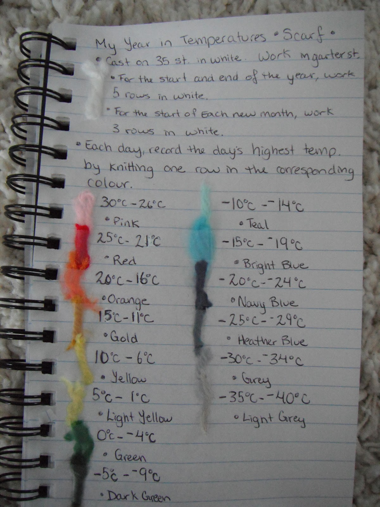
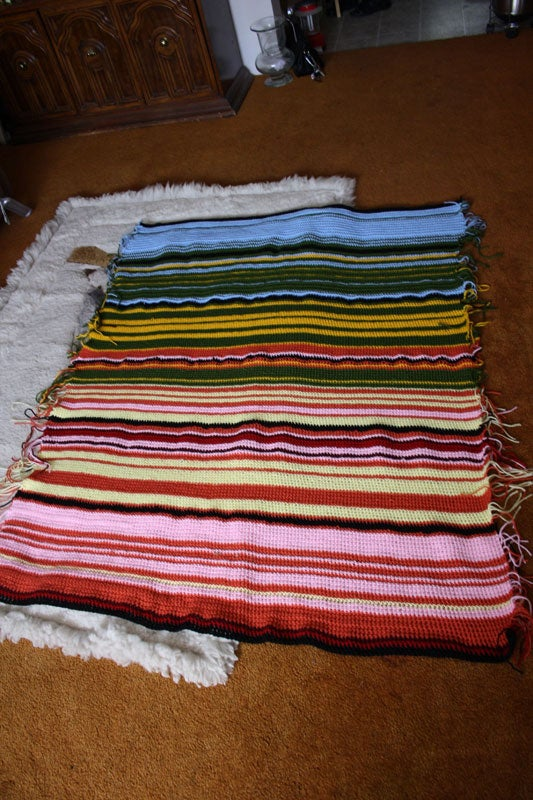
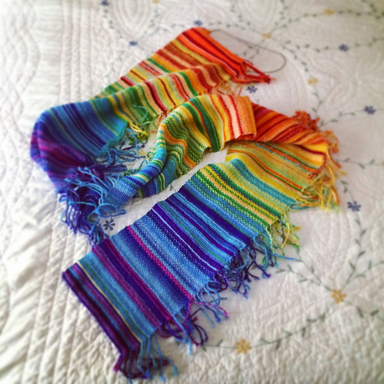
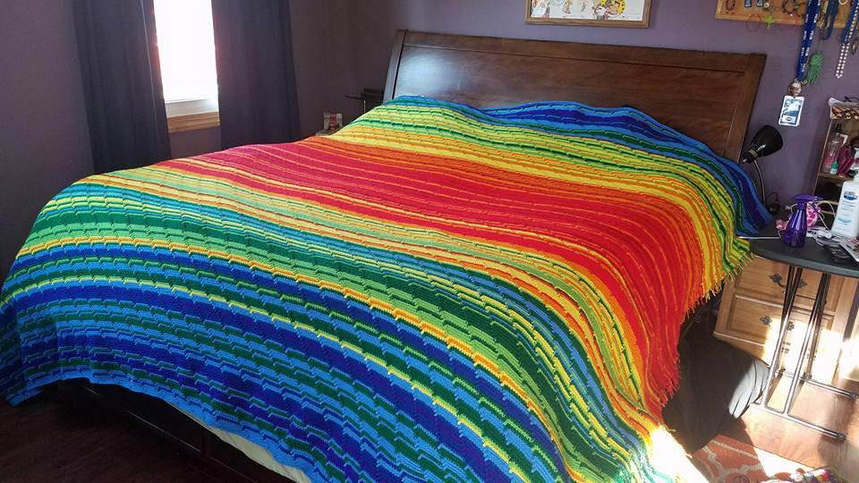

+++
author = "矢崎裕一"
title = "1日1段、5℃ごとに毛糸を替える──気温スカーフとブランケット"
slug = "temperature-scarf"
date = "2026-11-01"
description = "気温スカーフは、1日＝1段を長さに、その日の最高気温を5℃刻みで区切った階級を色に割り当てた、1年分の段階的なカラースケールの時系列です。"
categories = [
    "consume"
]
tags = [
    "データ物質化",
    "色"
]
image = "images/color-card.jpg"
series = ["data-physicalization"]
series_weight = 22
seriesByline = "Kristen Cooper ほか"
seriesTitle = "1日1段、5℃ごとに色を替える──気温スカーフ"
+++

気温スカーフ（Temperature Scarf）は、「1日＝1段」を長さに、「その日の最高気温を5℃刻みで区切った階級」を色に割り当てた、1年分の段階的なカラースケールの時系列です。毎日1段ずつ編み足すと、年末には365段の縞が残ります。縞の並びが日付で、縞の色が気温の階級です。凡例にあたる色見本は、編む人が自分の土地の気温幅に合わせて作ります。

原型は、カナダ・ブリティッシュコロンビア州北部に住む Kristen Cooper（クリステン・クーパー）が、2013年1月2日にブログ「Honey Nutbrown's」で公開した編み図です。dataphys.org は、これを「2013 – Temperature Scarves and Afghans」として載せています。以下は、Kristen のブログ本文・画像・コメント欄と、ブランケット（afghan）版を最初期に作った Arlene Cline（アーリーン・クライン）の投稿に沿います。

<!--more-->

## 2013年1月2日、「概念としての編み図」

Kristen の記事 "My Year in Temperatures -Scarf-" は、編み図の定義から始まります。

> "This is a conceptual knitting pattern that will look different for everyone who knits it. In this pattern, you record the day's highest temperature by knitting one row in the colour designated for each temperature. At the end of the year, you will have a visual colourful graph of the temperatures of your area for a whole year."

編む人ごとに見た目が変わる「概念としての編み図」だ、と書いています。その日の最高気温を、決めた色で1段編んで記録する。1年後には、その土地の気温の、色のついたグラフができる。Kristen 自身が、これを「グラフ」と呼んでいます。

手順は短いものです。白で35目を作り、ガーター編みで5段編む。あとは1日1段、その日の気温の色で編む。月の始まりには、区切りとして白を編んでもよい。年末に白を5段編んで終わりです。Ravelry の同じ編み図の説明には、1色が5℃の幅を表し、幅を広げて色数を減らしてもよい、とあります。決まっているのは、データを編み地に移す規則だけです。2017年には針の号数を聞かれて、毛糸も針も編み方も自分で選ぶのが「概念としての編み図」だ、と答えています。

着想源は、Lea Redmond（リア・レドモンド）の Sky Scarf です。毎日その日の空の色で縞を1本足していく企画でした。Kristen は2013年4月25日のコメントで、Sky Scarf が着想源で、気温のほうが記録しやすいと考えた、と書いています。数値を階級に区切れば毛糸の色を表から引ける、という判断だったと読めます。

広がりは速いものでした。公開翌日には、Ravelry で大勢が一緒に編んでいる、と Kristen が書いています。毛糸メーカーの Bernat（現 Yarnspirations）も同じ年に一斉に編む企画を行い、色のガイドを作りました。

## 手書きの色見本カードを、凡例として読む

ブログ記事には、Kristen の手書きのノートの写真が載っています。編み方の規則と、気温の階級ごとの色が書かれ、毛糸の切れ端が留めてあります。

Kristen Cooper／Honey Nutbrown's「Knitting!: My Year in Temperatures -Scarf-」より引用

このカードは、そのままチャートの凡例です。データと編み地の対応は、次のとおりです。

| データ | 編み地での表し方 | 具体的な値 |
|---|---|---|
| 日付（1日） | 長さ方向の位置。1日＝1段 | 細い毛糸なら1日2段でもよい（本人の回答） |
| その日の最高気温 | 段の色 | 5℃刻みの14階級、−40℃〜30℃ |
| 年の始まりと終わり | 白の段 | それぞれ5段 |
| 月の区切り（任意） | 白の段 | 本文は2段、カードは3段 |
| ― | 幅（データなし） | 35目、ガーター編み |

14の階級と色は、カードに次のように書かれています。

| 最高気温 | 色 | 最高気温 | 色 |
|---|---|---|---|
| 30〜26℃ | Pink | −5〜−9℃ | Dark Green |
| 25〜21℃ | Red | −10〜−14℃ | Teal |
| 20〜16℃ | Orange | −15〜−19℃ | Bright Blue |
| 15〜11℃ | Gold | −20〜−24℃ | Navy Blue |
| 10〜6℃ | Yellow | −25〜−29℃ | Heather Blue |
| 5〜1℃ | Light Yellow | −30〜−34℃ | Grey |
| 0〜−4℃ | Green | −35〜−40℃ | Light Grey |

30℃を超える階級はなく、最後の −35〜−40℃だけが6℃の幅です。寒い側に7階級を割いているのは、冬の最高気温が大きく下がる土地の凡例だからだと読めます。

暑い側は赤・橙、寒い側は青・灰です。ただし、いちばん暑い階級はピンクです。明るさも一方向には変わりません。寒い側は Navy Blue から Grey、Light Grey へと明るくなります。0℃をまたぐところで、黄から緑へ大きく色が切り替わる。**氷点の上か下かを、まず見分けさせる配色**と読めます。

白は14の階級のどれにも使われていません。年の始めと終わり、月の区切りという、気温ではない情報のために取ってあります。データを表さない区切りに、データでは使わない色を割り当てている、と読めます。なお、月の区切りの段数は、ブログ本文の "Knit two rows in white" とカードの "work 3 rows in white" で食い違っています。

## 凡例は、編む人の土地ごとに作り直す

このカードは、Kristen の土地のための凡例です。パリやドバイの読者には、気温の幅が狭いなら刻みを細かくして色を増やせばよい、と答えました。華氏の凡例を聞かれた2013年1月20日には、Bernat の華氏入りの凡例を紹介して、こう書いています。

> "Everyone seems to be making up their own."

みんな自分の凡例を作っているようだ、という意味です。ローカルな凡例は、その土地の1年の変化を、手持ちの色をすべて使って見せます。そのぶん、別の土地のスカーフと縞を並べて比べることはできない、と読めます。

同じ年の夏、ブランケット版が現れます。Arlene Cline は2013年7月15日、編み物の掲示板 Knitting Paradise に、かぎ針編みのブランケットの1〜6月分を投稿しました。

> "Each row is a day. I did the temperatures in 5 degree increments,with black separating each month. This is based on my city."

1段が1日、5℃刻み、月の区切りは黒。自分の住む街の気温だ、と書いています。

Arlene Cline／Knitting Paradise「temperature afghan-c」より引用

色は寒い側から blue、green、yellow、orange、pink、wine、red の順で、0℃未満は白でした。月の区切りの黒い段だけは長編みにして、編み目の種類も変えています。1〜6月で幅50インチ、長さ63インチになり、完成後は半年ずつ2枚に分けました。掲示板では別の利用者が、意味が失われないよう説明を作品に添えておくように、と書いています。凡例が作品から離れると、縞は意味を失う、という指摘と読めます。

ほかの作り手も、規則を少しずつ変えています。

| 事例 | 1段が表すもの | 気温の取り方 | 月の区切り |
|---|---|---|---|
| Kristen Cooper（2013、棒針） | 1日＝1段 | 日最高気温、5℃刻み14階級 | 白の段 |
| Arlene Cline（2013、かぎ針） | 1日＝1段 | 5℃刻み（最高か平均かは書かれていない） | 黒の段＋長編み |
| SleepyEyes（2014、Ravelry） | 1日＝2段 | 編む時刻の気温、18色 | ガーター編みと鹿の子編みを月ごとに交互 |

Ravelry ユーザー SleepyEyes／dataphys.org「Temperature Scarves and Afghans」より引用

SleepyEyes は、月の区切りを色ではなく編み地の手触りで表しました。区切りに色を使っていないぶん、色を気温の表現に回せると読めます。dataphys.org は、2016年分のブランケットも載せています。Sharon MacDermaid が編み、気象予報士の Ellen Bacca が投稿したものです。

Sharon MacDermaid 作、Ellen Bacca 投稿／dataphys.org「Temperature Scarves and Afghans」より引用

## 第三者はこの編み方をどう見たか

### 可視化研究から

Sydney Purdue、Melanie Tory らは IEEE VIS 2025 の論文 "Stitching Meaning" で、データ・テキスタイルの作り手のエンコーディングを調べました。159件のうち45件が気温ブランケットで、論文はその始まりを2013年の Cooper の投稿としています。虹色のカラーマップを使った作り手は25人。気温を段階的な色で表した22人の色数は8〜49色、中央値は14.5色でした。両端を開いた区切りについては、こう書いています。

> "Some creators who used these kinds of catch-all intervals expressed regret that extreme temperatures were grouped with less extreme temperatures."

「〜以上」「〜以下」の区切りで、極端な気温がそうでない気温と同じ色になり、後悔した作り手がいた、という指摘です。109度を超えないと思っていたら超え、2色足した人もいました。論文は、月の間の白い段を、データを表さない「注釈」に分類しています。

### 報道から

Earther の Maddie Stone は2018年、2017年に始まった Tempestry Project を取材しました。全員が同じカラースケールで、NOAA の日最高気温を編みます。共同創設者の Justin Connelly はこう話しています。

> "We want people to take our framework and develop their own collections, this large mosaic of international climate data that can be compared and contrasted because it's all the same color scale."

同じスケールだから、世界の気候データを並べて比べられる、という主張です。記事は、アラスカ Utqiagvik の何年分ものコレクションで、秋から初冬の気温上昇がはっきり見えた例を紹介しています。ローカルな凡例は1年の中の変化を見せ、共通の凡例は場所と年を比べさせる、と読めます。

### 気候科学者から

気候科学者の Ellie Highwood（エリー・ハイウッド）は2017年、この形式を、1段＝1年の世界平均気温の偏差に転用しました。そして、自分の配色をこう振り返っています。

> "rainbow colour scales aren't great as they can distort data and render it meaningless if you are colour blind"

虹色のスケールはデータをゆがめ、色覚によっては意味をなさない、という反省です。Canary Media は、このブランケットから Ed Hawkins の [warming stripes](/show-your-stripes/) が生まれたことを確かめています。

## 使い道

気温スカーフの規則は、可視化の仕事に持ち帰れる判断を含んでいます。どれも、データが1日ずつ届き、編んだ段は戻しにくい、という作り方の性質から来ていると読めます。

一つ目は、凡例を先に決めることです。Kristen は色見本カードの色を、気温の階級に当てはめました。毎日1段ずつ編むなら、凡例は編み始める前に要ると読めます。データがそろってから範囲を決める、いつもの順序とは逆です。先に決めるなら、範囲の外の値をどう描くかも、そのとき決めておく必要があります。Purdue らが記録した両端の区切りへの後悔も、この点にかかわると読めます。

二つ目は、比べさせたいものでスケールを選ぶことです。Kristen は土地ごとに刻みを変えるよう勧め、Tempestry は全員に同じ色を使わせました。前者は1枚の中の季節を、後者は場所や年の違いを見せると読めます。

三つ目は、区切りにデータと別の手段を使うことです。白、黒と編み目、手触り。気温の色と重ならないので、区切りを気温と読み違えません。

四つ目は、凡例を作品と一緒に残すことです。色見本カードがあって初めて、365段の縞はチャートになります。

Kristen や Arlene が、カラースケールの設計を学ぶために編んだ、と書いた記述は見つかりません。それでも1年分の縞は、刻みの幅、色の順序、両端の扱い、区切りの入れ方を、作り手に一つずつ決めさせます。カラースケールを設計する手順を、毎日1段ずつ手で確かめる練習としても読めます。

## 参考・出典

**一次情報**

- dataphys.org「2013 – Temperature Scarves and Afghans」（Pierre Dragicevic 追加、Andy South 提供）. [dataphys.org](https://dataphys.org/list/temperature-afghans-and-scarves/)
- Kristen Cooper, “Knitting!: My Year in Temperatures -Scarf-,” *Honey Nutbrown's*, 2013-01-02（本文・画像・コメント欄）. [ブログ](https://400squareftliving.blogspot.com/2013/01/knitting-my-year-in-temperatures-scarf.html) / [アーカイブ](https://web.archive.org/web/20250801120520/https://400squareftliving.blogspot.com/2013/01/knitting-my-year-in-temperatures-scarf.html)
- Kristen Cooper, “My Year in Temperatures -Scarf-,” Ravelry パターン, 2013年1月. [Ravelry](https://www.ravelry.com/patterns/library/my-year-in-temperatures--scarf-)
- Arlene Cline（arlenecc）, “temperature afghan-c,” *Knitting Paradise*, 2013-07-15. [Knitting Paradise](https://www.knittingparadise.com/threads/temperature-afghan-c.185138/)
- Arlene Cline, “temperature afghan,” *Knitting Paradise*, 2014-01-13（完成品）. [Knitting Paradise](https://www.knittingparadise.com/t-229890-1.html)
- SleepyEyes, “My Year in Temperatures -Scarf-,” Ravelry project, 2014. [Ravelry](https://www.ravelry.com/projects/SleepyEyes/my-year-in-temperatures--scarf-)
- Yarnspirations（旧 Bernat）, “Crochet Temperature Afghans & Blankets,” 2016-01-05. [Yarnspirations](https://www.yarnspirations.com/blog-20160105-crochet-temperature-afghans-and-blankets.html)
- Tempestry Project 公式サイト. [tempestryproject.com](https://www.tempestryproject.com/)
- Lea Redmond, “Knit The Sky.” [Leafcutter Designs](https://leafcutterdesigns.com/projects/knit-the-sky)

**第三者評価**

- Sydney Purdue, Eduardo Puerta, Enrico Bertini, Melanie Tory, “Stitching Meaning: Practices of Data Textile Creators,” *IEEE TVCG*（VIS 2025）. [論文ページ](https://vis.khoury.northeastern.edu/pubs/Purdue2025StitchingMeaningPractices) / [プレプリント](https://osf.io/preprints/osf/eyw2r_v1)
- Peter Rubinstein, “Data Visualizations You Can Wear? The Rise of Data Textiles,” *Northeastern Global News*, 2026-09-10. [記事](https://news.northeastern.edu/2026/09/10/data-visualizations-textiles/)
- Maddie Stone, “Meet the Knitters Who Are Turning Climate Change Data Into a Fashion Statement,” *Earther*（Gizmodo）, 2018-12-22. [記事](https://earther.gizmodo.com/meet-the-knitters-who-are-turning-climate-change-data-i-1831253754)
- Ellie Highwood, “#climatechangecrochet – The global warming blanket,” 2017-06-12. [ブログ](https://elliehighwood.com/2017/06/12/climatechangecrochet-the-global-warming-blanket/)
- “Who really invented the climate stripes?,” *Canary Media*, 2022-06-03. [記事](https://www.canarymedia.com/articles/climate-crisis/who-really-invented-the-climate-stripes)
